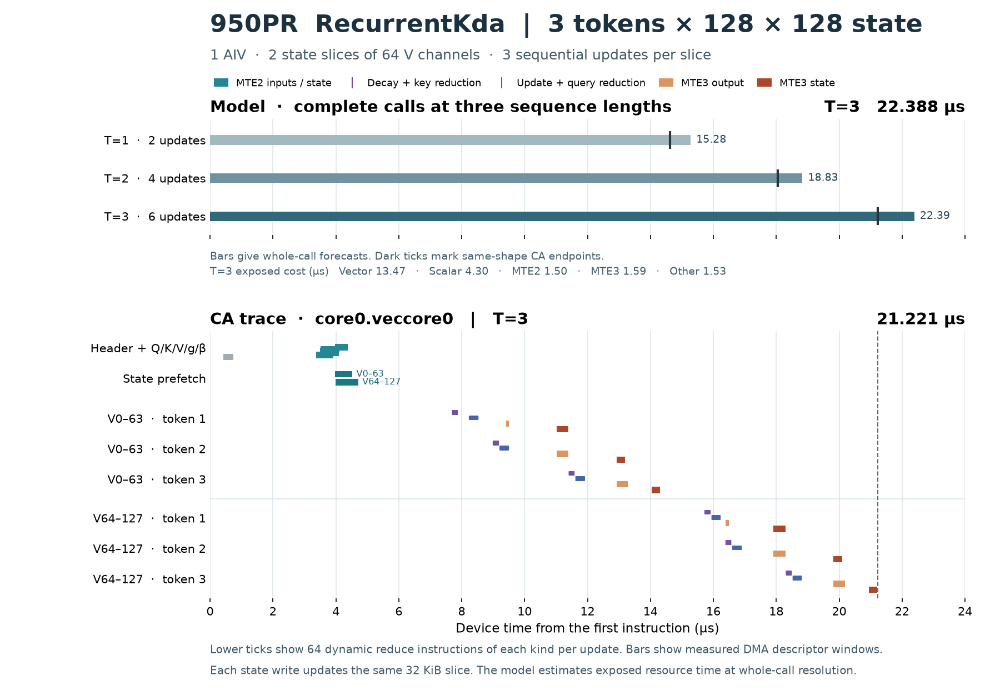

# Recurrent KDA 的状态分片与输出流水

950PR 上 `aclnnRecurrentKda` 的 `[B,T,Hq,Hv,K,V]=[1,3,1,1,128,128]` 使用一个 AIV，v0.21 模型 **22.388 µs**，完整 CA **21.221 µs**，高估 **1.167 µs（5.50%）**。上下两栏共用从第一条设备指令起算的时间轴。上栏的 T=1、2、3 是三次各自完整的调用。下栏展开 T=3 的两块状态，显示每块连续三次递推在真实指令流中的位置。所有 CA 来自已有的严格数值检查记录，此图新增采集为零。[逐事件及 GM、UB 地址证据](state-steps.json)



| T | 模型 µs | 完整 CA µs | 相对误差 |
|---:|---:|---:|---:|
| 1 | 15.277 | 14.622 | +4.48% |
| 2 | 18.832 | 18.048 | +4.34% |
| 3 | 22.388 | 21.221 | +5.50% |

**如何读上栏。** 输入为 BF16 Q/K/V、FP32 gate、beta 和状态、BSND 输入、K 在 V 前的状态存储，同时输出最终状态。模型按 $U=T K V/16384$ 定价。分母对应一个 $128\times128$ 状态更新，T=3 时 $U=3$。现有预测器分别估算临界核上各资源暴露的时间，再相加；图中给出了恰好相加为 22.388 µs 的五项预算。模型没有该 shape 的逐 tile 发起时钟，图中用整次调用的终点做比较。下栏的临界核窗口取 $(41314-6300)/1650=21.2206$ µs，1650 是该芯片每微秒的周期数。[当前总方法](../../../docs/modeling-strategy.md)

**如何还原状态片。** 安装包实际 kernel 为 `RecurrentKda_06bba6860f70bfd6aa54df1d4ed1928e_0`，`recurrent_kda_apt` 发布文件和 PR 捕获 ELF 的 `.text` 逐字节一致。MTE2 首先读 224 B 的头信息，接着读 12 B 的 beta、三份各 768 B 的 Q/K/V 和 1,536 B 的 gate。两个状态读的 GM 首地址相差 256 B，每个描述符具有 128 组 256 B 负载和 512 B 源行距。这正是 FP32 的 `[K=128,V=128]` 按 V 分成 0–63、64–127 两个条带，同时预取到不同 UB 地址。前一条带从 3.981 µs 读到 4.525 µs，后一条带从 3.982 µs 读到 4.712 µs。

安装包 `recurrent_kda_arch35.h` 先遍历 V 条带，再在条带内顺序遍历 token。用 $H$ 表示该片状态，用 $g,k,q,v,\beta$ 分别表示门、键、查询、值和更新系数。门衰减和状态与 $k$ 的点积给出旧状态对输出的估计。随后根据 $v$ 与估计的差更新状态，再将新状态与 $q$ 做点积产出输出。K=128 的两个融合向量函数分别在这两处做行内归约。第一个函数先乘门，再乘 $k$，最后归约；第二个函数先取残差、更新状态，再乘 $q$ 并归约。真实 ELF 和 trace 的两个归约 PC 分别为 `.text+0x7c34`、`.text+0x7d50`。根据相邻乘、加、减序列、源代码循环顺序以及每种指令每片正好 64 个唯一步骤 ID，将两组 PC 对应到上述计算；缺少源码行号符号，标注属于基于指令和布局的对应。CA 对同一 `(PC,动态指令ID)` 记录两次 pop。图中每个竖刻度取首个 pop，64 个 V 行每行一个刻度。完整 ID 和原始周期可从 JSON 复核。

| V 通道 | token | 衰减后与 k 点积首个归约 µs | 更新后与 q 点积首个归约 µs | attention 发起写回 µs | 状态发起写回 µs |
|---|---:|---:|---:|---:|---:|
| 0–63 | 1 | 7.696 | 8.238 | 9.406 | 11.013 |
| 0–63 | 2 | 8.995 | 9.208 | 11.015 | 12.921 |
| 0–63 | 3 | 11.405 | 11.618 | 12.922 | 14.037 |
| 64–127 | 1 | 15.724 | 15.939 | 16.394 | 17.908 |
| 64–127 | 2 | 16.392 | 16.606 | 17.910 | 19.818 |
| 64–127 | 3 | 18.306 | 18.520 | 19.819 | 20.938 |

**模型与 CA 的差距。** 每个 attention 半片写 64 个 BF16，目的地址为 `out_base + 2*(token_index*128 + v_start)`。每个 token 都向同一个 32 KiB FP32 状态半片提交一次写回。T=3 有 6 次状态写、6 次 attention 写，MTE3 描述符负载共 197,376 B。公共接口的逻辑写量为 66,304 B，只计一次最终 65,536 B 状态及 768 B attention。重复写出的 131,072 B 是库实现可观测的额外工作；描述符负载不能直接解释为外部 HBM 事务字节。第一片第二个 token 的归约在 8.995 µs 开始，早于第一个 token 的 attention 写和状态写。模型的五项预算尚未显式表达这种交叠。现有单次总时差不足以把 1.167 µs 分摊到具体步骤。

T=3 的 attention 共 384 项、最终状态 16,384 项、初态保持 16,384 项，三项对照均无超差，`SMOKE_PASS`。该次归档 CA 的墙钟为 114.34 秒。仅依赖已提交 JSON 即可重绘；附加 `--extract` 会从本机保留的严格回执、原始指令、ELF、设备时间轴和当前公共预测 API 受控重算。

```bash
toolchains/envs/cann-9.2.1/bin/python development/validation/recurrent_figure/figure.py
```
