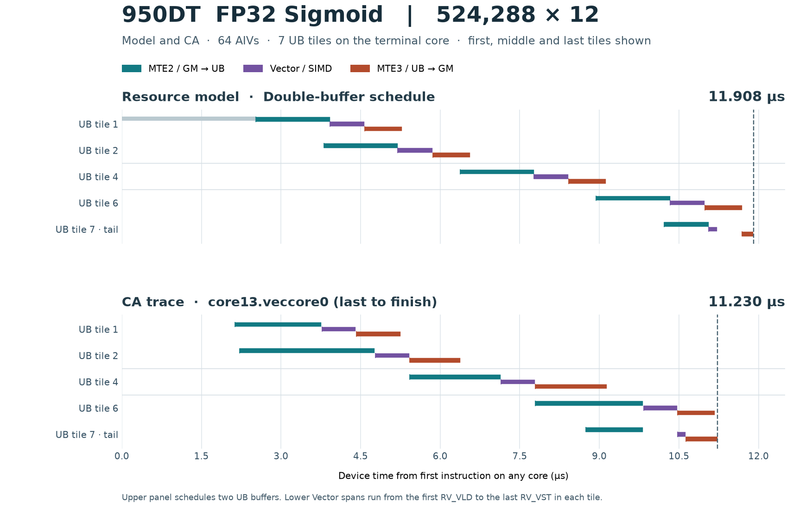
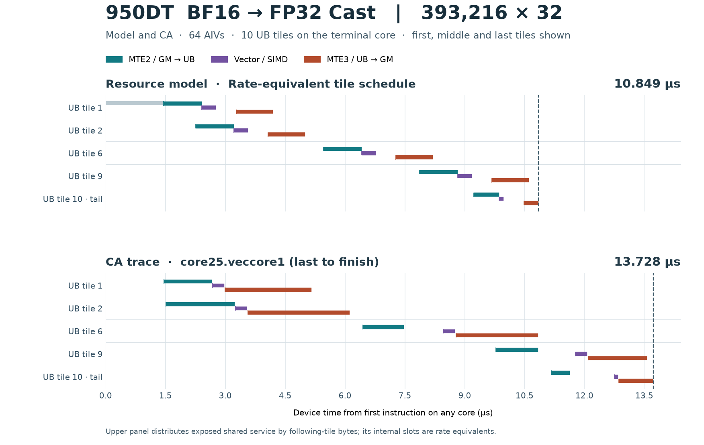
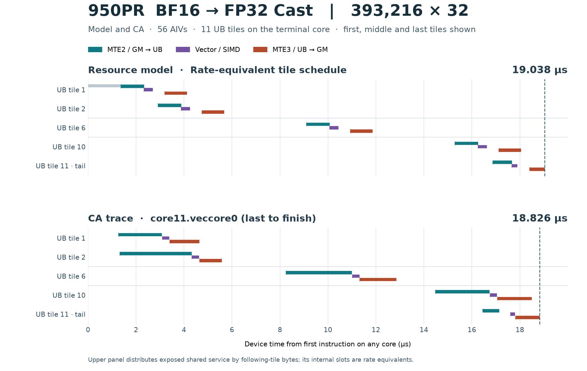
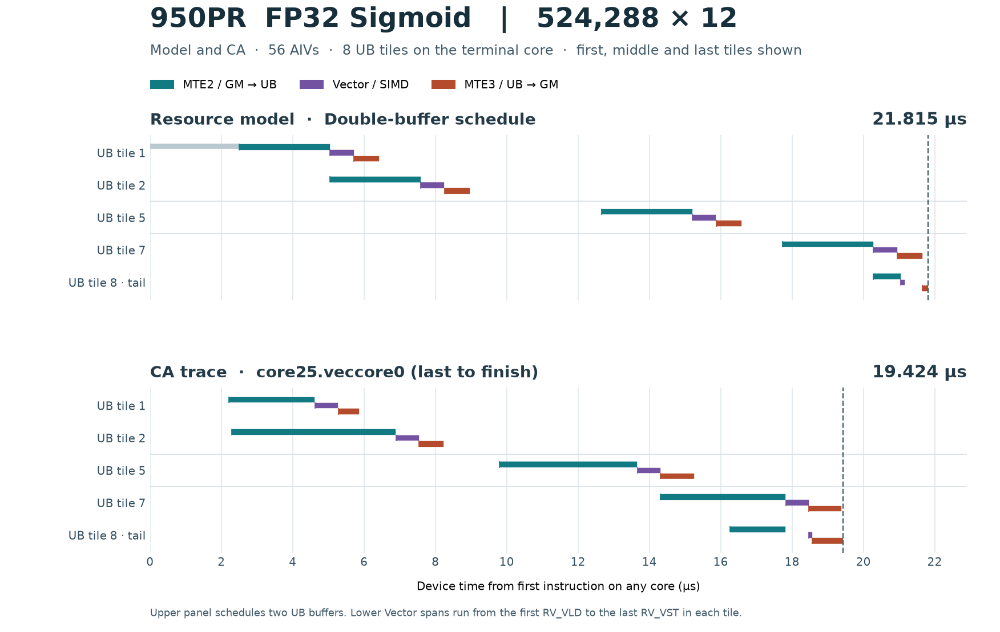
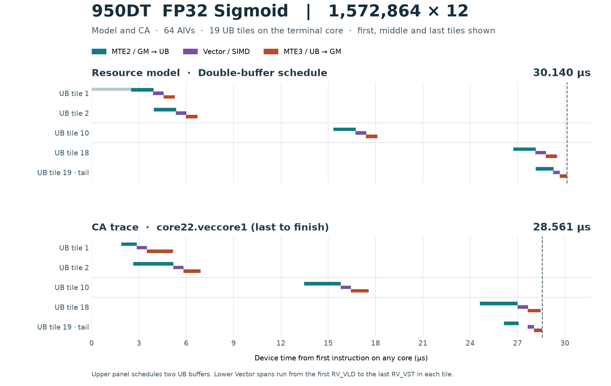
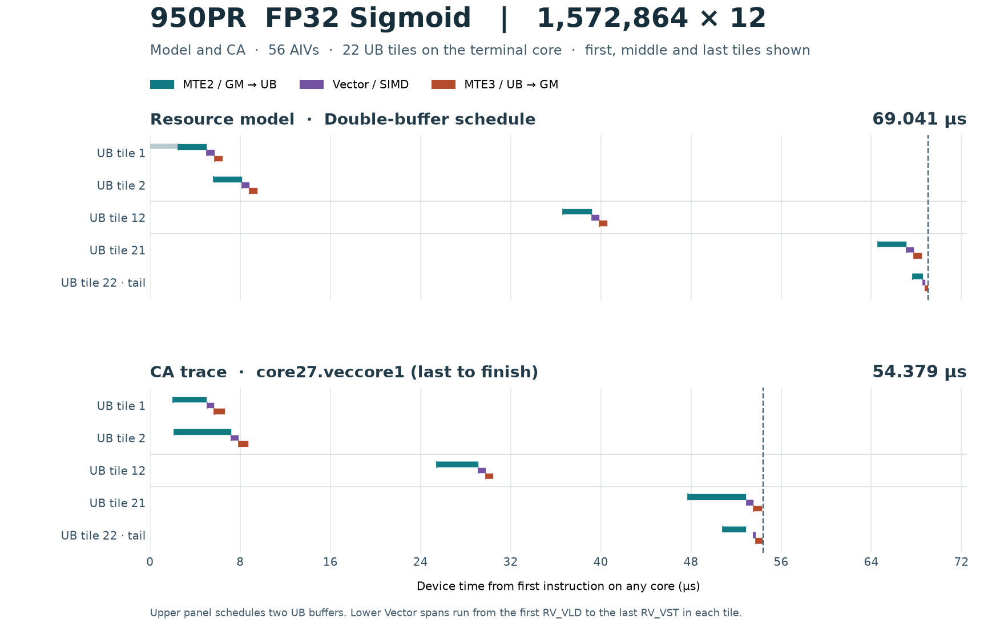
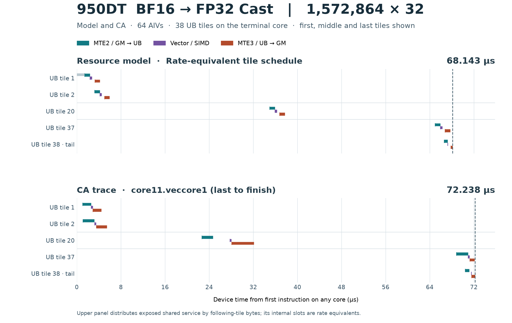
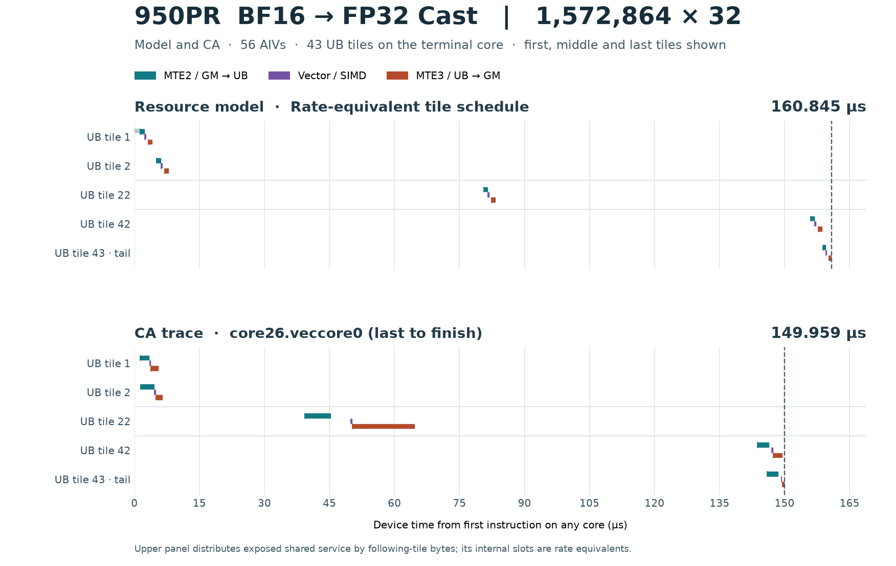

# 新长 prefill 的冻结预测与独立 CA

各图上栏取 v0.21 的冻结方法，下栏使用该次通过逐核时间窗与全部输出校验的终止核。横轴从全核最早首条指令开始。

## sigmoid_fp32 · [524288, 12] · Ascend950DT_9582

冻结模型 11.908 µs；完整 CA 11.230 µs；相对误差 +6.0%。

[完整时间戳、分块与 trace 哈希](holdout-sigmoid_fp32_524288_12-dt.json)

## cast_bf16_fp32 · [393216, 32] · Ascend950DT_9582

冻结模型 10.849 µs；完整 CA 13.728 µs；相对误差 -21.0%。

[完整时间戳、分块与 trace 哈希](holdout-cast_bf16_fp32_393216_32-dt.json)

## cast_bf16_fp32 · [393216, 32] · Ascend950PR_957b

冻结模型 19.038 µs；完整 CA 18.826 µs；相对误差 +1.1%。

[完整时间戳、分块与 trace 哈希](holdout-cast_bf16_fp32_393216_32-pr.json)

## sigmoid_fp32 · [524288, 12] · Ascend950PR_957b

冻结模型 21.815 µs；完整 CA 19.424 µs；相对误差 +12.3%。

[完整时间戳、分块与 trace 哈希](holdout-sigmoid_fp32_524288_12-pr.json)

## sigmoid_fp32 · [1572864, 12] · Ascend950DT_9582

冻结模型 30.140 µs；完整 CA 28.561 µs；相对误差 +5.5%。

[完整时间戳、分块与 trace 哈希](holdout-sigmoid_fp32_1572864_12-dt.json)

## sigmoid_fp32 · [1572864, 12] · Ascend950PR_957b

冻结模型 69.041 µs；完整 CA 54.379 µs；相对误差 +27.0%。

[完整时间戳、分块与 trace 哈希](holdout-sigmoid_fp32_1572864_12-pr.json)

## cast_bf16_fp32 · [1572864, 32] · Ascend950DT_9582

冻结模型 68.143 µs；完整 CA 72.238 µs；相对误差 -5.7%。

[完整时间戳、分块与 trace 哈希](holdout-cast_bf16_fp32_1572864_32-dt.json)

## cast_bf16_fp32 · [1572864, 32] · Ascend950PR_957b

冻结模型 160.845 µs；完整 CA 149.959 µs；相对误差 +7.3%。

[完整时间戳、分块与 trace 哈希](holdout-cast_bf16_fp32_1572864_32-pr.json)
