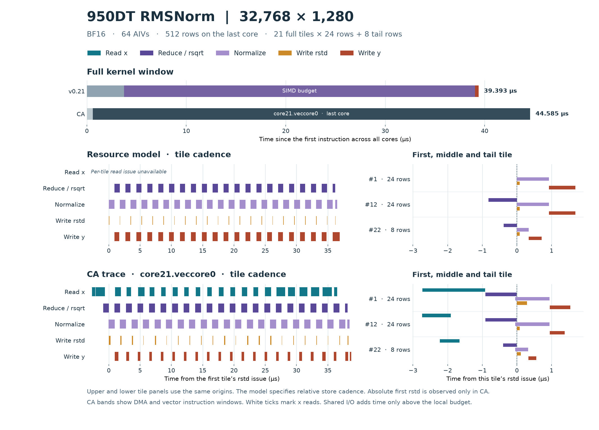
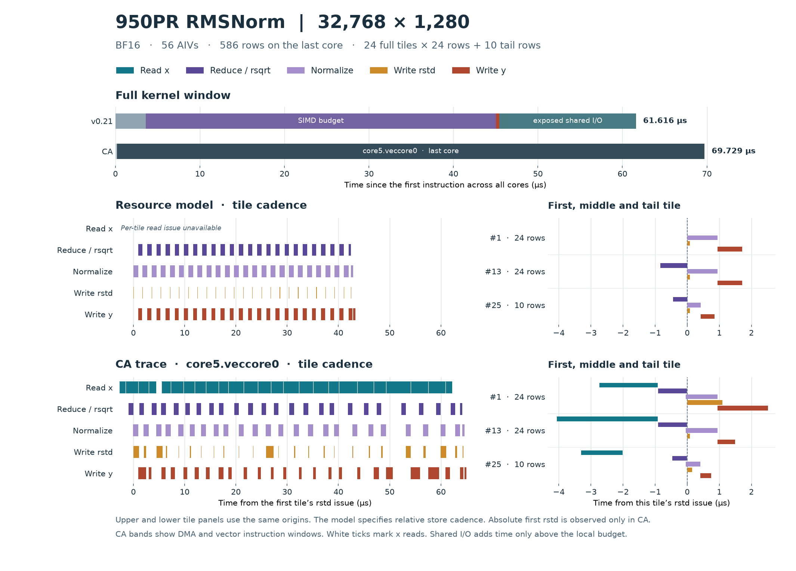

# RMSNorm 在 32,768 行上的逐核流水

950PR 的分核和 25 轮 UB 分块全部算对，但完整设备时间仍低估 11.63%。在最晚完成核上，模型每隔 **1.785 µs** 发起一整块的统计量写回，CA 中位间隔为 **2.561 µs**。950DT 的相应数字为 **1.743 / 1.842 µs**。与总耗时相比，发起间隔更清楚地揭示 PR 的跨轮等待。下列数据来自已完成的两次 CA。[逐核及全窗回执](receipt.json) · [每块地址、字节数、指令时间与模型周期](tiles.json)

| BF16 [32768,1280] | 950DT | 950PR | 970DT 外推 |
|---|---:|---:|---:|
| v0.19 冻结预测 µs | 43.776 | 121.615 | 21.823 |
| v0.20 冻结预测 µs | 39.567 | 61.603 | 21.823 |
| v0.21 公共入口回放 µs | 39.393 | 61.616 | 21.436 |
| 全核 CA µs | **44.585** | **69.729** | N/A |
| v0.20 / v0.21 有符号误差 | −11.26% / −11.64% | −11.65% / −11.63% | N/A |
| 最晚完成核 | core21.veccore0 | core5.veccore0 | N/A |
| 模型 / 实测 AIV 数 | 64 / 64 | 56 / 56 | 120 / N/A |
| 核上整块与尾块行数，模型与实测一致 | 21 × 24 + 8 | 24 × 24 + 10 | N/A |

实测的 DT 耗时 / PR 耗时为 0.639401，v0.20 为 0.642284，v0.21 为 0.639332。比值接近的同时，两端绝对时延都低估约 12%。每次调用做一次单卡 BF16 RMSNorm，输入 41,943,040 个元素，宽度 1280。这是一次 32,768 行的调用，若 prefill 每个请求都是 32k token，batch 8 无分块还会有 8 倍的行数。历史验收角色为 v0.20 冻结独立样本，v0.21 在已有测量上回放。查询使用 `estimate("rmsnorm", [32768,1280], chip=..., dtype="bf16")`，省略 `resident_aiv`。[原预登记](../../v0.20/rms/freeze.json) · [十对合格记录](../../v0.20/rms/pairs.json)





## 如何读图

顶部两条横线共享全核首条指令这个时间原点。模型色段是到达、准备、暴露读、SIMD 预算和暴露写的累计值。在 PR 上，共享 I/O 下界还增加 **16.166 µs** 才达到最终估计，图中单独着色。CA 条从全核首条指令起算，深色部分是最晚完成核的真实跨度。

下方两列都以上模型、下 CA 排列。左列以各自第一块 rstd 写发起为零，右列分别以所选块的 rstd 写发起为零。这样可以比较模型和 CA 的轮次间隔、读算写的相互遮挡、尾块缩短程度。模型只对全核读需求和起始暴露读收费，无法确定每次 x 的绝对发起时刻。CA 实测第一次 rstd 写距全核首指令为 DT 5.859 µs、PR 4.770 µs。底图的 x 青条为描述符开始到完成的跨度，白线表示一笔新描述符开始。向量色条覆盖对应那段指令序列的首尾，区间可能含空泡以及与其他子流水的重叠。

## 怎样从公式得到每块时间

设输入有 T 行、宽度 D，芯片有 C 个 AIV。先算每核最多处理 `ceil(T/C)` 行。DT 为 512，PR 为 586。BF16 每个元素占 2 B。对 D=1280，已安装实现对应的模型 UB 容量账本给每块最多 24 行。每个整块读取 x 和写 y 各 **61,440 B**，写 rstd **96 B**，两边的最后核上另有各一次 64 B tiling 和 2,560 B gamma 的读取。DT 的尾块为 20,480 / 32 B，PR 为 25,600 / 40 B。这些是每核每笔描述符的逻辑字节。两个 x、y、rstd 缓冲区各自交替使用，三个张量的 GM 地址在各自区域内按上块的实际字节数连续递增。[分块与定价](../../../operator_model/rms_resource.py) · [UB 预算和重叠公式](../../../operator_model/rms_v12.py)

模型用块内向量组数 `g = 行数 × ceil(D/128)` 计算轮次间隔。设 `f` 是芯片每微秒周期数，这两款为 1650。归约用 `(270.869 + 4.491 × g × v) / f` µs，归一化用 `(75.458 + 6.049 × g × v) / f` µs，`v` 为参考每核向量吞吐与目标每核吞吐的比值。固定项和每组周期来自较早的关键 AIV 流水，归约有 42 组观测，归一化有 44 组。以 PR 为例，`v = 1.02717`，每满块 240 组。归约 **0.8351 µs**、归一化 **0.9495 µs**，两个连续整块的 rstd 发起间隔为其和 **1.7846 µs**。图以首个 rstd 为原点，只从第二块画模型归约。y 写周期是固定开销 302.496 周期加每 KiB 写服务，本例取 16.018 周期 / KiB。允许 y 等待本块 rstd 完成。rstd 写服务由独立写入 133 周期和 128 B 窗口内的相邻核竞争构成，整形状每核有足够多的行使竞争项为零。主路径把可被向量工作覆盖的写区间去重，另取整片 I/O 下界，因而左列的各色条不能直接相加。[历史向量与写参数](../../v0.12/rms/profile.json) · [当前公共入口的状态组合](../../../operator_model/rms_dispatch.py)

## 误差更集中在哪里

| 最晚完成核上的逐轮指标，µs | 950DT 模型 / CA | 950PR 模型 / CA |
|---|---:|---:|
| 连续满块 rstd 发起间隔中位数，排除尾块 | 1.743 / 1.842 | 1.785 / 2.561 |
| 首个 rstd 发起到尾块 y 完成 | 36.883 / 38.720 | 43.288 / 64.957 |
| 满块 x 描述符窗口中位数 | N/A / 0.925 | N/A / 3.329 |
| 首次 rstd 写回窗口 | 0.081 / 0.294 | 0.081 / 1.095 |

PR 的每条 x 读描述符窗口明显更长，尤其可见连续满块的 rstd 发起逐步落后。当前实现把共享访存作为全核总下界，从两端首个 rstd 起看，每轮调度自身缺少 PR 上实际出现的约束。中段第 13 块内，PR 归约包络为 **0.900 µs**，归一化为 **0.990 µs**，与模型中 **0.835 / 0.950 µs** 的单块预算较接近。图中证据支持下一步检验 MTE2 的可重叠服务、双槽复用、跨核争用对下个块发起的影响。描述符能同时待发，包络内可能有排队，单凭 x 窗口长度不能反推出芯片实测的 HBM 带宽。

原十个独立形状的完整结果如下。WAPE 为全部绝对误差之和除以全部 CA 时间之和。最大误差是逐 shape 最大绝对百分比。v0.21 这两列是历史回放。

| 同一组十个 RMS shape | 950DT WAPE / 最大 | 950PR WAPE / 最大 |
|---|---:|---:|
| v0.19 冻结 | 3.92% / 12.90% | 59.36% / 74.41% |
| v0.20 冻结 | 9.40% / 12.90% | 13.01% / 22.55% |
| v0.21 回放 | 10.77% / 14.66% | 13.27% / 22.90% |

## 采集与复现

安装包实际调用 `aclnnRmsNorm`，两端均执行同一二进制的 `RmsNorm_normal_all_bf16_high_performance_5000`。宿主对每个 BF16 y 检查符号和数值，对每行 FP32 rstd 检查 `1/sqrt(1+1e-6)`，容差 `1e-4`。两端分别通过 41,943,040 个 y 与 32,768 个 rstd。原解析器已核对 64 / 56 个核的官方 duration 表并对完整 trace 分块求 SHA-256。每端保留约 22.5 GiB 原始目录，其中合并 trace 约 7.63 GiB；CA 墙钟为 84.93 / 96.29 分钟。图仅取关键核文件，大小为 115.6 / 132.2 MiB。解码时按流计算每个关键核文件 SHA-256，并以官方全核回执所列的该核首尾核对原点。[原宿主](../../../smoke/large_vector.cpp) · [原资格检查](../../../development/validation/sku17/campaign_collect.py)

```bash
python development/validation/wide_rms_receipt/receipt.py
python development/validation/wide_rms_receipt/tiles.py
toolchains/envs/cann-9.2.1/bin/python development/validation/wide_rms_receipt/plot.py
```

有仓内的 `tiles.json` 即可单独运行最后一条重绘。逐块识别绑定到实测 kernel 二进制 SHA。归约序列含 `VCADD` 和 `VSQRT`，归一化序列含两次 `VMUL`、BF16 转换和 `VST`。源码按 DMA 实际地址、长度和双槽交替逐块校验，将向量序列的进入、结束与相同顺序的输入和输出块交叉核对。[解码器](../../../development/validation/wide_rms_receipt/tiles.py)
