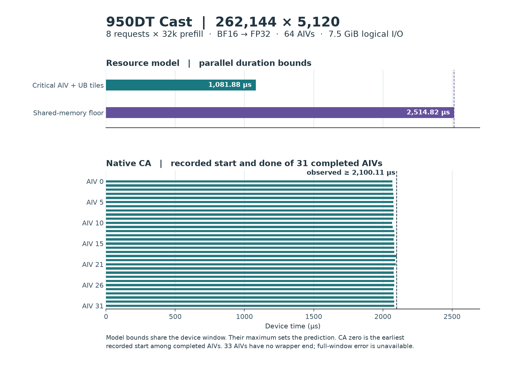
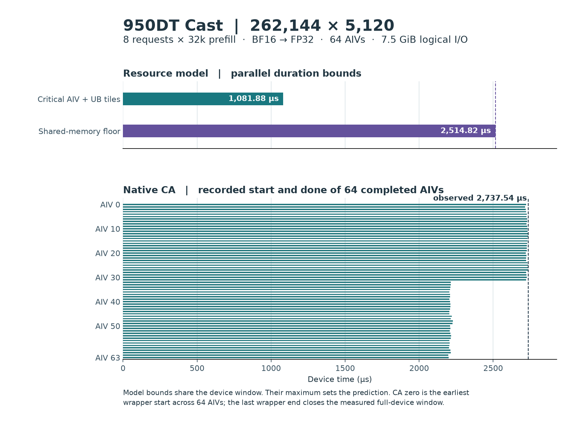

# 950DT 上的完整 prefill Cast

DeepSeek V4 Flash 场景按每卡 batch 8、每条请求 32,768 个 token、hidden size 5,120 推导。未切 chunk 时，单次 BF16→FP32 Cast 输入为 [262144,5120]，宿主逐项校验 1,342,177,280 个输出。输入约 2.5 GiB，输出约 5 GiB。该实验对应一次调度调用。系统按 chunk 或分段运行时应分别预测各次实际调用。

## 第一次完整输入采集

原始运行的 64 个 AIV 全部开始，只有 31 个有配对的 block_end 及同一 block 的 wrapper done。缺少结束的 AIV 为 19, 32, 33, 34, 35, 36, 37, 38, 39, 40, 41, 42, 43, 44, 45, 46, 47, 48, 49, 50, 51, 52, 53, 54, 55, 56, 57, 58, 59, 60, 61, 62, 63。已经结束的核中最早开始到最晚退出相差 3,465,175 个 wrapper tick。在 1.65 GHz 下完整设备窗至少为 **2100.106 µs**。STARS 调度 tick 和全机仿真进度计数各用不同时间基准。进程触及磁盘预算后停止，全量数值校验、整核窗口和指令窗口均未取得，主误差表的 CA 与误差均应填 N/A。

上次花费 6.192 小时，落盘 8.001 GiB。128 份 lpddr_state 周期状态文本共 7.687 GiB，占 96.078%。保留了原目录及按核摘要 SHA256。[31 个核的原始 tick 与摘要哈希](previous-partial.json)

图上半的两行都从零起算。它们分别表示最长 AIV 的双缓冲流水耗时、共享存储的全芯片吞吐下界，取较大者。图下半每一条横线都对应一个真实 wrapper 开始和完成事件，以这 31 个核中最早的开始作为零点。

## 相同 shape 的短控

两个新进程分别按完整输出和选择性丢弃周期文本运行相同 [32,4096] 输入、相同原生宿主、相同 CPU 亲和性。仅在新的空目录把预登记的 128 个输出名指向 /dev/null。系统调用记录保留文件打开标志和实际打开的 kernel 对象；这项额外记录只在短控启用。

| 采集 | 设备 wrapper 窗 µs | 活动 AIV | 逐项通过 | 周期日志 MiB | 宿主秒 |
|---|---:|---:|---:|---:|---:|
| 既有全输出对照 | 4.898788 | 64 | 131072 | — | 54.1 |
| 新全输出 | 5.164242 | 64 | 131072 | 26.06 | 87.1 |
| 新重定向 | 5.141818 | 64 | 131072 | 0.00 | 87.1 |

预登记的重定向门槛通过。两次短控分别观察到 128 和 128 个周期文件，以写入方式打开的检查结果分别是 True 和 True。
冻结程序要求重定向对本次全输出及既有全输出的相对窗口差均在 ±5% 内，实测分别 -0.434% 和 +4.961%。另列本次全输出对既有全输出 +5.419%，用于观察运行间窗口变动。
两个完整设备窗均覆盖相同的 64 个核及 block，0 个核的开始和结束 tick 均逐项相等。
短控实际打开安装包 ops_math/cast_apt 对象 Cast_b2717900ea7de2d41ea9c63d23aa269b_high_performance.o。对象 SHA256、逐核 tick 和系统调用 trace 的 SHA256 可复核。这个对象身份由短控直接观测，大 shape 的原生运行按实际取得的证据登记。

[两次短控证据](v3/control-evidence.json) · [预登记门槛及结果](v3/control-comparison.json)

## 完整 shape 重采

保留 v0.20 事前冻结的 DT 预测 2014.328 µs 以及首次重试前冻结的资源模型预测 DT 2514.820 µs、PR 5697.327 µs、970DT 1223.154 µs。这里直接观测的平台仅为 Ascend950DT_9582，970DT 数值来自外推。

新实验使用原生 aclnnCast，以整个输入逐项校验并要求 64 个 AIV 的 wrapper 起止齐全。预算 24 小时，按短控门槛选择仅丢弃周期文本，16 GiB。全量路径关闭逐指令采集和短控的系统调用采集。独立的 Kimi [262144,7168] DynamicMxQuant 占用唯一的长任务槽，其预算为 12 小时、24 GiB。Flash 管理进程会在 Kimi 终止并释放进程后启动。登记时的队列状态为 `complete`，更新时间 2026-11-19T23:58:28.996545+00:00。最终可取得的计时口径为全核 wrapper 窗。

[原输入、宿主和预算冻结](v3/registration.json) · [实时队列](v3/queue-status.json)

### 完整输入终态

宿主耗费 4.307 小时，原始输出 0.409 GiB。

64 个活动 AIV 提供完整 wrapper 窗，逐项正确 1,342,177,280。实测设备窗口 2737.538 µs，相对该冻结 DT 预测的有符号差为 -8.14%。原生采集仍仅覆盖 wrapper 口径。
[完整输入回执](v3/flash-retry.json)

首次短控把 102 个宿主线程限制在 16 个 CPU 上，全输出对照触及 900 秒墙钟；随后的未完成重定向对照已保留并中止。新短控保留 nice 19 和全部相同的设备、kernel、输入、数值、计时门槛，使用宿主完整可调度 CPU 集合，以便 CA 线程通过同步屏障。[前次回执](../full-hidden/v2/control-original.json)

[同一冻结总时延的逐阶段预算](stage-budgets.json)
