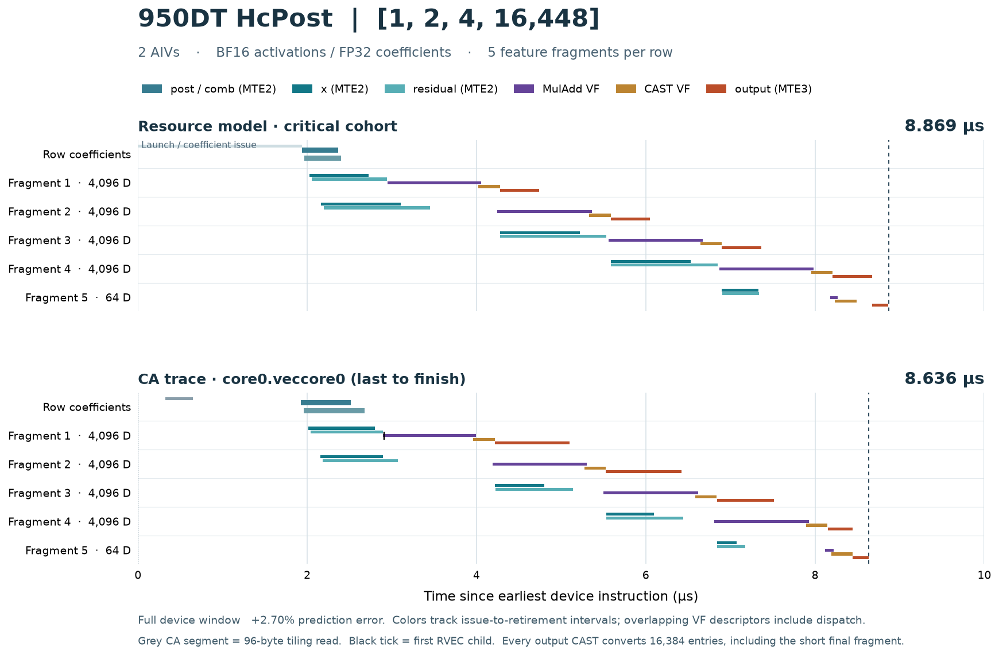
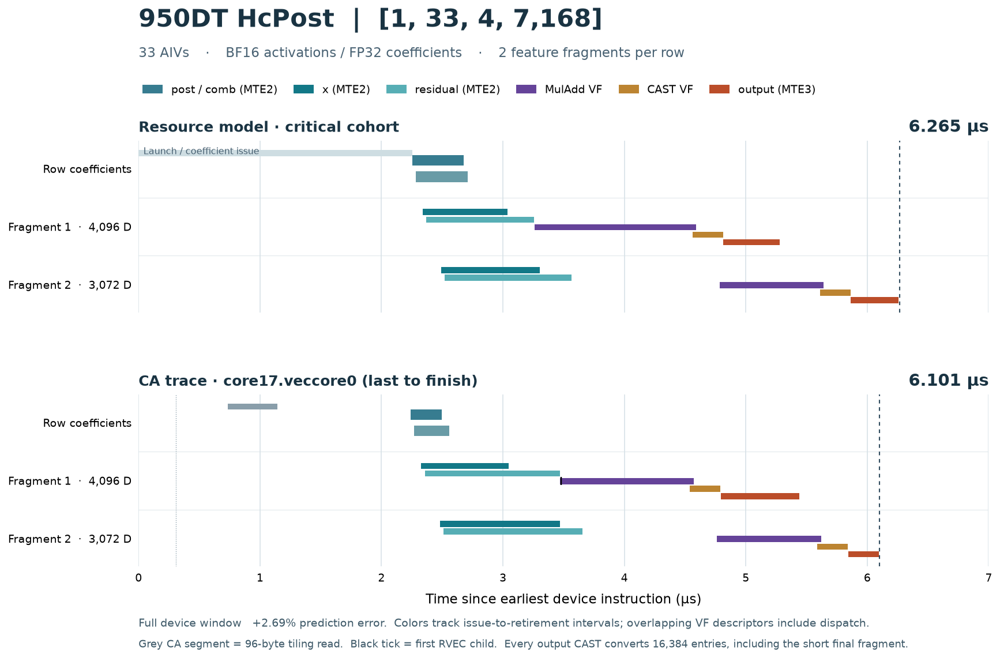

# vLLM Ascend HcPost 的分段资源模型

这个实验候选接受芯片配置及 [B,S,4,D]。输入 x 和四路 residual 为 BF16，每行的四个 post 和十六个 comb 系数为 FP32，输出四路 BF16。它返回设备时间、分核、读写字节、VF 数和有效 FP32 运算。建模分四步：从算法数工作量，从 vLLM 的 tiling 确定每核和每片任务，从独立资源价格计算服务时间，最后按队列的先后约束排程。整核总时延只用于检验。[开发与独立误差表](comparison.md)

## 从 shape 到片与工作量

设 T=B×S、N 为芯片的 AIV 核数、A=min(T,N)。单核基本行数 q=⌊T/A⌋，前 r=T mod A 个逻辑核多取一行。本实现的 D 片宽固定为 4096。每行有 K=⌈D/4096⌉ 片，第 i 片有效宽 wᵢ=min(4096,D−4096i)。没有 AIC 计算。公开定制算子 `aclnnHcPost` 的源码版本是 vLLM Ascend `c09d3e20b9c45c80b34ae3781440d90904a44023`，实际 CA 核对了设备代码段、两个 ACLNN 符号、分核以及全部 FP64 参考输出舍入为 BF16 的 bit equality。只列入有完整全核起止指令的窗口。[源码、文件散列与版本](../hc-post/source.json) · [独立采集合同](holdout-register.json)

单个输出为五个乘积之和，每个元素 5 次乘和 4 次加，整核数学量为 36TD FP32 ops。每行读 x 的 2D 字节、residual 的 8D 字节和系数 80 字节，写 8D 字节。另有每个活跃核一次 96 字节的 tiling 传输。DMA 报告的是 GM/UB 指令侧逻辑流量，片上命中时外存芯片的物理流量会更小。

每片有两个 VF。第一个用 64 个 FP32 lane 为一组，遍历四个输出通道，实际工作依赖 ⌈wᵢ/64⌉。第二个调用源码的 `Cast(...,4*dOnceDealing_)`。即使尾片只有 64 个元素，仍向 BF16 转换 16,384 个槽位。每次执行有 2TK 个 VF、16,384TK 个物理转换输出。这个固定成本解释了为何跨过 4096 的很窄尾片仍可能影响时延。

## 如何定价与排程

所有内部时间用目标核的周期数表示。时钟 f 以 GHz 计，设备时间 µs 为周期数除以 1000f。下面价格来自两端共九个开发窗，每个描述符的发起、完成时间及数据量都有独立记录。用于提价的宽度和对应观测中位数均已封存。[原始阶段价格](parameters.json) · [提取算法](../../../development/validation/hc_post_timing23/calibrate.py)

| 阶段 | 周期计算或信号 | 数据来源和局限 |
|---|---|---|
| 启动与多核发起 | 首个系数发起 3183+16.65k，首 VF 开始到第一个 RV 子指令的等待 18+11.98k。k 为该工作队列中最迟一组核的逻辑顺序，从 0 开始。 | 对 1–5 核开发窗取首个实际 RV 最晚核的时间；65×256 提供 64/56 核两组。两端使用同一价格。k 代表近似的发起跨度，无法预测每个物理核的 ID。软件分发、取指与仲裁的贡献尚未拆开。 |
| 系数与输入指令发起 | post 后 47 周期发 comb，第一对输入距 post 129 周期（多片多 12）。x 后 47 周期发 residual，满片再多 2。前两组可排队，下一满片发起间隔约 232、描述尾片多 20，下一行系数准备约 386。 | 取开发窗实际指令发起的间隔。这些是当前二进制指令模板的标量开销。 |
| DMA 延迟 | 每段 L=a+bn。n 是字节数，a 为固定响应周期，b 的单位是周期/字节。首组 x/residual 与后续组各有一套描述符响应价格。MTE3 也有独立价格。 | 先对每个独特字节数取中位数，再取所有不同长度间的两点斜率中位数。首组 x/residual 的 (a,b) 分别为 (731.57,0.05163)、(750.07,0.02194)，混合在途组使用 (702.79,0.10393)、(699.67,0.04191)，写回为 (306.34,0.01398)。两芯片共同估计；单条在途响应含队列等待，斜率不能直接解释成硬件峰值。系数短读缺少独立的服务量扫描，使用小描述符近似。 |
| 算术 VF | 有效体长 [75.4+26.9⌈wᵢ/64⌉]s。s=(255.68)/(1000P₃₂/(Nf))，P₃₂ 为整芯片 FP32 Vector TFLOP/s。首 VF 在有效体外加上述发起等待，后续 VF 加约 46 周期。 | 由首个 RV 子指令发起至算术父 VF 完成为有效体。256、1024、4096 宽下中位为 183、505、1797 周期。s 表示每核每周期 FP32 吞吐与 950DT 的比值倒数。不同机器指令 mix 的吞吐可能不能与通用 FP32 峰值同比变化。 |
| 输出 CAST | 约 418s 周期。与上一个算术 VF 的最后 52 周期可重叠，下一个算术 VF 可在 CAST 尾部提前约 47 周期提交。 | 4096 满片和 64 尾片的 CAST 指令体几乎同长。这两项重叠是父 VF 描述符跨度，避免把提交阶段重叠误解为同时执行两份完整 RV 运算。 |
| 第三片之后的双槽复用 | 片 i 的 x 发起受片 i−2 的 MTE3 **发起**+2 周期约束。受阻后 x 与 residual 可以只隔 2 周期发起。写指令在 CAST 完成+4 和前次写完成+2 之间取最大值。全核末次写完成后再留 10 周期。 | 2×16448 两个物理核各五片，三组双槽释放都满足这个约束。MTE3 的退休与发起分开，长响应可和后续计算同时进行。不同生成代码的两个接口必须重新核对。 |

以 i 表示某核连续执行的片编号，Xᵢ、Rᵢ 表示两次读，Vᵢ、Cᵢ 表示算术及 CAST，Wᵢ 表示写。对每一片，算术发起取 max(Xᵢ完成+3，Rᵢ完成+3，系数完成+3，Cᵢ₋₁完成−47)。写发起取 max(Cᵢ完成+4，Wᵢ₋₁完成+2)。上述每项都在约束一个真实依赖或资源队列。这里的“双读”指 x 与 residual 两个 MTE2 命令可同时在途；是否有两个硬件端口能在同一周期发射仍待验证。对 r 个多一行的核和其余核分别算到退场，再取最长。65×256 DT 有 64 个活跃核，最后结束的 core21.veccore0 只处理一行。它的首次 VF 等到第一个实际 RV 子指令用了 811 周期。处理两行的 core0.veccore0 对应等待为 18 周期，实际更早结束。PR 在这一点上有相同现象。

独立的共享资源下界取 max(逐核最长时间，假设冷读的外存字节/峰值外存带宽，GM 侧读写流量/已知 L2 带宽)。冷读下界使用输入读取量加无法容纳在 L2 的脏输出 max(0,输出字节−L2 容量)；输入预热、硬件回写策略或上下游融合会改变这个估计。MTE 局部响应优先反映单核不能达到整芯片峰值的事实，显式共享下界在大并发时才可能成为关键项。目前缺少整个 HBM/LPDDR 控制器的命中率、带宽利用率和不同 AIV 数下的吞吐扫描，因而大张量和跨代结果仍属外推。

## 算例：2 行，D=16448，950DT

输入 x 为 [1,2,16448]、residual 和输出为 [1,2,4,16448]，两个核各执行一行，形成为 4096、4096、4096、4096、64 五片。模型返回 1,184,256 FP32 ops、329,120 读字节、263,168 写字节和 20 个 VF。用 D 片宽而非尾片有效宽计算，二次 CAST 处理 163,840 个 BF16 槽位。预测的候选核第三片 x 在第 7060.63 周期发起，刚好比第一片写回发起的 7058.63 周期晚 2 周期。真实最后退场核同一对时间为 6964 和 6962 周期。整窗预测 8.869 µs，CA 8.636 µs，误差 +2.70%。



第四片输出在模型里用 764.5 周期退休，实测 487 周期。因此末次写回发起被推迟到 14311.1 周期，实测为 13937 周期；前面算术波形的几十周期差异也会传到末片。前两条 32 KiB 写描述符的实测响应反而为 1455、1477 周期。单一写服务价格对整窗尚可，但不能解释连续长写、尾部回收的所有等待。[模型与 CA 的所有时间戳](dt-16448-timeline.json)

## 独立算例：33 行，D=7168，950DT

这是预登记的新 shape，33 个 AIV 各执行一行，每行的两片分别为 4096 和 3072。图中的核是全窗口最后退场的 core17.veccore0，第一片 MTE3 的描述符跨度与第二片的算术、CAST 有重叠。全窗预测 6.265 µs，实测 6.101 µs，误差 +2.69%。原始离线 CA 产物约 774 MiB。[逐条时间戳和 SHA](dt-7168-independent.json) · [另一个独立掩码宽度 D4080](dt-4080-independent.png)



D=4112 在 4096 后只剩 16 个元素。两芯片的完整数值检查各发现 333 个 BF16 输出错误。源码的四个输出流共用递减的掩码余量，256-byte 寄存器的 FP32 运算按 64 元素处理。以 4×16 为初始余量，四个流预计取得 [64,0,0,0] 个有效 lane。按已登记的输入构造并令未写过的 UB 高位为零，预测各流分别错 0、112、111、110 个。双端原日志只保存总数，不能独立核对这四个分量。发布候选将不足 64 个元素的非空尾片标为不可用，继续提供逻辑工作量；原冻结预测、失败回执保留。另登记 D4160 以验证 64 元素的下边界。[失败条件和数值重放](failed-tail-mask.json) · [补充登记](supplement-register.json) · [D4160 独立补充实测图](dt-4160-supplement.png)

## 更换芯片与输入范围

本候选冻结时对比了 950DT 和 950PR 两种核数和存储系统。970DT 使用单独配置，带宽、频率、核数和每核 FP32 算力从目标配置读取。各个机制的迁移条件如下。

- 频率变化会改变“周期→微秒”；核数影响每核行数及发起扇出；Vector 算力另以每核每周期值变化定价。若目标缩短/延长转换、乘加或发射间隔的比例不同，需要分别给出价格。当前 CAST 与算术共用一个缩放比率。
- 目标 HBM 和 L2 带宽改变共享吞吐下界，目标 L2 容量改变假设的脏输出下界。每核 MTE2/MTE3 响应、发起节拍和排队，暂继承 950 的周期参数。仅提高标称内存带宽未必加速一两个核的短工作。
- 源码实际每核申请两个 x/residual/output 和系数缓冲，加一个 FP32 累加缓冲。按 4096 宽计算原始有效载荷至少 213,152 B，每个 post 槽按 32 B 对齐之后为 213,184 B，还需保留运行时的空间。950DT/PR 具备 248 KiB UB。当前固定核实现和候选定价都无法自动适配更小的 UB。只有保持相同 tile/队列几何且能装入 UB 时，才有理由沿用它。若目标改变 UB 大小或分片策略，需要替换分核/分片公式并重新计算工作与依赖。
- 已验证合同仅含 BF16 数据、FP32 系数、四路流、独立全窗。为避免生产者/消费者隐藏步幅，实验要求密集 D 为 16 的倍数。其它 dtype、带 stride 的布局、生产 vLLM 完整图、跨算子缓存及超大连续运行的时延都需单独验证。
- 非计时形状 [8,32Ki,4,7168] 在冻结调度下 950DT 为 10.661 ms、970DT 为 5.212 ms。970DT 的 128Ki、256Ki 单次展开分别为 20.832、41.658 ms，体现了很多稳态轮次后的近线性增长。这些都没有该 shape 的 CA。全张量在 8×256Ki、D=7168 时约 270.75 GB，已经超过 DT/PR 卡容量，系统部署需要按真实调度分块。即使单算子张量小于卡容量，也要为权重、KV 与其它张量留空间。[所有大场景及容量](query-cost.json)

### 970DT 参数敏感性

表中数字是原参数时间除以假设时间。每行只更改所列资源；所有数字均为模型外推。第一列形状只有 1 个有效 AIV，第二列形状有 120 个 AIV 及每核数千轮。单核小形状对首次读响应更敏感，长期流水则会暴露运算与分核吞吐的差异。[四个形状的完整敏感性结果](sensitivity.json)

| 对 970DT 假设的单项变化 | [T,D]=[1,1280] 加速比 | [262144,7168] 加速比 |
|---|---:|---:|
| 每核 MTE 有效字节/周期翻倍，响应起步价格不变 | 1.033× | 1.103× |
| MTE 固定响应周期减半，字节斜率不变 | 1.100× | 1.089× |
| 每核 FP32 Vec 峰值翻倍，沿用当前算术/转换同比假设 | 1.098× | 1.347× |
| 外存峰值带宽翻倍，局部 MTE 不变 | 1.000× | 1.000× |
| AIV 数减半，每核 Vec 能力不变 | 1.000× | 0.500× |
| UB 降为 192 KiB | 当前二进制缓冲无法装入 | 当前二进制缓冲无法装入 |

只有在排程命中共享带宽下界时，提高外存峰值才会改变这版预测。两例的 1.000× 也提示现有数据尚不能鉴别共享带宽利用率和跨核竞争，不能据此对实际 970DT 下结论。

## 查询成本与再现

独立计分始终读取冻结三芯片预测。同一参数和公式有一个独立的快路径，当同一核的六个队列时间戳整体平移、并且下一周期仍满足相同平移时，直接跳过重复的单行或双行节拍。405 个分支/边界对照与冻结实现的最大差异低于 0.000001 周期。额外 27 个三芯片真实长宽查询，与冻结逐行调度对照后，常驻 Python 进程单次最慢约 1.51 ms。启动 Python、开发期 trace 解析、离线 CA 墙钟分别计量。对宽度 1280、数百万行，原冻结逐行实现实测可超过 100ms，应使用经过等价验证的快路径。[查询基准](query-cost.json)

在仓库根目录运行以下命令可用现有文件重建结果。QA 使用 `python3 development/validation/hc_post_timing23/cost.py`。图上实测条带取资格回执指向的 trace，按字节和源码顺序核对每行两个系数与每片两个 DMA 读、两个 VF、一个写。原始 trace 与冻结模型在图旁的 JSON 中各有 SHA。

```bash
python3 development/validation/hc_post_timing23/calibrate.py
python3 development/validation/hc_post_timing23/report.py
toolchains/envs/cann-9.2.1/bin/python development/validation/hc_post_timing23/figure.py \
  results/v0.23/hc-timing/development-Ascend950DT_9582-t2-d16448.json dt-16448-timeline
```

已有仓库中的精简阶段快照也可直接重画独立双片图。此路径重新求每个模型时间戳，并与已归档的全片 CA 回执校验。无需安装 CANN 或保留原始 CA 目录。

```bash
python3 development/validation/hc_post_timing23/figure.py --snapshot \
  results/v0.23/hc-timing/dt-7168-independent.json dt-7168-independent
```
