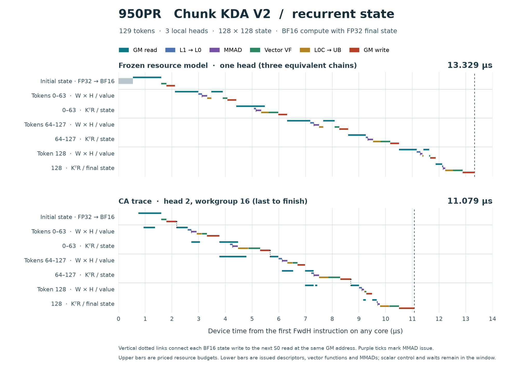

# 950PR 上一条 KDA 状态链怎样跑完 129 个 token

这个冻结之后的独立样例采用 BF16、BSND、每卡 3 个 Q/V 头、K=V=128、chunk=64，并带非零 FP32 初态。显式调用 FLA 26.9.1 的公开 `aclnnChunkKdaFwdV2`。这种小形状通过 Kimi 默认包装会走 V1。下面放大 V2 的中间 kernel `ChunkFwdH`；整个 V2 的三段耗时另外列出。

| 计时范围 | 冻结模型 | 950PR 完整 CA | 有符号误差 |
|---|---:|---:|---:|
| FwdH，含启动和退休 | 13.3291 µs | 11.0794 µs | +20.30% |
| 完整 V2，三段独立窗口之和 | 36.9413 µs | 34.5267 µs | +6.99% |

图的零点统一为该次 FwdH 所有核的首条指令，CA 的全核范围为 54,491–72,772 tick。950PR 使用 1,650 tick/µs。上栏是三个等价头中一条链的资源预算；下栏来自实测最后退休的 `core16.veccore0` 和对应的 `core16.cubecore0`。这里能逐块对齐，模型没有预测具体哪个物理核最后退休。

### 怎样从地址确认是同一个头

单个头的 FP32 状态有 128×128 个元素，占 65,536 B。在这个连续 VK 合同下，三个工作组各自的初态首读相隔 65,536 B，最终 FP32 写回的地址顺序也相同。按基址排序得到 `core0 → head 0`、`core1 → head 1`、`core16 → head 2`。该头每轮生成的 BF16 状态占 32,768 B。Vector 的状态写地址与 Cube 下一轮的 H 读地址逐字节相等。图中竖虚线连接生产者与消费者，两端的小点分别表示写完成与读发起。

| 状态生产者 → S0 消费者 | BF16 GM 地址 | 写完成 tick | 读发起 tick | 间隔 |
|---|---|---:|---:|---:|
| 初态转换 → 第一块 | `0x91560cb400` | 3,585 | 3,600 | 15 tick |
| 第一块 → 第二块 | `0x91560e3400` | 9,358 | 9,374 | 16 tick |
| 第二块 → 尾块 | `0x91560fb400` | 14,341 | 14,357 | 16 tick |

前两个块均在 S0 发起 64×128×128 的 MMAD，在 S2 发起 128×128×64 的 MMAD。尾块有效长度为 1，硬件按 16 行发起，实际两条 MMAD 分别是 16×128×128 和 128×128×16。S0 的 ELF 相对 PC 为 `0x28da4`，S2 为 `0x28870`。除 H 状态外，每块 S1 写出的临时 right 与 S2 读出的地址、数据量也吻合。[每笔实际指令、地址与 issue/retire 时刻](950pr-t129-h3-fwdh.json)

### 偏差发生在哪里

| Token 范围 | 模型状态写完成 µs | CA 状态写完成 µs | 模型晚于 CA |
|---|---:|---:|---:|
| 0–63 | 6.3092 | 5.6715 | 0.6377 µs |
| 64–127 | 10.5003 | 8.6915 | 1.8088 µs |
| 128 | 13.3291 | 11.0715 | 2.2576 µs |

芯片保持 H 的严格递推依赖，同时提前读入其它数据。第二块的 W 在 tick 7,049 已发起，此时第一块的状态要到 9,358 才写完。第二块的 U 预取更早，在 6,231 发起。尾块的 W 在 12,144 发起，第二块的状态到 14,341 才写完。冻结模型将同头各块依次计价，后一块的首个阶段预算须等待前一块全部计完。这解释了图上随块数扩大的部分高估。描述符可能含等待，图中没有把全部差额归因于外存带宽。

模型的 DMA 预算使用描述符字节、端口率及首响应开销。Cube 按实际填充的 M/N/K 和每核吞吐计价，Vector 函数按发射记录与目标每核算力计价。FwdH 的 S2 允许 Cube 与状态/gate 的读并行，取时间最大值。该头的 3 个分块依次累加，另计 895 周期启动。图上每一逻辑段在数值上都与原冻结预测相符。[冻结资源模型](../../../development/validation/kda_resource23/model.py) · [950DT 的指令与搬运成本依据](../../kda-resource23/dt-primitive-services.json) · [目标芯片参数](../../../configs/chips/Ascend950PR_957b.json)

CA 历史采集墙钟 **160.44 秒**。本次只重读原分片，新增 CA 为 **0 秒**。四组逐元素校验通过，包括 49,536 个 attention 输出、两个各 24,768 个元素的辅助矩阵与 49,152 个最终状态元素。每个活动核均通过真实 END、官方时长和 ELF 校验。[原始资格回执](../../kda-v23/supplement-ascend950pr-t129-h3.json) · [冻结预测](../../kda-v23/supplement-predictions.json) · [重绘脚本](../../../development/validation/kda_large_figure23/example.py)
