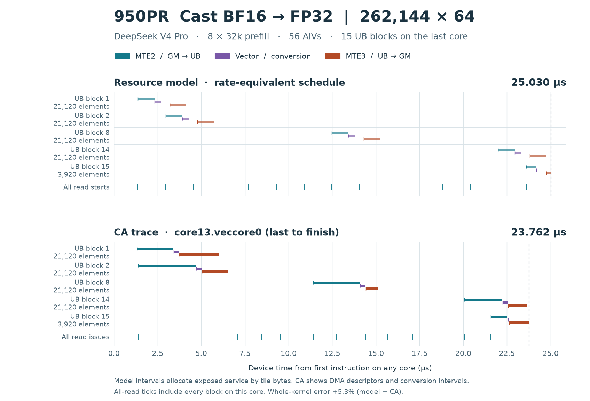

# 三个模型的整批 prefill 流水

每个 rank 一次提交 8 条完整序列。Flash 与 Pro 的宽度 32、64 来自各自 indexer 的复制投影输出，Kimi 的 12 来自 96 个 KDA head 按 TP8 切分。每张图上栏是当前 v0.23 资源模型（同形与 v0.22 点预测一致），下栏是对应 SKU 的正式库 CA 末核，时间零点统一取全核首指令。图上展开首、中、末块，底部每一根细线对应一块的读发起。相邻两根线的距离表示发起间隔；横条宽度表示该笔描述符的响应时间，两者可以相差很大。[模型规格与实际调用位置](../../../docs/prefill-shapes.md)

| 模型、库调用及单卡输入 | 950DT 模型 / CA µs（误差） | 950PR 模型 / CA µs（误差） | 970DT 外推 µs | 末核 UB 块 DT / PR |
|---|---:|---:|---:|---:|
| Flash，B8×32k，BF16→FP32 Cast [262144, 32] | [9.850 / 9.970](../../../docs/examples/figures/prefill-flash-32ki-dt.png)（-1.2%） | [13.046 / 14.080](../../../docs/examples/figures/prefill-flash-32ki-pr.png)（-7.3%） | 6.656 | 7 / 8 |
| Flash，B8×128k，BF16→FP32 Cast [1048576, 32] | [36.368 / 35.535](../../../docs/examples/figures/prefill-flash-128ki-dt.png)（+2.3%） | [88.943 / 70.711](../../../docs/examples/figures/prefill-flash-128ki-pr.png)（+25.8%） | 16.542 | 25 / 29 |
| Flash，B8×256k，BF16→FP32 Cast [2097152, 32] | [99.918 / 106.757](../../../docs/examples/figures/prefill-flash-256ki-dt.png)（-6.4%） | [232.748 / 223.493](../../../docs/examples/figures/prefill-flash-256ki-pr.png)（+4.1%） | 42.536 | 50 / 57 |
| Pro，B8×32k，BF16→FP32 Cast [262144, 64] | [16.592 / 17.041](../../../docs/examples/figures/prefill-pro-32ki-dt.png)（-2.6%） | [25.030 / 23.762](../../../docs/examples/figures/prefill-pro-32ki-pr.png)（+5.3%） | 9.951 | 13 / 15 |
| Kimi，B8×32k，FP32 Sigmoid [262144, 12] | [8.002 / 7.759](../../../docs/examples/figures/prefill-kimi-32ki-dt.png)（+3.1%） | [12.344 / 11.428](../../../docs/examples/figures/prefill-kimi-32ki-pr.png)（+8.0%） | 5.553 | 4 / 4 |
| Kimi，B8×128k，FP32 Sigmoid [1048576, 12] | [19.720 / 18.553](../../../docs/examples/figures/prefill-kimi-128ki-dt.png)（+6.3%） | [39.630 / 34.285](../../../docs/examples/figures/prefill-kimi-128ki-pr.png)（+15.6%） | 11.321 | 13 / 15 |
| Kimi，B8×256k，FP32 Sigmoid [2097152, 12] | [45.897 / 42.686](../../../docs/examples/figures/prefill-kimi-256ki-dt.png)（+7.5%） | [104.717 / 88.593](../../../docs/examples/figures/prefill-kimi-256ki-pr.png)（+18.2%） | 19.353 | 25 / 29 |

## 同一个块从何时开始读



**Pro。** PR 的前两笔 CA 读在 1.341 和 1.396 µs 发起，只隔 0.055 µs，两笔请求同时在途。模型按各块的字节分配未被覆盖的共享服务，第二块的建模起点更晚。到第 8 块，模型的读比 CA 晚 1.061 µs；到第 15 块晚 2.021 µs，整窗最终高估 1.268 µs。DT 上 v0.22 采用独立输入槽和输出槽的周转约束。以往图集所列 13.334 µs 属于 v0.21，当前回放已变为 16.592 µs。[DT 全部区间](pro-32ki-dt.json) · [PR 全部区间](pro-32ki-pr.json)

**Flash。** DT 首笔读发起只差 0.001 µs，第 26 块的模型读晚 8.555 µs，第 50 块反而早 6.526 µs，末窗偏短。PR 的第 29 块模型读晚 24.745 µs。整窗用最忙核估计做上栏，下栏按实际最后退休核选取。PR 上两者都走 57 轮，最后一轮分别为 15,664 / 15,656 个元素；图上保留两者实际粒度。起点偏差反映用平均服务间隔展开的局限，单笔描述符本身不能区分片上等待与外存服务。[DT 全部区间](flash-256ki-dt.json) · [PR 全部区间](flash-256ki-pr.json)

**128k 的偏差。** Flash 在 PR 上预测 88.943 µs，实测 70.711 µs，高估 25.8%。第 15 块和第 29 块的读发起分别晚 17.918 和 19.870 µs。模型把 117.33 MiB 计作外存流量并按 1.4 TB/s 定价，其中共享带宽约束在本核排程之外又增加了 54.952 µs。这里能从模型确定是哪项成本主导，要分清 PR 实际流量与片上驻留的贡献还需要对应的控制器计数。相同字节数不能证明两个 shape 选了同一实现；Pro 的 128k、256k 两个 [T,64] 输入已冻结四项双端采集；128k 与 Flash 256k 都有 67,108,864 个元素，这能验证换形后的分派。Pro 256k 有 134,217,728 个元素，还能检验加倍工作量后的 100 / 114 轮。正式回执生成前，两项 CA 计时均留空。[Pro 双端队列与预测](../pro-prefill/README.md) [Flash 128k 在 PR 的逐块记录](flash-128ki-pr.json)

**Kimi。** PR 实际的第 1、15、29 块读发起，相对预测分别早 0.424、20.262、17.403 µs。首笔读终点相差 0.101 µs，主要偏差是在后续各轮累积的。上栏按两对 UB 槽和全片带宽给出持续发起间隔；下栏的 Vector 区间从各块首个 RV_VLD 到最后一个 RV_VST。DT 同一组里中块和末块的读分别早 5.674、3.366 µs。[DT 全部区间](kimi-256ki-dt.json) · [PR 全部区间](kimi-256ki-pr.json)

两种 Cast 均为 CANN 9.2.1 ops-math 的 `aclnnCast`，Kimi 为 ops-nn 的 `aclnnSigmoid`。14 个设备窗都已完成全元素校验，原始采集墙钟合计 5.46 小时。本次重画复用归档，新增 CA 时间为零。每个 JSON 带 kernel 名、原始采集记录、时间戳摘要的哈希、所有块的模型和实测区间。它们属于已见 shape 的开发回放；970DT 仅返回模型外推。系统若使用 chunked prefill，应把当次调度的 token 数传给算子。[重画脚本](../../../development/validation/prefill_timelines/compare.py)

在仓库根目录用带 Matplotlib 的 Python 执行以下命令，可以只凭提交的 JSON 重画 Pro 的 950PR 图。省略 `--case` 会重画全部 14 张。

```sh
python development/validation/prefill_timelines/compare.py --case pro-32ki-pr --replot
```
