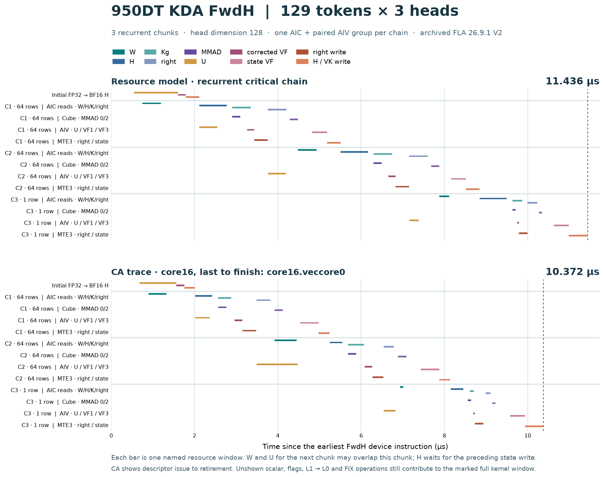

# KDA FwdH：把可以先发的读和必须等待的状态分开

FLA 26.9.1 的 `aclnnChunkKdaFwdV2` 依次启动 Prepare、FwdH、Finalize。FwdH 沿每个 head 推进循环状态。本实验保持三个阶段的分核、MMAD 和 VF 计数，以及 Prepare/Finalize 的 v0.23 时间。更改的是一条链内读、写、算怎样并行。所有时标先按芯片资源配置计算周期，再除以 1000f 转为微秒，f 为目标核 GHz。[分段实现](../../../development/validation/kda_prefetch24/model.py) · [冻结登记](register.json) · [逐 shape 和跨芯片结果](report.md)

## 为什么下一块 W、U 可以先读

每块最多 64 token。设块号 i、实际行数 nᵢ、key/value 维均为 128。Wᵢ、Uᵢ、Kgᵢ 是 Prepare 已经产生的输入，各为 256nᵢ B。Hᵢ 是上一块更新后写到 GM 的 128×128 BF16 状态，32 KiB。初态位于 FP32 VK 张量（64 KiB），中间状态保留 FP32 累加并传递 BF16 H；末块将 FP32 VK 写回。

在 T=129、H=3 的 DT 和 PR 上，保存每块状态的 AIV 与执行 MMAD 的 AIC 属于同一组。三个 W 描述符的 L1 目标地址都是 0，三个 Kg 都是 262144，H 和 right 共用 131072。U 读入同一 UB 地址 196608。真实二进制的这个通路能让前块计算/写回与后块读取同时进行。源码还包含仅供 `STATE_FP32 && SCALAR_G` 的另一种单头 W/K、U/g 双缓冲实现。本例的张量按 key 维提供 gk，实际地址确证了这里的固定槽排布。每个 H/right 的 GM 源地址与其生产者写目标一一对应。[官方发布源码与设备代码身份](../../kda-resource23/source-evidence.json) · [两芯片地址、发起和完成证据](cross-chunk-evidence.json)

| 从前块到后块，单位为周期 | DT 块 1→2 / 2→3 | PR 块 1→2 / 2→3 |
|---|---:|---:|
| 后块 W 发起 − 前块第二次 MMAD 发起 | −1 / +79 | −1 / +79 |
| 后块 U 发起 − 前块 right 写完 | +6 / +5 | +6 / +5 |
| 后块 H 发起 − 前块中间 H 写完 | +16 / +16 | +16 / +16 |
| 后块 W 读完至前块 H 写完仍可重叠 | 1300 / 1855 | 1453 / 2065 |
| 后块 U 读完至前块 H 写完仍可重叠 | 1256 / 2170 | 1521 / 2287 |

## 排程公式与参数

以 B(X) 表示指令或资源组开始，E(X) 表示完成。DMA 的服务时间使用 v0.23 冻结的路线价格 L(x)=a+x/b，其中 a 为本地响应固定周期，b 为有效字节/周期。目标配置可改变 MTE 带宽；同一活动组还要与其它组分享 L2 的吞吐。MMAD 延迟为固定前端周期加对齐的矩阵浮点工作量除以每核 Cube ops/cycle。VF 仍用算术指令记录及每核 FP32 算力估价。候选保留读写流量和 issued MMAD，只改变可见的依赖时间。[v0.23 全部原始价格](../../../configs/kda-fla-v2-26.9.1.json)

1. **第一次发起。** 初始 FP32 状态在 AIV 读、转 BF16、写 H₀；AIC 可并行发起 W₀。模型以 FwdH 首个 payload 为锚，首 W 晚 334.5 周期，取 24 个已合格历史窗的同组时标差中位数。U₀ 取初始 H 写完后 3 周期，历史样本一致。
2. **块 i 的第一次乘法。** Hᵢ 的读要等前一块产生 H；只要已释放 W 槽就能预读 Wᵢ。两个数据都在 L1 后，按 E₀=max(E(Wᵢ),E(Hᵢ))+L1→L0+MMAD₀+FIX 得到 WᵢHᵢ 的完成。MMAD₀ 维数为 (p,128,128)，p=16⌈nᵢ/16⌉。
3. **修正 value 与第二次乘法。** VF1 可在 max(E₀,E(Uᵢ)) 开始，完成后写修正 value 及 right，局部写服务单价包含这组描述符。Kgᵢ 有独立 L1 槽，模型在当前 MMAD₀ 发起时提交 Kg；rightᵢ 的读取等待 VF1 的写完成。第二次 MMAD 的输入到齐时间为 max(E(Kgᵢ),E(rightᵢ))，经过 L1→L0 后执行 (128,128,p)，再由 FIX 写给 AIV。
4. **递推状态与跨块搬运。** VF3 在第二次 FIX 和 state/gate 读都完成时计算新状态。后块 H 读受当前 H 写完约束。后块 U 读在当前 right 写完后 6 周期发起。后块 W 的发起使用当前第二次 MMAD 完成作为保守的槽释放时标；实际描述符可比它提前近一个 MMAD 时长。这个保守值能迁移到参数化 MMAD 延迟，未把 DT 上的提前量写成新芯片的固定值。
5. **整核与整次调用。** FwdH 用最大链时间与共享外存约束取大，三个串行设备窗相加。目标 AIC/AIV 核数决定可并发的 head 链。只有实际分配一条 sequence×head 链/工作组时启用新排程；同组多头的槽和交接顺序尚无独立鉴别证据，保留旧阶段估计并记录适用域。连续 64 行整块的三个在途时间戳整体平移时，可直接跳过重复块；尾块始终单独排程。

## 三块算例与真实流水

DT 输入 [1,129,3,3,128,128]，三条独立 head 链、每链 64+64+1 行。每条链发起 6 条 MMAD，整段共 18 条。图上每块四行，依次是 AIC 的 W/H/Kg/right 读、两次矩阵乘、AIV 的 U 读及纠正/状态 VF、right 和 H/VK 写。两面板以**该核函数所有物理核的首指令**为共同原点，虚线是完整设备窗的终点。lower 面板取最后退场核所在工作组，将同组 AIC 与承载该 head 的 AIV0 放在一起。图中省略的 L1→L0、FIX、控制与同步仍计入全窗。



DT 的 FwdH 从 13.306 µs 修正为 11.436 µs，实测 10.372 µs。第二、三块 MMAD₀ 仍各晚约 1009、1768 周期，说明图中的累积偏差尚未完全消除。PR 同形预测 11.459 µs，实测 11.079 µs。双端起始读价格均继承之前的资源价，同一调度在 DT 上的中间读与写更偏保守；现有证据不能把差异唯一归因到外存介质。[DT 每条时标与 SHA](dt-129-fwdh.json) · [PR 同轴图](pr-129-fwdh.png) · [PR 每条时标与 SHA](pr-129-fwdh.json)

真正独立的 T80/H1 横跨两块（64+16）。T145/H2 横跨三块（64+64+17）。950DT 最晚的 core16.veccore0 所在组，末块 MMAD₀ 在 14,306 周期发起，模型为 15,891 周期。H 的 MTE2 描述符实测持续 505 周期，峰值价格与响应构成的估计为 1,086 周期。这个局部差异是后段仍然高估的一个可见来源。[独立 DT 两块对照图](dt-80-independent.png) · [两块时标](dt-80-independent.json) · [独立 DT 三块对照图](dt-145-independent.png) · [三块 DT 时标](dt-145-independent.json) · [独立 PR 三块对照图](pr-145-independent.png) · [三块 PR 时标](pr-145-independent.json)

## 外推与使用边界

- 970DT 的频率、核数、带宽和算力来自芯片配置，本地指令响应和槽释放默认延续 950。三阶段的分核映射、未来编译模板、FP32 价格、缓存命中率和多头交错仍有不确定性。所有 970 结果均为外推。
- 历史上的短单块 DT 形状存在误差抵消。例如 T3/H1 单独 FwdH 的高估变小，但 Prepare 仍低估，三段合计随之进一步低估。评估同时列出每个阶段、三段 WAPE、最大误差和每个双端比值。
- Kimi K3 配置中 KDA 为 96 个头、头宽 128。取 attention TP=8，每卡 12 个头。常驻循环查询额外覆盖 B=1/8、每请求 32Ki/128Ki/256Ki 的逻辑形状，并保留独立请求边界。B=1 时每工作组一条链；B=8 时 96 条链会共享工作组，这一分支沿用旧估计。长序列没有相应 CA，不能作为独立精度样本。[模型配置](../../../configs/models/Kimi-K3.json)
- 首批 4 个预登记的独立观测覆盖两种新 shape。另行登记了八种新 shape 的双端采集，以同一冻结参数补足块边界和五块长链。累计文件按合格回执更新，列出实际样本数。CA 超时、输出不正确、ELF 或同步不合格时不产生可计分时间。[累计独立验证](supplement/report.md) · [续跑与预算](supplement/queue.md)
- 显式的 `implementation=fla_26_9_1_v2` API 返回资源预测和 `prefetch_timeline_cycles`。同一条递推链可读取代表块的时标；长序列的返回值标出真正的块号。60 组芯片/形状上的公开入口与原冻结候选逐阶段、逐时标一致。其中覆盖三种目标芯片、真实本地头数的长 prefill 外推和多头回退。[公共入口一致性与查询成本](public-parity.json)

可用仓库的阶段 JSON 在没有 CANN 的环境重画。复核物理地址需保留原机上的 trace。

```bash
python3 development/validation/kda_prefetch24/figure.py --snapshot \
  results/v0.24/kda-prefetch/dt-129-fwdh.json dt-129-fwdh
python3 development/validation/kda_prefetch24/report.py
```
