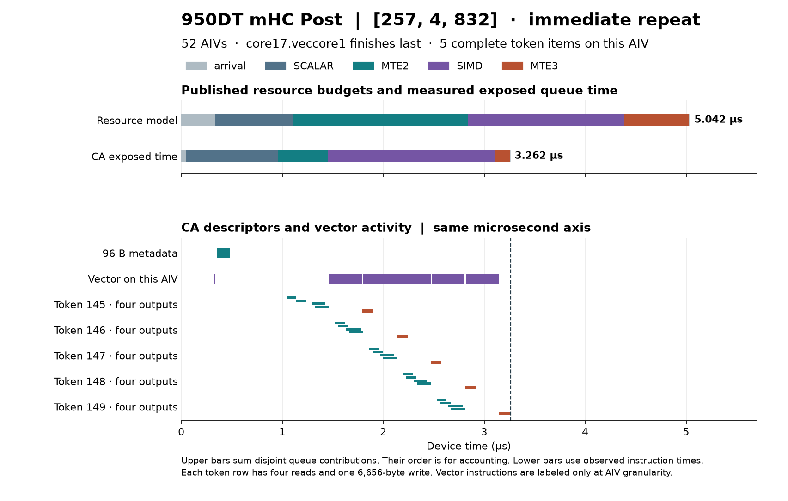

# 五轮 token 核的重复调用误差

950DT 上 [257,4,832] 的热态仍使用公开 v0.23 token 资源模型。下表按其校准时的原始规则给末核每个实际周期分配唯一的队列标签。多个队列同时在忙时依次优先记到 SIMD、MTE3、MTE2、SCALAR，未覆盖的时段归 other；最早设备指令到末核加入单独计 arrival。该分账适合精确核对预测贡献，不表示低优先级队列完全停顿。

| 贡献 µs | 模型 | CA 相同分账 | 模型 − CA |
|---|---:|---:|---:|
| arrival | 0.338 | 0.052 | +0.287 |
| SCALAR | 0.771 | 0.911 | -0.140 |
| MTE2 | 1.727 | 0.493 | +1.234 |
| SIMD | 1.550 | 1.658 | -0.109 |
| MTE3 | 0.645 | 0.143 | +0.502 |
| other | 0.010 | 0.005 | +0.005 |
| 全窗 | 5.042 | 3.262 | +1.780 |

| 末核真实轮次 / token | 首条系数读发起 µs | 本轮最后一笔操作数完成 µs | 写回发起 / 完成 µs | 写回字节 |
|---|---:|---:|---:|---:|
| 1 / 145 | 1.042 | 1.462 | 1.794 / 1.898 | 6656 |
| 2 / 146 | 1.524 | 1.802 | 2.134 / 2.241 | 6656 |
| 3 / 147 | 1.860 | 2.141 | 2.473 / 2.576 | 6656 |
| 4 / 148 | 2.196 | 2.476 | 2.808 / 2.918 | 6656 |
| 5 / 149 | 2.532 | 2.816 | 3.148 / 3.256 | 6656 |

全芯片的 257 笔写入对应完整连续输出，每笔 6,656 B。根据 GM 目的地址，最后完成的 core17.veccore1 写 token 145–149，每个 token 的四条输入地址分别按 64、16、1,664、6,656 B 前进，独立确认了 5 轮。首次到第二轮输入发起相隔 0.481 µs，后续三段发起间隔中位 0.336 µs。连续写回发起间隔中位 0.340 µs。第二轮首笔读 1.524 µs，早于第一轮写回完成 1.898 µs。流水实际重叠，直接把每轮响应时间相加会重复计费。

SIMD 指令仅能可靠归到该 AIV，图中单列。该证据能定位到固定开销、队列暴露时间和跨轮重叠，无法把软件调度、缓存或硬件发射中的单一因素确定为唯一根因。

[逐阶段、逐描述符与原始 trace 路径](multirow.json) · [v0.12 使用的分账实现](../../../scripts/wide-v10-trace.py)
