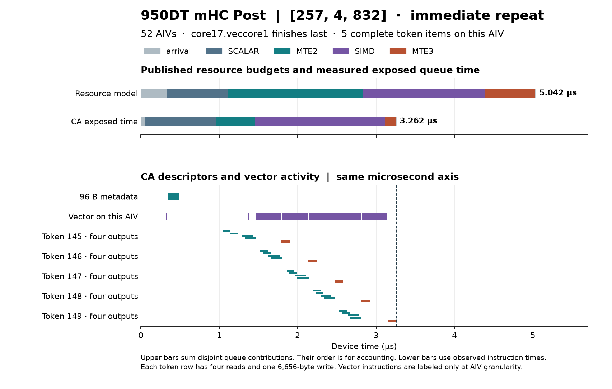
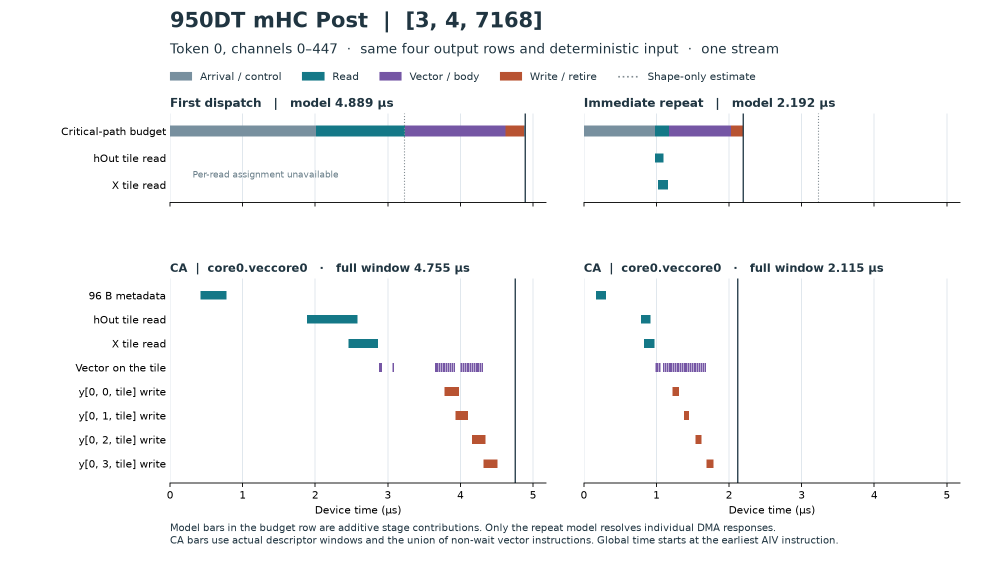

# 内置 mHC Post 的有序调用验证

| 芯片 / 本次协议 | 完整窗 | 候选 WAPE / 最大 | v0.23 WAPE / 最大 | 无前序 WAPE / 最大 |
|---|---:|---:|---:|---:|
| Ascend950DT_9582 / all | 21 | 11.93% / 54.57% | 13.84% / 54.57% | 40.05% / 76.94% |
| Ascend950DT_9582 / first | 4 | 5.07% / 8.07% | 3.65% / 5.00% | 30.52% / 38.26% |
| Ascend950DT_9582 / expand | 2 | 13.53% / 21.27% | 13.53% / 21.27% | 23.60% / 41.68% |
| Ascend950DT_9582 / reuse | 3 | 4.08% / 7.82% | 4.08% / 7.82% | 27.72% / 31.36% |
| Ascend950DT_9582 / immediate repeat | 10 | 18.30% / 54.57% | 25.10% / 54.57% | 60.73% / 76.94% |
| Ascend950DT_9582 / delayed revisit | 2 | 19.35% / 30.71% | 19.35% / 30.71% | 40.57% / 76.69% |
| Ascend950PR_957b / all | 22 | 12.19% / 51.95% | 15.37% / 51.95% | 39.00% / 78.11% |
| Ascend950PR_957b / first | 4 | 5.09% / 11.10% | 7.26% / 11.10% | 25.97% / 32.14% |
| Ascend950PR_957b / expand | 3 | 11.25% / 21.06% | 11.25% / 21.06% | 24.92% / 41.50% |
| Ascend950PR_957b / reuse | 3 | 3.26% / 5.89% | 3.26% / 5.89% | 25.68% / 29.62% |
| Ascend950PR_957b / immediate repeat | 10 | 20.51% / 51.95% | 28.60% / 51.95% | 63.91% / 77.73% |
| Ascend950PR_957b / delayed revisit | 2 | 19.16% / 31.78% | 19.16% / 31.78% | 41.93% / 78.11% |

冻结了每颗芯片 10 个新 shape、4 个独立进程、22 次调用。目前有 8/8 个进程回执，43/44 个完整设备窗。每个进程使用同一 aclrtStream，逐次计算单独的完整 BF16 输出金标。每端 10 组相邻重复；另有 2 次隔形回访。固定输入包含 T、四条残差流、宽度 D、dtype、芯片和可选前序。所有 970DT 数值均为外推。

这里的候选是冻结后的影子预测，尚未接入公开后端。v0.23 列是系统实际可调用的同流预测，无前序列也是现有公开行为。旧档案只用于阶段校准与选择要测试的假设，误差表只计注册之后的数据。遍查 1,329 份历史 JSON 结果清单时，仅 [1,4,192] 的形状在旧 v0.8 整链备用清单出现，既无对应运行目录亦无已发布实测；本次是首次可核验的独立 Post 实测。[形状查重](novelty.json)

新输入覆盖 1 至 257 个 token 和 192 至 7168 个通道。最大的 [257,4,832] 输出有 855,296 个 BF16 元素，按 4 条残差流的完整输入、系数和输出合计约 3.69 MiB；该点检验最长核多轮循环。5120 和 7168 来自 Flash、Pro 的真实隐藏宽度；实际 vLLM 路由可能选择另一套 HcPost。本批仅测库内置 Post，未取得整段 8×32k 至 8×256k 的 Post 全量窗口。

### 当前候选的可推广边界

| SKU / 事前注册路径 | 不同 shape / 窗口 | 影子 WAPE / 最大 | 公开 v0.23 WAPE / 最大 |
|---|---:|---:|---:|
| Ascend950DT_9582 / repeat operand schedule | 8 / 8 | 8.40% / 23.43% | 17.42% / 30.89% |
| Ascend950DT_9582 / first operand schedule | 1 / 1 | 8.07% / 8.07% | 1.82% / 1.82% |
| Ascend950DT_9582 / public resource stages | 9 / 12 | 13.66% / 54.57% | 13.66% / 54.57% |
| Ascend950PR_957b / repeat operand schedule | 7 / 7 | 9.16% / 26.55% | 21.35% / 31.50% |
| Ascend950PR_957b / first operand schedule | 1 / 1 | 0.48% / 0.48% | 10.25% / 10.25% |
| Ascend950PR_957b / public resource stages | 10 / 14 | 14.03% / 51.95% | 14.03% / 51.95% |

通道路线的相同输入紧邻重复有专门的 DMA 证据；实际调度需要同时知道前一调用的实现、形状与成功派发状态。token 冷发在本轮每端仅一个新实测入口。扩核、隔形回访、token 多轮热态，以及用户仅给 shape 的调用均沿用公开预测。保留冻结候选作为独立对照；局部状态的收益不能推及其他状态或通用 shape-only 默认值。

## 从调用上下文得到阶段与价格

当前流首次调用 H=0。超出同流历史最大使用核数 H 的后继为扩核，其他为可复用；成功派发后 H 更新为 max(H,A)。若紧邻调用的完整逻辑形状相同，且为通道分核路线，候选使用重复时观测到的发起、响应和交接成本。宿主每次重新构建张量；相同数值及调度合同不能证明物理地址和缓存命中相同。参数校准分开保留 90 个旧设备窗以及两端各一个旧同形重复，后者只有一个校准 shape。

实际 9.2.1 安装包调用 aclnnMhcPost，属于 ops_transformer/mhc_post_apt，BF16 结果为 FP32 累加后舍入。固定参考源码 9.1 的 arch35 AIV 分核与 UB 常驻机制用于解释数据复用；正式表以这次实际 ELF .text、内核名、核数和输出量为准。

每个末核拆成五段：全核首条至末核加入、末核首条至第一笔有效操作数 DMA 发起、第一笔发起至首条 SIMD 操作数 load、首条 SIMD load 至最后写描述符发起、最后写发起至末核退出。对于读窗口，$R=\max_j(I_j+(c_j+B_j k/1024)/F)+h/F$，$I_j$ 是从首笔开始累积的发起间隔（µs），$B_j$ 是端口描述符字节数，$k$ 是目标 MTE2 每 KiB 的服务周期，$c_j$ 是扣除端口服务后的固定响应周期，$h$ 是最后输入就绪到首个 SIMD 操作数的交接周期，$F$ 是目标频率（周期/µs）。通道路线先对齐 BF16 片宽再按一行/四行发起；token 路线实际使用四笔。

其余里程碑按共同的频率、每核向量吞吐、tile 片宽、每核轮数和活动核数定价。首发 token 路线有 4 个档案窗口直接测量相应分段；通道重复路线的固定段按两个旧端点该段的观测周期标定，沿用旧档案的服务斜率。若是其他状态，候选复用公开 v0.23 的资源阶段。所有状态同时应用共享 L2/HBM 物理下界。未提供历史时保留原公开的相对误差最小最大中心；此路径每对的两次预测必须相同。

[校准参数、单位对应项与冻结逐次预测](freeze.json) · [采集身份及预算](collection.json) · [对实际 v0.23.0 公共流的 132 次零差异复核](baseline-parity.json)

### 分段参数与单位

| 路线 / 前序 | 首行读次数 | 相邻发起间隔周期 | 固定响应周期 | 交接周期 | 标定窗 |
|---|---:|---|---|---:|---:|
| post_token / first | 4 | 154.00 / 248.00 / 49.00 | 677.35 / 529.21 / 593.90 / 607.10 | 28.00 | 4 |
| post_channel / repeat | 2 | 63.00 | 177.43 / 166.21 | 26.00 | 2 |

用目标芯片的本地 MTE2 带宽换算每 KiB 的服务周期。缺少该配置时使用 950 旧独立端口价 18.396 周期/KiB。上表的发起间隔和输入就绪交接取对应归一化 trace 周期的中位数，固定响应先扣除实际描述符字节的服务周期。

令 $s_f=1.65/f$，$s_v=(27/64)/(P_{32}/C_v)$，其中 $f$ 是目标 GHz，$P_{32}$ 是整芯片 FP32 向量 TOP/s，$C_v$ 是物理 AIV 数。下表截距以参考芯片微秒计，乘 $s_f$。到达阶段另加斜率乘 $s_f\,\log_2(A)/6$；主体阶段两项斜率分别乘 $s_v u\lceil K/64\rceil/32$ 与 $s_f(u-1)$。$A$ 是当前实际拟派发核数，$K$ 是单片宽度，$u$ 是最长核的轮数。控制和退出两段只有固定项。普通阶段斜率源于旧训练窗对应里程碑的非负稳健回归。

| 路线 / 前序 | 阶段 | 固定项 µs | 按列出的工作量单位计的斜率 µs |
|---|---|---:|---|
| post_token / first | arrival | 0.00000 | 0.43275 |
| post_token / first | control | 1.88048 | — |
| post_token / first | body | 0.06495 | 0.55404 / 0.26790 |
| post_token / first | retire | 0.21431 | — |
| post_channel / repeat | arrival | 0.00000 | 0.08844 |
| post_channel / repeat | control | 0.89818 | — |
| post_channel / repeat | body | 0.50707 | 1.58600 / 0.01000 |
| post_channel / repeat | retire | 0.16333 | — |

| 本轮配置 | AIV | GHz | 整芯片 FP32 Vector TOP/s | HBM GB/s |
|---|---:|---:|---:|---:|
| Ascend950DT_9582 | 64 | 1.65 | 27 | 4000 |
| Ascend950PR_957b | 56 | 1.65 | 23 | 1400 |
| Ascend970DT | 120 | 1.8 | 55.296 | 14400 |

输入配置的三种芯片均未指定 MTE2 实测速率，当前回退沿用上述独立服务价。970DT 使用 120 个 AIV 与 1.8 GHz、更换后的 FP32 Vector 峰值，UB 容量按参考配置继承；本轮没有其 CA 数据。[970DT 参数及来源](../../../configs/chips/Ascend970DT.json)

[宿主单流调用顺序](../../../smoke/vector_v8.cpp) · [完整输出金标](../../../smoke/extension_indexer_mhc.cpp)

## 每形状设备时间

| SKU | 协议 | [T,4,D] | 前序 H | 预测 / 实测 AIV | 候选 / CA µs | 差异 | v0.23 / 无历史 µs | 970DT 外推 µs | 内核入口 |
|---|---|---|---:|---:|---:|---:|---:|---:|---|
| 950DT | first | [1, 4, 192] | 0 | 1/1 | 4.755 / 4.528 | +5.0% | 4.755 / 3.082 | 4.358 | MhcPost …_5 |
| 950DT | immediate repeat | [1, 4, 192] | 1 | 1/1 | 1.889 / 1.742 | +8.4% | 2.280 / 3.082 | 1.731 | MhcPost …_5 |
| 950DT | expand | [2, 4, 448] | 1 | 4/4 | 4.211 / 5.349 | -21.3% | 4.211 / 3.120 | 3.860 | MhcPost …_5 |
| 950DT | immediate repeat | [2, 4, 448] | 4 | 4/4 | 1.970 / 1.899 | +3.8% | 2.313 / 3.120 | 1.806 | MhcPost …_5 |
| 950DT | immediate repeat | [8, 4, 896] | 32 | 32/32 | 2.015 / 2.030 | -0.8% | 2.313 / 3.120 | 1.847 | MhcPost …_5 |
| 950DT | delayed revisit | [1, 4, 192] | 32 | 1/1 | 2.280 / 1.744 | +30.7% | 2.280 / 3.082 | 2.090 | MhcPost …_5 |
| 950DT | first | [3, 4, 7168] | 0 | 48/48 | 4.889 / 4.755 | +2.8% | 4.889 / 3.232 | 4.389 | MhcPost …_5 |
| 950DT | immediate repeat | [3, 4, 7168] | 48 | 48/48 | 2.192 / 2.115 | +3.6% | 2.414 / 3.232 | 1.868 | MhcPost …_5 |
| 950DT | reuse | [5, 4, 5120] | 48 | 40/40 | 2.514 / 2.635 | -4.6% | 2.514 / 3.344 | 2.151 | MhcPost …_5 |
| 950DT | immediate repeat | [5, 4, 5120] | 48 | 40/40 | 2.353 / 2.091 | +12.5% | 2.514 / 3.344 | 1.917 | MhcPost …_5 |
| 950DT | reuse | [9, 4, 3840] | 48 | 36/36 | 2.682 / 2.686 | -0.2% | 2.682 / 3.529 | 2.243 | MhcPost …_5 |
| 950DT | immediate repeat | [9, 4, 3840] | 48 | 36/36 | 2.627 / 2.128 | +23.4% | 2.682 / 3.529 | 2.064 | MhcPost …_5 |
| 950DT | delayed revisit | [3, 4, 7168] | 48 | 48/48 | 2.414 / 2.747 | -12.1% | 2.414 / 3.232 | 2.120 | MhcPost …_5 |
| 950DT | first | [16, 4, 768] | 0 | 64/64 | 4.755 / 4.992 | -4.7% | 4.755 / 3.082 | 4.358 | MhcPost …_5 |
| 950DT | immediate repeat | [16, 4, 768] | 64 | 64/64 | 1.977 / 2.125 | -7.0% | 2.280 / 3.082 | 1.812 | MhcPost …_5 |
| 950DT | reuse | [29, 4, 320] | 64 | 58/58 | 2.280 / 2.473 | -7.8% | 2.280 / 3.082 | 2.090 | MhcPost …_5 |
| 950DT | immediate repeat | [29, 4, 320] | 64 | 58/58 | 1.972 / 2.116 | -6.8% | 2.280 / 3.082 | 1.808 | MhcPost …_5 |
| 950DT | first | [69, 4, 640] | 0 | 35/35 | 3.858 / 4.196 | -8.1% | 4.273 / 3.438 | 3.197 | MhcPost …_6 |
| 950DT | immediate repeat | [69, 4, 640] | 35 | 35/35 | 2.876 / 2.071 | +38.9% | 2.876 / 3.438 | 2.162 | MhcPost …_6 |
| 950DT | expand | [257, 4, 832] | 35 | 52/52 | 5.669 / 5.358 | +5.8% | 5.669 / 5.655 | 4.022 | MhcPost …_6 |
| 950DT | immediate repeat | [257, 4, 832] | 52 | 52/52 | 5.042 / 3.262 | +54.6% | 5.042 / 5.655 | 3.447 | MhcPost …_6 |
| 950PR | first | [1, 4, 192] | 0 | 1/1 | 4.758 / 4.282 | +11.1% | 4.758 / 3.085 | 4.358 | MhcPost …_5 |
| 950PR | immediate repeat | [1, 4, 192] | 1 | 1/1 | 1.893 / 1.736 | +9.0% | 2.283 / 3.085 | 1.731 | MhcPost …_5 |
| 950PR | expand | [2, 4, 448] | 1 | 4/4 | 4.215 / 5.339 | -21.1% | 4.215 / 3.124 | 3.860 | MhcPost …_5 |
| 950PR | immediate repeat | [2, 4, 448] | 4 | 4/4 | 1.976 / 1.888 | +4.7% | 2.317 / 3.124 | 1.806 | MhcPost …_5 |
| 950PR | expand | [8, 4, 896] | 4 | 32/32 | 4.215 / 4.137 | +1.9% | 4.215 / 3.124 | 3.860 | MhcPost …_5 |
| 950PR | immediate repeat | [8, 4, 896] | 32 | 32/32 | 2.020 / 2.020 | +0.0% | 2.317 / 3.124 | 1.847 | MhcPost …_5 |
| 950PR | delayed revisit | [1, 4, 192] | 32 | 1/1 | 2.283 / 1.732 | +31.8% | 2.283 / 3.085 | 2.090 | MhcPost …_5 |
| 950PR | first | [3, 4, 7168] | 0 | 48/48 | 4.895 / 4.773 | +2.6% | 4.895 / 3.239 | 4.389 | MhcPost …_5 |
| 950PR | immediate repeat | [3, 4, 7168] | 48 | 48/48 | 2.201 / 2.152 | +2.3% | 2.420 / 3.239 | 1.868 | MhcPost …_5 |
| 950PR | reuse | [5, 4, 5120] | 48 | 40/40 | 2.523 / 2.587 | -2.5% | 2.523 / 3.354 | 2.151 | MhcPost …_5 |
| 950PR | immediate repeat | [5, 4, 5120] | 48 | 40/40 | 2.367 / 2.068 | +14.4% | 2.523 / 3.354 | 1.917 | MhcPost …_5 |
| 950PR | reuse | [9, 4, 3840] | 48 | 36/36 | 2.695 / 2.745 | -1.8% | 2.695 / 3.544 | 2.243 | MhcPost …_5 |
| 950PR | immediate repeat | [9, 4, 3840] | 48 | 36/36 | 2.647 / 2.092 | +26.5% | 2.695 / 3.544 | 2.064 | MhcPost …_5 |
| 950PR | delayed revisit | [3, 4, 7168] | 48 | 48/48 | 2.420 / 2.724 | -11.1% | 2.420 / 3.239 | 2.120 | MhcPost …_5 |
| 950PR | first | [16, 4, 768] | 0 | 32/32 | 4.861 / 4.584 | +6.0% | 4.861 / 3.201 | 4.358 | MhcPost …_5 |
| 950PR | immediate repeat | [16, 4, 768] | 32 | 32/32 | 2.136 / 2.005 | +6.5% | 2.386 / 3.201 | 1.812 | MhcPost …_5 |
| 950PR | reuse | [29, 4, 320] | 32 | 29/29 | 2.157 / 2.292 | -5.9% | 2.157 / 2.684 | 2.090 | MhcPost …_6 |
| 950PR | immediate repeat | [29, 4, 320] | 32 | 29/29 | 2.157 / 1.633 | +32.0% | 2.157 / 2.684 | 1.808 | MhcPost …_6 |
| 950PR | first | [69, 4, 640] | 0 | 35/35 | 3.867 / 3.886 | -0.5% | 4.284 / 3.450 | 3.197 | MhcPost …_6 |
| 950PR | immediate repeat | [69, 4, 640] | 35 | 35/35 | 2.887 / 2.110 | +36.9% | 2.887 / 3.450 | 2.162 | MhcPost …_6 |
| 950PR | expand | [257, 4, 832] | 35 | 52/52 | 5.707 / 5.253 | +8.6% | 5.707 / 5.694 | 4.022 | MhcPost …_6 |
| 950PR | immediate repeat | [257, 4, 832] | 52 | 52/52 | 5.080 / 3.343 | +52.0% | 5.080 / 5.694 | 3.447 | MhcPost …_6 |

## 决定误差的阶段

Ascend950DT_9582 的 9 个详细阶段窗中，首读发起至首条 SIMD load 的有符号中位差为 -0.012 µs，SIMD load 至最后写发起则为 -0.022 µs。此组相对误差最大的 [9, 4, 3840]（immediate repeat）中，绝对偏差最大的阶段是 body，模型 1.251 µs，末核实测 0.861 µs。
Ascend950DT_9582 在 21/21 个完整窗预测正确分核。
Ascend950PR_957b 的 8 个详细阶段窗中，首读发起至首条 SIMD load 的有符号中位差为 -0.003 µs，SIMD load 至最后写发起则为 +0.020 µs。此组相对误差最大的 [9, 4, 3840]（immediate repeat）中，绝对偏差最大的阶段是 body，模型 1.271 µs，末核实测 0.827 µs。
Ascend950PR_957b 在 22/22 个完整窗预测正确分核。

同一个 [29,4,320] 重复调用可检验核数改变引发的路线差异。

| SKU | 预测路线 | 单核片宽 | 预测 / 实际 AIV | 安装包入口 | 重复预测 / CA µs |
|---|---|---:|---:|---|---:|
| Ascend950DT_9582 | post_channel | 160 | 58 / 58 | …_5 | 1.972 / 2.116 |
| Ascend950PR_957b | post_token | 320 | 29 / 29 | …_6 | 2.157 / 1.633 |

[逐里程碑误差](stage-errors.json)

## 状态可辨识性与成本

Ascend950DT_9582 的 9 对相同输入中，任意无前序单值最坏误差下界最高为 47.60%（(2, 4, 448)，两次实测 1.899/5.349 µs）。给同一长期分布而无顺序仍会丢失这一信息。
Ascend950PR_957b 的 10 对相同输入中，任意无前序单值最坏误差下界最高为 47.76%（(2, 4, 448)，两次实测 1.888/5.339 µs）。给同一长期分布而无顺序仍会丢失这一信息。

这一压力组只包含同族 Post 的连续、扩核和隔形调用。旧生产链 Pre→Sinkhorn→Post 的 950PR 组在 10 个不同 shape 上无前序 WAPE 为 6.93%，其终点的输入来自其他 kernel。该历史结果只描述生产者前序分布，与本轮首发/同族热态两端的误差分别使用自己的分母。[历史生产链回放](../../v0.22/post-stream/report.md)

按相同调用的 DT 时间 / PR 时间计算 21 个加速比，影子模型的比值 WAPE / 最大为 4.55% / 29.42%，公开 v0.23 为 3.73% / 18.41%。比值误差最大的 [29, 4, 320]（immediate repeat），实测 DT/PR = 1.296，候选 0.915，旧版 1.057。两端分核与具体函数不同，当前重复通道修正只作用在一端，跨芯片相对优势出现反向。两端总 WAPE 的改善与跨芯片相对误差的退化应同时保留。

预载配置/参数的单次候选查询 264 次，墙钟中位 0.0205 ms、P95 0.0369 ms、最大 0.2918 ms。冻结时首次候选查询最大 0.3784 ms。上述 8 个采集进程累计 30.8 分钟宿主墙钟，原始总量 9.11 GiB。

[完整冻结同集评分与逐核原始证据入口](evaluation.json) · [实时状态](status.json)

### 五轮 token 热态的负例

950DT [257,4,832] 的末核 core17.veccore1 完整处理 token 145–149。分核和轮次均正确，公开预测与影子均为 5.042 µs，CA 为 3.262 µs。按同一组互斥队列标签记账，MTE2 高估 1.234 µs、MTE3 高估 0.502 µs；二者解释总差 1.780 µs 的主要部分。五轮确实传输了全部输入和输出，跨轮重叠使实际暴露在关键路径上的搬运时间减少。

[按真实 GM 地址与指令排序核验的五轮里程碑和分账](multirow.md)

从 1 扩到 4 个 AIV 的 [2,4,448] 在两端实际最晚完成的都是新启用的 core16.veccore1。旧档案也观察到只有一个前序 AIV 时，末核加入较其他扩核慢；新区分只是单次观测到的调度轨迹，物理域被激活的时间与芯片的缓存命中率不能据此等同。隔形回访保留旧策略，与相邻输入重复单独比较。[逐次活动核、兄弟核、最后完成的核](topology.md)

### 独立核查每核的物理指令窗口

用同一口径重读 44 次调用。从所有活动 AIV 最早 ELF 入口指令到最后真实指令完成，对每个核核对已安装代码中的 END、输出写字节和官方表。1 次缺少至少一个软件生成的 END_LABEL。这个补充时钟统一排除人为标签，并单独评分，与预注册的含标签窗口有 43 次重叠，两种计时的最大差为 0.00182 µs。
Ascend950DT_9582 物理窗 22 个，候选 WAPE / 最大 11.21% / 54.65%，v0.23 13.03% / 54.65%，无前序 39.24% / 77.12%。
Ascend950PR_957b 物理窗 22 个，候选 WAPE / 最大 12.22% / 52.03%，v0.23 15.41% / 52.03%，无前序 39.05% / 78.29%。

[独立物理 END 收据索引](physical-summary.json)

[384 B 分片与逐行地址证据](small-figure-data.json)

[行及通道地址映射和图上的数据](figure-data.json)

## 结论

两端均达到 10 个不同新 shape，冷发、核扩展、紧邻热态和多轮执行已分别实测。有前序时，通道路线的立即重复得到改善；大 token 热态的最大误差和跨芯片分块边界仍限制推广。公开 v0.23 同流预测继续作为系统入口，候选仅作为影子验证。44 个完整物理窗已支撑不同状态的比较，使用过的留出集在后续方法调整中应改列为开发证据。
