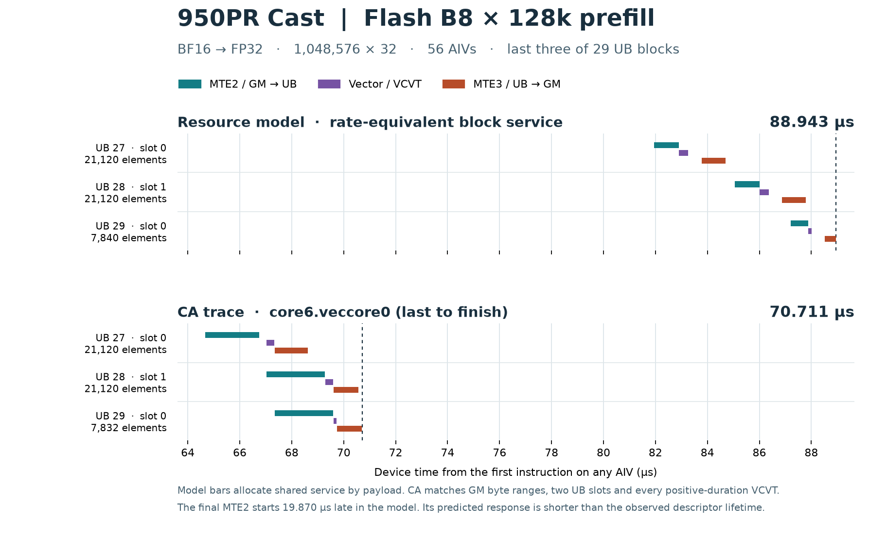
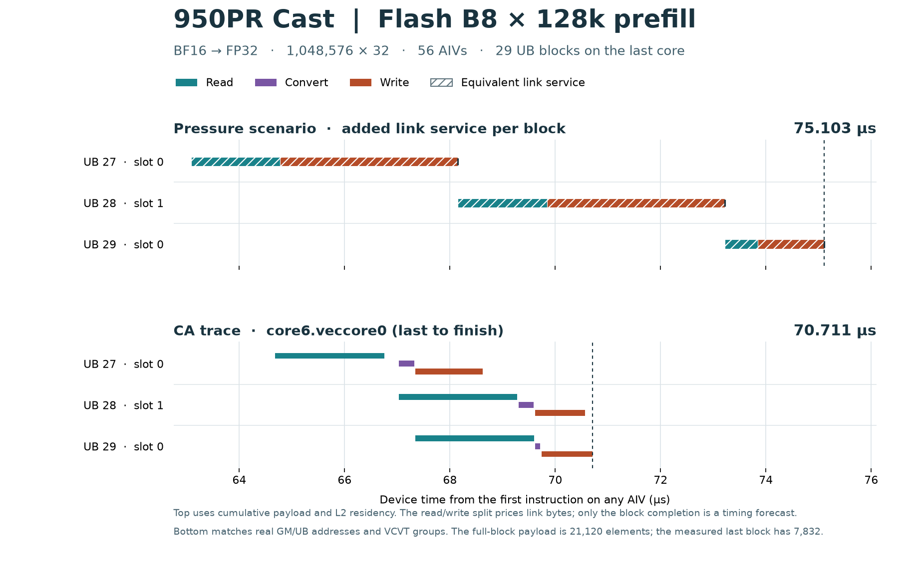

# 大 prefill 越过 L2 容量时，Cast 和 Sigmoid 的误差来自哪里

950PR 的两个 Cast 开发窗口里，当前预测将耗时高估 25.8% 和 29.9%。Flash B8×128k 的误差在末块读开始前已经形成。全核输入地址也给出了一个比总耗时更严格的约束。Sigmoid [1572864,12] 的 72 MiB 连续输入在 51.411 µs 的读描述符窗口内返回，折算为 **1,468.5 GB/s**，比该 SKU 配置中推定的 1,400 GB/s 高 4.9%。这说明单靠调节脏输出留驻比例，无法同时解释冷读、固定带宽和全部阶段的时间。两种资源价格已在一对同总数据量的新 shape 上冻结，待前序大任务完成后开展双端独立验证。[全核读窗口](sigmoid_fp32-1572864x12-Ascend950PR_957b-traffic.json) · [芯片参数与来源](../../../configs/chips/Ascend950PR_957b.json) · [独立验证队列](state.json)

| 算子 | 芯片 | L2 至 2×L2 完整旧窗 | 当前 WAPE | 压力情景 WAPE | 当前 / 情景最大绝对误差 |
|---|---|---:|---:|---:|---:|
| Cast BF16→FP32 | 950PR | 2 | 27.60% | 5.51% | 29.95% / 6.21% |
| Sigmoid FP32 | 950PR | 2 | 21.53% | 5.24% | 26.96% / 5.67% |
| Cast BF16→FP32 | 950DT | 3 | 4.28% | 4.28% | 5.48% / 5.48% |
| Sigmoid FP32 | 950DT | 2 | 6.72% | 6.72% | 7.52% / 7.52% |

WAPE = Σ|预测−CA|/ΣCA。上表均为既有合格窗口上的开发回放。PR 超过 2×L2 的另外四个 Cast 窗口，WAPE 从 5.47% 变为 2.31%。PR 小于等于 L2 的 25 个 Cast、18 个 Sigmoid 窗口，两个情景给出相同结果。相同输入和相同 trace 在同一算子内只计一次。[按区间与芯片完整统计](replay.json)

## Flash B8×128k 实际末核

八条 131,072-token 序列在本例不切 chunk，共有 1,048,576 行。每行是 Flash indexer 的 32 个系数；一次 BF16→FP32 转换读 64 MiB、写 128 MiB。56 个 AIV 运行一个 stock `aclnnCast`，全部 33,554,432 个输出逐位通过。正式全核窗是 70.711 µs；采集墙钟 1,216.5 s。离线复用原始分片绘图，新采 CA 为零。[原始回执](../../v0.20/large/cast_1048576_32_Ascend950PR_957b.json)

从全部活动核的指令窗选取最后退出的 `core6.veccore0`。读取两种 DMA 的 GM 连续地址和两个交替 UB 地址。逐块按 BF16、FP32 字节比和正耗时 VCVT 次数复核。第 29 块实际 7,832 个元素，模型按 16 元素对齐估 7,840 个。设备原点固定为任一核最早指令。上栏将当前模型的共享服务时间按各块负载摊分，下栏是实际 DMA 描述符发起至退休以及同组首末 VCVT。前 28 块各 21,120 个元素。[末三块地址、ELF、分片 SHA 和完整差值](flash-128ki-pr-tail.json)

| UB 块 | CA 读起止 µs | CA 写起止 µs | 模型读起点差 µs | 读描述符时长差 µs | 模型写起点差 µs | 写描述符时长差 µs |
|---|---|---|---:|---:|---:|---:|
| 27 | 64.680–66.755 | 67.346–68.622 | +17.266 | −1.119 | +16.426 | −0.355 |
| 28 | 67.029–69.281 | 69.614–70.569 | +18.016 | −1.296 | +17.257 | −0.034 |
| 29 | 67.345–69.596 | 69.742–70.705 | +19.870 | −1.585 | +18.783 | −0.545 |

正号表示模型更晚或时长更长。首块读发起差 −0.00026 µs，第 15 块已经晚 17.918 µs。末块写退休差 +18.238 µs，与全核误差 +18.232 µs 相差 0.006 µs。缩短单次 DMA 响应时长会进一步低估已观察到的末块响应。

## 全核逻辑流量能排除什么

对每个原始分片解析正耗时的 GM→UB 和 UB→GM 指令。以 GM 地址配对、排序并验证唯一连续张量覆盖，单独保留元数据访问。用每核实际 END 或该 END 前对应的最终 DCI、END_LABEL 退休和官方表恢复同一时间原点。本次九个窗口的每核原点极差均小于 0.013 个时钟。读窗口是所有输入描述符最早发起至最晚退休。若输入全冷、无预取，所有载入均在这个窗口内从片外服务，则实际有效读带宽至少为“全输入字节 / 读窗口”。这个条件下必须先满足读带宽，才有余量服务写回。

| 950PR 算子与 shape | 输入 / 输出 MiB | 首读 / 末读退休 µs | 全段逻辑读 GB/s | 当前估计片外写 MiB | 1,400 GB/s 下从首读至末个 DMA 退休可留给写的 MiB |
|---|---:|---|---:|---:|---:|
| Cast [4096,7168] | 56 / 112 | 0.959 / 53.351 | 1,120.8 | 37.33 | 15.63 |
| Cast [1048576,32] | 64 / 128 | 0.944 / 69.596 | 977.5 | 53.33 | 29.14 |
| Sigmoid [1572864,12] | 72 / 72 | 1.599 / 53.010 | 1,468.5 | 16.00 | −1.54 |
| Sigmoid [2097152,12] | 96 / 96 | 1.591 / 87.889 | 1,166.5 | 40.00 | 20.15 |

最后一列用预设接口上限乘设备窗口，再减逻辑输入量。负数表明该组假设本身不能成立。原 950PR log 明确装入 `lpddr5_6400M_bailu.ini`；现有归档缺少可与这四个窗口对时的物理控制器计数。脏行可能在核返回后才写回，输入也可能已有留驻或预取。因此 MTE3 指令覆盖的逻辑字节和退休时间不能认定为对应的物理 DDR 事务。950DT 五个既有样本可分别从 128 个物理控制器获得冷读和脏写计数，例如 Flash 同形完整进程测得 64.044 MiB 读、30.833 MiB 写。[DT 控制器原始统计](../../cast-capacity/controller-periods.json) · [PR Flash 全部地址范围](cast_bf16_fp32-1048576x32-Ascend950PR_957b-traffic.json)

## 用于独立验证的资源模型

设一次连续、单遍、异地写回的算子逻辑读写分别为 X、Y 字节，C 为芯片 L2 容量，R=min(C,X+Y)，q=Y/(X+Y)。当前模型将 Rq 字节输出留在 L2。压力情景保留的脏输出为 D=min(Y,R−R(1−q)ρ)，其中 ρ=min(1,B/I)。B 是目标芯片配置的片外 GB/s，I 是目标芯片全部活动 AIV 的混合请求发起上限，当前按 30 B/(AIV·cycle) × 活动 AIV 数 × GHz 并乘明确配置的本地端口速率比例。总片外流量估为 X+Y−D。解释是片外系统相对输入发起慢时，允许较早回收用完的清洁行以减少脏写。这是此前 Cast 容量敏感性的物理假设，本轮保留已有通用的 30 B/(AIV·cycle)，并用于所有 SKU 和两个算子。没有把新 shape 的时延回归当作参数。清洁行立即回收的极端情景 D=min(Y,R) 给出更乐观的列作对照。[参数实现](../../../development/validation/cache25/shadow.py) · [先前容量假设](../../cast-capacity/report.md)

| 950PR 开发 shape | 当前 µs | 压力情景 µs | CA µs | 压力情景估计片外写 MiB |
|---|---:|---:|---:|---:|
| Cast [4096,7168] | 70.967 | 57.128 | 54.612 | 18.855 |
| Cast [1048576,32] | 88.943 | 75.103 | 70.711 | 34.855 |
| Sigmoid [1572864,12] | 69.041 | 57.465 | 54.379 | 0.000 |
| Sigmoid [2097152,12] | 104.717 | 84.187 | 88.593 | 12.283 |

对于 Cast，再计算进度 z 下的外存成本：把公式中的 X、Y 换成 zX、zY。z 是忙核累计完成元素数/该核全部元素数，假设活动核在该块序号上进度近似均衡。第 i 块完成时间取本地双槽流水终点、片外进度时间、L2 服务时间三者最大值。片外进度时间包含既有 1,753 周期的启动项；在给定芯片上，每前进一块都重新计算该块之前所需服务的总字节数。在最后三块片外时间主导，图上栏的斜线条长是各块新增的读、溢出写字节除以共享带宽。条内分色表示账面成本，竖线为预测完成时刻。实际硬件可并行读写。

Flash 29 块全部写退休时刻的平均绝对偏差，原均匀分摊为 10.09 µs，按前缀累计、保留同一均匀留驻假设为 5.64 µs，按前缀累计并采用压力情景为 6.95 µs。后者在第 27–29 块的完成误差分别为 −0.47、+2.65、+4.40 µs。总耗时更准的候选在所有块的平均时间上仍有损失。运行时最终耗时计算保持 O(1)；离线可视化才逐块展开。[逐块完整回放](prefix-replay.json)

## 预先冻结的新形与成本

两形均为 156 MiB，只改变读写比例和算子。从当前账本排除了与既有样本相同的 shape 及相同展平元素数。两端之间保持相同的 API、dtype、输入模式、输出校验和官方设备 ELF。表中数字均为采集前预测。

| 新 shape | 950DT 当前 / 压力 µs | 950PR 当前 / 压力 µs | 970DT 压力情景外推 µs |
|---|---:|---:|---:|
| Cast [851968,32]，52 / 104 MiB | 25.02 / 25.02 | 61.98 / 48.14 | 14.07 |
| Sigmoid [1703936,12]，78 / 78 MiB | 34.20 / 34.20 | 78.31 / 62.41 | 16.25 |

后台每次启动一个官方 CA，等待既有 Pro 和 Flash 全 hidden 队列结束，后者已有 Kimi 前序。每次限 90 分钟 / 16 GiB，保留真实内存后端、全输出数值、ELF、活动核官方表和实际 END。额外尝试保留 profiler 清理前的控制器日志，若缺失则物理流量列保留 N/A。三个资源情景一起计算，101 次热查询中 Cast 和 Sigmoid 的中位数分别为 0.115 和 0.119 ms。独立结果按各算子与芯片在本目录生成 `*-result.json`，每核地址稽核为 `*-prospective-traffic.json`。[总预测和预算冻结](freeze.json) · [Cast 逐块前向预测冻结](prefix-forecast.json) · [进度](state.json)
