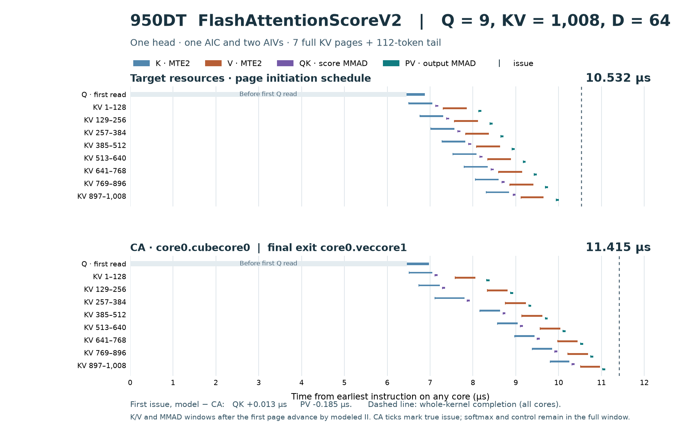

# Dense BF16 FA 的统一资源排程

| 数据角色 | SKU | 不同形 / 窗口 | v0.24 WAPE / 最大 | 当前 WAPE / 最大 |
|---|---|---:|---:|---:|
| development replay v0.25 | 950DT | 35 / 40 | 2.20% / 23.15% | 1.61% / 12.43% |
| prospective v0.25 | 950DT | 3 / 3 | 16.36% / 21.77% | 7.56% / 9.84% |
| development replay v0.25 | 950PR | 41 / 41 | 5.61% / 17.72% | 5.61% / 17.72% |
| prospective v0.25 | 950PR | 3 / 3 | 7.42% / 9.88% | 7.42% / 9.88% |

公共接口 `estimate("fa", [Q,KV,D,B,H], chip=…)` 对每块目标芯片都将 QK、PV、softmax、搬运和发起间隔分别计价。v0.24 在参考 DT 上转用了历史局部定价器，在目标 PR 上使用资源排程，相同芯片参数仅改名都可能换时间。本次复用已经冻结的资源公式，v0.24 显式 calibrated 路径仍可复算。

## 单个 KV 页怎样计时

以下以独立输入 [9,1008,64,1,1] 为例。Q 为一次校验的 query 数，KV 为有效上下文，D 为 head_dim，B、H 分别为本 rank 的请求数和本地头数。分核得到一个 AIC、两个 AIV，8 个 KV 页依次为七个 128 和一个 112。每页有 QK、PV 两项 MMAD，实测整次共 16 条。

每项 MMAD 的服务周期等于固定发起响应加上 2·pad16(Q)·pad16(KV页)·pad16(D) / 每核 Cube ops/cycle；pad16 是上取 16 对齐。K/V 请求按实际有效字节除以本地和共享预算中较小的可用带宽。首 QK 需要 Q/K 和 L0；首 PV 要等 V 及 QK/softmax 生产者。后续页的发起周期 II 取 Cube、Vector、MTE2、MTE1、FIX、前端六项服务需求的最大值。所有服务均使用目标芯片配置，时钟周期除以频率变成微秒。实际库合同为 aclnnFlashAttentionScoreV2、BF16 SBH dense noncausal，无 mask。

时间零点为全核第一条设备指令，虚线标记最后核退出。950DT 首 QK 模型/CA 为 7.128 / 7.115 µs，首 PV 为 8.138 / 8.323 µs。末页 PV 发起为 9.948 / 11.028 µs。预期间隔 0.259 µs，实测 8 次 QK/PV 发起的相邻间隔中位数分别是 0.408 / 0.409 µs。首发已经接近，短页流水中的间隔和同步仍低估；从整窗差值无法区分发起端与下游反压的份额。代码段、逐页尺寸、指令 PC 和原始 SHA 见配套数据。[每条实际/预测时标及覆盖范围](fa-dt-1008-pages.json)

| SKU | Q / KV / D / B / H | AIC/AIV | MMAD | v0.24 / 当前 / CA µs | 970DT 外推 µs | CA 秒 |
|---|---|---:|---:|---:|---:|---:|
| 950DT | [9, 1008, 64, 1, 1] | 1/2 | 16 | 13.899 / 10.532 / 11.415 | 9.676 | 98.5 |
| 950PR | [9, 1008, 64, 1, 1] | 1/2 | 16 | 10.533 / 10.533 / 10.915 | 9.676 | 102.4 |
| 950DT | [17, 895, 64, 1, 2] | 2/4 | 28 | 13.288 / 10.328 / 11.455 | 10.417 | 112.7 |
| 950PR | [17, 895, 64, 1, 2] | 2/4 | 28 | 10.329 / 10.329 / 11.462 | 10.417 | 142.7 |
| 950DT | [33, 319, 128, 1, 1] | 1/2 | 6 | 10.604 / 10.057 / 9.610 | 10.202 | 80.5 |
| 950PR | [33, 319, 128, 1, 1] | 1/2 | 6 | 10.086 / 10.086 / 9.252 | 10.202 | 88.4 |

| shape | DT/PR 旧 | DT/PR 当前 | DT/PR 实测 |
|---|---:|---:|---:|
| [9, 1008, 64, 1, 1] | 1.3196 | 0.9999 | 1.0458 |
| [17, 895, 64, 1, 2] | 1.2865 | 0.9999 | 0.9994 |
| [33, 319, 128, 1, 1] | 1.0514 | 0.9971 | 1.0387 |

双端耗时比 WAPE 18.60% → 2.85%，快慢方向 2/3 → 1/3。新模型在这三种低占用 shape 上预测 DT/PR 接近 1；两个形状真实 DT 慢约 4%，约束条件超出本地峰值能够区分的范围。历史 950DT [64,320,128,1,1] 则由旧版约 +9.0% 扩大到 +12.43%，已保留在全路线逐窗表。

六次串行 CA 共 625.2 秒；每个 shape/SKU 的公开入口各重跑 25 次，最大单次 0.150 ms。24 个实际核窗口均有唯一物理 END，与正式 duration 和聚合窗口一致，六端实际设备 ELF 均与既有正式 FA 家族一致。长 KV / 真实模型稀疏合同属于另外的覆盖问题。[逐核结束与 ELF](fa-physical-windows.json) · [事前封存](fa-freeze.json) · [精确计算结果](fa-scores.json) · [全路线总表](report.md)
