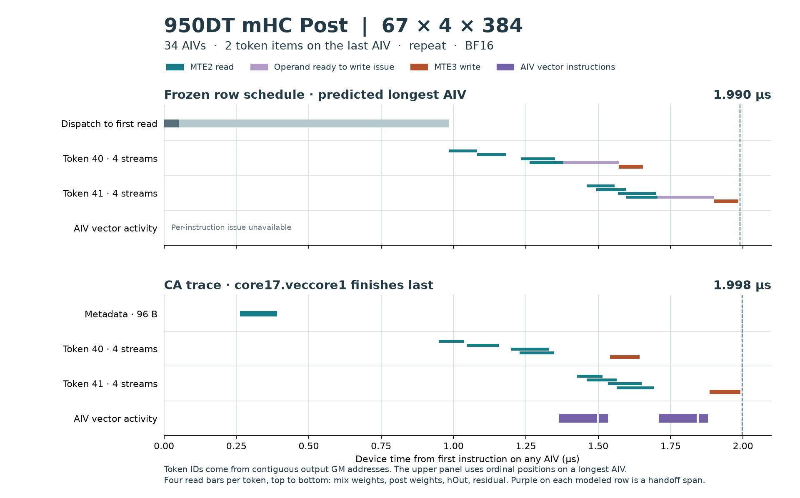
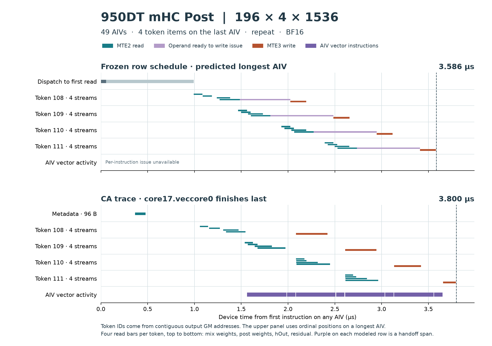

# 内置 mHC Post 的 token 循环流水

| 芯片及已知前序 | 独立窗 / 不同 shape | 逐行候选 WAPE / 最大 | 当前公开 v0.24 | 上轮 v0.24 影子 | 不传前序的逐行候选 | 不传前序的公开模型 |
|---|---:|---:|---:|---:|---:|---:|
| Ascend950DT_9582 / all | 8 / 5 | 10.61% / 27.59% | 29.17% / 63.28% | 29.97% / 63.28% | 25.12% / 43.60% | 46.52% / 79.81% |
| Ascend950DT_9582 / first | 2 / 2 | 10.53% / 13.48% | 7.84% / 8.07% | 10.08% / 12.35% | 38.22% / 43.60% | 17.80% / 31.25% |
| Ascend950DT_9582 / reuse | 2 / 2 | 21.42% / 27.59% | 37.57% / 56.88% | 37.57% / 56.88% | 9.37% / 9.75% | 56.05% / 72.75% |
| Ascend950DT_9582 / repeat | 4 / 4 | 3.58% / 5.62% | 43.28% / 63.28% | 43.28% / 63.28% | 23.41% / 32.25% | 66.70% / 79.81% |
| Ascend950DT_9582 / one-row | 2 / 1 | 10.92% / 13.48% | 13.11% / 24.53% | 16.08% / 24.53% | 38.80% / 43.60% | 38.80% / 55.93% |
| Ascend950DT_9582 / multi-row | 6 / 4 | 10.52% / 27.59% | 33.64% / 63.28% | 33.84% / 63.28% | 21.30% / 34.27% | 48.67% / 79.81% |
| Ascend950PR_957b / all | 6 / 3 | 2.39% / 6.67% | 16.78% / 46.39% | 17.57% / 46.39% | 28.33% / 33.07% | 31.04% / 69.85% |
| Ascend950PR_957b / first | 1 / 1 | 0.75% / 0.75% | 2.60% / 2.60% | 6.35% / 6.35% | 33.07% / 33.07% | 25.25% / 25.25% |
| Ascend950PR_957b / expand | 2 / 2 | 4.22% / 6.67% | 11.15% / 15.44% | 11.15% / 15.44% | 24.24% / 29.70% | 11.64% / 17.53% |
| Ascend950PR_957b / repeat | 3 / 3 | 1.15% / 1.79% | 31.89% / 46.39% | 31.89% / 46.39% | 30.44% / 31.76% | 57.76% / 69.85% |
| Ascend950PR_957b / multi-row | 6 / 3 | 2.39% / 6.67% | 16.78% / 46.39% | 17.57% / 46.39% | 28.33% / 33.07% | 31.04% / 69.85% |

两端各冻结 10 个不同形状，每个形状相邻调用两次。当前有 3/8 个进程回执、14/40 个合格全窗。每个进程使用新设备流，实际 ELF 来自 CANN 9.2.1 的 ops_transformer/mhc_post_apt，宿主接口为 aclnnMhcPost。核数、物理 END、官方逐核时长、逐核 END_LABEL、有效写回总字节和全部输出元素每次独立核验。候选尚在影子评估中。

注册前共扫描 1433 份历史结果，所有新形的结果 shape 字段均无命中。测试 T=57…449，D=192…5120，D=5120 对应 DeepSeek V4 Flash 的隐藏宽度。[完整输入与原始冻结价格](freeze.json) · [历史查重](novelty.json)

已完成样本中，最大偏差为 Ascend950DT_9582 的 [67, 4, 384]（reuse），预测 3.071 µs，CA 2.407 µs，有符号偏差 +27.59%。

## 通用机制与参数

给定同流上一条算子的已知驻留核数 H，以及是否紧邻相同调用，分别选择首次、扩核、普通复用或原样重复。A 是计划活动 AIV 数，R 是最长核分配的 token 行数。只有按 token 分核且 N=4 才使用这一候选。每行从 GM 读四组输入，其字节数为 $B=(64,16,2D,8D)$，写出 $8D$ 字节。已有完整逐指令导出可以将四组读和单笔写按 GM 地址步进对应到相同 token。

以周期为单位。首行读发起为 $r_0=a\log_2 A+c$，$a$ 是末核加入随活动核数的成本，$c$ 是末核加入到有效操作数发起。行内第 j 笔读在 $r_i+o_j$ 发起，$o_j$ 为该端口相邻发起间隔的累加。数据全部就绪于 $r_i+L_i$，$L_i=\max_j(o_j+h_j+B_j k_2/1024)$；$h_j$ 是该描述符的固定响应，$k_2$ 是目标 MTE2 每 KiB 服务周期。

首笔写 $w_0=r_0+L_0+b_0+g\lceil D/64\rceil v$。$b$ 是输入就绪到写发起扣除每组算术后的固定交接，$g$ 从真实 FP32 数据操作数就绪到该行写发起的 DB 时刻鲁棒拟合，当前每 64 通道约 31.78 周期。$v$ 为参考与目标每 AIV 每周期 FP32 算力比。首轮/后续轮分别使用各自端口固定响应与交接。首至次轮的读、写发起间隔独立于稳态间隔。

之后的行使用 $r_i=r_1+(i-1)I_r$，$w_i=\max(w_1+(i-1)I_w,r_i+L_s+b_s+g\lceil D/64\rceil v)$。发起间隔同时受向量与 MTE 服务下界约束。最后排空一笔 $h_w+8Dk_3/1024$ 的写响应和少量可观测的退出尾项。公开 v0.24 的全芯片 L2/HBM 字节下界仍独立取最大值。若缺 MTE 端口带宽则沿用 950 的每 KiB 周期；含 HBM 的实际共享峰值、核数和频率来自目标芯片文件。该闭式计算与 token 行数无关。

固定响应、间隔、首轮/稳态之间的差异均来自真实描述符记录，延迟扣除了对应字节服务。已知的进程/形状用整组剔除复核。D=5120 远超多轮拟合常见宽度；资源或 kernel 行为出现变化时只能据独立测量判定。紧邻重复代表可见的流关系，相同输入可由新物理分配承载，无法据此单独证明芯片命中缓存。970DT 没有 CA，全部数值为外推。

目前 14/14 个合格窗观察到的安装包 kernel 分支与预测路线一致，14/14 个的实测活动核数与模型相符。每行对应的完整 kernel 名和 trace 身份在逐形 JSON。

## 开发档案回放

| 状态 | 窗口 | 公开模型 WAPE /最大 | 候选 WAPE / 最大 |
|---|---:|---:|---:|
| all | 31 | 13.10% / 54.57% | 11.27% / 55.85% |
| first | 6 | 5.88% / 10.69% | 3.94% / 7.43% |
| expand | 4 | 8.89% / 16.04% | 10.75% / 40.99% |
| reuse | 16 | 9.37% / 19.31% | 15.64% / 55.85% |
| repeat | 5 | 45.27% / 54.57% | 7.72% / 13.73% |

这 31 窗已经参与建模，评分时剔除了所评全形状的两端窗口以及本次被测进程。首次、普通热态与原样重复分开考察。相同样本用途与冻结后的新批次在表中独立列出。[阶段校准代码](../../../development/validation/post25/calibrate.py) · [逐段价格](prices.json) · [开发窗口及对照](archive.json)

## 逐形实测与 970DT 外推

| 芯片 | T×4×D | 调用状态 | 核数 模型/CA | 最长核行数 | CA µs | 候选 µs | 有符号偏差 | 公开 µs | 上轮影子 µs | 970DT µs |
|---|---|---|---:|---:|---:|---:|---:|---:|---:|---:|
| Ascend950DT_9582 | 57×4×192 | first | 57/57 | 1 | 3.773 | 3.265 | -13.5% | 3.469 | 3.307 | 4.358 |
| Ascend950DT_9582 | 57×4×192 | repeat | 57/57 | 1 | 1.664 | 1.579 | -5.1% | 2.072 | 2.072 | 2.090 |
| Ascend950DT_9582 | 67×4×384 | reuse | 34/34 | 2 | 2.407 | 3.071 | +27.6% | 2.548 | 2.548 | 3.084 |
| Ascend950DT_9582 | 67×4×384 | repeat | 34/34 | 2 | 1.998 | 1.990 | -0.4% | 2.548 | 2.548 | 1.531 |
| Ascend950DT_9582 | 113×4×768 | repeat | 57/57 | 2 | 2.215 | 2.175 | -1.8% | 3.040 | 3.040 | 1.701 |
| Ascend950PR_957b | 57×4×192 | first | 29/29 | 2 | 3.801 | 3.830 | +0.7% | 3.702 | 3.560 | 4.358 |
| Ascend950PR_957b | 57×4×192 | repeat | 29/29 | 2 | 1.931 | 1.905 | -1.4% | 2.305 | 2.305 | 2.090 |
| Ascend950PR_957b | 67×4×384 | expand | 34/34 | 2 | 3.763 | 3.702 | -1.6% | 3.182 | 3.182 | 3.084 |
| Ascend950PR_957b | 67×4×384 | repeat | 34/34 | 2 | 2.029 | 1.993 | -1.8% | 2.555 | 2.555 | 1.531 |
| Ascend950PR_957b | 113×4×768 | expand | 38/38 | 3 | 4.002 | 4.269 | +6.7% | 4.287 | 4.287 | 3.323 |
| Ascend950PR_957b | 113×4×768 | repeat | 38/38 | 3 | 2.500 | 2.512 | +0.5% | 3.660 | 3.660 | 1.701 |
| Ascend950DT_9582 | 181×4×1024 | first | 61/61 | 3 | 5.134 | 4.705 | -8.4% | 5.527 | 4.702 | 3.951 |
| Ascend950DT_9582 | 196×4×1536 | reuse | 49/49 | 4 | 3.955 | 4.654 | +17.7% | 6.205 | 6.205 | 4.052 |
| Ascend950DT_9582 | 196×4×1536 | repeat | 49/49 | 4 | 3.800 | 3.586 | -5.6% | 6.205 | 6.205 | 2.448 |

## 跨芯片及成本

两端同一流序号的加速比为 DT 耗时 / PR 耗时。目前 5 对。加速比自身的 WAPE / 最大误差分别为逐行候选 9.09% / 29.69%、公开模型 7.38% / 25.16%。逐组含身份、每核和原始 trace 信息见 [评估数据](evaluation.json) 和 [合格回执](receipts/)。

预算为每组每 SKU 90 分钟、12 GiB，同时只运行一个 CA。已回执累计 CA 墙钟 19.0 分钟，峰值单进程原始落盘 6.83 GiB。480 次查询热进程、参数及芯片已载入，墙钟 p50/p95/最大 0.089/0.111/0.185 ms；最慢的初次注册查询 0.384 ms。

两轮的独立形状，GM 写地址与四组输入步进交叉核实。相同横坐标单位 µs，逐笔交接与真实 SIMD 活动的粒度已在图内标明。[绘图数据](two-token-repeat.json)

四轮的独立稳态形状，GM 写地址与四组输入步进交叉核实。相同横坐标单位 µs，逐笔交接与真实 SIMD 活动的粒度已在图内标明。[绘图数据](four-token-repeat.json)

## 复算一个新形状

取 Ascend950DT_9582、[T,N,D]=[67,4,384]、BF16、同流立即重复。预测分核为 34 个 AIV，每个最长核处理 2 个 token。每行读 64、16、768、3072 B，写 3072 B。上方图用输出地址确定实际末核 core17.veccore1 上的两个 token，预测则使用最长核上的第 1、2 行。

| 模型阶段 | µs |
|---|---:|
| arrival | 0.0511 |
| control_to_first_read | 0.9345 |
| first_read_to_ready | 0.3943 |
| ready_to_first_write | 0.1912 |
| overlapping_rows | 0.3294 |
| last_write_response | 0.0830 |
| exit_after_write | 0.0061 |
| shared_link_floor | 0.0000 |

合计 1.9896 µs。独立 CA 全核设备窗 1.9976 µs。下面的读发起与写回区间均以全核最早指令为零，首行写仍在执行时下一行即可发起读。

| 实际 token | 行首读发起 模型/CA µs | 末个操作数就绪 模型/CA µs | 写发起 模型/CA µs | 写完成 模型/CA µs |
|---:|---:|---:|---:|---:|
| 40 | 0.986/0.948 | 1.380/1.348 | 1.571/1.541 | 1.654/1.642 |
| 41 | 1.460/1.427 | 1.705/1.692 | 1.901/1.885 | 1.984/1.992 |

[全部独立窗口的逐轮间隔、阶段误差和不匹配事项](milestones.md)

## 超长输入的查询成本

将闭式排程与逐行递推在 58 个冻结配置的 162 行逐项比较，最大发起时间偏差 2.7e-15 µs。用 B=8、S=32k/128k/256k、D=5120 的内置接口做了 9 次纯模型计时，最长核达到 37,450 行，最大查询墙钟 0.123 ms。这里的真实整网绑定和其他 HcPost 分支有单独条目；本批没有这九个整段 shape 的 CA。[逐芯片外推与查询计时](schedule-check.json) · [实际 vLLM HcPost 分支](../../../docs/examples/hc_post_vllm.md)

## 去除合成终止标签的全物理窗口

用同一批日志另按完整 ELF 入口到全部真实指令结束重新核验，目前 14 个物理窗口。实物理 END、实际官方活动核、输出体积及独立数值金标均须完整。该口径排除所有核的工具合成 END_LABEL，并作为单独对照。

| 芯片 | 不同 shape | 候选 WAPE / 最大 | 已公开 WAPE / 最大 |
|---|---:|---:|---:|
| Ascend950DT_9582 | 5 | 10.59% / 27.69% | 29.23% / 63.36% |
| Ascend950PR_957b | 3 | 2.39% / 6.72% | 16.81% / 46.50% |

[逐核窗口与失败原因](physical/) · [单一口径总表](physical-summary.json)

[仅在精确重复时切换的预登记部署策略及单独五形留出](repeat-policy.md)

## 无合格窗口的调用

{'sku': 'Ascend950DT_9582', 'group': 'boundary', 'i': 4, 'reason': "ValueError('official/trace/write/terminal lane rosters disagree')"}
{'sku': 'Ascend950DT_9582', 'group': 'steady', 'i': 1, 'reason': "ValueError('official/trace/write/terminal lane rosters disagree')"}
