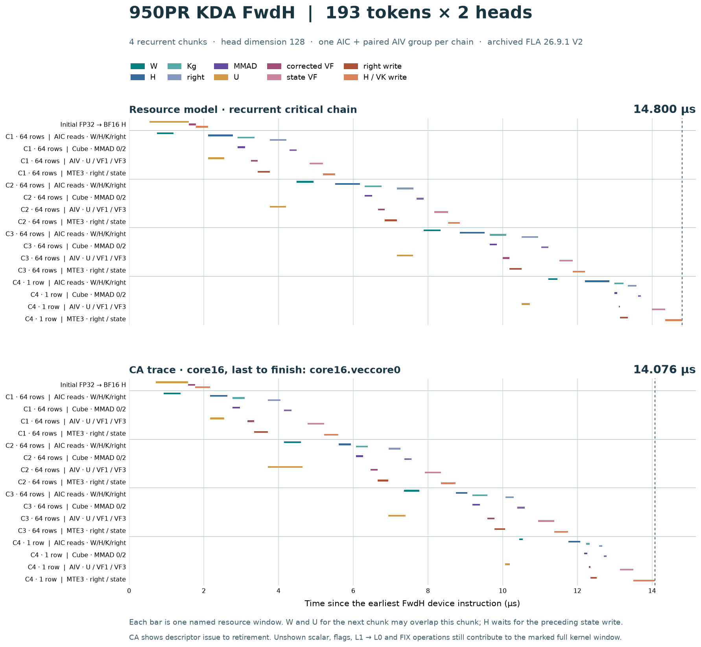

# KDA 三段 V2 的完整设备窗

每次调用使用发布版 FLA 26.9.1 的三个顺序 kernel；每段从全核第一条指令到末核退休，合计扣除段间宿主间隔。四组数值、整核退休、内存后端和 ELF 均合格才纳入耗时。下表的预测在各个样本采集前生成；后两批是在看到较早结果后补充的几何。

| 输入 T / H | 芯片 | Prepare / FwdH / Finalize 模型 µs | 相应 CA µs | 三段模型 / CA µs | 偏差 | 970DT 仅外推 µs |
|---|---|---:|---:|---:|---:|---:|
| [80 / 1](../../v0.24/kda-prefetch/independent-Ascend950DT_9582-80-1.json) | 950DT | 19.749 / 8.244 / 3.759 | 19.968 / 7.708 / 3.205 | 31.751 / 30.882 | +2.82% | 29.099 |
| [80 / 1](../../v0.24/kda-prefetch/independent-Ascend950PR_957b-80-1.json) | 950PR | 19.854 / 8.260 / 3.759 | 20.139 / 7.915 / 3.231 | 31.872 / 31.285 | +1.88% | 29.099 |
| [145 / 2](../../v0.24/kda-prefetch/independent-Ascend950DT_9582-145-2.json) | 950DT | 19.749 / 11.677 / 3.759 | 20.391 / 10.796 / 3.399 | 35.185 / 34.586 | +1.73% | 32.246 |
| [145 / 2](../../v0.24/kda-prefetch/independent-Ascend950PR_957b-145-2.json) | 950PR | 19.854 / 11.701 / 3.759 | 20.261 / 11.302 / 3.449 | 35.313 / 35.012 | +0.86% | 32.246 |
| [63 / 4](../../v0.24/kda-prefetch/supplement/supplement-Ascend950DT_9582-63-4.json) | 950DT | 19.671 / 5.627 / 3.747 | 20.528 / 5.638 / 3.455 | 29.045 / 29.621 | -1.94% | 26.619 |
| [63 / 4](../../v0.24/kda-prefetch/supplement/supplement-Ascend950PR_957b-63-4.json) | 950PR | 19.775 / 5.638 / 3.747 | 20.278 / 5.812 / 3.398 | 29.159 / 29.487 | -1.11% | 26.619 |
| [64 / 3](../../v0.24/kda-prefetch/supplement/supplement-Ascend950DT_9582-64-3.json) | 950DT | 19.749 / 5.633 / 3.759 | 20.032 / 5.488 / 3.223 | 29.141 / 28.744 | +1.38% | 26.707 |
| [64 / 3](../../v0.24/kda-prefetch/supplement/supplement-Ascend950PR_957b-64-3.json) | 950PR | 19.854 / 5.644 / 3.759 | 19.857 / 5.728 / 3.235 | 29.257 / 28.820 | +1.51% | 26.707 |
| [65 / 4](../../v0.24/kda-prefetch/supplement/supplement-Ascend950DT_9582-65-4.json) | 950DT | 19.749 / 8.104 / 3.759 | 20.219 / 7.682 / 3.775 | 31.611 / 31.675 | -0.20% | 28.971 |
| [65 / 4](../../v0.24/kda-prefetch/supplement/supplement-Ascend950PR_957b-65-4.json) | 950PR | 19.854 / 8.119 / 3.759 | 20.298 / 8.116 / 3.556 | 31.731 / 31.970 | -0.75% | 28.971 |
| [127 / 1](../../v0.24/kda-prefetch/supplement/supplement-Ascend950DT_9582-127-1.json) | 950DT | 19.749 / 8.956 / 3.759 | 20.115 / 8.227 / 3.386 | 32.464 / 31.728 | +2.32% | 29.752 |
| [127 / 1](../../v0.24/kda-prefetch/supplement/supplement-Ascend950PR_957b-127-1.json) | 950PR | 19.854 / 8.975 / 3.759 | 20.243 / 8.650 / 3.521 | 32.588 / 32.414 | +0.54% | 29.752 |
| [128 / 2](../../v0.24/kda-prefetch/supplement/supplement-Ascend950DT_9582-128-2.json) | 950DT | 19.749 / 8.966 / 3.759 | 20.367 / 8.644 / 3.399 | 32.474 / 32.409 | +0.20% | 29.761 |
| [128 / 2](../../v0.24/kda-prefetch/supplement/supplement-Ascend950PR_957b-128-2.json) | 950PR | 19.854 / 8.985 / 3.759 | 20.401 / 8.804 / 3.315 | 32.597 / 32.519 | +0.24% | 29.761 |
| [130 / 3](../../v0.24/kda-prefetch/supplement/supplement-Ascend950DT_9582-130-3.json) | 950DT | 19.749 / 11.445 / 3.759 | 20.566 / 10.267 / 3.485 | 34.953 / 34.318 | +1.85% | 32.034 |
| [130 / 3](../../v0.24/kda-prefetch/supplement/supplement-Ascend950PR_957b-130-3.json) | 950PR | 19.854 / 11.469 / 3.759 | 20.144 / 10.933 / 3.287 | 35.081 / 34.364 | +2.09% | 32.034 |
| [193 / 2](../../v0.24/kda-prefetch/supplement/supplement-Ascend950DT_9582-193-2.json) | 950DT | 19.749 / 14.769 / 3.759 | 20.269 / 13.385 / 3.478 | 38.276 / 37.132 | +3.08% | 35.079 |
| [193 / 2](../../v0.24/kda-prefetch/supplement/supplement-Ascend950PR_957b-193-2.json) | 950PR | 19.854 / 14.800 / 3.759 | 20.521 / 14.076 / 3.496 | 38.412 / 38.093 | +0.84% | 35.079 |
| [192 / 4](aligned26-Ascend950DT_9582-192-4.json) | 950DT | 19.749 / 12.298 / 3.759 | 21.133 / 11.371 / 3.488 | 35.806 / 35.992 | -0.52% | 32.815 |
| [192 / 4](aligned26-Ascend950PR_957b-192-4.json) | 950PR | 19.854 / 12.325 / 3.759 | 20.719 / 11.893 / 3.402 | 35.938 / 36.013 | -0.21% | 32.815 |

### 第四块的状态

T=193、每卡两个头，尾块只有一行。950PR 上第三块的状态写在 11.752 µs 退休；第四块 W 的读早在 10.444 µs 已发起，但第四块 H 读要等到 11.761 µs。模型对应时刻为 12.200、11.229、12.200 µs。依赖次序得到验证，前三块积累的时间差仍会影响最后一行。

[950DT 同形图](dt-four-chunks.png) · [逐块时间、来源与 ELF](pr-four-chunks.json)

### 保留未通过的数值检查

T=257 与 T=248 都在两种 SKU 上得到相同的设备数组。T=257 的 Aqk 在 [head=0,row=243,col=44] 偏离双精度发布算法参考 5.2452×10⁻⁶，允许 3.1325×10⁻⁶。对 T=248，Aqk 全通过，而 Akk 在 [0,242,40] 偏离 9.5367×10⁻⁶，允许 6.2915×10⁻⁶。attention 和最终状态在四次调用中均通过。原验收合同对这四个 shape×SKU 的耗时均记 N/A。双端分别确认了导出的每个 BF16 元素和同步状态。

[T=257 实际坐标](failed-257.json) · [T=248 实际坐标](failed-248.json) · [按正式设备内核的中间精度复现](numeric-audit.md) · [冻结、回执与全量评估](../evaluation.json)
