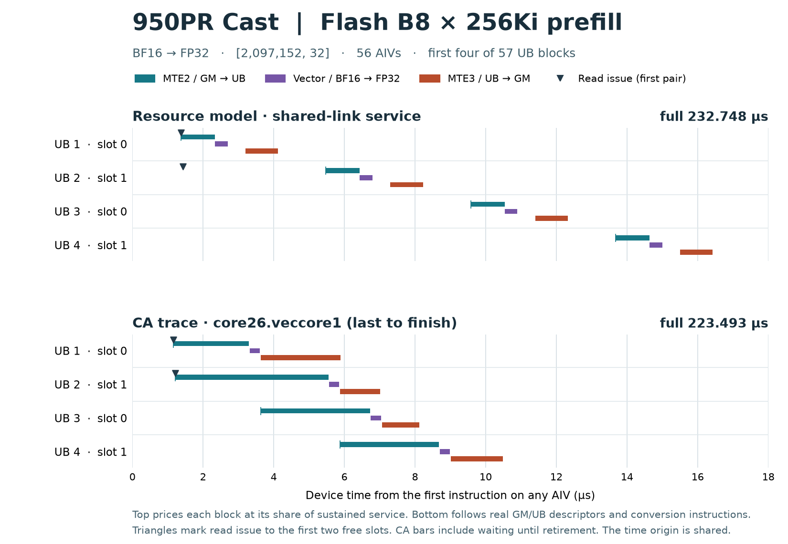

# 单卡大 prefill 中，第二块何时开始读

上图是 DeepSeek V4.1 Flash 的 indexer 系数张量。单卡同时处理 8 条序列，每条 262,144 个 token，张量为 BF16 [2097152,32]。Pro 的 64 通道系数张量在 B8×128Ki 得到相同的元素总数。两次调用都用 CANN 9.2.1 的 ops-math `aclnnCast`。读 128 MiB，写 256 MiB，整片 56 AIV。输入、输出均逐元素检查通过，数值来自两个单独的正式安装包 CA 调用。[Pro 同刻度图](pro-128ki-pr-head.png) · [图的数值和两个源 trace](equal-payload.json)

| 950PR 完整设备窗，µs | 资源模型 / CA | 末核 | 首两次读发起相隔，模型 / CA | 首条读描述符实测时长 | UB29 读起点 / 写终点误差，模型减 CA | 970DT 外推 |
|---|---:|---|---:|---:|---:|---:|
| Flash [2097152,32] | 232.748 / 223.493（+4.14%） | core26.veccore1 | 0.055 / 0.055 | 2.136 | +24.745 / −4.722 | 42.536 |
| Pro [1048576,64] | 232.748 / 224.719（+3.57%） | core29.veccore1 | 0.055 / 0.055 | 2.490 | +25.689 / −1.574 | 42.536 |

两个实验的末核都处理了 57 块。前 56 块每块 21,120 个元素，Flash 与 Pro 末核的尾块分别是 15,656 和 15,464 个，模型最重核为 15,664 个。末核由实际退出时间选取。两个 shape 的元素数、读写方向、实现合同相同，整窗仅相差 1.226 µs。该对照支持按元素总数定价这一路连续 Cast。跨过 L2 容量时的折点、不同 dtype 和访问布局仍需各自处理。

### 图上的两种时间

上栏黑三角给出 MTE2 发起时刻，青、紫、橙色长条依次给出按共享资源定价的读、转换、写服务。下栏的读写条从描述符发起一直画到退休，包含等数据和等下游的时间。两栏零点都是全片第一条设备指令，图只放大前四块，右上角标整窗。

用 $t_1=t_{arrival}+t_{control}$ 表示第一条读的发起时间，$t_2=t_1+c/(1000f)$ 表示第二条。其中 $f$ 是本芯片 GHz 频率，$c$ 是同一核指令前端在两个空闲 UB 输入槽之间发出下一条 MTE2 的周期数。950DT 的 Flash B8×32Ki 末核测得 91 周期。整个传输需要几微秒时，核仍能很早发出下一笔请求。热身结束后，槽位要等上一次计算消费或写回退休，不能把这个两笔之间的间隔重复乘 57 次。

其他 9 个 DT/PR 旧设备窗也有 91 个周期的发起间隔，第二笔的**绝对发起时刻**与 CA 最大相差 0.211 µs，来自首发的偏移。Flash 与 Pro 上栏按稳态服务均摊原本给出的 4.101 µs 是带宽预算间隔。外推沿用同一双缓冲指令实现，可在芯片详情覆写 `cast_initial_read_pair_cycles`，填 null 则只报告首笔。`estimate` 的 `projection["timing_diagnostics"]["initial_read_issue_us"]` 返回有依据的一到两个标记。整窗仍包含后续全部读写、换槽、共享链路和尾部退休。若自定义目标的前端特别慢，第二笔发起加上第二块读、转换和写的最低服务时间会成为额外的关键路径下界。[9 个回放和 1 个参数来源](initial-issues-replay.json) · [新形的事前发起预测](initial-issues-freeze.json)

### B8×256Ki 的 Pro

[2097152,64] 单次调用读 256 MiB、写 512 MiB。DT、PR、970DT 分别建出 100、114、53 个忙核块，模型给 227.018、520.357、104.673 µs。PR 的缓存脏数据留驻候选为 506.517 µs。预测在 DT 采集中、全窗发布前，以及在 PR 发起前登记。970DT 只有情景预测。DT 的 128 路原生内存控制器日志保留原文件的硬链接，既有仿真结束后核对周期、命令和全通道字节；PR 如缺相应计数，字节记为未知。[逐块完成时刻与三个硬件情景](pro-256ki-prefix-forecast.json) · [实际采集进度](../../v0.23/pro-prefill/README.md)

首四块的图可以与相同时间原点的整窗一起读。[Flash 57 块整窗](../../../docs/examples/figures/prefill-flash-256ki-pr.png) · [Pro 57 块整窗](../../v0.23/pro-prefill/pro-b8-128ki-pr-plot.png) · [Pro 第 28–30 块的放大视图](../../v0.25/pro-128ki-pr-middle.png)
