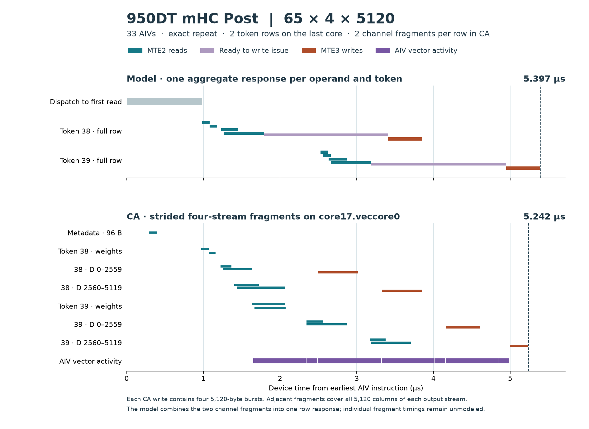

# 内置 MhcPost 的同流精确重复

| 芯片与前序 | 合格窗 | 可选策略 WAPE / 最大 | 默认 v0.25 WAPE / 最大 | 不传前序 WAPE / 最大 |
|---|---:|---:|---:|---:|
| Ascend950DT_9582 / all | 23 | 11.37% / 58.52% | 28.60% / 64.32% | 39.67% / 77.39% |
| Ascend950DT_9582 / repeat | 12 | 2.88% / 8.90% | 43.17% / 64.32% | 62.28% / 77.39% |
| Ascend950DT_9582 / entry | 11 | 17.71% / 58.52% | 17.71% / 58.52% | 22.78% / 70.41% |
| Ascend950DT_9582 / first | 4 | 8.34% / 15.81% | 8.34% / 15.81% | 12.07% / 25.50% |
| Ascend950DT_9582 / expand | 4 | 9.83% / 23.39% | 9.83% / 23.39% | 9.73% / 23.19% |
| Ascend950DT_9582 / reuse | 3 | 44.04% / 58.52% | 44.04% / 58.52% | 59.07% / 70.41% |
| Ascend950PR_957b / all | 22 | 12.73% / 57.22% | 29.43% / 64.98% | 36.88% / 78.10% |
| Ascend950PR_957b / repeat | 10 | 1.93% / 3.85% | 46.03% / 64.98% | 63.91% / 78.10% |
| Ascend950PR_957b / entry | 12 | 19.31% / 57.22% | 19.31% / 57.22% | 20.40% / 68.89% |
| Ascend950PR_957b / first | 5 | 11.04% / 20.08% | 11.04% / 20.08% | 8.60% / 20.66% |
| Ascend950PR_957b / expand | 5 | 15.45% / 23.81% | 15.45% / 23.81% | 15.01% / 23.62% |
| Ascend950PR_957b / reuse | 2 | 48.45% / 57.22% | 48.45% / 57.22% | 61.68% / 68.89% |

合格的独立重复形状为 950DT 12、950PR 10。全核窗口及机制身份同时合格才计入十形目标。共 45 个合格的重复与非重复调用，全状态 WAPE 和精确重复分别汇报。目标为两端精确重复分别 WAPE≤20%、最大≤40%、WAPE 优于默认，且各至少 10 个不同新形。当前判定为 **达到门槛**。

公开入口提供显式选择的实验模式。每个 OperatorStream 绑定一个 rank、设备和有序流，成功模拟一条实际派发后使用 advance；探索候选价格使用 preview。复用核数、核函数实现、dtype、残差与布局合同及完整 shape 均匹配时，且实际采用 token 分核，连续两个相同调用的后一个使用冻结的逐行模型。缺失具体 FP32 吞吐、通道分核、普通热态、首次和未知前序都沿用已有点估计。裸 estimate 调用保持无状态。

示例中两次调用传入相同 BF16 内置 Post。preview 多次不会把首次预测变成重复预测。未知的外部成功派发用 forget_history() 使旧合同失效。

```python
from operator_model import OperatorStream

stream = OperatorStream("Ascend950DT_9582", experimental_post_repeats=True)
first = stream.advance("mhc_post", [67, 4, 384], dtype="bf16")
repeat = stream.preview("mhc_post", [67, 4, 384], dtype="bf16")
print(first.latency_us, repeat.latency_us, repeat.projection["stages_us"])
```

公共 API 已与 DT、PR、970DT 的 102 条冻结预测逐条比对，最大差 0 µs。408 次实际 advance（含调度选择、工作量与速率返回）墙钟 p50/p95/最大 0.122/0.154/0.179 ms。970DT 全部为外推。

## 同集跨芯片比值

| 前序 | 同组双端窗口对 | 可选策略的加速比 WAPE / 最大 | 默认加速比 WAPE / 最大 |
|---|---:|---:|---:|
| all | 21 | 4.54% / 22.29% | 4.85% / 22.29% |
| repeat | 10 | 1.63% / 7.08% | 2.28% / 9.44% |
| entry | 11 | 7.15% / 22.29% | 7.15% / 22.29% |

比值均为 DT 耗时 / PR 耗时。未知前序的点估计与默认一致。同形首次和紧邻重复可能出现不同设备时间；小 token、宽通道的 channel kernel 走单独的分片路线。[小宽组历史配对、无法消除的误差及可观测状态](channel-observability.md)

## 所有合格新窗口

| 芯片 | T×4×D | 前序 | CA µs | 可选 µs | 默认 µs | 有符号误差 | 核数预测/CA | 970DT 外推 µs |
|---|---|---|---:|---:|---:|---:|---:|---:|
| Ascend950DT_9582 | 193×4×896 | first / entry | 5.464 | 5.962 | 5.962 | +9.13% | 49/49 | 4.216 |
| Ascend950DT_9582 | 193×4×896 | reuse / repeat | 2.915 | 2.904 | 4.566 | -0.37% | 49/49 | 2.055 |
| Ascend950DT_9582 | 449×4×512 | expand / entry | 5.604 | 5.950 | 5.950 | +6.18% | 57/57 | 3.858 |
| Ascend950DT_9582 | 449×4×512 | reuse / repeat | 4.199 | 4.073 | 5.322 | -3.00% | 57/57 | 2.510 |
| Ascend950PR_957b | 193×4×896 | first / entry | 4.993 | 5.995 | 5.995 | +20.08% | 49/49 | 4.216 |
| Ascend950PR_957b | 193×4×896 | reuse / repeat | 2.952 | 2.912 | 4.598 | -1.37% | 49/49 | 2.055 |
| Ascend950PR_957b | 449×4×512 | expand / entry | 5.472 | 6.427 | 6.427 | +17.46% | 50/50 | 3.858 |
| Ascend950PR_957b | 449×4×512 | reuse / repeat | 4.468 | 4.411 | 5.800 | -1.27% | 50/50 | 2.510 |
| Ascend950DT_9582 | 65×4×320 | first / entry | 3.869 | 3.863 | 3.863 | -0.16% | 33/33 | 3.255 |
| Ascend950DT_9582 | 65×4×320 | reuse / repeat | 1.978 | 1.959 | 2.466 | -0.95% | 33/33 | 1.503 |
| Ascend950DT_9582 | 121×4×1216 | expand / entry | 4.466 | 4.241 | 4.241 | -5.05% | 61/61 | 3.311 |
| Ascend950DT_9582 | 121×4×1216 | reuse / repeat | 2.539 | 2.420 | 3.613 | -4.68% | 61/61 | 2.218 |
| Ascend950DT_9582 | 65×4×5120 | reuse / entry | 5.433 | 8.613 | 8.613 | +58.52% | 33/33 | 4.790 |
| Ascend950DT_9582 | 65×4×5120 | reuse / repeat | 5.242 | 5.397 | 8.613 | +2.96% | 33/33 | 3.542 |
| Ascend950PR_957b | 65×4×320 | first / entry | 3.802 | 3.869 | 3.869 | +1.76% | 33/33 | 3.255 |
| Ascend950PR_957b | 121×4×1216 | expand / entry | 4.555 | 5.160 | 5.160 | +13.29% | 41/41 | 3.311 |
| Ascend950PR_957b | 121×4×1216 | reuse / repeat | 2.885 | 2.810 | 4.533 | -2.58% | 41/41 | 2.218 |
| Ascend950PR_957b | 65×4×5120 | reuse / entry | 5.538 | 8.707 | 8.707 | +57.22% | 33/33 | 4.790 |
| Ascend950PR_957b | 65×4×5120 | reuse / repeat | 5.278 | 5.481 | 8.707 | +3.85% | 33/33 | 3.542 |
| Ascend950DT_9582 | 127×4×448 | first / entry | 4.271 | 4.027 | 4.027 | -5.72% | 64/64 | 3.691 |
| Ascend950DT_9582 | 127×4×448 | reuse / repeat | 2.227 | 2.028 | 2.630 | -8.90% | 64/64 | 1.859 |
| Ascend950DT_9582 | 157×4×1088 | reuse / entry | 3.207 | 4.253 | 4.253 | +32.64% | 53/53 | 3.736 |
| Ascend950DT_9582 | 157×4×1088 | reuse / repeat | 2.796 | 2.659 | 4.253 | -4.90% | 53/53 | 2.134 |
| Ascend950DT_9582 | 337×4×640 | reuse / entry | 3.725 | 4.944 | 4.944 | +32.73% | 57/57 | 3.684 |
| Ascend950DT_9582 | 337×4×640 | reuse / repeat | 3.570 | 3.460 | 4.944 | -3.07% | 57/57 | 2.256 |
| Ascend950PR_957b | 127×4×448 | first / entry | 4.338 | 4.433 | 4.433 | +2.20% | 43/43 | 3.691 |
| Ascend950PR_957b | 127×4×448 | reuse / repeat | 2.410 | 2.362 | 3.036 | -1.96% | 43/43 | 1.859 |
| Ascend950PR_957b | 157×4×1088 | expand / entry | 4.527 | 4.911 | 4.911 | +8.47% | 53/53 | 3.736 |
| Ascend950PR_957b | 337×4×640 | reuse / entry | 4.033 | 5.502 | 5.502 | +36.42% | 49/49 | 3.684 |
| Ascend950PR_957b | 337×4×640 | reuse / repeat | 3.817 | 3.799 | 5.502 | -0.47% | 49/49 | 2.256 |
| Ascend950DT_9582 | 95×4×1280 | reuse / repeat | 2.484 | 2.466 | 3.695 | -0.71% | 48/48 | 1.916 |
| Ascend950DT_9582 | 151×4×768 | expand / entry | 4.100 | 4.266 | 4.266 | +4.05% | 51/51 | 2.786 |
| Ascend950DT_9582 | 151×4×768 | reuse / repeat | 2.521 | 2.510 | 3.639 | -0.44% | 51/51 | 1.997 |
| Ascend950PR_957b | 95×4×1280 | first / entry | 4.370 | 5.116 | 5.116 | +17.07% | 48/48 | 3.818 |
| Ascend950PR_957b | 95×4×1280 | reuse / repeat | 2.496 | 2.487 | 3.719 | -0.38% | 48/48 | 1.916 |
| Ascend950PR_957b | 151×4×768 | expand / entry | 3.801 | 4.287 | 4.287 | +12.80% | 51/51 | 2.786 |
| Ascend950PR_957b | 151×4×768 | reuse / repeat | 2.544 | 2.516 | 3.660 | -1.09% | 51/51 | 1.997 |
| Ascend950DT_9582 | 39×4×4096 | first / entry | 5.154 | 5.969 | 5.969 | +15.81% | 39/39 | 5.248 |
| Ascend950DT_9582 | 39×4×4096 | reuse / repeat | 3.454 | 3.384 | 4.572 | -2.03% | 39/39 | 2.979 |
| Ascend950DT_9582 | 81×4×2560 | expand / entry | 4.832 | 5.962 | 5.962 | +23.39% | 41/41 | 3.863 |
| Ascend950DT_9582 | 81×4×2560 | reuse / repeat | 3.547 | 3.443 | 5.335 | -2.95% | 41/41 | 2.458 |
| Ascend950PR_957b | 39×4×4096 | first / entry | 5.390 | 6.006 | 6.006 | +11.44% | 39/39 | 5.248 |
| Ascend950PR_957b | 39×4×4096 | reuse / repeat | 3.495 | 3.417 | 4.609 | -2.21% | 39/39 | 2.979 |
| Ascend950PR_957b | 81×4×2560 | expand / entry | 4.853 | 6.009 | 6.009 | +23.81% | 41/41 | 3.863 |
| Ascend950PR_957b | 81×4×2560 | reuse / repeat | 3.585 | 3.484 | 5.382 | -2.82% | 41/41 | 2.458 |

所有纳入样本来自同一流上的 CANN 9.2.1 内置 ops_transformer/mhc_post_apt 实际 ELF；逐核需有 END 与终止标记且匹配官方时长，写回字节及完整 FP32 参考舍入 BF16 金标逐元素检查。首批 5 形取自 v0.25 的 width/many 组；此前 boundary、steady 组仅作开发观察。补充 5 形和两种备用形的所有价格均在测量前登记。备用条件只看可评分形状覆盖数。

[首批独立五形的策略冻结](../../v0.25/post/repeat-policy-freeze.json) · [第二批注册和预算](registration.json) · [逐形误差与加速比](score.json) · [三芯片公共 API 数值与查询开销](api-equivalence.json)

## 宽度 5120 的独立流水对照

950DT 的 [65,4,5120]，33 个 AIV。预测 5.397 µs，实测 5.242 µs（+2.96%）。末核按实际输出 GM 地址负责 token 38、39。每个 token 的写回分为两个 2560 通道片，每片四次各 5120 B 的 burst 之间相隔 10240 B。全张量 520 个 burst 的覆盖经地址排序检查。

同一套 arch35 RegBase 参考 host 按 $U_{req}=320+52d_{inner}<U_{usable}$ 选择最少通道片。两组 FP32 系数各按 8 元素对齐并双缓冲，合计固定 320 B；每列 hOut 双缓冲需 4 B、残差流需 16 B、输出和中间量需 32 B。$d_{inner}$ 按 16 个 BF16 元素对齐且至少 32。取 253952 B 时 4864 列能整行放入，4880 列开始需要两片；5120 列分为两片各 2560。安装包的设备源码在 token 内先读两笔系数，再在 dOuter 循环里逐片读 hOut/残差、计算和写回。该处 trace 与参考 host 判据一致。

可选预测沿用预登记的整行价格。诊断中的 channel_tiles 指出核内有两片，schedule_granularity=whole_row_aggregate 表示当前耗时公式仍合并片间响应和发起间隔。各窗口同时报告数据搬运结构是否吻合。不同设备的可用 UB 可能变化，不能把单次整窗的接近程度当作未来分片调度精度。



[图的逐笔时间与归属](split-width-repeat.json) · [参考库 arch35 host 的 UB 选择器](https://gitcode.com/cann/ops-transformer/blob/14d022b1a4c3df263bf697534e3c25c7c992ff5d/mhc/mhc_post/op_host/op_tiling/arch35/mhc_post_tiling_regbase_arch35.cpp)

[宽度 5120 在两端的阶段复核](wide-stages.md)：常规复用的 MTE2 互斥计价比 CA 高约 2.51 µs / 2.63 µs，吃掉大部分总偏差。

## 极多轮时的 API 开销

对 B=8、S=32k/128k/256k、D=5120/7168 的整段 BF16 输入实调 950DT、950PR、970DT 接口。每个最忙 AIV 最多处理 37,450 行，18 个重复查询最大墙钟 0.822 ms。这里验证闭式模型的查询成本。这些形状的设备耗时在三颗芯片上均为外推；实际 vLLM DeepSeek 使用另一套 HcPost 绑定。

[逐形工作量、耗时外推与查询墙钟](large-api.json) · [上游实际 HcPost 绑定](../../../docs/examples/hc_post_vllm.md)

[普通热态改变 shape 的预登记机制试验](warm-schedule.md)
