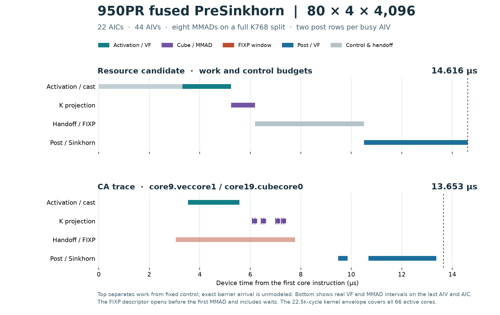

# 融合 mHC PreSinkhorn 的分核、投影与归约

| 算子 | 平台 / 旧数据组 | 完整 CA 窗 | v0.25 WAPE | 候选 WAPE | 候选最大绝对误差 |
|---|---|---:|---:|---:|---:|
| aclnnMhcPreSinkhorn | 950PR，全部 | 20 | 9.39% | 5.39% | 14.00% |
| 同上 | 950PR，T≤16 | 10 | 5.86% | 6.93% | 14.00% |
| 同上 | 950PR，16<T≤64 | 9 | 11.01% | 3.73% | 6.61% |
| 同上 | 950PR，T>64 | 1 | 21.88% | 7.05% | 7.05% |
| 同上 | 950DT，全部 | 24 | 7.91% | 5.97% | 12.89% |
| 同上 | 950DT，T≤16 | 12 | 5.55% | 5.10% | 12.89% |
| 同上 | 950DT，16<T≤64 | 11 | 9.54% | 7.38% | 10.61% |
| 同上 | 950DT，T>64 | 1 | 14.30% | 0.95% | 0.95% |

上表是重新使用真实旧窗口的开发回放。T>64 的两项均为 T=80。五个 950DT 形状的实际 VF、MMAD 和结束阶段用于校准。950PR 提供了对已知失败机制的开发检查。旧域中小 token 的 PR 误差上升了 1.07 个百分点。候选已冻结，默认入口保留 v0.25 的融合算法；新形独立验证在单独队列中。WAPE 为总绝对时差除以总 CA 时长。[全量逐形、实际核数、基线和 970 外推](replay.json) · [独立冻结](freeze.json) · [排队状态](state.json)

## 950PR 的一条完整流水

输入为 T=80，N=4，D=4096，激活 BF16、权重 FP32。库以 20 次 Sinkhorn 迭代、推理模式执行 `aclnnMhcPreSinkhorn`。真实运行为 `MhcPreSinkhorn_bd8e37c67f2294e1437f03bb2bace96c_1000_mix_aic`；三组 `hin/hpost/hres` 共检查 327,680 / 320 / 1,280 个输出值。设备 ELF、开始/结束和每个活动核的原始时钟均保存在完整回执。最晚 AIC 是 `core19.cubecore0`，最终结束的 AIV 是 `core9.veccore1`。全核实际窗为 13.653 µs，v0.25 预测 16.640 µs，候选预测 14.616 µs。970DT 使用其 1:1 参考路线外推为 14.378 µs。[原始回执与文件指纹](../../v0.22/recovered/mhc_pre_sinkhorn_80_4_4096_Ascend950PR_957b.json) · [图中全部指令区间](pr-t80-figure.json)

每个 token 的 K=N×D=16,384，投影产生 N²+2N=24 个系数。28 个物理 AIC 各候选一组，按 256 对齐后，每个满组 K=768；实际 21 个满组、1 个 K=256 尾组，合计 **22 AIC / 44 AIV**。后处理的忙核各处理 ceil(80/56)=2 行，40 个 AIV 有后处理 token。950DT 同形是 32 组 K=512，32 AIC / 64 AIV。原模型已预测对两端分核。

arch35 的 K 分片还有两层。对于实际 M=80，K_L1=128×floor(min(32768/80,1024)/128)=384；K_L0=32×floor(256/max(80,32))=96。PR 满组的两页 K384 各发四条 MMAD，尾组 K256 发三条。全芯片预测 21×8+3=**171 条 MMAD**，与实测完全一致。DT 满组由 K384 与 K128 构成，共 4+2=6 条。这里 M 按 16 对齐、输出 24 列按 32 列分配；宏观逻辑 MAC 使用原始有效维度。[固定上游分核源码](https://gitcode.com/cann/ops-transformer/blob/14d022b1a4c3df263bf697534e3c25c7c992ff5d/mhc/mhc_pre_sinkhorn/op_host/op_tiling/mhc_pre_sinkhorn_tiling_arch35.cpp) · [K 分片内核](https://gitcode.com/cann/ops-transformer/blob/14d022b1a4c3df263bf697534e3c25c7c992ff5d/mhc/mhc_pre_sinkhorn/op_kernel/arch35/mhc_pre_sinkhorn_m_k_split_core_arch35.h)

| PR 末核或窗口 | 已观测指令 | 时间 µs |
|---|---|---:|
| AIV，第一段 | 第一条转换/归约 VF 发起至该段末条 VF 退休 | 3.535–5.568 |
| AIC，FIXP | FIX_L0C_TO_DST 描述符 | 3.048–7.777 |
| AIC，投影 | 第一条 MMAD 发起至最后一条退休 | 6.083–7.424 |
| AIC，尾部 | 最后一条 MMAD 退休至 FIXP 退休的暴露部分 | 0.353 |
| AIV，最终归约 | 组归约 VF 第一次发起至末核最终退休 | 9.476–13.653 |

原模板把 FIXP 挂起期间的整个区间随局部 M 放大。此例的 FIXP 在第一条 MMAD 前已经发出，描述符内部包含生产者依赖。增加 M 会改变指令块数和计算量，却不会把这些固定依赖按同比例延长。原模型因而预测 AIC 成为末核。图上栏改为按独立工作与固定控制计价，紫色刻度是实测的各次 MMAD 发起。上栏固定总预算仅为绘图按 DT 实测的前段启动与交接间隔比例分摊；归约准备和同步存在重叠，模型尚不能独立预测每条跨核 flag 到达时间。[31 个完整窗口的末核分片与 PC](archive.json)

## 候选如何把工作量换成耗时

对 N=4、D=4096、C:V=1:2 的联合后处理模板，先求忙核 M/K 分块、页内 MMAD 数 Q 和每个 AIV 的后处理行数 r。每个 AIV 在激活阶段处理 E=ceil(M/2)×局部 K 个元素。P=align16(M)×align16(N²+2N)×局部 K 为忙 AIC 的对齐 MAC 数。用 950DT 时钟表示的工作服务分别为：

- 激活转换与部分归约为 0.100703×E 周期。这是临界 AIV 第一条至末条该阶段 VF 投递窗口的稳健元素斜率，覆盖混合访存与 SIMD。目标给出 MTE2 端口时，另施加 2E 字节的读下界。
- Cube 为 76.524×Q + 0.496836×P/1024 周期。第一项描述每条指令的发起与调度成本，第二项描述每 1024 个对齐 MAC 的服务。这两个系数联合解释**第一条 MMAD 发起到最后一条退休**的区间，阶段与发起存在相关性，单个系数不能解释成硬件手册原语。
- 联合归约和输出为 3,299×r 周期。样本从组归约 VF 的入口 PC（低地址 `14cb0`）计至该核最终退出；阶段包含固定 20 轮和输出，价格只覆盖该编译合同和宽度。

上述价格仅用 DT 的 T=1、20、33、56、80 取样，没有拟合算子总耗时。标量发起成本按目标频率换算，向量/投影服务按每核 FP32 Vector / 16-bit Cube 峰值比换算；HF32 的真实每核吞吐是仍待独立标定的量。首发固定控制与同步预算为同一目标设备的原有单行模板预测，减去该单行的三项模型工作成本并截零。最终用全片冷读写带宽作底限。解释是“首行已经要启动各执行单元，再给后续 token 增加转换、投影与归约服务”；固定预算里启动、到核偏斜和跨核等待仍耦合。[原始阶段价格与来源](prices.json) · [候选代码](../../../operator_model/mhc_pre_sink_resource.py)

公开 arch35 tiler 显示 T≥128、无梯度且切 K 时，可能给 Sinkhorn 单设一组 AIV；1:1 CV 也有独立 tiling key。本地已验证的数据只覆盖 1:2、T≤80 的联合模板。上述候选仅对那个模板提供细化工作量，T≥128 和 970DT 1:1 保持原模板并给出分支标记。需要用实际 950 安装库验证 MPMD 路线和大 T 后才能扩展。单行锚点及模板仍会继承旧版对非常小 T 的残差。201 次热候选查询的开销见逐形计分，单核 PC 解析与作图完全在线下。[阶段统计与查询墙钟](replay.json)

## 冻结后的检验

| 新形 | 950DT v0.25 / 候选 µs | 950PR v0.25 / 候选 µs | 970DT 外推 µs | 机制 |
|---|---:|---:|---:|---|
| [72,4,4096] | 15.752 / 13.526 | 16.640 / 14.423 | 14.378 | 两端第二阶段每个忙 AIV 均为 2 行 |
| [113,4,4096] | 21.690 / 14.507 | 23.165 / 18.020 | 19.815 | DT 2 行，PR 3 行；最长 K 分片分别 8 / 12 条 MMAD |

以上四项的预测和工作量在 CA 之前一次封存。每项限 45 分钟和 10 GiB；使用 16 个逻辑核、低优先级并串行采集。资格包括三组全量数值、实际 950DT/PR 运行时和内存后端、一个匹配的 MIX ELF、每个活动核的官方表和实际结束时刻。重放既有双端六个控制样本发现，融合 AIC 在 END 之前的 DCCI 会在 END 之后才退休。已在任何新采集前补录此真实指令，原始 3 周期容差与总预测冻结不变。回放 6 个完整旧窗、两端三形的每核原点最大极差 0.002 周期。实际结果保存在同目录 `fused-t*-dt.json` 与 `fused-t*-pr.json`。[原冻结](freeze.json) · [终点核验补充](endpoint-addendum.json) · [实时状态](state.json)
