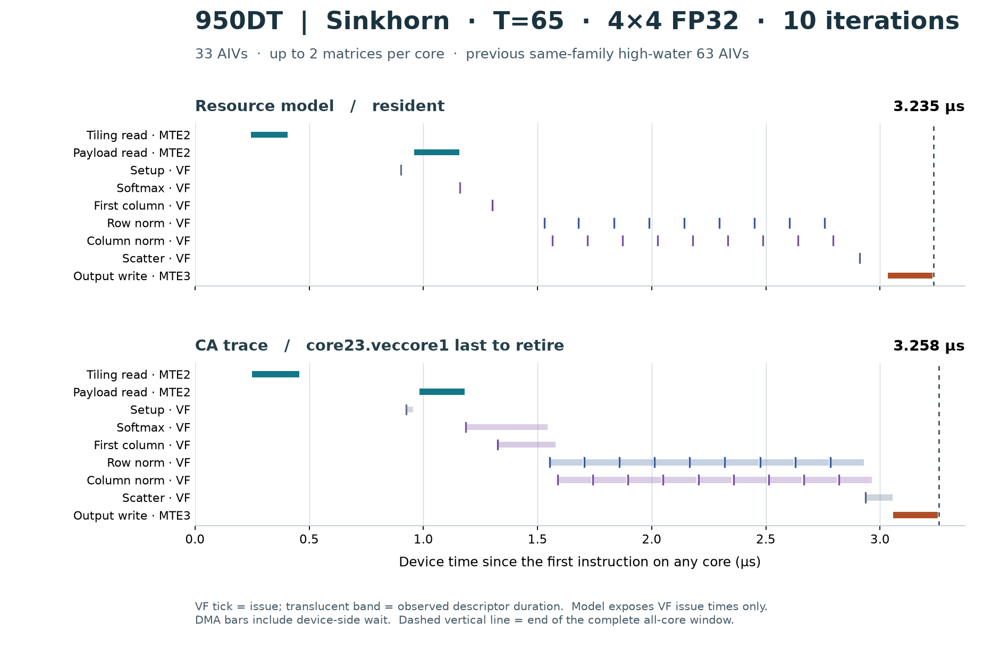

# 独立 mHC Sinkhorn 的首次发起与迭代间隔

| 数据与方式 | 窗数 | v0.25 WAPE / 最大 | 候选未提供历史 WAPE / 最大 | 候选已知历史 WAPE / 最大 |
|---|---:|---:|---:|---:|
| Ascend950DT_9582 开发回放 | 34 | 12.65% / 39.20% | 13.47% / 37.01% | 4.17% / 31.41% |
| Ascend950PR_957b 开发回放 | 20 | 9.03% / 19.28% | 10.21% / 20.01% | 3.81% / 9.29% |
| T above 64 开发回放 | 10 | 16.27% / 39.20% | 16.31% / 37.01% | 6.03% / 16.68% |
| I 10 or 12 开发回放 | 9 | 16.27% / 39.20% | 17.24% / 37.01% | 3.78% / 8.70% |
| all 开发回放 | 54 | 11.26% / 39.20% | 12.22% / 37.01% | 4.03% / 31.41% |

**保留 v0.25 公共默认。** 通过真实执行顺序取得同家族前序高水位 H 后，候选显著改善 T>64 和 10/12 次迭代的回放。shape-only 三场景等权点估计在 54 窗上的 WAPE 上升。950PR 的 20 个旧窗全部为首次调用，已有 PR 数据无法检验复用和扩核。候选定价只用 DT 的 34 个旧窗；PR 用来检查跨 SKU 回放。两端后续新形单独计分。[全部逐窗](replay.json) · [冻结后的新形结果](independent.json)

## 能够直接从 trace 区分的成本

本例调用安装包 aclnnMhcSinkhorn，FP32 连续 [T,4,4]，两个中间输出均不请求。正式设备符号为 MhcSinkhorn_8997d9c5c22e82688b98bc25d8daa9cd_0。两个 SKU 频率都是 1.65 GHz。旧 npusim 数据库存的是 entry_kernel_0，相对 PC 与正式 trace 的 VF 发起站点、计数与周期节奏一致；这些旧 DB 没有 ELF 字节，代码段身份只能在保留二进制的正式 msopprof 窗上逐字验证。

以下是四个可复查的设备窗口，单位为 µs。H 仅由该宿主批次更早的同家族 launch 数量重建；批次首项 H=0，后续只读真实已发射核数的高水位。十形新登记在采集前以预测分核独立生成 H。

| SKU / T / I | H | v0.25 | 候选未知 H | 候选已知 H | CA |
|---|---:|---:|---:|---:|---:|
| 950DT / 193 / 12 | 0 | 4.801 | 4.826 | 5.942 | 6.014 |
| 950DT / 68 / 10 | 0 | 4.473 | 4.408 | 5.319 | 4.922 |
| 950DT / 65 / 10 | 63 | 4.471 | 4.401 | 3.235 | 3.258 |
| 950DT / 66 / 10 | 47 | 4.471 | 4.401 | 3.235 | 3.212 |
| 950PR / 193 / 12 | 0 | 4.851 | 4.883 | 5.997 | 5.953 |
| 950PR / 68 / 10 | 0 | 4.515 | 4.457 | 5.367 | 4.937 |

T65、T66、T68 每核最多两行，I=10。最后 AIV 的第一个 VF 分别在 1525、1449、3553 个周期发起。三者首个 row/column 对到下一个同类发起都是 248 周期，后续都是 254 周期。T65 和 T66 运行在先前激活了 63/47 个 AIV 的同一进程；T68 是独立进程的首次运行。T193/I12 在 DT 和 PR 的首次 VF 分别需 4191 和 4195 周期。大于 64 token 的方向切换主要发生在进入实际迭代之前。已有 trace 能定位发起时间，无法把预热效应唯一分配给指令 cache、数据 cache 或调度器。[T65 逐指令数据](dt-65-hot.json) · [950DT T193 对照图](dt-193-first.png) · [950PR T193 对照图](pr-193-first.png)

## 如何从输入得到时间

1. 输入芯片、T、矩阵边长 n=4 和 I 次迭代。设 V 为 AIV 核数，普通核行数 r=⌈T/V⌉，实际用核 A=⌈T/r⌉，最后核 T−(A−1)r 行。目标 950 VReg 为 256 B、UB 块为 32 B。安装包代码对独立的矩阵行用 g=⌈r/(256/32)⌉=⌈r/8⌉ 次寄存器循环。每次 DMA 只搬运有效元素（每矩阵 64 B）。旧路径用 ⌈r/4⌉ 的工作估计，且公共 T 上限为 256。T>256 的待测行在同集表显示旧版 N/A。
2. 每核一个 UB 块时，setup、softmax、首次列归一化、I−1 对行列归一化和 scatter 共 2I+2 个 VF 描述符。全部 54 个历史临界核与此计数一致。候选只覆盖一个 UB 块；前后向保守 tiling 较小者可容纳的容量被超过时直接报告不支持。已知当前 4×4 路线的双缓存保守上限条件为 2·448r+64+3·256≤UB字节数。
3. 从全核第一条指令计时，按 tiling 读发起、读响应、setup VF 发起、输入读、softmax VF 发起、首次列 VF、交替行列 VF、scatter、输出写描述符和最后退休来排程。对可观测的阶段间隔 j，周期 b_j+q_j·A 来自 DT 同状态旧窗。b 为固定响应，q 为每多一个同时参与的 AIV 带来的额外周期。q 只在 tiling 发起、tiling 响应、首列发起与写响应中允许为正，取窗口两两斜率中位数后截断到非负；截距用剩余量中位数。稳态核内服务无须按 A 乘算。分层训练样本为首次 16、扩核 16、全部已覆盖 2；仅两个热态点不足以辨识热态的核数斜率。
4. 设 q 为目标与 DT 的每 AIV、每周期 FP32 峰值之比，f 为 GHz。单组首次 softmax→列的无阻塞起点差为 231 周期；首次列发起要同时满足 softmax 数据依赖和前端发起约束。对应周期为 max(softmax发起+231g/q, setup发起+b_fetch+q_fetch·A)。b_fetch、q_fetch 是整段发起预算，其余所有 b_j、q_j 的单位及数值保存在冻结参数中。首列到首行的预算为 378g/q，首个行列对的发起间隔为 248g/q，随后为 254g/q。首/稳态两者中的行到列发起相隔 56/62 周期（再乘 g/q）。全核周期除以 1000f 得设备 µs；FMA 峰值只作为可替换的 VF 价格代理，未来架构的除法和 gather 吞吐未知。这个代理在 950PR 上给出每对 260.90 周期，历史 PR trace 实为 254，显式保留这 2.72% 的阶段偏差。
5. 对本地搬运，读写分别取实测固定描述符响应和字节下界中的较大值。全片字节下界为 64T·f/B_HBM 个周期（带宽单位 GB/s），单核为 64r·f/B_MTE（能拿到本地 GB/s 时）。临界核上输入依赖发起和首列排程相互覆盖。输出写描述符在 scatter 后发起，再等待写响应和退休。多组寄存器内循环暂按一组稳态体线性外推，旧窗都没有超过 4 行/核，T449/513/4097 独立验证这一假设。厂商只提供容量或聚合峰值时，数据无法识别目标芯片本地延迟；970DT 全部标外推。
6. 若同进程同流、同家族 H 已知，H=0 取首次、0<H<A 取扩核、H≥A 取已覆盖场景。该映射只表示实际启动历史，没有观测到每个 cacheline 是否驻留。完全未知时返回三个阶段场景时标的等权平均，属于敏感性候选。采用过的旧留出全部计为开发回放。独立新形必须同时报告有 H 与无 H 两套口径，当前不替换公共默认。

[54 个窗口临界核事件与散列](trace-evidence.json) · [逐项周期参数](prices.json) · [安装包及输入文件 SHA](register.json)

## 新形验证与成本

每端 10 种原公共域内新 shape，另加 4 种 T>256 的新 shape。T67/I10 在新进程和同流中重复一次以直接检验启动历史，只计一种几何。T257、449、513、4097 覆盖每核 5、8、9 及更多行。每端四次进程启动，关闭张量 dump，保留可核查的全核事件。计时合格需要主输出每个 FP32 元素与 double golden 比较通过、已安装官方 ELF 的 .text 一致、原始 launch 顺序、全部 AIV 的物理 END 和厂商 duration 一致、实际输出总写字节符合 shape。核数/VF 数预测不符保留为模型误差。30 个设备窗口墙钟预算上限合计 13,600 秒，状态与实际消耗分别记录。可在仓库根目录运行 python3 development/validation/sink26/collect.py 续作，单槽进程名 sink26。

已运行 4500 次进程内预测，中位数 0.052 ms，P99 0.087 ms，最大 0.638 ms。全部 45 个 DT、PR、970DT 冻结预测逐值复算相同。单次预测为 O(1)，图上展开各次 VF 仅在可视化中执行。[复算与预算](checks.json) · [独立登记](register.json) · [独立结果](independent.json) · [后台状态](state.json)

独立 T67/I10 首次，950DT 候选 5.319 µs，CA 5.232 µs。[独立逐指令图](independent-950dt-67-first.png) · [精确时标](independent-950dt-67-first.json)
