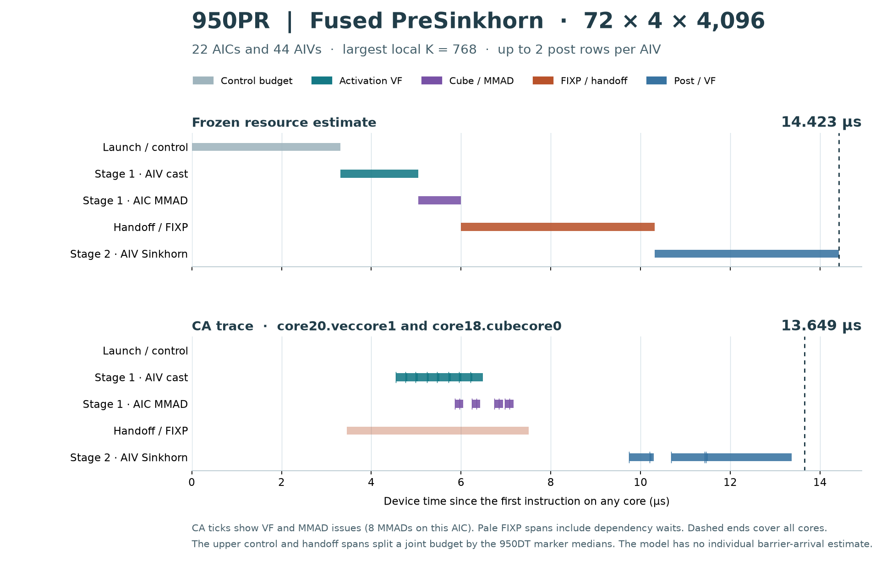

# 已接入的融合 PreSinkhorn 分块与时延

对于 `aclnnMhcPreSinkhorn` 的 BF16 `[T,4,4096]`、20 轮、无反传合同，公开默认入口已在 T<128、每个 AIC 配两个 AIV 的联合工作组上启用分段排程。两端用相同的十种几何独立复验后接入。输入达到 128 行时，950 库会启用另一支工作组；970DT 配置的 AIV:AIC=1:1 也属于其它分支。它们继续返回原重叠模板的外推值，可从 `projection["timing_diagnostics"]["schedule"]` 区分。自定义 2:1 芯片可使用同一个资源公式，计时也标外推。[冻结形状、逐端 API 对齐及历史分组](fused-public-installed.json)

| 数据角色 | SKU | 形数或窗数 | 公开 WAPE / 最大 | 同集旧版 WAPE / 最大 |
|---|---|---:|---:|---:|
| 两端匹配独立 | 950DT | 10 形 / 10 窗 | 3.21% / 10.61% | 20.56% / 48.53% |
| 两端匹配独立 | 950PR | 10 形 / 10 窗 | 6.11% / 11.37% | 24.80% / 44.11% |
| 含仅 PR 完整的 T127 | 950PR | 11 形 / 11 窗 | 6.69% / 11.37% | 26.55% / 44.11% |
| 旧开发回放 | 950DT | 24 窗 | 5.97% / 12.89% | 7.91% / 18.32% |
| 旧开发回放 | 950PR | 20 窗 | 5.39% / 14.00% | 9.39% / 21.88% |

历史 PR T≤16 的十窗 WAPE 从 5.86% 升至 6.93%，最大均为 14.00%。独立十对 DT/PR 耗时比 WAPE 从 4.68% 升至 6.88%，最大从 7.91% 升至 12.63%，两版快慢方向均正确 7/10。跨代预测没有 970DT 实测。T127 DT 三组全元素 golden 通过，早先冻结的 epilogue 与官方全窗相差 3.001351 周期，略超过上限。原失败保留，十对统计使用在双侧采集前启用的冻结后备 T91。[失败诊断](fused-t127-dt-physical.json) · [后备事前登记](reserve-activation.json)

## 950PR [72,4,4096] 的四段工作

以下所有时间单位为微秒。N=4 是残差流数，D=4096 是每流的隐藏维，投影长度 K=N·D=16384，输出列数 O=N²+2N=24，按 16 对齐为 32。使用 950PR 配置的 28 AIC 和 56 AIV。对于 T<128，M 分块只有一组，按 AIC 数切 K，并把每段的 K 向上对齐到 256。于是最宽分块 k=256·⌈⌈16384/28⌉/256⌉=768，需要 ⌈16384/768⌉=22 个 AIC。第二阶段每个 AIV 最多负责 r=⌈72/56⌉=2 行，36 个 AIV 有第二阶段载荷；跨核联合启动时实际共用到 22 个 AIC 和 44 个 AIV，CA 的核清单相符。

- **激活与转换。** 每个 AIV 的关键块处理 E=⌈T/2⌉·k=27648 个元素。价格是 950DT trace 的 0.100703 个参考 Vector 周期/元素，用目标每 AIV FP32 价格换算；若给了本地 MTE2 带宽，同时施加 2E 字节的最低读取时间。目标为 1.733 µs。
- **块投影。** 令 m=16⌈T/16⌉=80，o=16⌈O/16⌉=32；每个关键 AIC 需要 m·o·k=1,966,080 个对齐乘加。该库的 L1 页 K 步长为 128⌊min(⌊32768/m⌋,1024)/128⌋=384，L0 步长为 32⌊256/max(m,o)⌋=96。每个满 K 分块共两页、每页四次 MMAD。设备用独立的发起项“8 次 × 76.524 目标时钟周期”，计算项按每 1024 个对齐乘加 0.49684 个 DT 参考周期计价，再按目标每 AIC 峰值换算，合计 0.949 µs。HF32 投影取 16-bit Cube 牌价的相对速率作为代理，未独立测得新芯片的 HF32 吞吐。
- **第二阶段。** 每行 3299.0 个参考 Vector 周期，来自 950DT 第二维阶段在末 AIV 上的 VF 跨度，依目标每 AIV FP32 峰值重定价。两行需要 4.107 µs。
- **启动和交接。** 用同一芯片一行模板总成本，扣除一行输入的前三项，余下的 7.633 µs 作为启动与跨工作组交接预算。图中按 DT 初次 VF 和交接间距中位数 5804:7571 分开绘制这笔预算。这个分配只解释画面，逐核到达 barrier 的确切周期目前不可辨识。

前三项加控制预算为 14.423 µs，还需满足输入、权重和输出按芯片外存带宽传输的下界。本例下界较低，预测整窗仍为 14.423 µs。装包实际 kernel 是 `MhcPreSinkhorn_bd8e37c67f2294e1437f03bb2bace96c_1000_mix_aic`。CA 为 13.649 µs，高估 0.774 µs（5.67%）。模型投影段开始 5.046 µs，实际首条 MMAD 5.860 µs；模型第二阶段从 10.316 µs 开始，而末 AIV 已在 9.748 µs 发起。这两个时序误差方向相反。该次 trace 的 66 个物理核及 hin、hpost、hres 三份全输出均完成资格检查。[分段价格与其来源](../../v0.26/presink/prices.json) · [各条带的真实 PC、工作核与全窗](fused-t72-pr-timeline.json)



```python
from operator_model import estimate

r = estimate("mhc_pre_sinkhorn", (72,4,4096), dtype="bf16", chip="Ascend950PR_957b")
print(r.status, r.latency_us, r.active_aic, r.active_aiv)
print(r.projection["target_plan"], r.projection["stages_us"], r.work)
```

从源码树外安装 wheel 后，核对 11 种形状在 DT/PR/970 三端的 33 项冻结预测，及两端原有 44 个回放窗，数值完全一致。693 次公共 API 查询中位 0.260 ms，P99 0.311 ms，最大 4.338 ms，含首次装入参数。用于补足匹配集的两次 T91 CA 各耗时 250.39 秒（DT）和 264.15 秒（PR）。[完整 API 校验](fused-public-installed.json)
