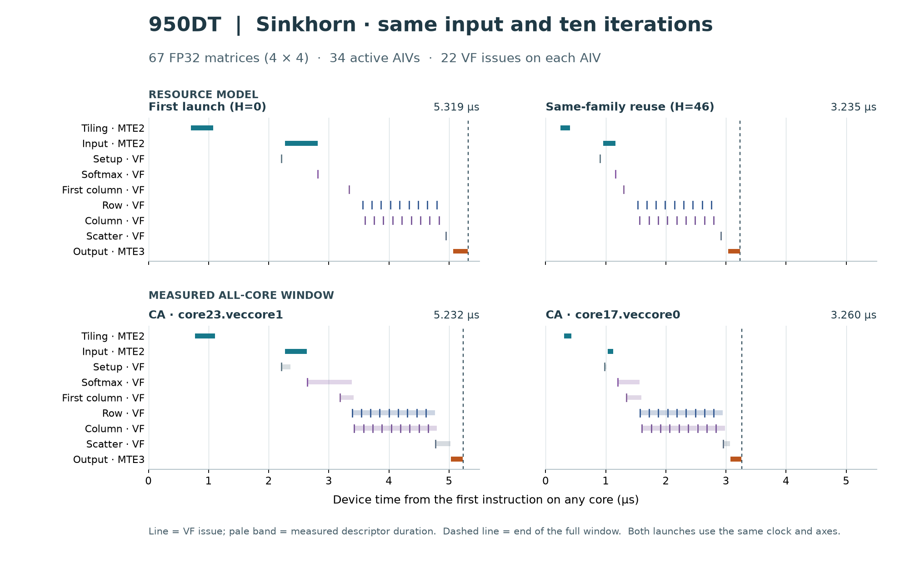

# 已接入的显式前序 Sinkhorn 流水

`estimate("mhc_sinkhorn", (T,4), {"num_iters": I, "resident_aiv": H})` 为独立 `aclnnMhcSinkhorn` 定价。实际输入是 `[T,4,4]` 连续 FP32 张量，输出为同尺寸 FP32；API 用 `(T,4)` 表示这个方阵合同。H 是调度器在**同一卡、同一流、同一内核家族**上已知的活动 AIV 高水位。首次启动用 0；同族且此前已覆盖 46 个核可传 46。上下文未知时省略 H，或传 `None`。工具不会根据相同 shape 的观测或混合算子序列推断 H。

| 独立数据 | SKU | 不同形状 / 启动窗 | 显式 H 的 WAPE / 最大 | 原 shape-only 同集 WAPE / 最大 | 公开资格 |
|---|---|---:|---:|---:|---|
| T≤256 | 950DT | 10 / 11 | 3.09% / 8.31% | 16.64% / 37.21% | 已验证 |
| T≤256 | 950PR | 10 / 11 | 3.88% / 12.92% | 25.75% / 80.84% | 已验证 |
| T>256，仍为单 UB 块 | 950DT | 4 / 4 | 12.96% / 26.37% | N/A | 外推 |
| T>256，仍为单 UB 块 | 950PR | 4 / 4 | 20.37% / 37.53% | N/A | 外推 |
| 任一 970DT 输入 | 970DT | 0 / 0 | N/A | N/A | 跨代外推 |

四个大形在两端均符合 WAPE≤25%、最大≤50% 的目标。它们仅覆盖四种几何，不能单独支持大形分支的十形验证。原域的 11 对 DT/PR 耗时比 WAPE 为 4.50%，最大 16.86%，快慢方向对 8/11。扩展域为 7.20%、11.62%、1/4，预测两个接近的耗时相除时，误差可能改变快慢方向。[逐窗、冻结预测、源 trace 散列和安装包校验](public-sink-installed.json)

## 从 shape 到全核耗时

设 A 是配置的 Vector 核数，R=⌈T/A⌉ 是关键 AIV 承担的矩阵数，C=⌈T/R⌉ 是有载荷的核数，G=⌈R/8⌉ 是本核需要的寄存器组数。库核每个工作核发起 2I+2 个 VF，包括设置、初始 softmax、交替的行/列规约及输出重排。前序状态按 H=0、0<H<C、H≥C 分别选首次、扩核、热态价格。状态选择只依赖传入的 H 和当前分核。

预算以**目标每核周期**表示。设 F 为 GHz 频率，P 为整片 FP32 Vector TOPS，基准每核 FP32 峰值为 255.681818 操作/周期，r = (1000 P / (A F)) / 255.681818。若 target 只有总算力，先除核数和频率再换算成本，避免重复使用整片核数。2× 用于换算配置标称 FMA 的操作数；P 已按操作/秒给出时不再乘 2。一个价格阶段的控制项为 θ₀+θ₁C，单位为周期；θ₀ 表示该状态的固定指令/队列等待，θ₁ 是每增加一个工作核带来的发起展开或队列延迟。价格来自 950DT 每个阶段的相邻真实 PC 时间差。首次、扩核分别有 16 个源窗；热态只有 2 个开发源窗，由新独立序列检验可重复性。源头的状态价格可直接逐项核查。[原始阶段价格与来源摘要](../../v0.26/sink/prices.json)

每个关键核读写各 64R 字节，每片读写各 64T 字节。令本地 MTE2 带宽 b₂、MTE3 带宽 b₃ 和全片外存 B 的单位都为 GB/s。读的字节下界为 max(64R·F/b₂,64T·F/B) 个周期，写同理使用 b₃。无独立本地端口数据时，以已测描述符等待和全片带宽下界取较大值。96 字节 tiling 单独读，然后才发起输入读；读完成后触发 softmax。设 F₀ 为首次列规约发起时刻，取“softmax 发起 + 231G/r”与“setup 发起 + 已测到首列的控制距离”较大者。随后首次行规约于 F₀+378G/r 发起。从首行到 scatter 的增量为

```text
I = 1      0
I ≥ 2      [248 + max(0,I−2) × 254] × G/r   个周期
```

248 与 254 为 DT trace 中每核第一对和稳态的行/列发起间隔。scatter 后用该状态的写发起间隔和 MTE3 描述符退休价，最后加出口指令。周期除以 1000F 得到微秒。返回的 `issue_epochs_us` 是全核第一条设备指令为零的时标，`stages_us` 为六个相邻区段，求和等于预测整窗。模拟条件为单 UB 块，保守的内存门槛是 896R+832 字节（双缓冲工作区、mask 和对齐预留）。多 UB 分块有不同的块间先后约束。此时仍可提供核数和算法工作量，耗时返回 `unavailable`。

## 950DT 同一输入，首次与热态为何相差 2 µs

输入 `(67,4)`、I=10、64 个 AIV、1.65 GHz，得到 R=2、C=34、G=1。芯片每次读入和写出各 4,288 B，关键 AIV 各 128 B，共 22 个 VF 发起。API 的算法工作量为 46,632 个 Vector 标量等价运算（24,120 个 ALU、1,072 个 exp、21,440 个 div），Cube 为零；算法运算数与实际 VF 发起数分别报告。后一次 H=46 已覆盖当前 34 个核。改变的是前段到达与等待时间，发起工作量和归一化稳态间隔均相同。

| 关键时标或量（µs） | H=0 首次 | H=46 热态 |
|---|---:|---:|
| tiling 读发起 → 完成 | 0.703 → 1.077 | 0.246 → 0.406 |
| 输入读发起 → 完成 | 2.270 → 2.814 | 0.960 → 1.158 |
| 首列 / 首行 VF 发起 | 3.337 / 3.566 | 1.301 / 1.530 |
| 稳态两次行规约间隔 | 0.154 | 0.154 |
| scatter VF / 写回发起 | 4.948 / 5.070 | 2.912 / 3.034 |
| 模型 / CA 整窗 | 5.319 / 5.232 | 3.235 / 3.260 |



CA 调用安装包 `aclnnMhcSinkhorn`，设备 ELF 为 `MhcSinkhorn_8997d9c5c22e82688b98bc25d8daa9cd_0`，两个端点均检查 golden 全输出、每核 VF 数、输出搬运和真实退出。950PR 首次的 CA 为 5.068 µs，对应预测为 5.367 µs；同族 H=46 观测为 3.28545 µs，预测为 3.28575 µs。[DT 每根条带与指令 PC](950dt-same-input.json) · [PR 图](950pr-same-input.png) · [PR 源数据](950pr-same-input.json)

```python
from operator_model import estimate

result = estimate(
    "mhc_sinkhorn", (67, 4),
    {"num_iters": 10, "resident_aiv": 46},
    chip="Ascend950DT_9582", dtype="fp32",
)
print(result.status, result.latency_us, result.active_aiv)
print(result.projection["timing_diagnostics"]["issue_epochs_us"])
print(result.work["logical_read_bytes"], result.work["logical_write_bytes"])
```

970DT 的新芯片预测使用相同分核与依赖公式及目标芯片资源，并标记 `extrapolated`。迭代数支持 1 到 100，2 到 32 有开发或独立 trace；其余迭代数也标外推。显式 `timing_mode="calibrated"` 只返回已确认范围的数值。独立安装的 wheel 从源码目录外核对 45 条事前预测，整窗和各关键发起时标全部数值一致。在本机 945 次 Python 公共查询中位为 0.094 ms，P99 为 0.122 ms，最大为 4.093 ms，包含首次参数访问。[安装包结果](public-sink-installed.json)
