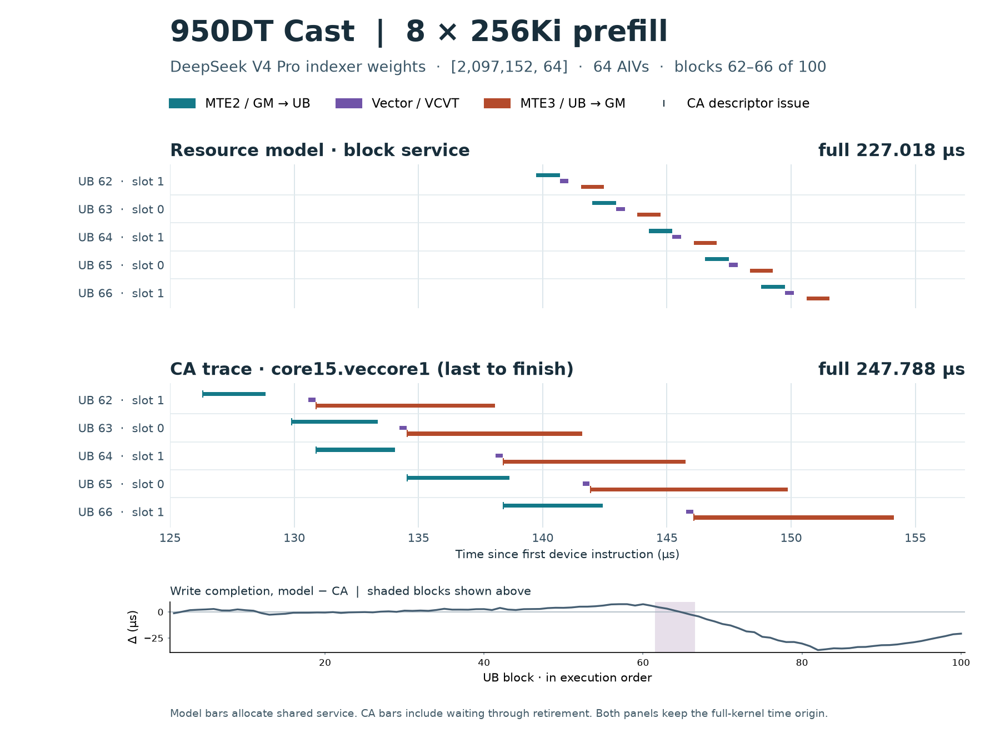

# 100 个 UB 块的预测、实测与片外字节



DeepSeek V4 Pro 单卡 B8×256Ki 的 64 个 indexer 系数展平后得到 [2097152,64]。在目标机的安装包中执行一次 `aclnnCast`，64 个 AIV 全部结束，134,217,728 个 FP32 结果逐位通过。模型 **227.018 µs**，全核 CA **247.788 µs**，误差 **−8.38%**。成本为 3,082 秒、峰值临时文件 39.40 GiB。该图和以下分析全部复用同一次采集。上图中部的写等待与读算发生重叠，底部曲线在第 82 块达到 −36.487 µs。[首四块](../../v0.26/memory/pro-b8-256ki-dt-head.png) · [尾四块](pro-256ki-dt-blocks-97-100.png) · [完整调用、金标和全核退出](../../v0.23/pro-prefill/pro-b8-256ki-dt.json) · [100 个地址块与起止](../../v0.23/pro-prefill/pro-b8-256ki-dt-blocks.json)

| B8×256Ki Pro，设备端 | 950DT | 950PR | 970DT |
|---|---:|---:|---:|
| 冻结公开模型，µs | 227.018 | 520.357 | 104.673（外推） |
| 本次合格 CA，µs | 247.788 | 529.287 | N/A |
| 逻辑读 / 写，MiB | 256 / 512 | 256 / 512 | 256 / 512 |
| 模型计入片外的读 / 写，MiB | 256 / 426.667 | 256 / 437.333 | 256 / 384.843（外推） |
| 控制器实测读 / 写，MiB | 256.051 / 444.113 | N/A | N/A |

同一输入在 PR 的真实末核执行 114 轮，整窗低估 1.69%，CA 用时 58 分 32 秒。模型对双槽首次两读的发起均晚了 0.416 µs，间隔仍准确到一个时钟。若用此前的缓存压力候选，预测 506.517 µs，低估扩大到 4.30%。[PR 全核与输出校验](../../v0.23/pro-prefill/pro-b8-256ki-pr.json) · [原冻结预测同集比较](../../v0.26/memory/pro-b8-256ki-pr-score.json)

DT 的控制器覆盖整个进程，128 份原生文件的读写命令大小直方图之和等于 DMC/DDR 报告的 734,174,720 B。与模型的片外预算相比多了 17.497 MiB。它解释了部分高估带宽的现象；指标覆盖元数据和收尾，且没有逐核总线仲裁标识，不能从它唯一还原某个 UB 的写等待。[逐周期读写及 128 个文件哈希](pro-256ki-dt-controller-periods.json) · [控制器原始累计值](../../v0.26/memory/pro-b8-256ki-dt-controller.json) · [冻结的双端及 970DT 预算](../../v0.26/memory/pro-256ki-prefix-forecast.json)

## 哪些 PR 误差能用缓存解释

复用九个已完成的 Cast/Sigmoid 窗口，逐核读取真实 GM 地址、长度、描述符发起与退休，和原采集按核重算的 SHA-256 验证一致。以下四个 PR 样例属于**开发诊断**。设输入、输出为 $X,Y$ 字节，首个输入读到最后一个数据 DMA 退休之间有 $T$ µs。假如所有冷输入与离开缓存的输出都必须在这个窗口经过标称 $B$ GB/s 的单一链路，则最少须留下 $D_{req}=X+Y-1000BT$ 字节的脏输出。这里 $B=1400$ 是 PR 配置中的产品档位假设。使用 112 MiB L2 模拟完全相联字节 LRU 和直接取模的 1/4/8/16 路、64/128 B 行 LRU。允许所有读早到发起、所有写晚到退休，取各组织的最大脏字节。该上界只约束列出的替换和地址映射假设。

| 950PR 开发窗 | 必须留下的脏输出 MiB | 测试的 LRU 最多能留下 MiB | 只考虑读时，窗口需要的最高 GB/s | 读窗口在 1400 GB/s 下仍缺 MiB |
|---|---:|---:|---:|---:|
| Cast [1048576,32] | 98.86 | 86.26 | 1458.4 | 0.755 |
| Cast [4096,7168] | 96.37 | 90.77 | 1481.8 | 1.232 |
| Sigmoid [1572864,12] | 73.54 | 69.61 | 1562.4 | 4.871 |
| Sigmoid [2097152,12] | 75.85 | 69.95 | 1539.2 | 3.803 |

最后一列甚至把全部标称带宽让给输入，允许任意交错、抢占、跨核共享。每笔输入读的区间两端向外取整，再各放宽一个设备周期。枚举区间 $[a,b]$，计算发起和退休都落入区间的最低输入量，并以最早到期优先的队列独立计算未能如期送达的字节。比如第二个 Sigmoid，即使片外完全不写，局部读密度仍达到 **1539.2 GB/s**。五个 950DT 同类窗口在配置的 4000 GB/s 下都能装下全部输入读。这检验的是冷读、描述符窗口和标称带宽三个假设的组合。预取或初始驻留、异步服务与退休的关系、模拟器实际带宽都有待分别测量。尚无 PR 的同口径控制器计数可以分摊三者。给 PR 调一个更大的通用带宽会将未辨识的机制带入 970DT。[每个最紧区间及原始指纹](read-windows.json) · [两种访问顺序及缓存组织的计算代码](../../../development/validation/memory27/retention.py) · [算例芯片配置](../../../configs/chips/Ascend950PR_957b.json)

设置 L2 缓存提示涉及访问策略；芯片公布的 L2 容量与实际命中、miss 流量是不同的观测量。物理 L2 事件或读写回执对判断这些假设更直接。[CANN 平台属性](https://www.hiascend.com/doc_center/source/zh/CANNCommunityEdition/910/API/runtimeapi/aclcppdevg_03_2279.html) · [CANN 的 L2 访存性能指标](https://www.hiascend.com/doc_center/source/zh/CANNCommunityEdition/910/devaids/Profiling/atlasprofiling_16_0069.html)

两个 156 MiB 形状原本已经在队列中，预登记的检验为“纯读峰值是否超过芯片配置的 101%”。预期 PR 超过、DT 不超过，阈值和代码哈希在结果公开前封存，额外 CA 调用数为零。[前向登记](read-freeze.json) · [独立结果](read-holdout.json)

在冻结的 156 MiB Cast [851968,32] 上，DT 的 1,344 条完整输入读覆盖 54,525,952 B，最紧区间 2614.02 GB/s，名义 4000 GB/s 可以调度，CA 全窗 26.481 µs。PR 的一核缺退出记录，保留耗时 N/A。在其余 55 个完整核的子集上，最紧区间已经要 1485.05 GB/s，1400 GB/s 下至少缺 1.555 MiB 的读取服务。加入遗漏的核只会增加此区间需求。这个反例约束的是“全部请求在描述符窗口内经同一冷链路服务”的假设，不能据此推出真实 HBM 带宽。[PR 不完整窗口的保守检查](pr156-partial.json) · [DT 原始核与输出核验](../../v0.25/cache/cast_bf16_fp32-dt-result.json)

同为 156 MiB 的 Kimi beta Sigmoid [1703936,12] 在 PR 获得了全部核的独立窗口。公开预测 **78.311 µs**，压力候选 **62.408 µs**，CA **63.807 µs**（分别 +22.73% / −2.19%）。最紧读区间要求 1551.21 GB/s，在冷读假设下较 1400 GB/s 多 4.220 MiB，符合采前预测。该输入的开始与全部输出均完成核验，采集墙钟 14 分 12 秒。[真实库与数值检查](../../v0.25/cache/sigmoid_fp32-pr-result.json) · [独立的读区间审计](read-holdout.json)

从仓库根目录执行下列命令可以从已归档的工作块 JSON 重画目标区域。更换 `--first` 和 `--count` 即可看其他块。

```bash
toolchains/envs/cann-9.2.1/bin/python development/validation/memory27/block_figure.py --first 62 --count 5
```
