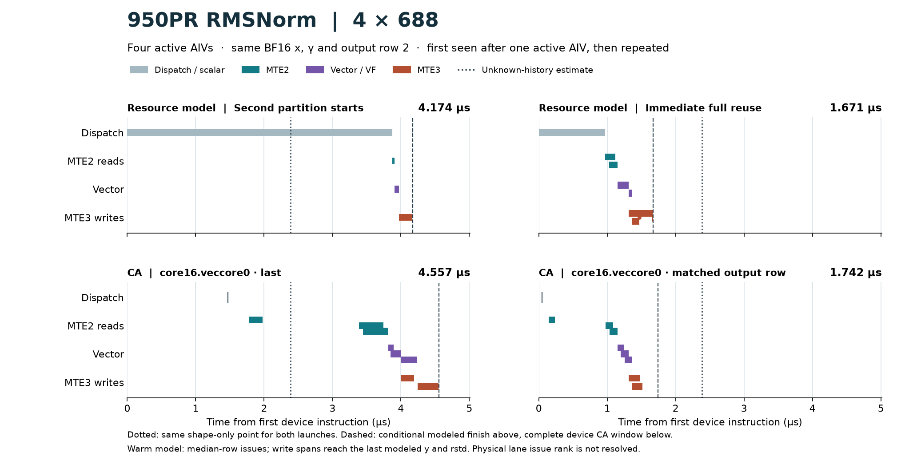

# RMSNorm 无前序点预测

| 芯片 | 两个前序都合格的独立 shape | 首次遇到该形，候选 / 旧默认 WAPE、最大 | 同形立即复跑，候选 / 旧默认 WAPE、最大 |
|---|---:|---|---|
| Ascend950DT_9582 | 9/10 | 25.67% / 48.43% · 21.69% / 44.95% | 22.70% / 42.50% · 35.59% / 57.61% |
| Ascend950PR_957b | 8/10 | 20.92% / 47.62% · 18.22% / 47.44% | 19.99% / 36.98% · 32.48% / 52.39% |

已返回 6/8 个宿主进程、35/40 个核验合格的目标窗。公开 shape-only 继续采用当前估计。候选接入所需的两端独立完整配对、两种前序各 WAPE≤25% 且最大≤50% 的判定为尚未通过。970DT 均为外推。

## 同一形状的两个资源端点

对完全覆盖的热态，令 $A$ 为本次活动 AIV 数、$K=\lceil D/128\rceil r$ 为本核处理 $r$ 行的向量组数。首条 gamma 搬运发起中位周期为 $G=g_0+g_A(A-1)$，各核发起的离散幅度按在同一 rstd 扇区的核数分配。x 描述符在 gamma 发起后 96 周期发出。等两条读都退休才能开始归约，数据就绪时刻还要满足本核读取总字节的端口下界。

令 $t_r$ 为归约后发出 rstd 写的时刻。归约到该时刻的成本按固定开销和每向量组的服务相加；从 $t_r$ 到 y 写发起另计规范化。对于同一个 128 B 扇区上的 FP32 rstd，依次按 $d_j=\max(t_{r,j}+L_{solo},d_{j-1}+I_{sector})$ 退休。最终取 y 与 rstd 的最晚完成，加退出周期，并满足 MTE、L2、HBM 下界。训练单元是某条 DMA 的发起、响应或 VF 到写发起的间隔。每次启动在端口/向量拟合中只贡献一次统计。没有使用 shape 的实测总时定价。超过一个 UB tile 的核使用既有多段排程。

上端点为单独首次调用 $T(H=0)$ 和已用一个 AIV、开始启用第二分区 $T(H=1)$ 中较慢者。下端点为完全覆盖时的资源估计。两端假设时延为 $l,u$，相对误差平衡点 $2lu/(l+u)$ 满足 $p/l-1=1-p/u$。这只是两个模型场景之间的决策，真实 CA 可以落在两端之外。其他前序与同时工作的其他流也会改变终点。输入仍只有 shape、dtype、chip。各 AIV 的计算量按核数和 tile 上界展开，训练不要求未来芯片上提供结果。

## 先前配对中的偏差

旧的冷、热谐均参考在 950PR [4,608] 给 2.219 µs。H=1→4 会打开第二个派发分区；CA 4.578 µs，单独冷启动的预测只有 3.081 µs，显式给这个扩核前序则为 4.166 µs。末核 x 读约 3.37–3.88 µs；同形紧接重复则是约 1.03–1.17 µs，完整窗 1.762 µs。相反，两核 [2,2944] 的热态已知 H 预测 1.852 µs、实测 1.610 µs。其末核 y 写发起、退休约 1.49、1.60 µs，而旧单条热 y 描述符预算约 0.209 µs。分别估首发和热态的确切指令响应可以同时处理两个偏差。

| 数据角色 | SKU | 首次或扩核候选 | 完全覆盖候选 | 冷/热端点谐均，前 / 后 | 旧默认，前 / 后 |
|---|---|---:|---:|---|---|
| v0.23 同形双端与同进程剔除开发 | Ascend950DT_9582 | 23.56% / 49.13% | 20.58% / 46.75% | 23.42% / 48.96% · 23.61% / 49.45% | 19.36% / 45.25% · 37.33% / 57.94% |
| v0.23 同形双端与同进程剔除开发 | Ascend950PR_957b | 23.55% / 48.21% | 18.66% / 46.68% | 23.81% / 51.54% · 19.98% / 45.64% | 20.71% / 47.80% · 33.00% / 53.97% |
| 早期 199 窗开发回放 | Ascend950DT_9582 | 19.47% / 46.15% | 13.08% / 31.74% | 18.87% / 47.18% · 14.85% / 36.96% | 12.69% / 43.22% · 30.12% / 54.94% |
| 早期 199 窗开发回放 | Ascend950PR_957b | 19.78% / 41.45% | 16.97% / 21.67% | 19.73% / 42.17% · 13.85% / 19.03% | 13.47% / 38.35% · 31.44% / 37.69% |

早期回放的“完全覆盖”包括已覆盖全部所需 AIV 的普通前序；新实验的第二窗为同形同一流的立即复跑。两种覆盖协议的缓存与指令响应可能有差异。单次真实芯片资源响应尚不能覆盖所有这些隐状态。

| 热态阶段 | 基础周期 | 增量周期 | 单位 |
|---|---:|---:|---|
| gamma_issue | 1583.60 | 4.431 | 每多一块活动 AIV |
| issue_spread | 0.00 | 11.075 | 每多一块活动 AIV |
| x_response | 197.25 | 10.909 | 每 KiB |
| gamma_response | 240.85 | 7.605 | 每 KiB |
| reduce | 227.71 | 4.860 | 每 128 通道向量组 |
| normalize | 44.73 | 6.318 | 每 128 通道向量组 |
| y_response | 159.22 | 3.976 | 每 KiB |

来源为 18 个旧的双端热态单 UB 启动。x 与 gamma 发起间隔 96 周期，rstd 最短独占响应的逐窗中位数 127.5 周期。同一扇区后继退休间隔沿用 v0.22 的 157 周期，退出 9 周期。响应的基础项衡量端口固定开销，增量项按目标端口字节价或每核每周期 FP32 吞吐缩放。冷/开分区取现有已校准分支。

## 独立逐窗

| 芯片 | [T,D] | 真实前序 H | 时序 | 当前默认 / 冷热谐均 / 新候选 µs | 已知 H / CA µs | 新候选偏差 | 970DT 外推 µs |
|---|---|---:|---|---:|---:|---:|---:|
| Ascend950DT_9582 | [1, 736] | 0 | entry | 2.290 / 2.150 / 2.001 | 3.190 / 3.536 | -43.40% | 1.835 |
| Ascend950DT_9582 | [1, 736] | 1 | repeat | 2.290 / 2.150 / 2.001 | 1.622 / 1.453 | +37.77% | 1.835 |
| Ascend950DT_9582 | [4, 688] | 1 | entry | 2.448 / 2.276 / 2.386 | 4.173 / 4.447 | -46.34% | 2.187 |
| Ascend950DT_9582 | [4, 688] | 4 | repeat | 2.448 / 2.276 / 2.386 | 1.737 / 1.738 | +37.33% | 2.187 |
| Ascend950DT_9582 | [19, 2416] | 4 | entry | 4.232 / 3.921 / 3.820 | 4.172 / 4.740 | -19.41% | 3.501 |
| Ascend950DT_9582 | [19, 2416] | 19 | repeat | 4.232 / 3.921 / 3.820 | 3.289 / 3.380 | +13.01% | 3.501 |
| Ascend950DT_9582 | [35, 1744] | 19 | entry | 5.680 / 5.249 / 5.090 | 4.597 / 4.647 | +9.52% | 4.665 |
| Ascend950DT_9582 | [35, 1744] | 35 | repeat | 5.680 / 5.249 / 5.090 | 4.591 / 4.494 | +13.25% | 4.665 |
| Ascend950PR_957b | [1, 736] | 0 | entry | 2.233 / 2.100 / 1.959 | 2.977 / 3.233 | -39.41% | 1.835 |
| Ascend950PR_957b | [1, 736] | 1 | repeat | 2.233 / 2.100 / 1.959 | 1.623 / 1.465 | +33.65% | 1.835 |
| Ascend950PR_957b | [4, 688] | 1 | entry | 2.395 / 2.223 / 2.387 | 4.174 / 4.557 | -47.62% | 2.187 |
| Ascend950PR_957b | [4, 688] | 4 | repeat | 2.395 / 2.223 / 2.387 | 1.737 / 1.742 | +36.98% | 2.187 |
| Ascend950PR_957b | [19, 2416] | 4 | entry | 4.190 / 3.850 / 3.807 | 4.172 / 4.552 | -16.36% | 3.501 |
| Ascend950PR_957b | [19, 2416] | 19 | repeat | 4.190 / 3.850 / 3.807 | 3.289 / 3.255 | +16.97% | 3.501 |
| Ascend950PR_957b | [35, 1744] | 19 | entry | 5.657 / 5.169 / 5.015 | 4.597 / 4.807 | +4.34% | 4.665 |
| Ascend950PR_957b | [35, 1744] | 35 | repeat | 5.657 / 5.169 / 5.015 | 4.591 / 4.507 | +11.27% | 4.665 |
| Ascend950DT_9582 | [31, 1552] | 0 | entry | 5.508 / 5.117 / 4.977 | 5.995 / 6.067 | -17.97% | 4.562 |
| Ascend950DT_9582 | [31, 1552] | 31 | repeat | 5.508 / 5.117 / 4.977 | 4.463 / 4.335 | +14.82% | 4.562 |
| Ascend950DT_9582 | [129, 1376] | 31 | entry | 4.023 / 3.420 / 3.370 | 3.563 / 3.841 | -12.25% | 3.436 |
| Ascend950DT_9582 | [129, 1376] | 43 | repeat | 4.023 / 3.420 / 3.370 | 2.796 / 2.708 | +24.46% | 3.436 |
| Ascend950PR_957b | [31, 1552] | 0 | entry | 5.479 / 5.037 / 4.903 | 5.782 / 6.077 | -19.33% | 4.562 |
| Ascend950PR_957b | [31, 1552] | 31 | repeat | 5.479 / 5.037 / 4.903 | 4.463 / 4.428 | +10.71% | 4.562 |
| Ascend950PR_957b | [129, 1376] | 31 | entry | 4.019 / 3.354 / 3.372 | 3.566 / 3.724 | -9.43% | 3.436 |
| Ascend950PR_957b | [129, 1376] | 43 | repeat | 4.019 / 3.354 / 3.372 | 2.796 / 2.856 | +18.09% | 3.436 |
| Ascend950DT_9582 | [2, 2816] | 1 | entry | 2.521 / 2.386 / 2.341 | 4.307 / 4.540 | -48.43% | 2.146 |
| Ascend950DT_9582 | [2, 2816] | 2 | repeat | 2.521 / 2.386 / 2.341 | 1.840 / 1.643 | +42.50% | 2.146 |
| Ascend950DT_9582 | [3, 3520] | 2 | entry | 2.618 / 2.479 / 2.423 | 2.748 / 2.745 | -11.72% | 2.221 |
| Ascend950DT_9582 | [3, 3520] | 3 | repeat | 2.618 / 2.479 / 2.423 | 1.928 / 1.854 | +30.71% | 2.221 |
| Ascend950DT_9582 | [5, 5680] | 3 | entry | 2.877 / 2.706 / 2.727 | 3.523 / 3.445 | -20.83% | 2.500 |
| Ascend950DT_9582 | [5, 5680] | 5 | repeat | 2.877 / 2.706 / 2.727 | 2.135 / 2.142 | +27.34% | 2.500 |
| Ascend950PR_957b | [2, 2816] | 1 | entry | 2.467 / 2.334 / 2.346 | 4.309 / 4.336 | -45.89% | 2.146 |
| Ascend950PR_957b | [3, 3520] | 2 | entry | 2.565 / 2.426 / 2.426 | 2.751 / 2.853 | -14.96% | 2.221 |
| Ascend950PR_957b | [3, 3520] | 3 | repeat | 2.565 / 2.426 / 2.426 | 1.931 / 1.881 | +28.96% | 2.221 |
| Ascend950PR_957b | [5, 5680] | 3 | entry | 2.829 / 2.653 / 2.732 | 3.528 / 3.309 | -17.45% | 2.500 |
| Ascend950PR_957b | [5, 5680] | 5 | repeat | 2.829 / 2.653 / 2.732 | 2.140 / 2.033 | +34.35% | 2.500 |

## 当真实前序已知时

| SKU | 协议 | 仅按 shape 的新候选 | 按真实 H 的生产估计 | 冻结热端点（仅复跑） |
|---|---|---:|---:|---:|
| Ascend950DT_9582 | entry | 25.67% / 48.43% | 5.01% / 11.98% | — |
| Ascend950DT_9582 | repeat | 22.70% / 42.50% | 3.59% / 11.99% | 4.64% / 9.52% |
| Ascend950PR_957b | entry | 20.92% / 47.62% | 6.04% / 8.41% | — |
| Ascend950PR_957b | repeat | 19.99% / 36.98% | 2.39% / 10.72% | 5.00% / 11.00% |

下界假设在知道每个实测对以后，可任意选择一个同时服务这对的点。单对相对最坏下界为两端差的绝对值除以两端之和；两个协议不能区分时，两组 WAPE 较差者的下界为每对绝对差求和除以每对两端总和。该事后下界不参与模型定价。

| SKU | 完整配对 | 最大误差下界 | 两协议较差 WAPE 下界 |
|---|---:|---:|---:|
| Ascend950DT_9582 | 9 | 46.85% | 23.10% |
| Ascend950PR_957b | 8 | 44.68% | 19.79% |

冻结时三种芯片 63 次独立候选查询墙钟中位数 0.290 ms，最大 2.571 ms。已返回进程的 CA 墙钟 659.0 秒。

[冻结的三端预测、硬件与程序版本](freeze.json) · [分阶段参数](prices.json) · [开发逐窗回放](development.json) · [候选与 CA 核对](score.json) · [实际指令窗口](landmarks.json)

## 同序号双端速度比

速度比取 DT 耗时除以 PR 耗时。两端均有完整同形前后双窗的形状才进入对照。

| 前序 | 双端对数 | 新无历史比值 WAPE / 最大 | 旧无历史比值 WAPE / 最大 | 给定真实 H 的比值 WAPE / 最大 |
|---|---:|---:|---:|---:|
| entry | 8 | 3.82% / 6.58% | 3.74% / 6.28% | 3.34% / 4.06% |
| repeat | 8 | 3.03% / 5.39% | 3.07% / 5.56% | 2.43% / 5.46% |

初采的缺口与补测分开保存。补测只有在同一新进程原样重放输入前缀、相邻的两次目标都通过时才能计入整对。

| 初采未合格目标 | 原因 | 当前可评分的替代对 |
|---|---|---|
| Ascend950PR_957b [2, 2816] repeat | ValueError('missing ELF entry/physical END/terminal label on core16.veccore0') | 待合格 |

[补测登记与单槽预算](recovery-freeze.json)

## 更多轮次与完整 prefill

早期归档中的 41,943,040 个元素有两种形状：8192×5120 与 32768×1280。每个样例直接列该形的完整 CA 窗。当前新对照集按相同形状双前序采集，历史的大形只有各自原有协议。

| 历史档案 shape | 950DT 新 / CA µs | 950PR 新 / CA µs |
|---|---:|---:|
| [8192, 5120] | 38.546 / 44.868 | 61.264 / 70.485 |
| [32768, 1280] | 38.560 / 44.585 | 61.259 / 69.729 |

以仓中 [DeepSeek Flash](../../../docs/workloads/deepseek-flash.md) 与 [DeepSeek Pro](../../../docs/workloads/deepseek-pro.md) 工作负载的独立 input_layernorm 为例，按整批一次派发：$T=8S$，$D$ 分别为 5120、7168。下表只给候选外推。单次独立 RMS 的这个大形没有该合同的完整 CA；实际分块 prefill 需按实际每次调度行数重新估计。

| 模型位置 | 每请求 S | 单卡 [T,D] | 950DT / PR / 970DT 外推 µs |
|---|---:|---|---:|
| Flash input_layernorm | 32768 | [262144, 5120] | 1311.91 / 3757.11 / 551.05 |
| Flash input_layernorm | 131072 | [1048576, 5120] | 5339.23 / 15263.73 / 2192.91 |
| Flash input_layernorm | 262144 | [2097152, 5120] | 10708.98 / 30605.89 / 4381.83 |
| Pro input_layernorm | 32768 | [262144, 7168] | 1848.98 / 5291.52 / 769.75 |
| Pro input_layernorm | 131072 | [1048576, 7168] | 7486.91 / 21399.89 / 3068.73 |
| Pro input_layernorm | 262144 | [2097152, 7168] | 15004.15 / 42877.73 / 6133.21 |

在这些多 UB 块情景，输入 x 和 y 读写量随 T 成正比，多轮重叠、最后一轮余量及缓存容量仍影响短区间的增量。Kimi 自定义的融合归一化须按其实际 kernel 合同单独验证。

## 两种误差约束能否同时做到

即便知道所有实测端点，取同一时延同时服务两次调用时，每形 $p_i$ 的可行区间为 $[l_i,u_i]=[\max(\min(E_i,R_i),0.5\max(E_i,R_i)),\min(\max(E_i,R_i),1.5\min(E_i,R_i))]$。此区间同时保留最大误差 50% 和不受支配的点。若非空，该形首次绝对误差可在两个端点到 $E_i$ 的距离之间连续取值。两个协议的绝对误差之和固定为 $D=\sum |E_i-R_i|$。将所有首次误差的最小值、最大值分别求和，所得区间必须与 $[D-0.25\sum R_i,0.25\sum E_i]$ 有交集。这个检验给出同时满足 WAPE 和最大偏差的充要条件。小 footprint 的物理分组只覆盖两派发分区各自首个物理核，950 的核内有两个 AIV，即本次活动核 $A\le4$。

| 数据 | 芯片 | 全部配对 WAPE 下界（含 50% 限制） | 小 footprint 配对数 | 小 footprint 下界 | 小组两协议同时达标 |
|---|---|---:|---:|---:|---|
| 旧配对开发 | Ascend950DT_9582 | 21.52% | 5 | 36.03% | 不可行 |
| 旧配对开发 | Ascend950PR_957b | 20.99% | 5 | 34.25% | 不可行 |
| 冻结后独立 | Ascend950DT_9582 | 23.10% | 4 | 39.08% | 不可行 |
| 冻结后独立 | Ascend950PR_957b | 19.79% | 3 | 35.30% | 不可行 |

小 footprint 的结论只适用于这些同输入但不同前序的完整配对。较大负载改变总体 WAPE 的权重，可以使总集跨过门槛。[逐组精确可行区间和窗口下界](feasibility.json)

## 原始全核物理终点复核

只用各原进程，从全片第一条指令到最后一条真实 ELF 指令完成为止。每个核都按同一规则去掉工具合成的 END_LABEL。次级口径不混入主验收的分母；各回执仍要求两个全输出正确、正式 ELF、所有核的入口/END、总写回字节及两份指令记录一致。

| SKU | 完整不同 shape | 首次或扩核 WAPE / 最大 | 同形复跑 WAPE / 最大 |
|---|---:|---:|---:|
| Ascend950DT_9582 | 9 | 25.65% / 48.41% | 22.78% / 42.65% |
| Ascend950PR_957b | 9 | 23.79% / 47.60% | 21.57% / 41.63% |

[全部原始物理终点](physical.json)

[每个阶段、时钟与实际 core](pr-second-partition.json)
