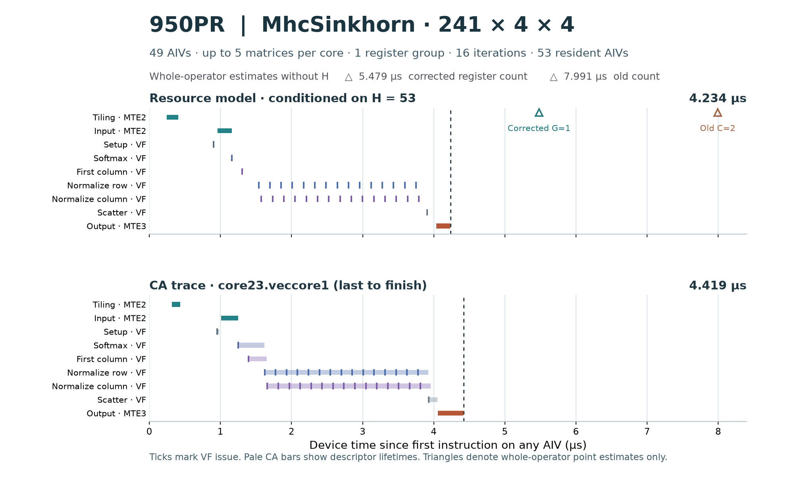

# Standalone mHC Sinkhorn 的默认点与已知前序资格

|开发回放|窗 / 不同形|旧无 H WAPE / 最大 %|压到条件端点|越界时用端点谐均|按真实 G 校正旧 SIMD|已知 H 旧 / 专项|
|---|---:|---:|---:|---:|---:|---:|
|950DT · legacy supported|45 / 43|13.48 / 39.20|13.48 / 39.20|13.48 / 39.20|13.48 / 39.20|3.94 / 31.41 → 3.94 / 31.41|
|950DT · old T>64/I10 development|3 / 3|25.64 / 39.20|25.64 / 39.20|25.64 / 39.20|25.64 / 39.20|3.89 / 8.06 → 3.89 / 8.06|
|950PR · legacy supported|31 / 30|13.94 / 80.84|11.96 / 50.04|10.90 / 37.41|10.93 / 37.41|3.83 / 12.92 → 3.83 / 12.92|
|950PR · old T>64/I10 development|1 / 1|8.55 / 8.55|8.55 / 8.55|8.55 / 8.55|8.55 / 8.55|8.70 / 8.70 → 8.70 / 8.70|

旧无 H 的 PR 最大偏差来自 **[241,4]、I=16、resident**。最忙核 R=5，旧公共式按每 64 个 FP32 字分包，`C=ceil(16R/64)=2`；安装库中的单 VF 内真实寄存器工作的单位为 `G=ceil(R/8)=1`。已在同一 PC 验证 scatter 的八条子指令与稳态的 254 周期发起，两者和 R=2 的 G=1 核一致。这个真实差别能解释旧模型额外付出一遍迭代费用。

|950PR 末核开发窗 T/I|R / G|VF 数|scatter 子指令数|稳态发起间隔 cycles|每方向 MTE 载荷 B|
|---|---:|---:|---:|---:|---:|
|67/10 · H=0|2 / 1|22|8|254.0|128|
|67/10 · H=46|2 / 1|22|8|254.0|128|
|241/16 · H=53|5 / 1|34|8|254.0|320|
|251/20 · H=44|5 / 1|42|8|254.0|320|
|449/8 · H=52|9 / 2|18|16|411.0|576|
|4097/4 · H=52|74 / 10|10|80|1659.0|4736|

## 三条资源对照

冻结阶段排程用同一实现的可达 H 算出区间 [L,U]。区间是模型情景，不是 CA 保证区间。把旧估计 p 压到最近端点可以保留区间内全部样本，但越界后保留的偏差方向仍可能同号。第二个对照仅在越界时改取 2LU/(L+U)，其余情况原样返回。两者仅用目标资源，不需要目标芯片有 CA。

第三个对照用实际寄存器组数改旧估时器的 SIMD 段。令 F 为旧 SIMD 固定发起成本（按 target frequency 换算），S 为旧 SIMD 全段，改用 `p′ = p − (S−F)(C−G)/C`。保留原控制、读写和各段固定成本，不改任何阶段系数。R≤4 时 C=G=1，任何芯片都得到旧值。旧无 H 机制只覆盖 T≤256，在 DT 的原支持域 R≤4，因此 DT 的 45 个老窗均保持原价。本项修订源自旧窗的指令数，独立资格由下文 T233 的两端冻结实验单列。

|PR 发生变化的旧窗|状态|旧价 / CA µs|[L,U]|端点 / 越界谐均 / 校正 G µs|旧 SIMD µs|读写都走 HBM 的理想时间 µs|
|---|---|---:|---|---|---:|---:|
|241/16|resident|7.991 / 4.419|4.234–6.630|6.630 / 5.168 / 5.479|5.622|0.0220|
|251/20|expand|9.249 / 6.427|4.867–7.304|7.304 / 5.842 / 6.109|6.878|0.0229|

例如 T241 时读与写各 64T=15,424 B，即便按全部发生于 1400 GB/s HBM，理想服务仅 0.0220 µs。吞吐只给出服务时间下限；它无法为高估的 7.991 µs 提供物理上限。原大偏差中可定位到错误迭代工作量，仍有未知前序造成的剩余误差。DT 在原 T>64/I10 三个窗里，T68 首发、T65 和 T66 均 resident，三条旧估计全在条件区间内。端点压缩和修正寄存器数都不能消除其 25.64% WAPE。

## 四个事前冻结几何的双端逐窗表

每一格的格式为 **旧无 H / 冻结无 H / 旧已知 H / 冻结已知 H / 完整 CA**，均为 µs。“待测”与“N/A”分别表示尚无合格回执与旧无 H 源本就没有定价。I 是迭代数。合格实测必须通过每核终止与所有输出检查。无 H 备选公式的开发回放与下表原本已冻结的两个预测独立区分。

|真实队列 / 序号|T / I|950DT|950PR|970DT 外推无 H / 已知 H|
|---|---|---|---|---|
|first/0|69 / 10|4.475 / 4.044 / 5.340 / 5.340 / 5.009|4.516 / 4.107 / 5.387 / 5.387 / 5.078|3.863 / 5.547|
|sequence/0|137 / 10|4.492 / 4.093 / 5.571 / 5.571 / 待测|4.533 / 4.146 / 5.618 / 5.618 / 待测|3.863 / 5.547|
|sequence/1|69 / 10|4.475 / 4.044 / 3.235 / 3.235 / 待测|4.516 / 4.107 / 3.286 / 3.286 / 待测|3.863 / 2.963|
|sequence/2|1153 / 6|N/A / 5.195 / 6.551 / 5.573 / 待测|N/A / 5.290 / 6.651 / 5.646 / 待测|4.177 / 4.426|
|sequence/3|2257 / 4|N/A / 5.780 / 7.528 / 6.042 / 待测|N/A / 6.440 / 8.629 / 6.721 / 待测|4.219 / 4.500|
|sequence/4|1153 / 6|N/A / 5.195 / 5.134 / 4.156 / 待测|N/A / 5.290 / 5.236 / 4.232 / 待测|4.177 / 3.103|

|已取得的独立样本|窗 / 不同几何|冻结无 H WAPE / 最大|旧无 H 同可定价窗|旧 H|专项 H|
|---|---:|---:|---:|---:|---:|
|950DT · all|1 / 1|19.28 / 19.28|10.66 / 10.66|6.61 / 6.61|6.61 / 6.61|
|950DT · G>1|0 / 0|N/A|N/A|N/A|N/A|
|950PR · all|1 / 1|19.12 / 19.12|11.06 / 11.06|6.09 / 6.09|6.09 / 6.09|
|950PR · G>1|0 / 0|N/A|N/A|N/A|N/A|

本次已登记的四个几何只有 T69、T137 落在旧无 H 合同内。两端在这两个几何上都满足 C=G=1 且原价在 [L,U] 内，所以即使全跑完，三种替换规则也不会在这些待测窗里与旧价分离。

## 已知 H 的多寄存器组接口

现行 `estimate("mhc_sinkhorn",[T,4],{"num_iters":I,"resident_aiv":H},chip=...,dtype="fp32")` 接受系统提供的同族前序，不要传入别的 kernel 使用的 AIV 数。公开资源模型可以在经验证的小形上返回已知 H 估计，也能在工作区可容纳的更大形上给出标为外推的旧估计。v0.28 的多寄存器专项用 helper 固定发起加 G−1 份边际工作；校准只使用 DT 的发起与 scatter 指令数据。

|多组 G>1 的历史回放|窗数|旧已知 H WAPE / 最大|专项 WAPE / 最大|
|---|---:|---:|---:|
|950DT|2|20.80 / 26.37|6.70 / 6.79|
|950PR|3|25.04 / 37.53|2.04 / 5.85|

本快照共有 0 个已核验的 G>1 前向窗。原登记四形中仅 T1153/I6、T2257/I4 刺激新公式，不能将其他两种 G=1 几何计作它的多组独立证据。公开默认和显式已知 H 接口维持现有资格，开发侧可调 `schedule28.estimate([T,4],I,chip,H,H)` 查看逐发起时间；其依赖版本化验证资料，当前没有作为已验证的新增 wheel 接口发布。[冻结条件、源码、旧批次和同轴图](report.md)

[逐窗数值、源码指纹及 CA 来源](eligibility.json) · [原四形登记](register.json) · [正在执行的同一单槽](state.json)

## 旧小形的逐窗影响

|同集旧窗|窗|原价逐位相同|严格改善|严格退化|同形 T67／I10 首次、覆盖复跑 (µs)|该配对的最小可能最大相对误差|
|---|---:|---:|---:|---:|---:|---:|
|950DT|45|45|0|0|5.232、3.260|23.22%|
|950PR|31|29|2|0|5.068、3.285|21.34%|

仅有 shape 时，同一 T/I 的冷、热窗都对应一个预测 p。两种状态绝对相对误差相等时最小化最大误差，可得 p=2LU/(L+U)，下界为 (U−L)/(U+L)。上表使用 T67 的真实双窗；23.22% 与 21.34% 都低于 50% 门槛，两点不能证明整个算子的 WAPE 达标或不可能。

|DT 已超目标的 T>64/I10 旧小组|R / C / G|H|CA / 旧与修订未知价 / 已知 H (µs)|旧与修订无 H 偏差|
|---|---:|---:|---:|---:|
|T68 / first|2 / 1 / 1|0|4.922 / 4.473 / 5.319|-9.13%|
|T65 / resident|2 / 1 / 1|63|3.258 / 4.471 / 3.235|+37.23%|
|T66 / resident|2 / 1 / 1|47|3.212 / 4.471 / 3.235|+39.20%|

三形都只需一个寄存器组。首次低估、热态两点高估，能够由同族系统前序解释的部分可直接通过已公开的 `resident_aiv` 估价重现。在只有单次形状的 API 上，修复寄存器计数保留该小组原值。

## 目标芯片分核改变时的换组点

安装包 CalcSoftmax、CalcColNorm、CalcRowNorm 和 ScatterOutFromNorm 都从 `GetVRegSize()/GetUbBlockSize()` 得到逐 VF 的 `blockCnt`，以 `ceil(handleNum/blockCnt)` 驱动内层循环。950 采用 256 B 寄存器、32 B UB 块，每一遍覆盖 8 个矩阵。64 B 是完整 4×4 FP32 输入矩阵的大小，用它除寄存器长度会提前一倍跨组。各代在同一实现假设下由目标 AIV 数 V 确定 R=ceil(T/V)。如果底层寄存器或 UB 事务大小改变，需要按目标实现重定价。

|可用 AIV|旧规则首次误计第二遍的 T|底层首次需要第二遍的 T|边界前后真实组数|
|---:|---:|---:|---|
|32|129|257|T128→1、T129→1、T256→1、T257→2|
|56|225|449|T224→1、T225→1、T448→1、T449→2|
|64|257|513|T256→1、T257→1、T512→1、T513→2|
|120|481|961|T480→1、T481→1、T960→1、T961→2|

## 新形 [233,4,4] / 16 次归一化的双端验证

这个新形在 PR 每核至多处理五个矩阵，在 DT 至多四个。原四形队列完成后才开始同一设备、同一流的首次与立即复跑，每端只增加一种几何。每次通过实际 SKU、完整输出、ELF、所有物理 AIV 的 END 和写回字节后填入 CA。已知 H 可降低前序不确定性；该列只用来解释发起与首次/复跑差异。

|芯片|H / 物理状态|活跃 AIV / R / G|旧无 H / 新无 H / 已知 H (µs)|CA (µs)|旧 / 新有符号误差|
|---|---|---:|---:|---:|---:|
|950DT|0 / first|59 / 4 / 1|5.424 / 5.424 / 6.767|待测|待测|
|950DT|59 / resident|59 / 4 / 1|5.424 / 5.424 / 4.158|待测|待测|
|950PR|0 / first|47 / 5 / 1|7.988 / 5.476 / 6.588|待测|待测|
|950PR|47 / resident|47 / 5 / 1|7.988 / 5.476 / 4.234|待测|待测|
|970DT 外推|0 / first|117 / 2 / 1|5.008 / 5.008 / 7.315|N/A|N/A|
|970DT 外推|117 / resident|117 / 2 / 1|5.008 / 5.008 / 3.809|N/A|N/A|

|已测新形首次与复跑|合格窗 / 不同形|旧无 H WAPE / 最大 %|新无 H WAPE / 最大 %|已知 H WAPE / 最大 %|
|---|---:|---:|---:|---:|
|950DT|0 / 0|N/A|N/A|N/A|
|950PR|0 / 0|N/A|N/A|N/A|

[事前预测与资格条件](eligibility.freeze.json) · [持久队列状态](eligibility.state.json)

## PR T241 旧窗的发起与写回

已知 H=53 的行列循环约每 0.158 µs 发起一对，CA 为 254 个周期即 0.154 µs。完整 CA 是 4.419 µs，条件模型为 4.234 µs。上图两个空心三角仅标无 H 的旧价 7.991 与改组数后的 5.479 µs；模型不提供这两个总价对应的逐指令时刻。CA 淡色矩形含依赖等待。[图内原始数值与校验指纹](eligibility.trace.json)

## 在线计算和离线采集开销

|芯片|候选计价调用次数|中位 / P95 / 最大 (ms)|
|---|---:|---:|
|950DT|500|0.0119 / 0.0141 / 0.0490|
|950PR|500|0.0144 / 0.0161 / 0.0538|
|970DT|500|0.0122 / 0.0143 / 0.0551|

这是已加载配置和价格文件后、每次重新计算的候选计价函数耗时。一次物理模型调用与两个前序状态的 CA 采集各自计时，离线每端一次进程预算 1,200 秒、2,200 MiB。合格回执记录实际墙钟和目录占用，CPU 来自同一进程的 time 记录。[预测开销](eligibility.cost.json)
