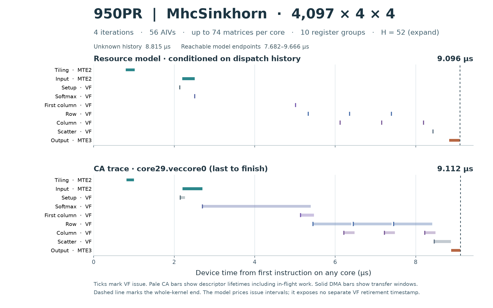
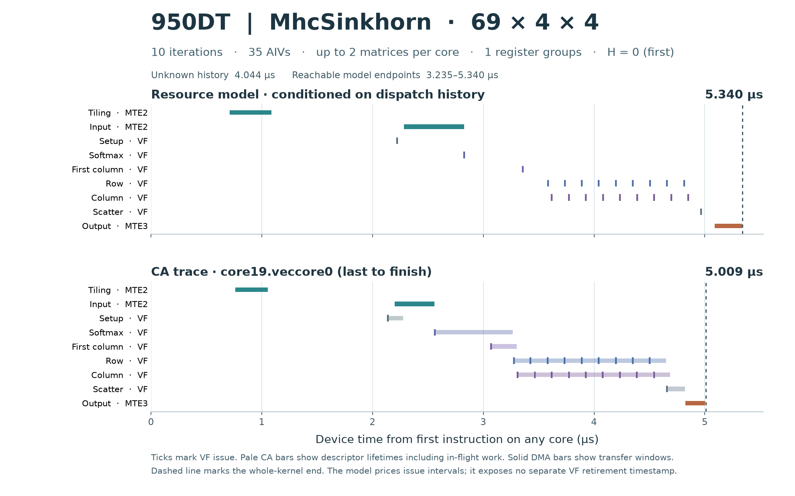

# mHC Sinkhorn 的寄存器分组与未知启动状态

| 分组 | 950DT 完整窗 | 旧无前序 WAPE / 最大 | 新无前序 WAPE / 最大 | 950PR 完整窗 | 旧无前序 WAPE / 最大 | 新无前序 WAPE / 最大 |
|---|---:|---:|---:|---:|---:|---:|
| 原历史开发回放 | 34 | 12.65% / 39.20% | 15.78% / 38.20% | 20 | 9.03% / 19.28% | 13.04% / 31.20% |
| 原历史中 T>64、I=10 | 3 | 25.64% / 39.20% | 21.91% / 25.88% | 1 | 8.55% / 8.55% | 16.81% / 16.81% |
| T≤256 全部回放 | 45 | 13.48% / 39.20% | 16.38% / 39.81% | 31 | 13.94% / 80.84% | 14.61% / 31.20% |
| T>256 回放 | 4 | 无计时 | 17.98% / 35.60% | 4 | 无计时 | 15.43% / 32.23% |

**前序已知时，宽行的改善最大。** T>256 同四窗的 WAPE / 最大从 DT 12.96% / 26.37% 降到 4.89% / 6.79%，PR 从 20.37% / 37.53% 降到 2.34% / 5.85%。单寄存器组的三种状态预测逐值保留。完全未知前序时，在状态间折中会损失首次启动精度，老开发集两端总体 WAPE 均上升。这里报告开发候选，发布版公共接口和有序流估计保持 v0.27。[逐窗回放与消融](replay.json) · [冻结后新四形双端逐窗对照](forward.md)

## 调用合同和代码路径

输入为单独发布的 FP32 4×4 矩阵批次，外部逻辑 shape [T,4,4]，模拟 API 简写 [T,4]，I 为正的归一化迭代次数，关闭中间值。库为 CANN 9.2.1 ops-transformer 的 aclnnMhcSinkhorn，实际 ELF 为 MhcSinkhorn_8997d9c5c22e82688b98bc25d8daa9cd_0。归档实测包、宿主、算子核 .text 和设备参数在预测前取了散列。当前证据覆盖完整矩阵写出、全核退休和整次设备时间；仅最晚结束的 AIV 用于图和逐阶段发起比较。在发布版同族有序 OperatorStream 内，前序可从调用顺序重建。[冻结合同](register.json) · [发布算子源码](../../../toolchains/cann/9.2.1/cann-9.2.1/opp/built-in/op_impl/ai_core/tbe/impl/ops_transformer/ascendc/mhc_sinkhorn/op_kernel/arch35/mhc_sinkhorn_arch35.h)

设 V 是目标芯片的 AIV 数，R=ceil(T/V) 是最忙核所取得的矩阵数，A=ceil(T/R) 为实际参与 AIV 数，G=ceil(R/8) 为该核在原实现 FP32 寄存器布局的 pass 数。每次从 GM 逻辑读取并写回各 64T 字节，每核至多读写各 64R 字节。发出 setup、softmax、第一轮列归一化、交替行列归一化和最后 scatter，各核共 2I+2 个 VF。G 增加代表相同 VF 帮助函数内部多次执行同一段向量指令。源码 CalcSoftmax、ColNorm、RowNorm 和 Scatter 均可核查这个内层循环。这一模型要求单 UB 能容纳 896R+832 字节。其他布局、缺 FP32 能力、跨 UB 的核内调度都保留未定价状态。

## 稳态、首对和 DMA 的价格

以 950DT 一个时钟周期为基础，先把一次 helper 的固定成本与多一遍寄存器工作分开。对相邻两行 VF 的发起间隔，首对为 P₁=248+156.5625(G−1)，稳态 P=254+156.5625(G−1) cycles。248、254 来自 G=1 逐发起事件，156.5625 取 DT G=1、2、9 的两次单位增量中位数。真实 steady 在 DT G=1、2、9 分别是 254、411、1503 cycles，独立于上述增量定价来源的 PR G=2、10 为 411、1659 cycles。旧方案乘以整个 G，会在之后每个 pass 重付 helper 首发成本。例如 G=10 时，按参考 AIV 的旧价为 2540 cycles、新价为 1663.06 cycles。用 PR 配置中的每核 FP32 吞吐重定价后，目标芯片旧价为 2609.02 cycles、新价为 1708.25 cycles，PR 实际为 1659 cycles。后者差 49.25 cycles。

设 b 是目标每个 AIV 每周期的 FP32 算力相对参考芯片的比例，f 是 GHz，向量价从参考 cycles 换到目标 µs 时除以 1000fb。下面其余数值均以参考 cycles 表达。

- G=1 时保留旧实现逐发起定价，包括初始化可推迟首列 VF。G≥2 时 softmax 自第一次发起至可提交第一列的流水距离为 max(231,176+427(G−1))。实测 G=2 与 G=9 中第一列均在 softmax 描述符结束前 419 cycles 提交。考虑初始化限制后，以「softmax 到达时刻 + 流水距离」和「setup 到达时刻 + 该状态的控制开销」的较晚者作为第一列时刻。
- 第一列到首个行 VF 为 443+8(G−2)，稳态列发起后到下一行发起的剩余预算为 319+8(G−2)。首个行 VF 发起后，再经过 P₁+max(0,I−2)P 即可发起 scatter（I=1 省去行列对）。图上始终给行、列各自的发起线，与 CA 中可以交叠的描述符对齐。
- Scatter 到写回发起使用「当前启动状态的单 helper 开销 + 49(G−1)」。增量由 DT 同一 RV_VSCATTER 指令地址的每八条记录逐 pass 取样，剔除起动段后，连续发起间隔为 49 cycles。第一段内还有填充与其他指令，因此该项是资源近似。每一阶段都可以通过逐核 trace 单独质询，三款芯片使用同一套公式。[价格与原始指令证据](prices.json) · [84 个完整窗关键发起点](landmarks.json)
- DMA 继续采用 max(状态及参与核数的描述符延迟，64R / 本地 MTE 带宽，64T / 共享 HBM 带宽) 的成本下界。64T 只用于数据载荷，96 字节 tiling descriptor 单独计价。CANN 模型中状态影响发起周期和依赖等待，物理带宽仅提供服务时间下界。MTE 带宽缺省使用芯片文件继承值。首发、重用、扩核的控制 cycles 按目标频率缩放。未来代际改变单核发射宽度、regbase 容量或指令集时，既有单核 FP32 比率仅是替代参数，需重新确认实现与吞吐。

## 调用方未知前序时能推断什么

H 是同一进程、同一实现中已经驻留的同族 AIV 高水位。H=0 为首次，0<H<A 为扩核，H≥A 为驻留。如果上层能提供范围 [hₗ,hᵤ]，仅保留与之相交的状态。比如 A=1 不存在扩核。只有 shape 时使用 [0,V]；知道首次或已覆盖全部活跃核时退化为唯一排程。逐状态算出 xₛ，L 和 U 为这些设备时间中的最小、最大值。

对任意单点 p，端点相对误差的最大值为 max(|p/L−1|,|p/U−1|)。式子的最小值在 p*=2LU/(L+U) 取得，误差为 d=(U−L)/(U+L)。该结论不需要历史比例。为了利用用户的 25% 目标，先取 e=max(25%,d)，把各**可达状态**的等权均值限制在 [(1−e)U,(1+e)L] 内作为无历史点。等权仅用来打破多个可行点的并列，没有用观测总时延估计首次或重用出现的概率。若已知唯一状态，各选法给同一值。区间 [L,U] 仅描述模型状态跨度。85% 或 95% 之类的预测覆盖率需另行检验，当前没有该保证。例如 DT 的原 34 个开发窗仅 19 个真值落在该区间内，PR 为 19/20。

用**相同宿主生成数据、相同 ELF 和相同 shape** 的 T67/I10 两次全窗给出信息上的下界。DT 首次 5.231515 µs、驻留 3.260000 µs，任何单一输出在此二者上的最小最大相对误差至少 23.22%。PR 首次 5.068485 µs、驻留 3.285455 µs，相应下界 21.34%。一对各出现一次时，最低可达 WAPE 也为 (U−L)/(U+L)。调用方若确知顺序即可分别走冷、热价格，解除这一限制。[逐输入、核函数及数值散列](../../v0.27/fusion/unknown-history.json)

PR 旧域最大偏差落在 T=241、I=16 的驻留窗。原无前序预测 7.991 µs，修正后未知前序点 5.293 µs，接受真实 H 后 4.234 µs，CA 为 4.419 µs。

系统侧偶尔只知道**紧邻的上一次**相同实现，没有更早的调度记录。设前一形状预测动用 a 个核，就能合法收窄到 H∈[a,V]；若 a≥A，则当前只可能驻留。把这一信息用在 v0.26 双端各 11 个有前一形状的完整窗，DT 的 WAPE / 最大从完全未知 13.58% / 24.04% 降到 13.37% / 19.97%，PR 从 15.22% / 25.01% 降到 11.72% / 20.82%。其中只剩一个可达状态的 DT 三窗从 18.96% / 24.04% 降到 5.30% / 8.31%，PR 四窗从 21.43% / 25.01% 降到 2.86% / 5.85%。还有两个可达状态时，两端子组的 WAPE 都可能变差。逐步收窄模型状态范围能消除确定的路径，对每次实际误差并无单调性保证。跨族或不受支持的前序也不能提供这个下界。[仅使用前一形状的逐窗检查](one-predecessor.json)

### 消融与适用范围

| 数据与前序 | 保留逐组重付、未知时取端点调和均值 | 分出寄存器工作、仍取调和均值 | 分出寄存器工作、取状态均值 | 分出寄存器工作、25% 约束点 |
|---|---:|---:|---:|---:|
| 950DT T>256 四窗 WAPE | 25.13% | 19.17% | 15.39% | 17.98% |
| 950PR T>256 四窗 WAPE | 32.65% | 15.90% | 15.73% | 15.43% |
| 950DT 历史 T>64/I=10 三窗 WAPE | 21.62% | 21.62% | 24.98% | 21.91% |

另检验将旧公开的资源估计约束在新状态端点之间。DT 原域 45 窗全部落在端点内，因此原先超线的 I=10 三窗完全不变。PR 原域 WAPE 从 13.94% 降到 11.96%，最大仍有 50.04%。将旧估计约束进更窄的 25% 可行带时，原域 DT 与 PR 的 WAPE 为 15.84%、14.08%。这一回放消融没有得到单一方法对所有分组同时改善，未纳入冻结点或发布接口。

新宽行公式直接改善已知前序的工作定价。未知前序时，稳健点在新旧数据的首次/重用配比之间仍有取舍。25% 约束点控制的是模型端点偏差，观测值还包含调度抖动和数十到上千 cycles 的控制等待。原公共计时仅覆盖 T≤256，全回放表保留该边界。每端四个新几何未满十形，单组回放改善不足以替换所有无历史默认调用。

## 具体算例与同轴图

PR 运行 T=4097、I=4，V=56，R=74，A=56，G=10，末核读写各 4736 字节。全网格各向读写 262208 字节。顺序已知时 H=52，属于扩核，预测 9.096112 µs，CA 窗为 9.111515 µs，误差 −0.17%。隐去 H 后三种可达状态给 7.681545–9.666308 µs，候选点 8.814655 µs。该 PR 窗是历史回放，DT 的三条指令证据用于本轮定价。



两图共享全核首条指令为零点和 µs 横轴。VF 整条在途的时间只有 CA 能给出，因此上图以发起线表示已有模型输出，下图以浅条加发起线呈现描述符重叠。两条虚线均为本次设备全窗。[逐条数值、全窗回执和 SHA](replay-950pr-t4097-i4.json)

冻结后的第一个新几何在 950DT 首次执行 T69、I10，最忙核两个矩阵、一个寄存器组。已知 H=0 的预测 5.340 µs，完全未知时 4.044 µs，CA 实测 5.009 µs。已知前序时全窗仍有 +6.61% 残差。DT 首对与稳态发起分别预测、实测 248 和 254 cycles，剩余误差发生在这些周期以外，包括 DMA、setup 和 scatter。PR 同形首对/稳态也实测 248/254 cycles，按 PR 的 FP32 峰值折算成 254.74/260.90 cycles。DT/PR 配置使用的整芯片 27/23 FP32 TOPS 并非该 VF 的实测单指令吞吐。



[新形逐阶段数值和原始 trace 散列](independent-950dt-t69-i10.json)

970DT 的同形投影通过自己的 V、核频率、FP32 速率、可用 UB 与带宽进入相同算式。970 的实际寄存器组织、单 VF 内 issue 间隔和软件库实现未被实测。三款芯片共 18 个冻结价格已重算，108 个 H 范围检查可达集与端点误差约束。对 DT T2257/I4 首次，单独将 FP32 峰值加倍得到 6.698→5.255 µs，频率和算力同升 20% 得 5.582 µs，单设 HBM 吞吐 4 GB/s 得 78.089 µs，MTE2 为 1 GB/s 得 8.458 µs。实测进程内预测中位 0.213 ms，最大 1.094 ms，包含最多三个候选状态。[物理敏感性与查询成本](checks.json)

## 再现

```bash
python3 development/validation/fusion28/landmarks.py
python3 development/validation/fusion28/calibrate.py
python3 development/validation/fusion28/score28.py
python3 development/validation/fusion28/checks28.py
python3 development/validation/fusion28/recent28.py
toolchains/envs/cann-9.2.1/bin/python development/validation/fusion28/figure28.py --pr
```

四个几何均在任何新采集启动前锁定，双端各六窗（重复两个形状以检验状态），970 仅定价。后台程序使用单槽、低 CPU 优先级，开新采集前检查负载、内存与磁盘。每端单形预算 600 秒 / 1100 MiB，五窗顺序预算 1800 秒 / 5500 MiB。实际墙钟由回执累计，离线资格验证另计。完整 raw 大文件保存在当前验证机。[查重](novelty.json) · [冻结](register.json) · [进度](state.json) · [逐窗计分](independent.json) · [新留出末核发起间隔](issue-forward.json)
