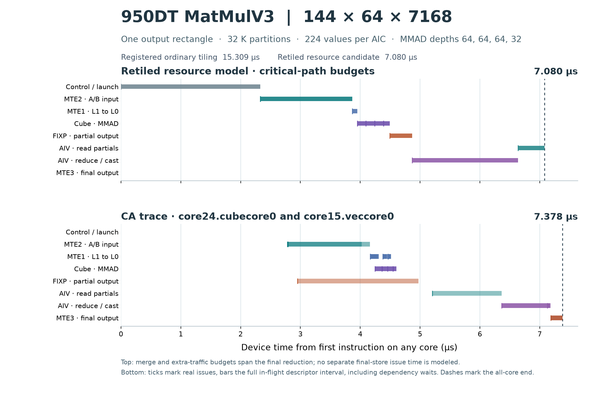

# 重选输出块后切 K

| SKU | 样本角色 | 完整窗 | 旧 WAPE / 最大 | 冻结候选 WAPE / 最大 | 每个分块与 MMAD 都对齐 |
|---|---|---:|---:|---:|---|
| Ascend950DT | used in development | 4 | 46.88% / 107.49% | 6.81% / 10.51% | 是 |
| Ascend950DT | frozen prospective | 0 | N/A | N/A | N/A |
| Ascend950PR | used in development | 4 | 38.97% / 108.81% | 4.94% / 7.41% | 是 |
| Ascend950PR | frozen prospective | 0 | N/A | N/A | N/A |

| [M,N,K] | SKU | 来源 | 实测输出矩形 × K 段 | 生产 µs | 候选 µs | CA µs | 真实/预测 MMAD |
|---|---|---|---|---:|---:|---:|---:|
| [9, 1280, 5120] | 950DT | used in development | 5×[6] | 11.999 | 11.288 | 10.215 | 420 / 420 |
| [9, 1280, 5120] | 950PR | used in development | 5×[5] | 13.004 | 12.631 | 13.642 | 400 / 400 |
| [16, 512, 5120] | 950DT | used in development | 2×[16] | 11.930 | 8.315 | 8.023 | 160 / 160 |
| [16, 512, 5120] | 950PR | used in development | 2×[14] | 11.930 | 8.345 | 8.254 | 168 / 168 |
| [81, 32, 5120] | 950DT | used in development | 1×[32] | 7.691 | 5.820 | 6.333 | 64 / 64 |
| [81, 32, 5120] | 950PR | used in development | 1×[28] | 7.691 | 5.754 | 6.184 | 56 / 56 |
| [144, 64, 7168] | 950DT | used in development | 1×[32] | 15.309 | 7.080 | 7.378 | 128 / 128 |
| [144, 64, 7168] | 950PR | used in development | 1×[28] | 15.309 | 7.113 | 7.332 | 112 / 112 |

## 资源机制

上游普通 Matmul 的输出 tile 不能直接复用于切 K。这里在常规方案只能发一波且原来不止一个输出块时，从目标 L0A、L0B 的 BF16 双缓冲和 64 深度最低要求得到输出分块的轴上限。AM、AN 分别为均分后输出轴的 16 元素对齐宽度。L0C 容纳 4AM·AN 字节才有资格。投影场景观察到的调度是尽量把输出合并，令 G=ceil(M/AM)ceil(N/AN)，每块最多 S=floor(C/G) 个 K 段，其中 C 是目标 AIC 数。各段深度为 ceil(K/S)，最后一段保留真实尾数。实际 MMAD 深度由 min(L0A/(4AM),L0B/(4AN)) 向下对齐 64 得出，另受 L1 双缓冲页限制。

按候选矩形重算源 host 的准入成本。usedCore/totalCore 是 HBM 与 L2 可达带宽的比例，比较两种几何的 max(有效传输成本,计算成本) 以及分段带来的归约开销。这与最终整窗的设备排程分开。最终时间为 launch + max(局部页流水,芯片冷 HBM 输入,L2 到各核的实际输入) + merge。merge 计价沿用已冻结的每个 K 分片发起与 FP32 归约机制。缺单独 L2 峰值时用旧 Matmul 已使用的 100 字节/核/周期。开源 DAV_3510 会枚举多种切 K 候选、并按平台实施再平衡，本候选只描述已经看到的单波饱和模式。

以 DT [144,64,7168] 为例，原普通模型推 9 个 tile，实际是整个输出一块。32 个 AIC 各处理 K=224，四个 MMAD 的深度为 64、64、64、32。[9,1280,5120] 则真实分成五个 [9,256]，各自的 K 连续覆盖 5120。DT 每块 6 段，PR 每块 5 段。启动 AIC 为 32/28，实际承担 MMAD 的 AIC 为 30/25。逐核输入地址、输出矩形、K 区间、结果写出与原始 SHA 可复算。[源数据](score.json)

新留出只用两种从真实模型推导的几何，每端各两窗，仍未达到十形。必须按前瞻登记的数值、物理退休、核数，以及输出分块与 K 边界资格审查。已看过的历史窗只作开发回放。970DT 仅作外推。后台严格等窄矩形前序队列完成。[冻结的三芯片预测和准入条件](freeze.json) · [状态](state.json)

## 同轴算例

上图列出已建模的阶段预算，下图读取各自最后结束的 AIC 与 AIV。实测 FIXP 描述符可先发起再等待 Cube 写完，末尾归约预算只表征聚合发起和增量流量。在图中独立标注这些计时口径。[每条发起、整窗原点和原始 SHA](dt-144-retile.json)
