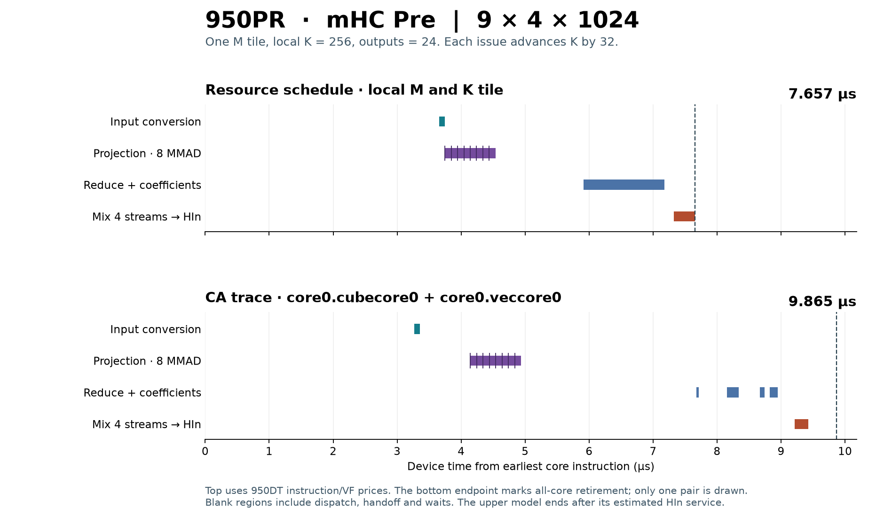

# 大形 mHC Pre 与 Sinkhorn 的分段预测

| 输入 | 芯片 | 当前公开 µs | 分段候选 µs | 已有或待测证据 |
|---|---|---:|---:|---|
| Pre [9,4,1024] | 950PR | 9.344（旧小形路径） | 7.657 | 同一旧窗 9.865 µs，候选低 22.4%，见下图 |
| Pre [512,4,5120] | 950DT / PR | 2512.51 / 2982.25 | 56.43 / 67.59 | 候选任务登记时双端尚未开跑 |
| Pre [4096,4,5120] | 950DT / PR | 20100.11 / 23219.43 | 412.08 / 517.13 | 候选任务登记时双端尚未开跑 |
| Pre [512,4,5120] / [4096,4,5120] | 970DT | 909.17 / 6767.28 | N/A | 公开模型外推；安装的 Pre 使用 1 AIC 配 2 AIV，970 的 1:1 替代调度未知 |

以上大形为 Flash 的每 rank D5120 参数，T512 是单个 512-token chunk，T4096 可由 8 请求各取 512 个 token 形成。内置三段调用是有完整 golden 的参考实现。vLLM 独立扩展拥有另一份执行合同。全部新端点的 raw 已在候选登记时检查；模型摘要、原冻结、真实采集身份与资格可逐项核对。[阶段冻结与价格来源](stage-freeze.json) · [原公开预测与采集](freeze.json) · [全路线实际状态](report.md) · [候选逐窗实时计分](stage-live.md)

## mHC Pre 的工作如何分到核

单独 Pre 实际执行 `aclnnMhcPre`，BF16 输入，FP32 投影权重，返回 hin、hpost、hres、inv_rms、hmix、hpre 六组张量。取残差流数 N=4，投影输入宽 K=N·D，输出列数 O=N²+2N=24。T>256 的公开时价使用 v0.8 小形流水模板，将 Cube/MTE1 等临界段乘以 ⌈T/32⌉·⌈K/128⌉ 的需求比例。此粒度漏掉可以同时处理的 M、K 分组和 AIV 独立承担的第二阶段。以 T4096 为例，单次逻辑读写为 212.48 MB，在 4 TB/s 或 1.4 TB/s 的冷 HBM 峰值服务时间为 53.12 或 151.77 µs。L2 命中和 GM 工作区重读会改变实传字节；这个数量级只能帮助发现差距。

**分块。** 参考 op-host 14d022b1 的 CalculateMkTiling，将每个 M 块最多取 256 行，初始 m₀=⌈T/256⌉，最多 k₀=⌊C/m₀⌋ 组 K，C 为 AIC 数。取 m=16⌈⌈T/⌊C/k₀⌋⌉/16⌉ 行。对 K 分片按 256 对齐，临界 K≥2048 时按 1024 的顺序部分和切齐。DT T4096 得到 16×2 的 M、K 网格，临界核负责 M256、K10240；PR 得到 26×1，临界核负责 M160、K20480。网格表示有工作内容的 AIC，硬件实际派发还可能包含只参加同步的核。安装包内源文件读 cubeBlockDimM/K，再按 mIndex、kIndex 分割；第二阶段在总体同步后单独取每 AIV 最多 r=⌈T/AIV⌉ 行，余量行有尾块。参考 host 与安装包的 AIC 源文件散列有别，最终网格仍由大形实际 ELF 验证。参考 host 的 M-K 还要求 T≤10240 且 T≤256C，超过时进入按 batch/token 区分的 SplitBS。B8×32Ki 完整且不按 chunk 切分的 Pre 有 262144 行；单个 BF16 残差输入已达 10 GiB，且跨越这个切换门槛。因此不能将 T4096 的流水按 64 倍作为其预测。

**投影与交接。** 在 19 个 DT 开发窗取指定 AIC 的真实 MMAD 和同核号 AIV0 的 7 个有序 VF；另 9 个 PR 窗独立核对指令类别。小形两端可见 f32×f32、N24、K32。安装包 MmadBase 将 FP32 累加顺序固定为每 32 个元素发起，另一个 HF32 分支才允许一次消耗更宽的 baseK；现行工作量报告的 HF32 标注应当核对。指令在 M≤16 时服务 163 周期，在 17≤M≤32 时为 259 周期。从两档区别得到每条服务 C=67+96·⌈M/16⌉ 个 950 时钟。外推到 M160 或 M256 时，把固定发起项按目标频率、每增加 16 行的工作项按目标每 AIC 算力重定价。当前芯片配置缺单独的 FP32 Cube 吞吐；变更架构时相对每核 16-bit Cube 峰值仅可作代理。

每个 L1 页为 128 的倍数，受 32768/m 个元素和 1024 的上限约束。对本地 AIV，输入转换在复用小形的固有 78 周期后，以每个本地输入元素 0.0546875 个参考周期计价，完整页的输入量为 ⌈m/2⌉·页宽。两个 staging 槽轮换。各页就绪时间取「上一页生产结束、同槽前一消费者结束」两者较晚者，再加转换服务；各页 MMAD 等待「该页就绪、前一页计算结束」两者较晚者。整个输入只收一次实测首个转换 VF 6032 周期，两阶段交接取 DT 小样末 MMAD 与首个第二阶段 VF 间隔中位数 2266 周期。该间隔是不同引擎的事件界标，有未观测核间到达差异。

**系数归约与 HIn。** 取安装包的 32 行上限、8 行对齐和 80 KiB 部分和缓冲约束，T4096 在 DT 的关键 AIV 分成 32+32 行，PR 分为 32+32+8+2。当前实际 D5120 的 HIn 输入与输出缓冲一次可放 2 行。候选按每 2 行 2034 个参考周期计可见系数 VF 跨度，HIn 取每个输出元素 0.25830 个参考周期，另取 249 周期的观测组间隔。上述价格来自 DT 的局部指令间隔/长度；顺序累加多组部分和、跨页缓存、最终 DMA 退休还缺长几何样本。以 T4096 为例，DT 的投影双槽扫描是 311.48 µs，后处理是 95.57 µs，两项加首次发起与交接为 412.08 µs。小形 R 行 VF 的调度与大形 32 行组存在差异，该阶段的线性展开属于外推。

上图两行以全核首指令为 0。紫线刻度逐条对应 8 次 K32 的 MMAD，蓝色为归约及系数计算，橙色的 HIn 混合四条残差流。下图画 core0 的一对 AIC/AIV，右端虚线是全核 9.865 µs，最后结束的是 core1.veccore0。上图按相同 M、K、D 重算，预算结束于 HIn，7.657 µs。定价用 DT 的阶段价格，PR 的这个已知窗用于诊断；该偏差同时体现了首条投影发起、第二阶段 DMA/VF 到达、余核退休尚未识别的时间。[条带、PC、原始核文件和 SHA](pre-mk9-pr.json) · [绘图脚本](../../../../development/validation/large29/fusion/stage_figure.py)

## Sinkhorn 随每核行数变化的条件时延

纯 FP32 的 4×4 Sinkhorn 在一行内完成 I=20 轮。独立运行 H=0 表示从可验证的全空状态发起；H≥当前用核数表示已驻留，中间状态表示扩核。Pre 后马上派发 Sink 时没有可辨识的同族前序，独立冷态的数值不能直接当成链内测量。下表的单 UB 数值沿用已冻结的寄存器和发起模型，预测仍以 µs 计。公开 shape-only 对所有三形均报 N/A。

| T | 950DT 首次 / 扩核 / 已驻留 | 950PR 首次 / 扩核 / 已驻留 | 970DT 首次 / 扩核 / 已驻留 |
|---:|---:|---:|---:|
| 512 | 7.49 / 6.24 / 4.77 | 10.69 / 9.79 / 8.37 | 7.61 / 5.75 / 4.37 |
| 4096 | 30.75 / 30.08 / 28.66 | 38.40 / 37.83 / 36.41 | 19.88 / 18.19 / 16.87 |

每核行数 r=⌈T/AIV⌉，运行核数 A=⌈T/r⌉，每个寄存器组处理 8 行，组数 g=⌈r/8⌉。第一行列对与稳态行列对的发起间隔各有独立价格，依赖链中的 Vector 工作按 g 和目标 FP32 每核吞吐缩放。MTE2/MTE3 由每行 64 字节、A 个核的共享带宽和可用的本地端口下界限制。H 决定首发和交接调度。已有定价仅覆盖少量额外大 T；不同 I 或不同历史的大 T 完整窗不能充当 I20 的新验证。[原阶段价格](../../../v0.26/sink/prices.json)

T262144 相当于单 rank B8×32Ki 一次派发。每核最高 DT 4096 行、PR 4682 行、970 2185 行。安装包外层按 tUbFactor 循环，每块有一次 CopyIn、softmax、第一列归约、19 对行列归约、scatter 和 CopyOut；启动时创建 mask。若把每块输入至写出的段序列串行，首块额外支付一次启动与退休，另可比较两种 UB 容量。保守方案使用旧保护值 (UB−832)/896，精简方案只计 FP32 推理输出实际 queue 的 (UB−832)/576，下取整。两者分别是 282、439 行。本机安装的 kernel 源能证明存在块循环；正式 host 可能继续向下对齐 tUbFactor，是否连续预取也会改变时间。这些数值是**两种假设的情景值**，不能作严格上下界或通用点精度。

| T262144 | 保守 / 精简块数 | H=0 双方案 µs | 已驻留双方案 µs |
|---|---:|---:|---:|
| 950DT | 15 / 10 | 1800.9 / 1767.1 | 1795.0 / 1764.0 |
| 950PR | 17 / 11 | 2123.9 / 2084.8 | 2122.0 / 2083.1 |
| 970DT | 8 / 5 | 881.8 / 863.5 | 875.8 / 859.5 |

## 核验与回填

同一份候选登记包含公式版本、19 个 DT 和 9 个 PR 的数据库或核片 SHA、各端 K/M 分配、H 条件、所有原始任务当时的启动标志。阶段预测固定在 2026-11-20 04:05:08 UTC，主实验冻结文件保持原值。获取成功回执后按 chain 中的具体阶段独立计分；发生超时、数值错误或物理退休检查失败时保留原记录。970 仅作架构外推。每种已冻结的芯片/形状重复计算 100 次，包含多 UB 的三种历史、两种容量情景，所有组合中最慢的 P95 为 1.634 ms，单次最大 3.459 ms。计时只含已加载配置的开发候选公式；采集、导入、旧 DB 离线定价分别计算。[逐端查询耗时](stage-query.json)[冻结详情](stage-freeze.json) · [算法](../../../../development/validation/large29/fusion/stage_candidate.py)

有一项旧证据补录。总表初始扫描中的 fused PreSinkhorn 最大 D4096 样本显示两端为 T80。v0.27 的额外已发布完整窗还包括 DT [113,4,4096] 14.603 µs，PR [127,4,4096] 16.495 µs；T127 DT 未过该次物理退休资格。新增的 T512 仍跨越有意义的 T128 工作组切换边界。[DT T113](../../../v0.27/fusion/receipts/fused-t113-dt.json) · [PR T127](../../../v0.27/fusion/receipts/fused-t127-pr.json)
