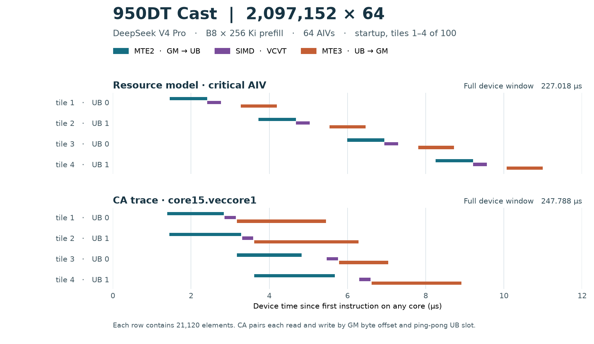

# 六个 Vector 算子的大输入验证

每条序列 32、128 和 256 Ki 个 token、单卡 batch 8，对应一次未切块调度 262,144、1,048,576 和 2,097,152 行。调度切 chunk 时以该次实际分配的 token 数为准。下表按实际核函数、输入宽度与调用协议选数。所有 970DT 数字均为外推。

| 已有真实输入 | 950DT 模型 / CA µs | 950PR 模型 / CA µs | 忙核轮数（DT / PR） | 970DT µs | CA 口径 |
|---|---:|---:|---:|---:|---|
| quant <code>[2048, 5120]</code> | 11.531 / 11.364 | 17.834 / 18.504 | 5 / 5 | 7.733 | 全部核指令 [DT](../../../../results/v0.29/quant/instruction-controls.json) / [PR](../../../../results/v0.29/quant/instruction-controls.json) |
| quant <code>[262144, 7168]</code> | 1200.415 / 1778.988 | 3992.864 / N/A | 820 / 863 | 527.779 | 全部核 wrapper [DT](../../../../results/v0.20/full-quant/native.json) |
| rmsnorm <code>[2048, 5120]</code> | 13.011 / 14.337 | 16.683 / 17.820 | 7 / 8 | 8.653 | 全部核指令 [DT](../../../../results/v0.19/sku/final-records.json) / [PR](../../../../results/v0.19/sku/final-records.json) |
| cast_bf16_fp32 <code>[2097152, 64]</code> | 227.018 / 247.788 | 506.517 / 529.287 | 100 / 114 | 104.673 | 全部核指令 [DT](../../../../results/v0.23/pro-prefill/pro-b8-256ki-dt.json) / [PR](../../../../results/v0.23/pro-prefill/pro-b8-256ki-pr.json) |
| cast_bf16_fp32 <code>[4096, 7168]</code> | 28.424 / 29.724 | 57.128 / 54.612 | 22 / 25 | 14.894 | 全部核指令 [DT](../../../../results/v0.20/large/cast_4096_7168_Ascend950DT_9582.json) / [PR](../../../../results/v0.20/large/cast_4096_7168_Ascend950PR_957b.json) |
| cast_bf16_fp32 <code>[262144, 5120]</code> | 2514.820 / 2737.538 | 5683.487 / N/A | 993 / 1135 | 1223.154 | 全部核 wrapper [DT](../../../../results/v0.23/full-hidden/v3/flash-retry.json) |
| sigmoid_fp32 <code>[262144, 12]</code> | 8.002 / 7.759 | 12.344 / 11.428 | 4 / 4 | 5.553 | 全部核指令 [DT](../../../../results/v0.23/prefill/kimi-32ki-dt.json) / [PR](../../../../results/v0.23/prefill/kimi-32ki-pr.json) |
| sigmoid_fp32 <code>[1048576, 12]</code> | 19.720 / 18.553 | 39.630 / 34.285 | 13 / 15 | 11.321 | 全部核指令 [DT](../../../../results/v0.23/prefill/kimi-128ki-dt.json) / [PR](../../../../results/v0.23/prefill/kimi-128ki-pr.json) |
| sigmoid_fp32 <code>[2097152, 12]</code> | 45.897 / 42.686 | 104.717 / 88.593 | 25 / 29 | 19.353 | 全部核指令 [DT](../../../../results/v0.23/prefill/kimi-256ki-dt.json) / [PR](../../../../results/v0.23/prefill/kimi-256ki-pr.json) |
| attn_res_fwd <code>[3, 7168, 8, 1]</code> | 10.152 / 9.712 | 10.221 / 9.474 | 1 / 1 | 9.303 | 全部核指令 [DT](../../../../results/v0.21/fusion/receipts/attn_res_fwd_3_7168_8_1_Ascend950DT_9582.json) / [PR](../../../../results/v0.21/fusion/receipts/attn_res_fwd_3_7168_8_1_Ascend950PR_957b.json) |
| moe_gating_top_k <code>[24, 896, 16]</code> | 5.340 / 5.915 | 5.391 / 5.682 | 1 / 1 | 4.893 | 全部核指令 [DT](../../../../results/v0.19/workloads/router-qualified.json) / [PR](../../../../results/v0.19/workloads/router-qualified.json) |

表中轮数为目标分核后最忙 AIV 顺序处理的 token、UB 块或专家排序行数。Pro Cast 的 100/114 次和 Kimi Sigmoid 的 25/29 次另有逐块 DMA 验证。归档文件保存每例的测量哈希、核数、采集成本及可用的原始指令/窗口。两种芯片使用相同数值校验。新独立例只在回执通过后计入。[归档明细](archive.json) · [Pro Cast 逐块流水图](../../../v0.23/pro-prefill/pro-b8-256ki-dt-plot.png) · [Flash 完整输入的核窗图](../../../v0.23/full-hidden/cast-full-hidden-complete.png)

Kimi beta 的本地宽度是 12 个头，Pro indexer 系数宽 64，Flash router 输入宽 5120，Kimi MxQuant 混合投影输入宽 7168。Pro Cast 的 2,097,152 行没有覆盖 router 的整 hidden 宽度。AttnResFwd 的现有 7168 宽控制最多 3 个 token 且保存 materialized、写回 bank，旧控制的最大 token 数 8 仅有 512 通道。router 在真实 896 专家宽度已测至 24 行；现有最大 65 行使用 128 个专家。这两项是本轮优先补的缺口。[Kimi 配置与算子](../../../../docs/workloads/kimi-k3.md) · [Flash 配置与算子](../../../../docs/workloads/deepseek-flash.md) · [Pro 配置与算子](../../../../docs/workloads/deepseek-pro.md) · [AttnRes 分层派发表](../../../../development/workloads/prefill_shapes.py)

## 采前冻结与完成状态

| 实际调用与 shape | 芯片 | 忙核轮数 | 公开预测 / CA µs | 970DT µs | 单次预算 | 当前证据 |
|---|---|---:|---:|---:|---:|---|
| moe_gating_top_k <code>[4096, 896, 16]</code> | 950DT | 64 | 125.683 / N/A | 64.095 | 5h / 64 GiB | 排队或运行中，instruction |
| moe_gating_top_k <code>[4096, 896, 16]</code> | 950PR | 74 | 154.458 / N/A | 64.095 | 5h / 64 GiB | 排队或运行中，instruction |
| attn_res_fwd <code>[512, 7168, 8, 1]</code> | 950DT | 8 | N/A / N/A | N/A | 4h / 64 GiB | 排队或运行中，instruction |
| attn_res_fwd <code>[512, 7168, 8, 1]</code> | 950PR | 10 | N/A / N/A | N/A | 4h / 64 GiB | 排队或运行中，instruction |
| rmsnorm <code>[8192, 5120]</code> | 950DT | 26 | 39.379 / N/A | 21.582 | 4h / 64 GiB | 排队或运行中，instruction |
| rmsnorm <code>[8192, 5120]</code> | 950PR | 30 | 61.622 / N/A | 21.582 | 4h / 64 GiB | 排队或运行中，instruction |
| cast_bf16_fp32 <code>[32, 4096]</code> | 950PR | 1 | 2.681 / N/A | 2.508 | 1h / 4 GiB | 排队或运行中，wrapper |
| cast_bf16_fp32 <code>[262144, 5120]</code> | 950PR | 1135 | 5683.487 / N/A | 1223.154 | 36h / 72 GiB | 排队或运行中，wrapper |
| quant <code>[262144, 7168]</code> | 950PR | 863 | 3992.864 / N/A | 527.779 | 36h / 72 GiB | 排队或运行中，wrapper |
| rmsnorm <code>[262144, 5120]</code> | 950DT | 820 | 1312.284 / N/A | 551.800 | 36h / 72 GiB | 排队或运行中，wrapper |
| rmsnorm <code>[262144, 5120]</code> | 950PR | 937 | 3757.462 / N/A | 551.800 | 36h / 72 GiB | 排队或运行中，wrapper |

前三个不同 shape（两个 SKU 各 3 个）走官方全核指令窗；PR 的小 Cast 用于检查库、DDR、全输出及核集合。全长原生运行只计完整 wrapper start/done 窗，不混入指令 WAPE。每个端点独立获取、释放共享主机锁，离线验证时释放锁，每个端点最多一次实际启动。首版登记后、尚未运行时修正了监督进程对临时文件消失的处理，冻结价格一致。[首次登记](initial-freeze.json) · [生效登记](freeze.json) · [队列状态](state.json)

Quant 另有已登记的 [16384,7168] 两端官方采集和 [131072,7168] 950DT 原生采集，在原队列完成后接收其结果。这两种 shape 对应 B8 × 2048 token chunk 和 B4 × 32 Ki 全输入。Flash RMS 的旧 [262144,5120] 950DT 官方尝试在 900 秒终止，全 golden、完整时延均缺失，这次按 36 小时/端的原生预算补。[Quant 运行与回执](../../quant/report.md) · [原 RMS 超时](../../../v0.19/prefill/rmsnorm_262144_5120.json)

RMSNorm [8192,5120] 代表 4 × 2048 个已调度 token。Router [4096,896,16] 代表 8 × 512 个已调度 token。AttnResFwd [512,7168,8,1] 是总计 512 个已调度 token。三个 chunk 均可检验每核多轮。未切 8 × 32 Ki 的 AttnResFwd 与 router 仍缺实测，两者的 128/256 Ki 也没有完整窗口。32/128/256 Ki 逐个未切场景的模型、准备读写的字节和资源估计见情景表。[六类未切情景](full-scenarios.json)

## Kimi AttnResFwd 真实 prefill 的条件排程

按 vLLM Ascend 已固定的源码，H=7168、bank 有 8 个槽、1 行历史残差有效。addend、mix 和 output norm 开启，输出与 materialized 共用张量，写 bank 的索引为 −1，optimize_prefill 开启。每核多行且 UB 可容纳缓存时使用 tiling key 40021，score 用到的两条权重以及输出 gamma 每个 payload 核各读一次。旧 40020 时间价格未在该协议校准。源代码的第 1–11 层 attention/FFN 符合本合同。冻结清单误将层号写成 13–23；第 13–23 层实际有效残差为 2。shape、标志、命令及冻结预测均无需变化。[前端派发公式](../../../../development/workloads/prefill_shapes.py) · [实际库的构建清单](../../../v0.19/workloads/attn-res-build.json)

令 H 为通道数，n 为有效 bank 行，P 为有 payload 的 AIV 数，r 为最忙核的 token 数。BF16 每行 U=2H 字节。在本合同每个 rank 总读取 U·(3P+(2+n)T)，总写入 2UT。每个 token 先准备 prefix，再对 n+1 行做均方与打分归约、小 softmax、加权和、输出归一化；写 prefixOut 的 MTE3 可以与打分部分重叠。模型把输出写回作为下一个 token 的依赖假设。缓存的三行权重只进 setup。全局冷输入 HBM、所有已知 L2 带宽、每核 MTE2/MTE3 和 Vector 峰值的服务时间分别计算。

$$S_{token}=S_{prefix}+\max(S_{prefix\ store},S_{scores}+S_{softmax}+S_{norm})+S_{output\ store},\qquad S_{ideal}=\max(S_{setup}+rS_{token},S_{resources}).$$

每个 S 为资源服务时间（µs），字节数除以 GB/s × 1000，FP32 或 BF16 等价运算除以目标每核峰值。MTE 没有目标配置时沿用已有 950DT 微段价，读/写分别为 18.39635/16.01826 周期每 KiB，按目标频率换算。它们是转用的端口服务假设；HBM 冷输入与理想驻留、不公开的 L2 带宽、rsqrt/exp/倒数及归约树同步、DMA 发起/响应等会改变真实时延。下表保持单独的 conditional schedule，在线 estimate 仍返回 N/A。[模型及细分公式](../../../../operator_model/attn_res_prefill_plan.py) · [端口参数](../../../../operator_model/rms_resource.py)

| [512,7168,8,1] | 活动/发起 AIV | 忙核行数 | MTE2 / MTE3 µs | FP32 / BF16 µs | 冷输入 HBM µs | 条件 service µs |
|---|---:|---:|---:|---:|---:|---:|
| Ascend950DT_9582 | 64 / 64 | 8 | 4.214 / 2.175 | 2.464 / 0.068 | 5.516 | 7.834 |
| Ascend950PR_957b | 52 / 56 | 10 | 5.151 / 2.718 | 3.159 / 0.085 | 15.759 | 15.759 |
| Ascend970DT | 103 / 120 | 5 | 2.575 / 1.246 | 1.416 / 0.039 | 1.532 | 4.653 |

CA 验收要求实际核名末尾为 40021、已固定 vendor 的 ELF .text 一致、数值检查覆盖完整输出与 raw prefix、未写的全部 8 个 bank 槽保持逐元素相等、实际发起核全部存在物理 END 且和官方 duration 表一致。各端未拿到回执之前，本分支没有独立误差。

该报告另外按已有原始 trace 对两端的 RMSNorm、AttnResFwd、Router、Sigmoid、Cast 五个形状分别核对每个物理 AIV 的唯一 END、END_LABEL 和全核结束时刻与归档窗的一致性。10/10 个归档端点通过。Quant 的双端 [2048,5120] 有独立的指令与输出字节审计，Pro 两个长 Cast 的原回执已有全核终止指令。这些核验均复用同一次 CA。[物理终止核验](archive-ends.json) · [Quant 两端核验](../../quant/instruction-controls.json) · [Quant 已有任务的只读回执](linked-quant-receipts.json)

## Pro Cast 的逐块同轴图

本例选取 B8 × 256 Ki 真输入上 950DT 临界核前 4 个 UB 块。图上是当前模型，图下是归档 CA，横轴都从设备任一核的第一条指令开始。两端点标注为完整算子时间，图的视窗放大到起始 12 µs。每个块有 21,120 个元素，CA 中的输入/输出 GM 地址偏移以及双缓冲槽逐块对应。第 2 块的 MTE2 在模型中 3.723 µs 发起，CA 已在 1.448 µs 发起；提前发起和之后的写回等待都能从同一行读取。完整模型 227.018 µs，实测 247.788 µs。

[逐块阶段起止和源文件指纹](pro-cast-startup.json)
