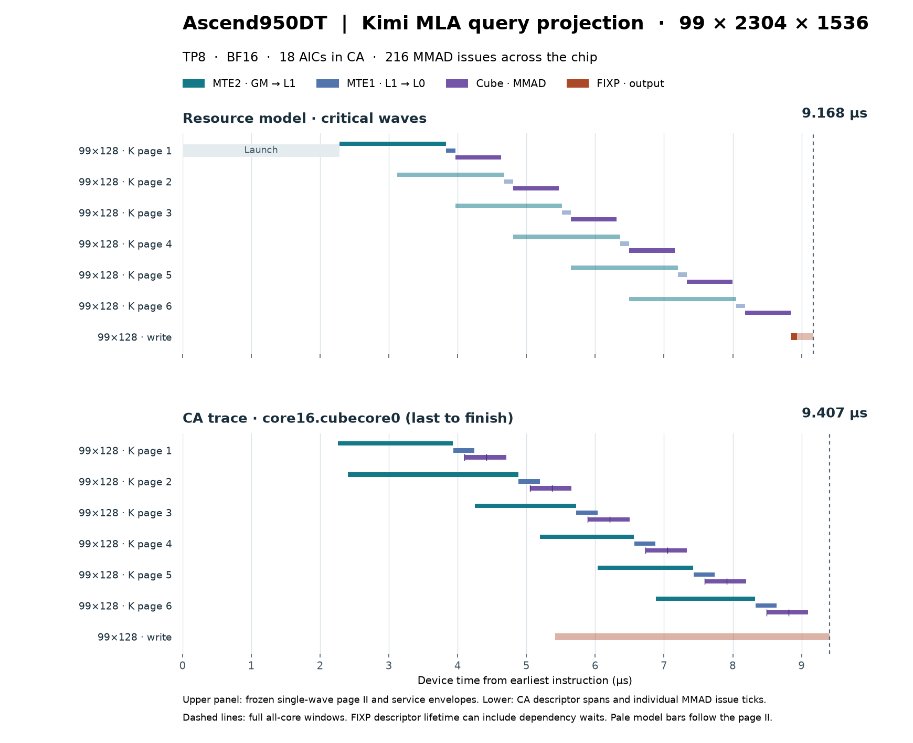

# 同一 Kimi 投影的批量变化

从 [1,2304,1536] 到 [99,2304,1536]，CA 耗时在 DT 从 6.680 增至 9.407 µs，在 PR 从 7.494 增至 9.847 µs。逻辑计算量增加 99 倍，这两个端点实际均使用 18 个 AIC，发起 216 次 MMAD，命中 key 2。权重几何相同，每次 MMAD 的有效标量工作随 M 增长。更大的 M 会跨越分块边界，两个端点间的斜率不足以给出固定每 token 成本。

M=99 来自 B=11、每请求校验 9 个 token。DT 每个 AIC 的一个 99 × 128 输出矩形遍历六个 K=256 的读页；每页两次 MMAD，故整片 18 × 6 × 2 = 216 次。预测整窗 9.168 µs，CA 9.407 µs，偏差 −2.54%。按实际 GM 输入、输出地址对应每页，模型的 MTE1、MTE2 为阶段包络，CA 显示每条描述符。M=144 时模型重新选择矩形，预测 DT 启用 24 AIC。[冻结的八场景](report.md)

[逐页数值 JSON](pages-99-dt.json) · [重绘程序](../../../../development/validation/matmul29/decode/pages.py)

旧形每端点耗时 78–104 秒、1,206–1,894 CPU 秒，按 8 或 16 核估算相同 CPU 工作，下界为 151–237 或 75–118 秒。新增验证优先选取 8–16 个连续三秒内空闲的物理核，并留八个同类核供其它工作。设备价格、单槽及 1200 秒、1 GiB 上限均沿用原登记。需要恢复时，从仓库根目录以 CANN Python 在 development/validation/matmul29/decode 加入 sys.path 后执行 import spare、spare.plan()、spare.base.host=spare.spare、spare.base.run()。已有 raw 缺 cost 时会保留现场，避免重复采集。[旧 CPU / 墙钟](host-adjustment.json) · [安全交接](host-handoff.json) · [队列状态](state.json)
