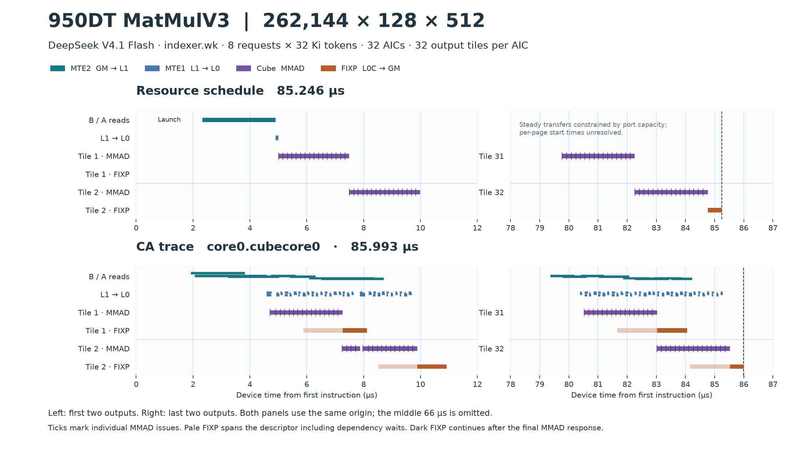
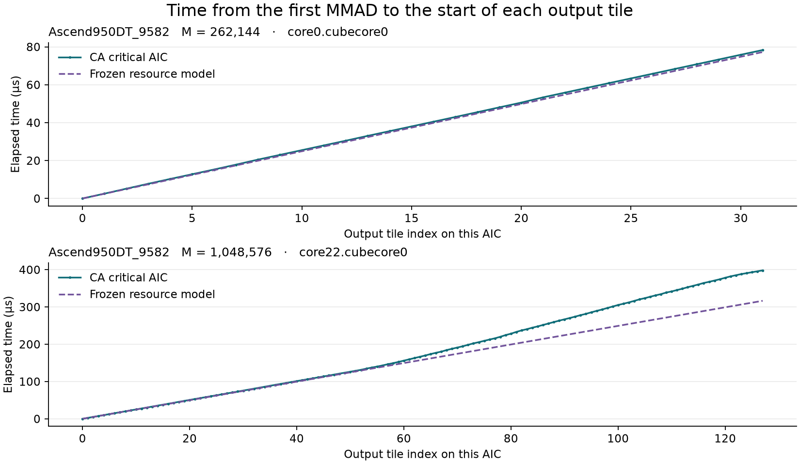

# Flash indexer.wk 的 B 常驻 L1 算例

| 设备与本卡形状 [M,N,K] | 原预测 µs | B 常驻候选 µs | CA µs | 每核输出块 | 候选偏差 |
|---|---:|---:|---:|---|---:|
| 950DT [32768,128,512] | 19.153 | 15.467 | 15.562 | 32 核各 4 块 | −0.61% |
| 950PR [32768,128,512] | 28.820 | 28.310 | 26.690 | 16 核各 5 块、12 核各 4 块 | +6.07% |
| 950DT [262144,128,512] | 113.505 | 85.246 | 85.993 | 32 核各 32 块 | −0.87% |

三端点都用于解释实现、确定端口情景及尾段，属于开发回放。旧版与候选开发 WAPE 分别为 25.91% 和 1.92%。950PR B8×32Ki、双端 B8×128Ki/256Ki 的五份预测在读取其 CA 之前已经封存，原队列中两项正在测、三项尚未开始。采集完成后的逐形比较另表给出。[动态评分](score.md) · [数值冻结与源码指纹](freeze.json)

图上方为候选的就绪时间与发起间隔，下方为原始 trace 中最后完成的 core0.cubecore0。每个紫色刻度对应一次 MMAD 发起。浅橙色按 FIXP 描述符从发起到完成绘制，它可与前置乘加重叠。深橙色标出实际最后一次乘加响应后的剩余部分。输入首次填充联合计价，稳定阶段的 A 页发起时刻只在实测部分可见。[每个绘图区间和 PC](figure-data.json) · [原始末核的全 32 块](development-traces.json)

## 输入和工作

DeepSeek V4.1 Flash、每卡 B8、每请求 32,768 tokens、TP8、单次整批未切 chunk 的 indexer.wk 投影给出 $M=8\times32768$、$K=512$、$N=128$。数值合同为 BF16 连续 ND，输入 A[M,K]，权重按 B[K,N] 提供，无 bias，输出 C[M,N]。实际入口是 CANN 9.2.1 的 aclnnMatmul，三次实测均启动 MatMulV3_ND_ND_ND_ND_BF16_BF16_BF16_BF16_high_performance_131074。服务部署若转置、使用 NZ、量化权重、合并或切分调用，需要重新确认实现路径。

ops-nn 的 ASWT 先检查可复用的输出块数、初始计算/带宽侧判断和局部存储。B 的 BF16 大小 128 KiB，满足不超过 512 KiB L1 的 3/4。A 大于该空间，并且 M 有足够多重复块。DoBL1FullLoad 将 B 摆入单个 AIC 的 L1。两块 FP32 L0C 缓冲将 M 方向限制为 $262144/(2\times4\times128)=256$ 行，硬件乘加块 [256,128,32]，读 A 的 K 页深度 128。[宿主源码](../../../../third_party/ops-nn/matmul/mat_mul_v3/op_host/op_tiling/arch35/matmul_v3_basic_aswt_tiling.cpp) · [候选代码](../../../../operator_model/matmul_full_load.py)

本例有 $262144/256=1024$ 个输出块，每块做 16 次 MMAD。单块四次读 A 共 256 KiB，L1→L0 的 A/B 总量 384 KiB，生成 64 KiB BF16 输出。FIXP 的 128 KiB 是 FP32 源负载量，硬件描述符注明 F322BF16。对三个训练窗口的全部 92 个 AIC shard 核验了读 A 页地址、固定 B 地址、MMAD 类型和最终输出地址。所有 C 地址连续覆盖完整输出且每块恰好写回一次。950DT B8 中每核 1 次读取相同 GM B 的 128 KiB，复用至 32 个输出完成。[逐核核验](rosters.json)

## 按资源计价

频率 $f$ 以 GHz 表示，BF16 全芯片峰值 $P$ 用 TFLOP/s，Cube 核数 $c$，每 AIC 每周期的计算量 $p=1000P/(fc)$。一块 MMAD 的发起间隔 $I=\lceil 2m_bn_bk_b/p\rceil$，三个小写下标分别为核心计算块的 M/N/K。DT 配置给出每核每周期约 8,182 ops，故 $I=257$ cycles。三个末核内部的实测发起间隔中位数均为 257，响应中位数均为 281。多出的 24 周期只在末次乘加排空时加一次。这个 24 周期差是 950 同形 MMAD 的校准项，移植到另一种指令实现仍需替换或重新验证。

每输出块稳定发起间隔取
$$
S=\max\left(IK/k_b,\ 2m_bK/r_2,\ 2(m_b+n_b)K/r_1,\ 2m_bn_b/r_w\right).
$$
$r_2,r_1,r_w$ 是每 AIC 每周期的 GM→L1、L1→L0、L0C→GM 有效字节数，其中写端口使用 BF16 目的字节。第一项是乘加单位可持续的发起周期，其余三项是各独立资源所需服务周期。同一块的不同 K 页以及相邻输出之间支持重叠。MTE1 与写端口沿用原 Matmul 指令校准，为 180.65、158.30 B/cycle。本例末核的 256 KiB A 数据最低交付速率约 63.75 B/cycle，冻结情景取 64。该量是一个已满足的服务需求，未独立测得端口饱和上限。显式芯片端口带宽可替换这组假设。

首轮读取 B 和第一张 A 页，对核内端口、全片 L2、HBM 三条资源分别计价取最大，再付读响应延迟以及第一块 L1→L0 送入时间。B 在每核只发一次，L2→AIC 计 $c_a|B|$，冷权重的 HBM 最少计 $|B|$，其中 $c_a$ 为活跃 AIC。三条并发完成边界分别为关键 AIC 执行 $\lceil\#tiles/c_a\rceil$ 块的结束、全片 L2 服务完成、全片 HBM 服务完成。取最大，再收取一次最终 BF16 写端口及排空。各总线给出的 GB/s 除以 GHz 得 B/cycle，cycles 除以 $1000f$ 得 µs。启动/到达、读响应、写排空来自已有 [指令价格](../../../v0.16/matmul.json)，不是对这三个开发点重拟合的总时延。

冷 HBM 假设下，至少要搬 $|A|+|B|+\max(0,|C|-L2)$。这里假设 A/B 冷且无 alias，允许全部 L2 用来保留最终脏 C；写部分全部立即回写给出另一种情景。本例两个情景为 85.246 和 88.179 µs，PR 同形为 196.082 与 244.017 µs。这是两种资源情景，不是统计置信区间。未收到物理 HBM、L2 每事务及缓存初态，无法从页响应反推唯一命中率或有效带宽。950 默认 L2 带宽假设 100 B/(cycle·AIC)，MTE2 假设如上。970 使用其独立芯片配置中 30 TB/s L2 与 14.4 TB/s HBM，仍假设 B 常驻实现、缺失的片上细节及 24 周期尾差延续。970 无 CA。

## 流水与剩余误差

| 开发窗 | 首次 MMAD 发起 cycle | A 页描述符响应中位 cycle | 毗邻输出 A 读发起间隔中位 | 毗邻输出首 MMAD 间隔中位 | 末次 MMAD 完成到 FIXP 完成 cycle |
|---|---:|---:|---:|---:|---:|
| DT 32,768 | 8060 | 1754 | 4132 | 4189 | 797 |
| PR 32,768 | 6553 | 4436.5 | 8650 | 8707.5 | 900 |
| DT 262,144 | 7765 | 1663 | 4112 | 4112 | 781 |

DT B8 的 16×257=4112 周期与 A、L0、Cube、FIXP 三十二输出的发起间隔中位数均一致。原模型高估 27.512 µs。候选首 MMAD 预计在 8,253 cycles，实测 7,765，比实测晚 0.296 µs；后续存在少量超过 4,112 cycles 的重启间隔，所以末尾合计早了 0.746 µs。在 PR，28 AIC 每步要补 $28\times256$ KiB 的 A，按 1.4 TB/s 和 1.65 GHz 计算约 8651 周期。较小的 M 含最后一波部分核空闲，模型用全片总字节约束与单核尾波并行求最大。它仍高估 1.620 µs，偏差可能来自初态/竞争与到达时间。CA 的页响应含等待，无法把这部分唯一拆分为 L2 命中、队列和 HBM 服务。

开发三窗原采集花费 3.9、5.3、23.3 分钟，B8 原 trace 峰值 4.16 GiB；本次复用全部原始数据。冻结的可定价输入在本机各执行 120 次，组中位 0.12–0.27 ms，最大 0.96 ms。预测只读芯片配置与既有轻量价格文件。[查询墙钟](query.json) · [持续评分脚本](../../../../development/validation/matmul29/full_load_score.py)

## 冻结后的首个盲测端点

B8×32Ki 在 950PR 的合格全窗为 **174.953 µs**，离线采集 30.1 分钟。旧版 206.156 µs（+17.83%），冻结候选 196.082 µs（+12.08%）。同一形状 DT→PR 的耗时比实测 2.0345，旧版 1.8163，候选 2.3002。DT 的大幅改善同时扩大了此配对比值的偏差。该 PR 实验在冻结时正在采集且原始数据未读。[独立回收](score.json)

对 28 个实际核逐条核验，16 核各有 37 个输出块，另外 12 核各有 36 个。全部 16,384 次 MMAD 都是 [256,128,32]。MTE2 队列中的 8,276 项包括 4,152 次 MOV_SPR_XN 寄存器设置及 4,124 个搬移描述符，其中 A 有 4,096 页，B 有 28 份，全部取同一 GM 权重地址。FIXP 的 2,048 项包括 1,024 次寄存器设置及 1,024 次真实 BF16 写回。两类寄存器设置均没有读写对应的张量，且无 wait/sync 标志。每次 FIX 描述符本身可以提前发起，包含等待前置 MMAD 的时间。全部 A 页和输出块的地址连续、无重叠地覆盖完整张量。[逐核地址与被计数的指令类型](pr32-geometry.json)

最晚核 core4.cubecore0 的输出间隔中位数为读 A 8,040 cycles，首 MMAD 7,871.5 cycles。只将冷 A+B 的 268,566,528 字节按 PR 的 1.4 TB/s 搬一次，已需 191.833 µs，超过实际全窗。要让这组峰值与全窗同时成立，至少 23,631,853 字节未经过该链路；反过来，全部走 HBM 需要至少 1.535 TB/s 的整窗有效速率。指令描述符能证明 GM→L1 的字节和地址，现有记录不能唯一辨认 HBM 事务命中、初始 cache 占用或模拟器的实际服务带宽。[逐事件差值](pr32-residual.json)

在打开后续长形 CA 之前，另封存“初始 A 最多有一整片 L2 已驻留”的敏感性：只减去 HBM 侧的相应输入字节，保持关键 AIC、L2、首轮及写排空调度不变。PR 在 B8×128Ki 的这一情景为 795.269 µs，冷输入原预测为 879.155 µs；B8×256Ki 两者为 1,753.967 和 1,837.853 µs。满驻留是容量极限条件，没有寄存实测或按目标误差选择驻留比例。[后续预测及冻结时间](cache-conditions.json)

## B8×128Ki 的实测检验

950DT 同一个 Flash 投影扩到 [1048576,128,512] 后，134,217,728 个 BF16 输出全部正确。32 个 AIC、0 个 AIV，实际发出 65,536 条 MMAD。全片从最早指令到末核退休共 **405.617 µs**，离线采集 **98.2 分钟**，峰值原始文件 **18.03 GiB**。相同二进制和全核物理 END、异步排空都已核对。候选在采集已启动且结果未读取时冻结，事前价格 **324.490 µs（−20.00%）**，公开路线 **437.251 µs（+7.80%）**。本形公开路线更准。[完整回执](../../../v0.28/matmul/long-prefill/131072-dt.json) · [最初 END 标签差异的原始回执](131072-dt-initial.json)

| 950DT 同一投影 | 每个 AIC 输出块 | 末核相邻 tile 首次 MMAD 的间隔，中位 / 平均周期 | 首 tile 到末 tile 的首次发起，模型 / CA (µs) |
|---|---:|---:|---:|
| B8×32Ki | 32 | 4112 / 4168 | 77.256 / 78.307 |
| B8×128Ki | 128 | 5135 / 5173 | 316.499 / 398.127 |

行数与 MMAD 数都增至四倍，实测耗时增至 **4.717 倍**。128Ki 末核 core22 的 B 仍只读一次，每块仍有 16 条 MMAD。按先后将该核 127 个 tile 间隔分成四段，各段的平均间隔为 **4164、4544、6149、5802 周期**，模型全程使用 4112。块内相邻 MMAD 的中位间隔仍是 257 周期，但 1920 个块内间隔中有 452 个超过它。相对这个基准，块内累计多出 100,511 周期，跨块多出 34,175 周期。首块到末块的发起时间相差 81.628 µs，足以解释整窗少算的 81.127 µs。将所有输出都算作写回，现有共享链路的敏感性结果也只有 339.837 µs。地址调度、读写并发和 L2 脏输出排出都可能拉长供数间隔；本次普通指令 trace 缺少控制器计数，不能单独识别这些原因。128Ki PR 与 256Ki 双端沿用已冻结预测。[32Ki 逐块数据](262144-128-512-dt-intervals.json) · [128Ki 同口径数据](131072-dt-intervals.json) · [重绘脚本](../../../../development/validation/matmul29/full_load_intervals.py)
