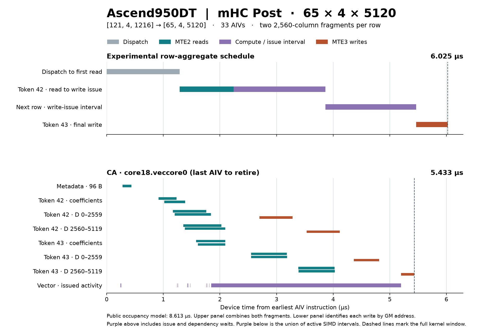

# 有序调度下的内置 mHC Post

同一张卡上有多个有序流时，每个流各维护一个 `OperatorStream`。在知道首次启动或前一条成功派发的内置 Post 时，系统现在可用 `track_post_history=True` 模拟关键 AIV 的逐行读写发起。下表全部由公共入口沿宿主派发顺序回放。输入只有算子、shape、dtype、attrs 和芯片；CA 提供对照设备时间。

| 芯片 / 数据角色 | 窗 / 不同形 | 新有序流 WAPE / 最大 | 原有序流 WAPE / 最大 | 仅 shape WAPE / 最大 |
|---|---:|---:|---:|---:|
| 950DT · 全部历史回放 | 151 / 113 | 8.20% / 58.52% | 9.55% / 58.52% | 30.29% / 79.81% |
| 950PR · 全部历史回放 | 88 / 56 | 7.13% / 57.22% | 11.10% / 57.22% | 31.07% / 78.23% |
| 950DT · 触发新的首次/换形分支 | 40 / 40 | 8.55% / 45.13% | 13.19% / 56.88% | 19.16% / 72.75% |
| 950PR · 触发新的首次/换形分支 | 29 / 29 | 5.45% / 14.47% | 15.49% / 37.49% | 15.93% / 51.78% |
| 950DT · 未触发该分支 | 111 / 88 | 8.06% / 58.52% | 8.06% / 58.52% | 34.83% / 79.81% |
| 950PR · 未触发该分支 | 59 / 44 | 8.22% / 57.22% | 8.22% / 57.22% | 40.99% / 78.23% |
| 950DT · 原 v0.27 采前冻结的普通 token 首次/换形 | 4 / 4 | 7.92% / 13.87% | 17.49% / 32.73% | 30.66% / 51.35% |
| 950PR · 原 v0.27 采前冻结的普通 token 首次/换形 | 5 / 5 | 5.22% / 13.53% | 15.09% / 36.42% | 17.50% / 51.78% |
| 950DT · 原采前冻结的相邻同形 token | 12 / 12 | 2.88% / 8.90% | 2.88% / 8.90% | 62.28% / 77.39% |
| 950PR · 原采前冻结的相邻同形 token | 10 / 10 | 1.93% / 3.85% | 1.93% / 3.85% | 63.91% / 78.10% |
| 950DT · Pre → Sinkhorn → Post 中的 Post | 24 / 23 | 8.85% / 20.75% | 8.85% / 20.75% | 8.85% / 20.75% |
| 950PR · Pre → Sinkhorn → Post 中的 Post | 10 / 10 | 6.93% / 14.29% | 6.93% / 14.29% | 6.93% / 14.29% |
| 950DT · 仅真实指令退休口径（另计） | 54 / 27 | 8.45% / 58.58% | 10.96% / 58.58% | 39.63% / 79.89% |
| 950PR · 仅真实指令退休口径（另计） | 56 / 27 | 7.53% / 57.27% | 11.50% / 57.27% | 38.06% / 78.32% |

全表按完整 DB 或聚合 trace 的 SHA-256 去重。各分组可以共享历史样本。物理指令退休口径单独保存。WAPE 为绝对误差之和除以 CA 时间之和。先前冻结的样本在本版用于集成回放。本轮新双分片采集另有事前登记和状态，排队期间其 CA、误差均为 N/A。已拒收窗口保留原始原因，对通过数值 golden 的前一条调用仍可从完整宿主日志确认此次为换形。334 次 Python 公共流查询（含宿主顺序中的其他调用）中位 0.193 ms，P95 0.317 ms，最大 0.875 ms。设备时间和主机查询时间分别记录。[逐窗数据、源文件哈希及其他分组](score.json)

## 何时能选用逐行模型

`OperatorStream(..., track_post_history=True)` 在原 `aclnnMhcPost` BF16 四流、含 residual、连续 ND 合同上运行。令 $T$ 为本卡 token 数，$D$ 为一行的通道宽，$C$ 为芯片 AIV 数。当 $2T\ge C$ 时将完整 token 分到核，最长核处理 $r=\lceil T/C\rceil$ 行，活跃核数 $A=\lceil T/r\rceil$。当一行可装入目标 UB，且已知本流首次，或换形且可确定扩核/复用，按上一条成功内置 Post 的入口选择控制价格。四个已观测的状态是首次、token 后扩核、token 后复用、通道后复用；有效源为 14、10、5、11 个独立宿主过程。通道后扩核缺该控制价格，沿用原模型。给定的平台若无 FP32 Vector 吞吐也沿用已有推算。[冻结控制和发起阶段价格](../../v0.28/post/parameters.json)

每行读取 64 B、16 B 两组系数，$2D$ B 的 BF16 主输入及 $8D$ B 的四路 residual。第 $j$ 个描述符在 $a_j$ 周期发起，其固定响应为 $L_j$ 周期，端口的字节服务价格为 $k$ 周期/KiB；该行操作数全部就绪在 $\max_j(a_j+L_j+b_j k/1024)$。从就绪到发写，还要支付按 $\lceil D/64\rceil$ 组计算且依目标每 AIV FP32 吞吐缩放的工作。行间发起间隔取冻结控制供给、向量服务、读字节服务和写字节服务的最大值。首行和第二行单独建立依赖，从第三行起按稳态间隔直接算末行发起。末次 $8D$ B 写完、控制退休后再检查 HBM/L2 全片流量下界。控制周期由目标频率换算为微秒。目标提供 MTE2、MTE3 带宽时分别替换；缺失时继承 950 的有效服务周期/KiB。返回值同时更新阶段微秒、工作量与实际吞吐。[流水公式与阶段实现](../../../operator_model/post_token_pipeline.py)

```python
from operator_model import OperatorStream
stream = OperatorStream("Ascend950DT_9582", track_post_history=True)
stream.reset()                                # 该 rank、该流从空队列开始
stream.advance("mhc_post", [127, 4, 448])       # 4.029 µs
quoted = stream.preview("mhc_post", [157, 4, 1088])
issued = stream.advance("mhc_post", [157, 4, 1088])
assert quoted == issued                        # 3.490 µs，reuse_after_token
repeat = stream.advance("mhc_post", [157, 4, 1088])
stream.forget_history()                       # 外部另有不可见的派发
```

同一序列在 950PR 因活动核从 43 增到 53 而选择扩核，普通换形预测 4.488 µs，CA 4.527 µs；在 950DT 首发已经使用 64 个核，换形可复用，CA 3.207 µs。显式传入的 `resident_aiv` 优先。未知前缀时，仅当后续同族调用已证明驻留核下界覆盖下一次活动核数时，才可以选复用。其他内核或独立 vLLM HcPost 会截断前序；预览和被拒调用都不会推进状态。[两次实际调用的逐 token 实测与模型同轴图](../../v0.27/post/unseen-same-token.png)

**保留显式开关。** 普通首次/换形仍只有每端 4/5 个经过采前冻结的独立 shape。DT 的历史 [72,4,256] 在通道后复用时预测 3.223 µs，CA 2.221 µs；切入前为 2.384 µs。当前阶段法把“同入口、同驻留状态”的启动时间概括为中位周期，无法从外部序列确定这次格外短的控制。DT 历史阶段开发集总体最大误差由 23.38% 上升到 45.13%。原相邻完全同形 token 保留已有双端 12/10 形的准入；通道 repeat 按既有预登记在这里仍为 10/8 形，双侧样本门槛尚缺。全算子含未知前序、双分片的实际误差仍见首表。仅 shape 的历史同形样本任取常数的 WAPE 下界为 DT 27.64%、PR 28.81%。[通道冻结条件](../../v0.28/post/registration.json) · [形状相同而启动状态不同的误差下界](../../v0.27/history-bounds.json)

## 旧模型的尾差来自重叠的宽行读取

[121,4,1216] → **[65,4,5120]** 是普通 token 换形。每端实际启动 33 个 AIV，最长核处理两行。内置库依据 $320+52d_{\rm aligned} < U$ 选择能装入 UB 容量 $U$ 的通道分片，宽度向 16 对齐。当前 950 配置把每行分为两个 2560 通道片。每行先取一次两组 FP32 系数，每片各读取 5120 B 的主输入和 20480 B 的四路 residual，执行向量混合，再向四组间隔 10240 B 的目标地址各写 5120 B。分片沿独立输出通道，所以片间没有数值归约。每个输出元素内部的四路加权和是向量侧完成的。这一地址归属通过全芯片的 520 个连续 GM 写区间、共 2,662,400 B 逐字节覆盖来验证。

| SKU / 最后退休核 | 公开有序流 / CA | 整行候选 / 偏差 | 12 笔输入响应时长之和 / 区间并集 | 次行首读比上一行末写退休早 |
|---|---:|---:|---:|---:|
| 950DT · core18.veccore0 | 8.613 / 5.433 µs | 6.025 µs / +10.90% | 6.839 / 2.455 µs | 2.536 µs |
| 950PR · core17.veccore1 | 8.707 / 5.538 µs | 6.109 µs / +10.31% | 7.028 / 2.685 µs | 2.459 µs |

逐笔响应求和分别重复覆盖 4.385/4.343 µs。旧公开模型本身用抹平重叠后的互斥队列阶段线性估算，并没有显式逐笔求和；它给 MTE2 多计 2.513/2.629 µs。这两组数值分别度量描述符重叠和旧阶段模型的残差。上图的整行候选把相同数据量聚合到一行读就绪预算、一次写和发起间隔；下图按真实写地址拆出两个分片。MTE2 的响应包含排队与等待，因此单凭这些区间不可反推出 HBM 命中率。970DT 仅为硬件情景外推。[原互斥阶段审计](../../v0.26/post/wide-stages.md)




[950DT 逐笔时间、地址和模型里程碑](wide-dt.json) · [950PR 逐笔明细](wide-pr.json) · [提取与绘图程序](../../../development/validation/post29/wide_trace.py)

**新双分片验证。** 在两端各用一个隔离宿主，从 [112,4,768] 起步，依次派发 [67,4,4912] 和 [69,4,5680]。两个目标 shape 有不同宽度和不等长尾片，均具备可从系统端推导的同族高水位。登记中同时保存公开时延、整行候选、仅 shape 及 970DT 外推。每 SKU 最大 2400 秒、6 GiB，单槽调度主动等待已登记的大作业优先，并保留至少 64 个空闲物理核。两形均须核对完整 golden、官方 ELF 和退休名单、活跃核、四路输出字节与完整窗。整行候选有原数据的一形开发回放；即使这两形通过，仍达不到每端十种独立 shape 的默认准入目标。[预登记与三卡预测](split-register.json) · [可恢复队列状态](split-state.json)

## 复算

在仓库根目录运行 `python3 development/validation/post29/replay.py` 可重建有序流全量同集计分。使用带 matplotlib 的 CANN 隔离环境运行 `toolchains/envs/cann-9.2.1/bin/python development/validation/post29/wide_trace.py` 可从历史原始 trace 重绘两端。文件编码为 UTF-8。两个分片目标的持久队列名为 `post29-split`，其 `run` 子命令只会沿已有登记恢复，拒绝重跑已有原始数据的实例。独立进程从源码目录外加载本轮构建的 wheel，已核对 DT 的首次时延和后继 `reuse_after_token`；整套 Python 测试 309 项通过。
