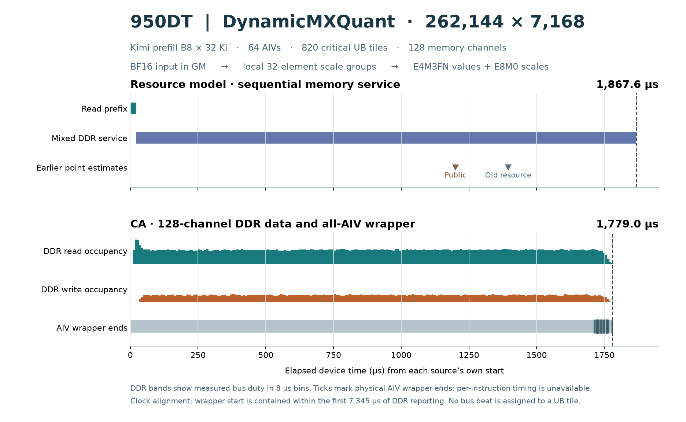

# DynamicMXQuant 的跨 L2 连续搬运情景

Kimi K3 mixed-QKV 的 BF16→MXFP8 分支，在单卡 B8×32 Ki 的一次完整 dispatch 中输入为 `[262144,7168]`。同一 CANN 9.2.1 ops-nn 库内核 `DynamicMxQuant_bf16toe4m3_high_performance_33_mix_aiv` 将每核 4,096 行分成 820 轮。公开默认耗时 1,200.415 µs，旧目标资源模型 1,394.986 µs，本情景 1,867.553 µs。实测 1,778.988 µs 的口径是全 64 AIV wrapper 首次启动至最后完成，FP8 输出与 E8M0 scale 均逐元素通过。该次运行的首末指令耗时为 N/A。[结果摘要](report.md) · [原生回执](../../v0.20/full-quant/native.json)

在 128 个内存通道上，每 8 µs 汇集原始 DDR 读、写有效拍，下图的面积代表传输量。64 条 AIV 结束刻度采用同一次原生启动的核时钟。两套时钟的绝对原点缺少对应关系，已知 wrapper 被控制器窗口包含时，模型图下半部允许二者的起点相差 0–7.345 µs。没有把汇总的忙周期填成逐 tile 的 MTE、SIMD 或退休记录。[图中数值、按通道的原始指纹](b8-service.json)

## 算法、实现与计算

输入为 `M×H` 的连续 BF16，末轴 32 元素一组、`scale_alg=0`、E4M3FN 输出。延用供应商 key 33 的 AIV 分核、UB 按块预取和数据/scale 两路写回。设输入读 $R=2MH$ 字节，输出 $W=MH+2M\lceil H/64\rceil$ 字节。$A$ 是实际使用的 AIV 数，$I$ 是最忙核的迭代次数，$B_t$ 为一个输入 UB tile 的字节数，$C$ 是目标 L2 容量。

$$L=\min(R,A\min(I,2)B_t),\qquad f=\min\left(1,\frac{\max(0,C-L)}{R-L+W}\right).$$

$L$ 是当前输入的活跃单/双缓冲页预算，由已有分块方案确定。$f$ 是其余读写流能留在 L2 的比例。假设在均匀顺序扫描中，活跃页以外最后留下的干净输入和脏输出，按两者进入缓存的字节量分享剩余空间。预测可留的脏输出为 $fW$。这项假设可以通过同一进程的 DDR 写事务独立检验。组相联冲突、缓存所有权、提前逐出或写直达都可能改变它。

把 $fR$ 字节归入开始的读阶段，剩余 $(1-f)R$ 与逐出写 $(1-f)W$ 共用双向总线。$B$ 是目标的引脚字节率，单位 B/µs。$T_s$ 和 $T_e$ 是已有 kernel 模型中的首次发起和排空，单位 µs。$T_0$ 为旧公开入口对此 dispatch 的总价。

$$T_p=\min(T_0,T_s+T_e+fR/B),\quad T_m=\frac{(1-f)(R+W)}{\eta B}.$$

这个读前缀是等效服务预算。在干净输入的实际驻留未知时，用 $T_0$ 封住单独前缀可以保留小形原价，避免跨过 L2 容量就跳变。$T_p$ 与 $T_m$ 描述同一总线的连续服务。$\eta$ 是混合读写且 DMC 持续有请求时的有效数据拍比例。

$$T_{scenario}=\max(T_0,T_p+T_m,T_{MTE2,min},T_{SIMD,min},T_{MTE3,min}).$$

后三项是最忙 AIV 上读完其输入、执行实际 VF、写完数据与 scale 的吞吐下界。用每核字节除每核端口吞吐给 MTE2/3 计价。若 UB 块有 $h,w$ 个元素行列，$g=h\lceil w/32\rceil$，该块计算包括 $\lceil g/8\rceil+\lceil g/128\rceil$ 轮和固定 VF 发起。按整块与行/列尾块最多四类相加，把每轮工作量除目标每核 Vector 吞吐。并发流水的三个下界取最大值。真实芯片的 CA 只用于离线校准，调用上述函数只需 shape、芯片配置与所选混合链路服务情景。[实现](../../../operator_model/quant_stream_memory.py) · [安装库分块与逐 tile 原算例](../../../docs/examples/quant.md)

## 参数依据和能测到的差别

- 950DT 的 128 条 ×32 位、8 Gbit/s 引脚给出 4.096 TB/s，芯片配置名义值为 4.000 TB/s。将前者用于实际控制器时钟域的换算。950PR、970DT 没有对应量化实测引脚口径，使用各自名义 1.4、14.4 TB/s 作条件输入。
- $\eta=0.737096$ 是此前三个 **Cast** 不同形状在满队列混合读写期的有效数据拍比例的中位数，覆盖 48,374 个完整物理通道·µs。该参数没有读取量化总耗时，也没有用 B8 的实测服务率回调。分别拟合读、写每个 32 B 数据拍的时间，在整组留出 Cast 的三个形状上误差 −1.06%、−0.11%、−2.16%，等向处理为 +0.14%、+0.81%、−0.72%。分方向模型在两种形状上变差，其读写单价排序也随留出形变化，本候选采用原先冻结的单一混合服务率。[校准充分统计与源文件指纹](direction-prices.json)
- B8 的 $R=3,758,096,384$、$W=1,937,768,448$、$L=9,175,040$ B，预测留脏 42.609 MB。实际控制器整进程 DDR 写 1,888.006 MB，逻辑输出减去它得 49.762 MB。旧模型低估物理写量 75.280 MB，修订后高估 7.153 MB。差额还包括元数据和进程收尾，不能据此给每个 UB tile 分摊写回时刻。读预测偏低 5.427 MB。
- 预测中，等效前缀 22.455 µs，混合服务 1,845.098 µs。64 个 AIV 自身窗口的 MTE2 忙周期占比中位 98.55%，SIMD 53.94%，MTE3 60.69%，三者可重叠。按已有每核吞吐估算的纯服务下界为 735.85、934.59、199.40 µs。控制器原生报告的 77.24% 全程数据拍和 78.53% 混合高占用期数据拍说明量化流比校准用 Cast 更有效。脏字节误差缩小，同时总时间比 v0.27 的 Cast 中点 1,847.445 µs 偏大，实测偏差从 +3.85% 到 +4.98%。仅看总时延会漏掉这两项方向相反的变化。[旧阶段与完整控制器读写](../../v0.27/quant-channel-service.md)
- 固定 950DT 的内存链路、单核算力与主频，改变核数并按比例改变整芯片 Vector 吞吐，可以把核内工作和共享链路分开。8/16/32/64/120 AIV 的该形候选分别为 8,776/4,390/2,197/1,868/1,869 µs。前几组仍受每核迭代支配，64 核后带宽已满，额外核增加活跃页占用。所有变核结果均为模型敏感性，真实记录只有 64 核。因端口服务、地址调度、缓存策略和目标芯片引脚尚不充分可辨识，不能把 DT 的 $\eta$ 作为 970DT 固有硬件常数。[核数消融](diagnostics.json)

## 同集误差和采集资格

|芯片与计时|样本角色|不同形 / 窗|公开 WAPE / max|候选 WAPE / max|
|---|---|---:|---:|---:|
|950DT 全核首末指令|历史回放，最长 30.31 MiB 逻辑工作集|58 / 59|4.74% / 13.61%|4.74% / 13.61%|
|950PR 全核首末指令|历史回放，同一完整性门槛|53 / 53|7.71% / 16.83%|7.71% / 16.83%|
|950DT B8 全核 wrapper|单一大形开发回放|1 / 1|32.52% / 32.52%|4.98% / 4.98%|

两端已合格指令窗都未跨 L2 容量，所有 112 个点新旧逐位相同。不同核的窗口来自同一调度，核不是独立 shape。另一个历史大输入 `[262144,5120]` 完整核退出和两组数值输出均缺失。不能把未合格旧窗、同一次 B8 的 64 个 AIV 或 B8 总时间一分为二作为另一规模的独立标签。[逐窗口与归档审核](score.json) · [历史宿主日志清单](diagnostics.json)

B4×32 Ki 的 `[131072,7168]` 继续采用 v0.27 的原生 64-AIV 合同与预算。该运行早于 v0.29 冻结，v0.29 的 924.228 µs 于完成前登记，冻结时未查看其中间设备事件或 DMC 数据。B4 用来检验缩短同一流量的外推，只给 wrapper 资格。它不计为采前完全独立的完整指令窗。[v0.27 原冻结](../../v0.27/quant-transfer/freeze.json)

另行登记尚未采集的 `[16384,7168]`。它对应 Kimi 单卡 8 请求、每请求 2,048 个本次参与 prefill 的 token；这和 B8×32 Ki 一次完整合批是两种调度。冷流量模型预测 DT 的物理写回 77.445 MB，旧模型预测 0 MB；PR 分别为 83.193 MB 与 12.386 MB。每端运行一次，检查 E4M3FN 的 117,440,512 个值和 E8M0 的 3,670,016 个 scale、实际 ELF 的 .text、库 kernel 身份、全部 AIV 退役、逐核官方时间和实际 MTE3 输出字节。PR 缺少已确认的物理控制器名单时，保存通道记录，仅将其计数标为观测子集。足以证伪共享价格的一项是 DT/PR 延迟比，旧、新分别为 0.448×、0.337×；另一项是在 DT 上物理写回究竟更接近哪种 L2 假设。每端单次不能建立整个大形合同的跨芯片精度。[采前登记及三芯片逐阶段数值](freeze.json) · [最新完整结果](report.md) · [后台队列](state.json)

|Kimi BF16 输入|950DT 公开 / 候选 (µs)|950PR 公开 / 条件候选 (µs)|970DT 公开 / 条件候选 (µs)，外推|
|---|---:|---:|---:|
|[16384,7168]|79.958 / 98.355|178.669 / 291.546|37.561 / 37.561|
|[131072,7168]|602.614 / 924.228|1,958.627 / 2,707.562|265.962 / 265.962|
|[262144,7168]|1,200.415 / 1,867.553|3,992.864 / 5,467.444|527.779 / 529.926|

当前生产入口保留原模型。已加载芯片配置后，基于 B8 重新计算公开入口和本候选共 128 次/芯片，950DT、950PR、970DT 的 P95 分别为 1.39、1.44、1.39 ms。离线成本单列：已完成 B8 原生采集 4.89 h、峰值 6.78 GiB。新增双端按单槽排在 B4 后，保留 `--dump=false` 下的全核指令和控制器副本，跨 L2 新形张量量为此前最大指令窗的 11.2 倍，每端设 3 h 和 64 GiB 上限，不能用超时替代完整计时。实际成本随回执更新。[查询基准](diagnostics.json) · [全量逐项数据](score.json)

复核实际库版本时，CANNBot 的 DynamicMxQuant 950 算子卡用于对照尾轴 block32 及 tiling key 33，实际运行身份由 CANN 9.2.1 安装包的 ELF 与宿主 `aclnnDynamicMxQuantGetWorkspaceSize` / `aclnnDynamicMxQuant` 校验。该知识卡同时介绍 V2 与其他实现分支，本算例限于前述 BF16、末轴、E4M3FN 与 `scale_alg=0` 合同。[调用方与 golden 实现](../../../smoke/large_vector.cpp) · [安装包 ELF 路径与哈希](freeze.json)

正式指令窗的核验代码还在两条旧 `[2048,5120]` 原始 trace 上做了独立的采集链路核查。DT 的 64 核和 PR 的 56 核都有且只有一条 END，聚合的 MTE3 有效载荷均为 10,813,440 字节，官方全核窗分别复得 11.364 和 18.504 µs。旧宿主将 FP8 与 scale 的 golden 合并成一行，当前宿主分开两行记录；两者都逐字节验证。这个控制不占新增留出名额。[逐芯片验证、原始指纹和实际 VF 次数](instruction-controls.json) · [两端原始逐 tile 算例](../../../docs/examples/quant.md)
