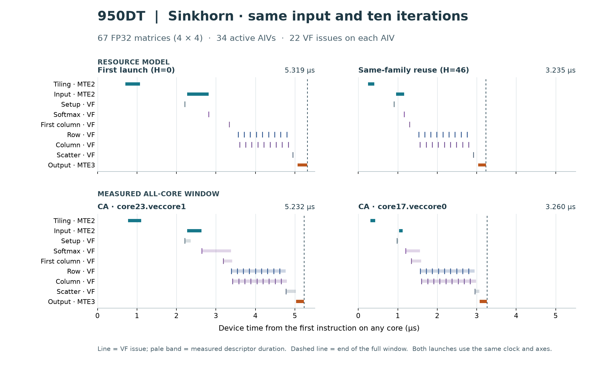
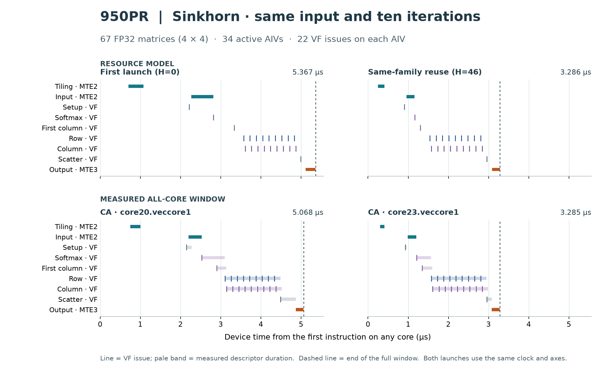

# mHC Sinkhorn · 同一批输入上的无状态与同流估时

### Summary

|950 芯片及数据角色|窗 / 不同形|现行无状态 WAPE / 最大 %|现行从真实首发跟踪|现行中途接入|候选只看 shape|候选使用可见前缀|
|---|---:|---:|---:|---:|---:|---:|
|950DT · 旧开发、T>64/I10|3 / 3|25.64 / 39.20|3.89 / 8.06|4.35 / 9.13|21.91 / 25.88|8.12 / 17.85|
|950DT · v0.26 冻结十形，T≤256|11 / 10|16.64 / 37.21|3.09 / 8.31|8.86 / 31.22|18.67 / 39.81|14.23 / 39.81|
|950DT · 该冻结集 T>64/I10|3 / 2|24.40 / 37.21|3.38 / 8.31|8.96 / 14.50|21.01 / 24.04|12.53 / 22.71|
|950DT · 中途接入、扩核与热态均可能|4 / 4|4.36 / 8.24|2.32 / 4.11|4.36 / 8.24|9.35 / 17.54|9.99 / 19.80|
|950DT · 中途接入、已证实全部覆盖|4 / 4|31.47 / 37.21|4.03 / 8.31|4.03 / 8.31|20.67 / 24.04|4.03 / 8.31|
|950DT · v0.28 原登记已完成|1 / 1|10.66 / 10.66|6.61 / 6.61|10.66 / 10.66|19.28 / 19.28|19.28 / 19.28|
|950DT · 本次候选采前冻结新窗|0 / 0|N/A|N/A|N/A|N/A|N/A|
|950PR · 旧开发、T>64/I10|1 / 1|8.55 / 8.55|8.70 / 8.70|8.55 / 8.55|16.81 / 16.81|16.81 / 16.81|
|950PR · v0.26 冻结十形，T≤256|11 / 10|25.75 / 80.84|3.88 / 12.92|11.30 / 43.92|18.36 / 25.87|11.97 / 25.87|
|950PR · 该冻结集 T>64/I10|3 / 2|17.24 / 37.41|4.70 / 6.57|8.08 / 10.93|20.19 / 25.01|14.27 / 18.97|
|950PR · 中途接入、扩核与热态均可能|4 / 4|19.33 / 43.92|3.87 / 6.57|19.33 / 43.92|13.05 / 18.28|13.73 / 20.18|
|950PR · 中途接入、已证实全部覆盖|4 / 4|48.68 / 80.84|1.37 / 4.17|1.37 / 4.17|23.29 / 25.01|1.37 / 4.17|
|950PR · v0.28 原登记已完成|1 / 1|11.06 / 11.06|6.09 / 6.09|11.06 / 11.06|19.12 / 19.12|19.12 / 19.12|
|950PR · 本次候选采前冻结新窗|0 / 0|N/A|N/A|N/A|N/A|N/A|

**25.64% 确实可在当前无状态入口复现。** 它来自 950DT 的三个旧开发窗口，首次一个、同族覆盖后的热态两个。PR 存档只有 T68 首次；两端旧组的协议构成不同。已知完整成功执行顺序时，现版系统后端即可使用 `OperatorStream(chip,track_sinkhorn_history=True)`，每次以实际同流顺序调用 `advance("mhc_sinkhorn",[T,4],{"num_iters":I})`。这一推荐对应 v0.26 登记前已冻结的条件估时，每端十种 T≤256 的新形；v0.29 对它们做入口一致性回放。未经区分的单次调用仍需保留前序未知。

刚附到已有流时先调用 `forget_history()`，执行完成的同族算子可以恢复覆盖核数的下界。不同流、未观测的调用、其他算子的 AIV 不能当作同族已经覆盖。只有方案已选定且实际 dispatch 才推进，查询候选用 `preview`。

## 逐形回放与外推

|数据和协议|SKU|T / I|H / AIV / R|全核 CA µs|现行无 H / 有序 µs|无状态保护点 / 中途接入 µs|970DT 同协议外推 无 H / 有序 µs|
|---|---|---:|---:|---:|---:|---:|---:|
|旧三形及 PR 对照 · first|950DT|68 / 10|0 / 34 / 2|4.922|4.473 / 5.319|4.044 / 4.473|4.138 / 5.528|
|旧三形及 PR 对照 · resident|950DT|65 / 10|63 / 33 / 2|3.258|4.471 / 3.235|4.044 / 3.235|4.135 / 4.308|
|旧三形及 PR 对照 · resident|950DT|66 / 10|47 / 33 / 2|3.212|4.471 / 3.235|4.044 / 3.235|4.136 / 4.308|
|旧三形及 PR 对照 · first|950PR|68 / 10|0 / 34 / 2|4.937|4.515 / 5.367|4.107 / 4.515|4.138 / 5.528|
|v0.26 冻结 · first|950DT|67 / 10|0 / 34 / 2|5.232|4.473 / 5.319|4.044 / 4.473|4.137 / 5.508|
|v0.26 冻结 · first|950PR|67 / 10|0 / 34 / 2|5.068|4.515 / 5.367|4.107 / 4.515|4.137 / 5.508|
|v0.26 冻结 · resident|950DT|67 / 10|46 / 34 / 2|3.260|4.473 / 3.235|4.044 / 3.235|4.137 / 4.309|
|v0.26 冻结 · resident|950PR|67 / 10|46 / 34 / 2|3.285|4.515 / 3.286|4.107 / 3.286|4.137 / 4.309|
|v0.26 冻结 · resident|950DT|130 / 10|58 / 44 / 3|3.528|4.489 / 3.235|4.082 / 3.235|4.135 / 4.308|
|v0.26 冻结 · expand|950PR|130 / 10|29 / 44 / 3|5.060|4.530 / 4.727|4.135 / 4.530|4.135 / 4.308|

T65 的真实宿主输入此前依序为 T2、4、8、9、16、31、32、63，T66 之前为 T3、5、7、11、15、21、33、47。两者调用参数和宿主成功输出逐次核实。T68 两端单独启动。未来芯片使用相同的宿主顺序，再按 120 个 AIV 计算 H 和实际分核。

## 哪段流水随前序变化

CANN 9.2.1 `aclnnMhcSinkhorn`，真实 FP32 key 0、4×4、无中间输出。$R=\lceil T/V\rceil$ 是可用 $V$ 个 AIV 下的每核最多矩阵数，实际活跃核 $A=\lceil T/R\rceil$。$G=\lceil R/8\rceil$ 由 256 B 寄存器包含 8 个 32 B UB 块确定。本组全为 G=1，每核每次有 $2I+2=22$ 次 VF，包括前处理、交错行/列归一化与末尾 scatter。已知 H=0 选首次，0<H<A 选扩核，H≥A 选覆盖。tiling 描述符、输入读取、首次 VF 与最后写回有独立的发起/等待价；按目标频率换算循环周期，用目标每核 FP32 的每周期能力重定价。254 周期稳态间隔从 DT 的连续 row 发起读到，不把整段 VF 生命周期按迭代数相加。[阶段校准参数](../../v0.26/sink/prices.json) · [实际源码与硬件边界](../../v0.28/fusion/eligibility.md)

|算例|首发 tiling|输入发起|首次列|首次行|稳态行间隔|scatter|写回发起 / 写描述符窗口|
|---|---:|---:|---:|---:|---:|---:|---:|
|950DT T68 first|1160/1189|3746/3650|5505/5016|5883/5355|254/254|8163/7635|8365/7975 ; 402/137|
|950DT T65 resident|406/412|1584/1622|2146/2186|2524/2565|254/254|4804/4845|5006/5046 ; 324/323|
|950DT T66 resident|406/400|1584/1546|2146/2107|2524/2485|254/254|4804/4765|5006/4967 ; 324/326|
|950PR T68 first|1160/1145|3746/3682|5505/4986|5894/5325|261/254|8236/7605|8443/7807 ; 402/329|

表内是“模型 / 实际周期”，零点为本次启动各核最早指令，后两列包含等待。旧热态两形与首次形的主要差距出现在首次读/发起、scatter 前的累积偏移及末写回；迭代数相同的稳态行间隔保持 254 周期。不同 T 的末核可能处理尾块，R 是最忙核上限。以下是同一 T67 的首次、热态模型和实测，时序差异亦可从同形配对直接看到。

## 只有部分同族历史时的物理区间与单值

维护已观察到的同族最大活跃核数 $h$。若流在观测前已有调用，真实 H 仅知落在 [h,V]。条件模型最多枚举 first、expand、resident 三类，一类只算一次。设 $L,U$ 是可达阶段时间的最低和最高值；它们是模型端点。若业务给出状态概率 $p_s$，批量总时的期望为 $\sum_s p_s T_s$，可由调度器的历史策略估计概率。没有这样的信息时，不把旧批次首次/热态出现频率搬到新业务。

只剩一种状态即可直接定价。多种状态尚存时，新增离线对照保留原价 $t_0$，并将它投影到 $[(1-\delta)U,(1+\delta)L]$，其中 $\delta=\max(0.25,(U-L)/(U+L))$。0.25 沿用了 v0.28 对可达条件模型的对称相对预算；样本 WAPE 是验收指标，两者不等价。与早先直接取等状态均值不同，旧价在可达预算内就原样返回。

同形 T67 首次/热态在 DT 为 5.232/3.260 µs、PR 为 5.068/3.285 µs。任何无 H 单值的这两个点的最大相对误差下界分别为 23.22%、21.34%，来自 $p=2LU/(L+U)$ 与真实两个窗口；两者都小于 50% 门槛。DT 的三旧形回放降低到 21.91%，代价是在原 v0.26 十形上的无 H WAPE 16.64%→18.67%；PR 的对应首次 T68 单窗 8.55%→16.81%。把保护点用在“确定有前序、上限未知”的 DT 四个扩核窗口也从 4.36% 升到 9.99%。因此现在可推荐的是已经冻结验证的有序接口；新增单值继续作为诊断，对无 H 不改变公共后端。

## 冻结、覆盖与开销

v0.28 四形流的 T69 首次两侧均已测，不能充作 v0.29 的新留出。仍未开跑的有序序列与 T233 寄存器试验已在本轮登记了所有可观察场景。T69 再出现是已有几何的新状态；T137、T233 是本轮内单寄存器可区分的全新几何；T1153、T2257 属于多寄存器，沿既有专项单列。这次新增 CA 为 0，收集结果以设备全核退出、逐元素数值、AIV 集合及 VF 个数核验。当前收到的本轮合格数见开头表，旧资格不顺延给新增保护点。

[逐形、完整前序、物理阶段、全核回执及实测与外推](score.json) · [本轮观测前冻结](freeze.json) · [现行有序入口的十形验证](../../v0.27/fusion/stream.md)
