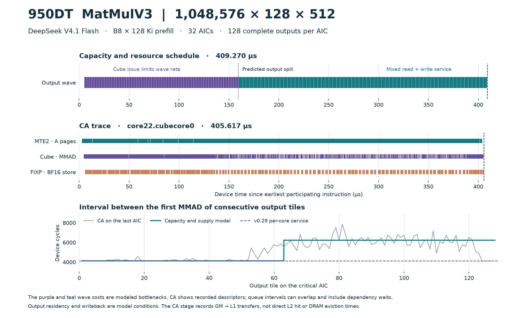

# 大 Matmul 的 L2 容量与读写供数

| 验证角色 | 几何与芯片 | 旧 B 常驻预测 µs | 本候选 µs | CA µs | 本候选偏差 |
|---|---|---:|---:|---:|---:|
| 开发回放 | Flash B8×32Ki，950DT [262144,128,512] | 85.246 | 85.246 | 85.993 | −0.87% |
| 开发回放 | Flash B8×32Ki，950PR 同形 | 196.082 | 176.124 | 174.953 | +0.67% |
| 开发回放 | Flash B8×128Ki，950DT [1048576,128,512] | 324.490 | 409.270 | 405.617 | +0.90% |
| 冻结时正在采集 | B8×128Ki，950PR | 879.155 | 1091.722 | 见动态表 | 见动态表 |
| 采前冻结 | B8×256Ki，950DT [2097152,128,512] | 643.482 | 892.683 | 见动态表 | 见动态表 |
| 采前冻结 | B8×256Ki，950PR 同形 | 1837.853 | 2472.902 | 见动态表 | 见动态表 |

包含每卡 32,768 行的另外两个小控制后，5 个开发端点的 WAPE 从 14.77% 到 0.93%，最大偏差 3.37%。本候选利用了前三个大形的流水证据。剩余三个端点的登记时间、原始回执核对、三端同集比较、当次 CA 成本与失败状态由只读评分器持续更新。[动态逐形及跨芯片对照](comparison.md) · [完整冻结](freeze.json)

上图的波从预测的首 MMAD 开始，颜色表示每一波先遇到的资源限制。下图读取原 CA 的最后完成 AIC，记录实际 MTE2 页、MMAD 与 FIXP 描述符的起止。两栏都从全核最早指令计时。第三栏以输出块序号展示相邻首 MMAD 的间隔，保留了中途与末端波动。这是一个开发算例。[图中预测与实测点](figure-data.json) · [原始 PC 时间窗的逐块摘录](critical-1048576-dt.json)

## 计算步骤和资源参数

候选延续 v0.29 的适用域，覆盖真实 MatMulV3 BF16、连续 ND、B 矩阵在每个参与 AIC 的 L1 驻留、沿 N 恰好一个完整输出矩形、完整 K 页和计算块。它通过源实现的 L1/L0C 容量与重复次数判支。初始指令及写回尾段复用已有阶段价格。未满足该分支时返回 N/A，这次单独验证候选。[实现](../../../operator_model/matmul_supply30.py) · [原分块、每级页与价格](../../v0.29/matmul/full-load/report.md)

以图中 Flash indexer.wk 为例，M=8×131072、K=512、N=128。实际库入口 aclnnMatmul 启动 MatMulV3_ND_ND_ND_ND_BF16_BF16_BF16_BF16_high_performance_131074。32 个 AIC 共执行 65,536 次 [256,128,32] MMAD，每核 128 个输出块。每个输出块读 A 为 a=2×256×512=262,144 B，写 C 为 c=2×256×128=65,536 B。B 的逻辑大小 b=131,072 B，每个 AIC 的 L1 只装入一次。相邻 MMAD 的核内间隔按照全片 BF16 峰值、活跃配置与时钟得到 257 cycles，对应 S_core=16×257=4112 cycles/输出。

**容量阶段。** 设 C₂ 为整片 L2 容量（字节），P 为每核首张 A 的页大小（本例 65,536 B），n 为活跃 AIC 数，U 为输出块总数。用
$$
D=\max(0,C_2-b-2nP),\qquad H=\min(U,\lfloor D/c\rfloor)
$$
估计暂时可留在片上的完整输出块数。B 的共享副本占 b，A 的 ping-pong 预留每核两页。前 H 块写入 L2；后续新增输出块同时向 HBM 读 A、回写较早的脏 C。H 不是拟合的 token 断点。DT 128Ki 得 D=129,892,352 B，H=1,982 块，即约 62 个 32 核波；PR 是 1,734 块、约 62 个 28 核波。实际 FIXP 描述符带 Normal:firstvictim 策略，但没有直接量出每个被驱逐脏行的时刻。此容量模型假设输出能占用剩余空间，cache 映射冲突、多调用抢占、脏行提前写回均可令转折更早。

**每波价格。** 同一波中有 u 个尚能留在 L2 的输出和 v 个需要腾出空间的输出。令 R₀=ua、R₁=va，写回量 W=vc。首波从对应的 R₀/R₁ 扣除每核首张 A 页，因为启动填充阶段已经收取它。B_H、B₂ 分别是整片物理 HBM 和逻辑 L2 带宽，以配置 GB/s 除以 GHz 得字节/芯片周期。每波时长为
$$
T_w=\max\left(S_{core},\ \max\left(\frac{R_0}{F B_H},\frac{R_0(1-\rho)}{B_H}\right)+\frac{R_1+W}{\eta B_H},\ \frac{R_0+R_1+(u+v)c}{B_2}\right).
$$
F 是有少量初始 L2 读命中时可观察到的逻辑输入吞吐与物理配置带宽之比，ρ 是全体读阶段最多能由初始 L2 供应的份额，η 是混合读写时实际占用数据拍的比例。两类事务在一个资源端口串行收费，计算和传输并行取最大。尾波按真实参与核数给内存计价，实际活跃的核心仍做一个完整输出块。总时间为首 MMAD 到达成本、所有波 T_w 之和、最后的 MMAD 反应尾差及 BF16 写回排空之和，再除以 1000×主频 GHz 换算 µs。用不超过五个等价连续波段直接求和，在线复杂度与 M 无关。

**η 来历。** 复用 950DT 官方控制器已有 128 路 DDR 读/写数据拍。每个 1,000 DFI 周期面板核对 32×(读拍＋写拍)=该周期物理字节。只取 DMC 队列至少 95% 时间非空的报告期，按实际写比例归入十分位。该 Matmul 的混合段写占比 1/5，对应 15%–25% 组。每种控制至少有 128 个合格通道报告期后，各来源等权取中位得到 0.694115。它是实际事务比例，不由算子完成时间反推。

|独立控制 | 合格通道报告期数 | 有效数据拍/可用拍 |
|---|---:|---:|
| Kimi quant [262144,7168] | 18,354 | 0.78817 |
| Cast [8192,5120] | 187 | 0.68938 |
| Cast [2097152,32] | 207 | 0.69885 |
| Pro Cast [2097152,64] | 232 | 0.63429 |

周期样本并非独立实验，四组差异说明通道映射、事务调度、算子数据流都会改变 η。950PR 与 970DT 未取得同口径混合流量计数，继承 950DT 的 η 是可替换假设；传入明确的目标控制器效率或不同芯片配置可单独重新计价。[各写比例分组、原始计数指纹](external-service.json)

**逻辑读取 F 与初态。** 950PR 的四组独立 Cast/Sigmoid 使用真实 DMA 发起与退休窗口，紧窗口的逻辑入流下限分别为 1458、1482、1562、1539 GB/s，均超过配置的 1400 GB/s。为复现这类有缓存的资源情景，取最大已证实必要值 1562.396，再除配置值为 F=1.116。此值是 AIV 逻辑窗口的服务约束，迁移到 AIC 是一项跨引擎条件。它既未测到单独 HBM 引脚峰值，也未测得 AIC L2 命中率。全作业能预先供应的输入字节最多
$$
X=\min(C_2,Ha(1-1/F)),\qquad \rho=X/(Ha)
$$
，没有可留存块时取零。这个额度在各波分摊一次。纯冷输入模式强制 F=1、ρ=0。950DT 的独立需求值低于其 4000 GB/s 配置；未知芯片也从 F=1 起。没有新芯片 CA 时仍可按用户给定的容量、频率、核数、算力、带宽运行。[读取窗口与价格](prices.json)

## 哪些阶段得到证实

DT 128Ki 的末核有 2,048 条 MMAD。当相邻发起时间超过理想 257 cycles 时，将超出部分计为供数或依赖空泡。实测共 134,686 个额外周期，其中 115,243（85.6%）恰逢每页首条 MMAD。相应 A 页真实退休晚于上一乘加发起+257 的周期，累计至少覆盖 75,164（55.8%）；对应 L0A/B 搬入退休覆盖 114,447（85.0%）。两种量有重叠，不相加。三个源 trace 在按 PC 类型、顺序、页偏移分配后，未出现对应页或操作数在 MMAD 已发起后才退休的反例。这为输入到达延迟提供了指令证据。高压阶段 A 页响应增加到约 3,200–3,305 周期，但 FIXP 本身的描述符持续时间大体维持在约 3,800–4,100 周期。

| 末核输出序号（零起） | A 页响应中位 cycles | 邻块首 MMAD 平均间隔 cycles | 本组额外发起周期 | 其中已由 A 页退休晚覆盖 |
|---|---:|---:|---:|---:|
| 0–31 | 1493.5 | 4163 | 1,610 | 296 |
| 32–63 | 1808.0 | 4597 | 15,428 | 6,881 |
| 64–95 | 3304.5 | 6167 | 65,632 | 39,017 |
| 96–127 | 3196.0 | 5782 | 52,016 | 28,970 |

当 DT 的 32 核进入混合段，全片每波读写 10 MiB，按 4 TB/s×0.694115 得 6,231 cycles。模型将约第 63 个波之前视为纯读；真实 trace 大约从第 52 个块起已出现供数延迟，末尾又恢复几个 4,112 周期的快波。模型能解释后半程速率下降，但阶跃时刻与收尾分布仍有偏差。将混合效率改为 1，128Ki 预测降至 333.025 µs，明显不足。将四个独立来源的效率逐端取极值，128Ki DT 为 379.525–432.780 µs，实际 405.617 µs。关联的 DMA 退休/发起和跨算子的控制器服务支撑此解释，但 Matmul 的逐波物理驱逐与通道计数仍待独立确认。[DT 32Ki 对照](critical-262144-dt.json) · [PR 32Ki 对照](critical-262144-pr.json)

在 PR B8×128Ki，冷输入单独给出 1125.333 µs，中心条件为 1091.722 µs，外部效率范围产生 996.792–1166.845 µs。970DT 的 B8×32/128/256Ki 分别为 25.617/102.310/236.067 µs，皆为条件外推。冻结时 12 个预测调用（含一个不适用分支）最大墙钟 1.50 ms；本轮新 CA 数为零。DT B8×128Ki 原有 CA 墙钟约 98.2 分钟，峰值 18.0 GiB。用数据前已冻结独立评分；若 PR 内存系统不同，该候选也可能比 v0.29 或原公共模型更差。[实际采集成本、全部消融及分组误差](score.json)
