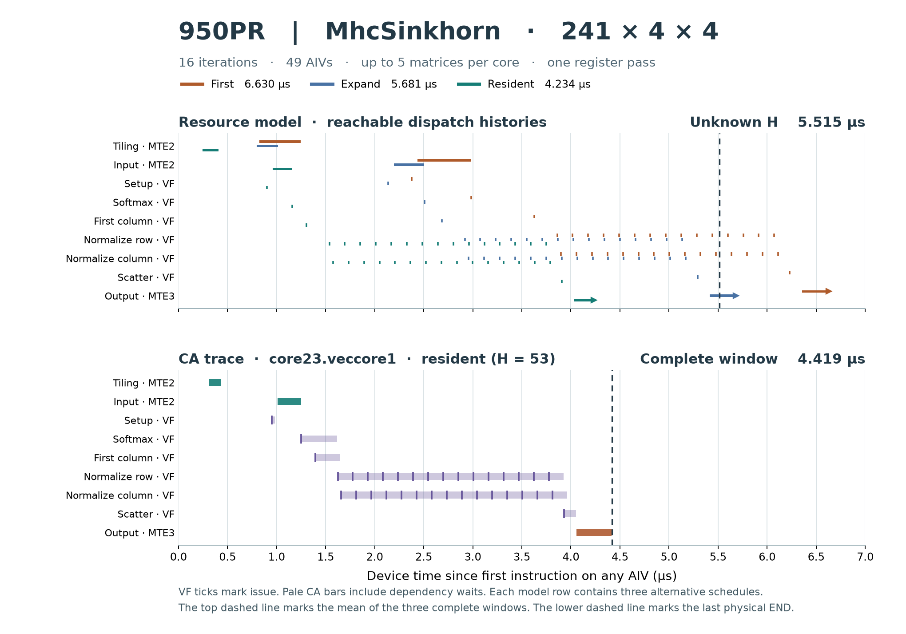

# standalone mHC Sinkhorn 的无历史预测

|验证集|芯片|已定价 / 全窗（已定价不同形）|旧同集 WAPE / 最大 %|当前 WAPE / 最大 %|已知 H WAPE / 最大 %|
|---|---|---:|---:|---:|---:|
|原冻结十形|950DT|11 / 11（10）|16.64 / 37.21|16.43 / 35.22|3.09 / 8.31|
|原冻结十形|950PR|11 / 11（10）|25.75 / 80.84|15.86 / 35.64|3.88 / 12.92|
|原 T>64，I10 开发|950DT|3 / 3（3）|25.64 / 39.20|24.98 / 37.01|3.89 / 8.06|
|原 T>64，I10 开发|950PR|1 / 1（1）|8.55 / 8.55|9.73 / 9.73|8.70 / 8.70|
|新旧均有价格的全部实测|950DT|70 / 70（53）|10.73 / 39.20|10.57 / 37.01|4.00 / 31.41|
|新旧均有价格的全部实测|950PR|42 / 42（36）|12.50 / 80.84|10.33 / 35.64|3.90 / 12.92|
|其中独立调用|950DT|46 / 46（44）|13.43 / 39.20|14.24 / 37.01|4.00 / 31.41|
|其中独立调用|950PR|32 / 32（31）|13.86 / 80.84|12.02 / 35.64|3.90 / 12.92|
|Pre 后真实 Sink 组件回放|950DT|24 / 24（13）|5.84 / 17.54|3.91 / 11.13|N/A|
|Pre 后真实 Sink 组件回放|950PR|10 / 10（7）|8.26 / 20.80|5.04 / 14.47|N/A|
|只有热调用，单寄存器|950DT|6 / 6（6）|33.59 / 39.20|32.95 / 37.01|2.99 / 8.31|
|只有热调用，单寄存器|950PR|4 / 4（4）|48.68 / 80.84|31.77 / 35.64|1.37 / 4.17|
|原冻结额外大 T（部分可定价）|950DT|2 / 4（2）|N/A|16.02 / 25.23|12.96 / 26.37|
|原冻结额外大 T（部分可定价）|950PR|1 / 4（1）|N/A|21.51 / 21.51|20.37 / 37.53|

原十形每卡 11 窗，T67 同形先后在首次、驻留状态出现两次。每窗的无 H 数值已经随 v0.26 登记早于正式 CA 冻结。本轮按 kernel 的单寄存器规则接入公共入口，复核此前的前瞻数值。额外四个大 T 每卡的已知 H 指标包含四窗，无 H 各覆盖 DT 两窗、PR 一窗，缺口见下表。所有旧数据的本轮角色均为回放。汇总中不混入一个耗时也未取得的新形。[原始登记](../../v0.26/sink/register.json) · [当前冻结与数值核对](freeze.json) · [逐窗及逐来源指标](score.json)

## 分核、发起与未知历史

公开调用为 `estimate("mhc_sinkhorn", [T,4], {"num_iters": I}, chip=...)`。宿主的真实输入为 FP32 [T,4,4]，eps=1e-6、return_intermediates=false。CANN 9.2.1 的 `aclnnMhcSinkhorn` 派发内置 ops-transformer kernel `MhcSinkhorn_8997d9c5c22e82688b98bc25d8daa9cd_0`。安装源在 CalcRowNorm、CalcColNorm 与 ScatterOutFromNorm 中均使用 `ceil(handleNum / (GetVRegSize()/GetUbBlockSize()))`。V 是目标 AIV 数，每核最多 R=⌈T/V⌉ 个 4×4 矩阵，启动 A=⌈T/R⌉ 核。按 950 的 256 B 寄存器、32 B UB 块，每个归一化 VF 需 G=⌈R/8⌉ 遍。输入与输出各 64T B。离线观察最晚 END 的核，所有实际活跃核均校验退役。历史 SQLite 未导出的 ELF 文本保留其原始 kernel 标识；不得把 SQLite 的 `entry_kernel_0` 别名视为重新验证了其 ELF SHA。

行列具有真实依赖。一次 UB 块先发起参数与输入搬运，再发 setup、softmax、首列，随后 I−1 对行列和最终 scatter，共 2I+2 个 VF。相邻 VF 描述符可重叠。G=1 时首次行至下一行的间隔为 248 个参考周期，稳态为 254 个周期。首列到首行 378 周期；首对行到列的间隔 56 周期，稳态 62 周期。各值来自 950DT 原归一化段发起轨迹。仅当 I≥2 时才存在后续行对，I=1 的理论外推缺少同样的盲验证。

目标向量速率系数为 ρ=(峰值 FP32 ops/s / V / f) / 255.682。f 在此用 Hz，255.682 是参考 DT 每核每周期 FP32 ops。向量周期除以 ρ，频率把周期换为 µs。临界读/写至少需 max(64T/B_HBM, 64R/B_MTE) 的服务时间，各端口带宽取目标配置。可测量的描述符等待与这个下界取大者。上式 B 以 B/s 表示，结果以秒表示。共享端口等待和首发竞争按独立事件的周期建模，物理可辨识的是端到端一次描述符的发起/完成间隔；有效 HBM 命中率、内部仲裁机制不可从这个小形独立识别。不同代际的 UB、发起机制或 VF ISA 改变时需替换相应资源参数。[原价格表及样本数](../../v0.26/sink/prices.json) · [已安装源的 SHA](freeze.json)

H 表示这条流已知同族内核驻留过的 AIV 高水位。若 H=0，采用首次调度；若 0<H<A，按扩核调度；H≥A 则采用驻留调度。每个状态在 950DT 源事件上分别校准，有 16/16/2 个开发观测。令每种可达完整调度的末时刻为 tₛ，普通无 H 入口返回 Σtₛ/|S|，同时暴露各状态价格、最小/最大末时刻和相对误差 minimax 对照值 2lu/(l+u)。S 是由 A 决定的可达状态集合，A=1 时不存在扩核态。等权仅表示调用者未提供部署频率。在可观察前序的系统仿真中，可直接使用 `OperatorStream(track_sinkhorn_history=True)` 获得这次的条件价格。误差范围仅是几个物理场景末时刻，存在未建模残差。

## 一个可复算的 950PR 例子

T=241、I=16、V=56，R=5、A=49、G=1，每活跃核最多搬入和写出 320 B，整卡读和写各 15,424 B。34 次 VF 中包含 15 对行列归一化。旧模型以每个 4×4 矩阵完整的 64 B 除寄存器，误得两遍并返回 7.991 µs。公共新模型的首次、扩核、驻留分别 6.630、5.681、4.234 µs，均值 5.515 µs。同一调用真实的 H=53，49 个活跃 AIV，最后一个 core23.veccore1 在全窗 4.419 µs 退休。无 H 有符号误差 +24.81%，已知 H 为 −4.17%。同 shape 的 970DT 无 H 时为 5.200 µs 外推。

上图每个阶段的三种颜色分别表示三种前序。下图 VF 左边缘是发起点，淡色矩形是该描述符完整生存期。下框起点是所有核最早指令、终点是所有核最后 END。原迹核片和全窗散列均随数据提供。[图内逐事件记录](unknown-t241-pr.json) · [对应合格回执](../../v0.26/sink/receipts/grow-Ascend950PR_957b.json)

## 逐状态、逐来源与剩余风险

|芯片 / 样本来源|完整 / 当前定价|旧 WAPE / 最大 %|当前 WAPE / 最大 %|相对 minimax 对照 %|v0.28 稳健候选 %|
|---|---:|---:|---:|---:|---:|
|950DT · all|74 / 72|10.73 / 39.20|10.70 / 37.01|13.76 / 39.81|12.31 / 39.81|
|950DT · state/first|21 / 21|15.46 / 31.22|16.89 / 29.85|23.24 / 39.81|21.74 / 39.81|
|950DT · state/expand|22 / 21|7.47 / 21.47|8.20 / 16.07|12.51 / 22.79|10.57 / 22.64|
|950DT · state/resident|7 / 6|33.59 / 39.20|32.95 / 37.01|21.61 / 25.06|21.36 / 25.88|
|950DT · state/foreign Pre|24 / 24|5.84 / 17.54|3.91 / 11.13|5.21 / 12.72|3.91 / 11.13|
|950DT · chain/model-v7|3 / 3|9.55 / 10.78|5.79 / 6.94|1.38 / 3.05|5.79 / 6.94|
|950DT · chain/sku17|1 / 1|10.87 / 10.87|4.84 / 4.84|3.14 / 3.14|4.84 / 4.84|
|950DT · chain/v8cv|10 / 10|5.43 / 17.54|3.49 / 11.13|5.85 / 10.14|3.49 / 11.13|
|950DT · chain/v9mhc|10 / 10|4.74 / 12.23|3.71 / 10.02|5.85 / 12.72|3.71 / 10.02|
|950DT · fusion21|10 / 10|16.48 / 29.23|16.63 / 28.06|22.66 / 38.20|20.84 / 38.20|
|950DT · model-v7|3 / 3|12.93 / 20.50|14.52 / 18.83|18.15 / 23.25|15.49 / 21.45|
|950DT · sku17|1 / 1|5.91 / 5.91|11.04 / 11.04|12.48 / 12.48|11.04 / 11.04|
|950DT · v0.26/sink/boundary|4 / 4|20.34 / 31.22|19.73 / 31.16|19.99 / 39.81|19.22 / 39.81|
|950DT · v0.26/sink/first|1 / 1|14.50 / 14.50|15.74 / 15.74|23.10 / 23.10|22.71 / 22.71|
|950DT · v0.26/sink/grow|6 / 6|14.41 / 37.21|14.21 / 35.22|17.46 / 28.88|17.46 / 28.88|
|950DT · v0.26/sink/wide|4 / 2|N/A|16.02 / 25.23|26.16 / 35.60|17.98 / 35.60|
|950DT · v0.28/fusion/first|1 / 1|10.66 / 10.66|11.85 / 11.85|19.56 / 19.56|19.28 / 19.28|
|950DT · v8vec|10 / 10|11.01 / 37.23|11.77 / 35.07|13.33 / 29.70|12.19 / 29.70|
|950DT · v9vec|10 / 10|10.37 / 39.20|12.15 / 37.01|16.50 / 32.13|13.93 / 32.13|
|950PR · all|46 / 43|12.50 / 80.84|10.55 / 35.64|14.13 / 32.23|12.65 / 32.23|
|950PR · state/first|25 / 25|9.15 / 19.28|10.98 / 21.51|17.31 / 32.23|14.67 / 32.23|
|950PR · state/expand|5 / 4|19.33 / 43.92|7.04 / 10.48|14.19 / 18.28|10.12 / 18.28|
|950PR · state/resident|6 / 4|48.68 / 80.84|31.77 / 35.64|21.86 / 24.07|22.06 / 25.01|
|950PR · state/foreign Pre|10 / 10|8.26 / 20.80|5.04 / 14.47|3.89 / 12.69|5.04 / 14.47|
|950PR · chain/sku17|10 / 10|8.26 / 20.80|5.04 / 14.47|3.89 / 12.69|5.04 / 14.47|
|950PR · fusion21|10 / 10|11.68 / 19.28|12.20 / 17.98|18.39 / 29.21|15.94 / 29.21|
|950PR · sku17|10 / 10|6.40 / 16.54|8.65 / 20.01|13.90 / 31.20|10.17 / 31.20|
|950PR · v0.26/sink/boundary|4 / 4|25.56 / 43.92|12.54 / 34.03|16.66 / 23.65|15.55 / 24.52|
|950PR · v0.26/sink/first|1 / 1|10.93 / 10.93|12.07 / 12.07|19.58 / 19.58|18.97 / 18.97|
|950PR · v0.26/sink/grow|6 / 6|28.90 / 80.84|19.14 / 35.64|19.65 / 25.87|20.38 / 25.87|
|950PR · v0.26/sink/wide|4 / 1|N/A|21.51 / 21.51|32.23 / 32.23|15.43 / 32.23|
|950PR · v0.28/fusion/first|1 / 1|11.06 / 11.06|12.10 / 12.10|19.62 / 19.62|19.12 / 19.12|

旧 T>64/I10 的 DT 三窗 T65/66/68 是同一核分配边界附近的不同发射状态。原均值跨过 25% 线只改善 0.67 个百分点，尚有明显热态偏高，只看 DT 独立调用的同集回放 WAPE 也有小幅退化。按最差相对误差选择的调和平均向较短热端靠拢，同时会拉大冷态低估。已经提前登记的 v0.28 稳健候选把点限制在各场景的可达相对误差带内；新增寄存器遍数的稳态间隔按 254+156.56(G−1) 周期建模。该方案复用了历史大形开发窗，当前只取得新 T69 首次的两端实测，宽 T 仍在等原实验。两种对照保留证据等级。

|T67、I10 同 ELF、同输入 SHA 的冷热对|冷实测 µs|热实测 µs|只给同一预测的最佳最坏误差|
|---|---:|---:|---:|
|950DT|5.232|3.260|23.22%|
|950PR|5.068|3.285|21.34%|

该下界为 (tmax−tmin)/(tmax+tmin)。同输入两端点只能给一个价格时，即使已知真实端点，单次最大相对误差也不能小于上表。它不证明所有混合流 WAPE 均超过目标。历史区间外的实测点同样在 score.json 中给出。[同形生成器、ELF 与完整窗指纹](../../v0.27/fusion/unknown-history.json)

## 冻结十形的双端设备时间

|T / I / 发射顺序|DT 旧 / 当前 / CA µs|PR 旧 / 当前 / CA µs|970DT 当前外推 µs|CA 加速比 DT/PR|预测加速比 DT/PR|
|---|---:|---:|---:|---:|---:|
|58 / 4 / boundary 0|3.589 / 3.660 / 5.218|3.563 / 3.471 / 3.819|3.354|1.366|1.054|
|130 / 10 / boundary 1|4.489 / 4.481 / 3.528|4.530 / 4.530 / 5.060|4.247|0.697|0.989|
|173 / 12 / boundary 2|4.812 / 4.892 / 3.730|4.844 / 4.846 / 3.616|4.677|1.032|1.009|
|251 / 20 / boundary 3|6.039 / 6.160 / 6.158|9.249 / 6.162 / 6.427|5.784|0.958|1.000|
|67 / 10 / first 0|4.473 / 4.408 / 5.232|4.515 / 4.457 / 5.068|4.260|1.032|0.989|
|13 / 3 / grow 0|3.344 / 3.177 / 3.870|3.357 / 3.196 / 3.743|2.911|1.034|0.994|
|46 / 8 / grow 1|4.186 / 4.188 / 4.562|4.219 / 4.228 / 4.650|3.838|0.981|0.991|
|67 / 10 / grow 2|4.473 / 4.408 / 3.260|4.515 / 4.457 / 3.285|4.260|0.992|0.989|
|89 / 12 / grow 3|4.796 / 4.797 / 3.607|4.846 / 4.853 / 3.608|4.690|0.999|0.988|
|157 / 12 / grow 4|4.806 / 4.855 / 5.138|4.856 / 4.912 / 5.198|4.623|0.988|0.988|
|241 / 16 / grow 5|5.426 / 5.530 / 5.533|7.991 / 5.515 / 4.419|5.200|1.252|1.003|

旧无 H 的双端时间比 WAPE / 最大误差为 14.75% / 45.77%，按严格 >1 判方向命中 7/11。接近 1 的时间比也逐项保留。

当前无 H 的双端时间比 WAPE / 最大误差为 9.03% / 41.90%，按严格 >1 判方向命中 9/11。接近 1 的时间比也逐项保留。

已知 H 的双端时间比 WAPE / 最大误差为 4.50% / 16.86%，按严格 >1 判方向命中 8/11。接近 1 的时间比也逐项保留。

## 分块边界和真正大 T

|SKU|T / I|每核遍数 G|公开 / 旧 µs|已知 H µs|v0.28 多寄存器开发候选 µs|CA µs|970DT 普通外推 µs|
|---|---|---:|---:|---:|---:|---:|---:|
|950DT|257 / 4|1|3.616 / N/A|4.773|3.114|4.836|3.542|
|950DT|449 / 8|1|4.269 / N/A|4.385|3.819|4.553|4.287|
|950DT|513 / 6|2|N/A / N/A|3.876|4.258|3.622|3.938|
|950DT|4097 / 4|9|N/A / N/A|11.327|8.105|8.964|N/A|
|950PR|257 / 4|1|3.640 / N/A|4.795|3.142|4.637|3.542|
|950PR|449 / 8|2|N/A / N/A|4.577|4.943|4.200|4.287|
|950PR|513 / 6|2|N/A / N/A|3.945|4.304|3.525|3.938|
|950PR|4097 / 4|10|N/A / N/A|12.531|8.815|9.112|N/A|

公开合格范围为两个 950 配置、G=1、2≤I≤32，原盲测范围 T≤256、A>1。T>256 但 G=1 的预测标外推。G>1 的额外 VF 指令与原价的线性整段倍乘不符；于公开 DT/PR 无 H 路径暂不填值。T262144 对应单 rank B8×32Ki 的一次完整调用，跨多 UB 块；早先大形报告给出两种块容量假设的条件情景。相同输入如果实际分 chunk，物理形状会改变。[多 UB 的冻结情景](../../v0.29/large/fusion/stage-report.md) · [大形采集状态](../../v0.29/large/fusion/report.md)

追加登记包含 v0.28/29 已排调用，共 22 个端点/调用记录；重复形状的独立执行、不同前序及同形链组件分列。采集数值、退役和输入必须由该队列原回执校验；回放分层按 trace SHA 去重。v0.28 T233 初始登记对 raw 父目录名称有笔误，原文件保持封存，后验再次检查时正确的两个 raw 目录和回执均未产生。[追加冻结](freeze.json) · [真实目录复核](path-check.json)

## 查询与 CA 开销

|环境|互异 (T,I) 调用数|中位 / P95 / 最大 ms|
|---|---:|---:|
|950DT|400|0.259 / 0.295 / 3.653|
|950PR|400|0.280 / 0.452 / 0.659|
|970DT|400|0.307 / 0.451 / 0.993|

配置已加载，调用整个公开 estimate 计算每次的工作量、分核、无 H 状态、投影和速率。此次直接复用原 CA 分片，未增加 CA 实例。PR 示例原进程 6 个有序窗总计 282.3 秒、2.03 GiB raw，未把整个宿主进程费用算给 T241 一窗。刷新测量与完成态执行 `python3 development/validation/sink30/audit.py`、`python3 development/validation/sink30/report.py`；图由 `toolchains/envs/cann-9.2.1/bin/python development/validation/sink30/figure.py` 重建。[查询计时](query.json)
