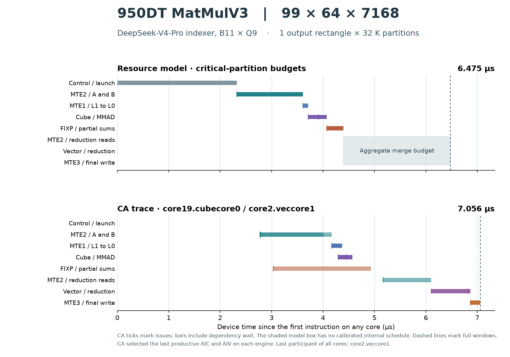

# B11 推测校验下的 Pro 索引器投影

每卡 11 个请求、每请求 8 个推测 token 加 1 个主模型校验位置，矩阵乘提交 99 行。DeepSeek-V4-Pro 的索引器 `indexer.weights_proj` 使用 `[7168,64]` 逻辑输入到输出权重，本文采用连续 BF16 `A[99,7168] @ B[7168,64]`、无偏置。公开接口传 `[M,N,K]=[99,64,7168]`。此例只演示一次 BF16 后端调用。

1. **工作量。** 每元素有 7168 次乘加，乘加计两次，逻辑计算量为 `2×99×64×7168 = 90,832,896 ops`。A 和 B 的一次逻辑读分别是 `2×99×7168` 和 `2×7168×64` 字节，输出一次写 `2×99×64 = 12,672 B`。
2. **选择并行方式。** 在两个 950 配置里，64 KiB L0A、L0B 各按 BF16 双缓冲并为 K 保留至少 64 个元素后，每个输出轴的上限均为 `65536/(2×2×64)=256`。99×64 可以交给同一组 AIC。K 足够长，按当前 host 规则跨核切 K。DT 有 32 个 AIC，每段深度 `7168/32=224`。16 对齐后的输出行数为 112，以 L0A/L0B 容量可取 128 深的 MMAD。因此每核一条 K128、一条 K96，全片 64 条。PR 有 28 个 AIC，每核 K256，用两条 K128，全片 56 条。970DT 若仍使用相同选路规则，120 AIC 的切 K 准入门槛为 15,360，高于 K7168。此处 970 走普通排程，仅作外推。
3. **怎样换算成时间。** DT 的发起预算为 2.326 µs。每核 MTE2 首次 A/B 搬入、MTE1 首次装载、两次 MMAD 和 FIXP 排空形成 2.073 µs 的本地流水。先取该本地流水与冷 HBM、跨核 L2 供给三者的最大值，再加上 2.076 µs 的部分和归并，得到 6.475 µs。PR 对应为 2.315 + 2.188 + 1.958 = 6.461 µs。模型依赖芯片频率、每核 Cube 吞吐、L2/HBM 服务及 950 模板的描述符固定开销。归并发起开销的系数来自已有 host 的 `GetNegPerf`，阶段固定周期来自已有 950 校准。供给和阶段预算均写入采前冻结文件中。
4. **核验实际流量。** 每个 K 段要为所有 M×N 个输出产生 FP32 部分和。DT 写 `4×99×64×32 = 811,008 B`，PR 写 `4×99×64×28 = 709,632 B`，随后由 AIV 读回。按每条 FIXP 真实写地址与每条 AIV MTE2 的源地址、burst 长度、个数及 stride 检查整个地址集合，再核对最终的 BF16 输出。每条 MMAD 的实际 `(m,n,k)` 与理论直方图独立核对。[字节核验](traffic.md) · [每种 MMAD 指令和工作量](work.json)

[冻结输入和逐阶段参数](freeze.json) · [正式设备窗与误差](report.md) · [芯片参数与建模公式](../../../../docs/modeling-strategy.md)

图中上栏灰框是模型的归并总预算（指令发起与服务量之和），尚不能拆成逐条向量、读取和写回的起止时间；下栏则按真实描述符分别显示三个阶段。

DT 整窗为 **7.056 µs**，比当前预测 **6.475 µs** 长 **0.582 µs（8.24%）**。把首条 MMAD 按核分开看，32 个 AIC 的首发最早、居中和最晚分别是 **3.175、3.748、4.295 µs**，模型的 **3.713 µs** 接近中位核，比最晚核早了 **0.582 µs**。说明这里有真实的核间到达差异；仅用全片最早发起来代表关键路径，会误判偏差方向。末个 AIC 的部分和到 **4.931 µs** 才写完，其中一条 FIXP 描述符在 **3.032 µs** 已发起，跨过了它所依赖的 MMAD。随后 50 个有效 AIV 都在 **5.164 µs** 发起首次部分和读取，但各核读完的时刻从 **5.645 到 6.104 µs**，最终写出从 **6.524 到 7.056 µs** 才分别完成。核间到达分散和共享读取的尾延迟都可由这些时间直接看见；不能只用一个首发差值归因全部误差。其余 14 个 AIV 有完整结束记录而没有承担部分和。数值核对通过全部 6,336 项，原始采集用时 8.94 分钟。[图中各区间、全核分布和源指令散列](pro-b11-mtp8.json) · [该次完整回执](99-64-7168-dt.json)

同一公开 API 在两个 B11 shape、三个配置上的六个结果都重现了采前冻结值。每个组合使用新的 Python 进程，在 import 后计第一次 `estimate`，实测为 2.20–3.02 ms；随后重复 50 次，最慢单次 0.335 ms。这些是本机调用耗时，不是 CA 时间，也不是设备预测微秒数。[逐组合查询成本](query-cost.json)
