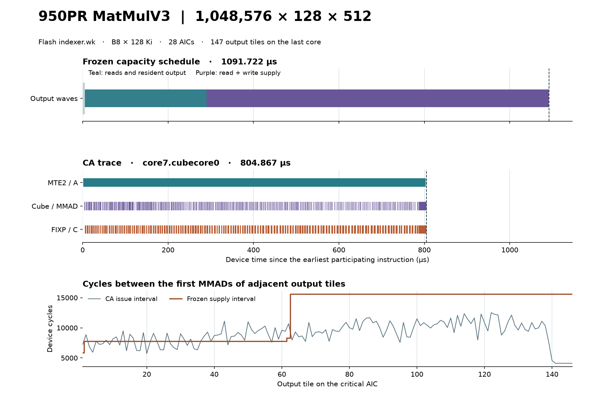

# Flash 整批 B8 × 128Ki 的 950PR Matmul

TP8 的 indexer.wk 将 1,048,576 行、宽 512 的 BF16 激活投影到 128 通道。输入 A 为 1 GiB，权重 B 为 128 KiB，输出 C 为 256 MiB；计算量为 137.439 GFLOP。实调 aclnnMatmul，安装包 kernel 为 `MatMulV3_ND_ND_ND_ND_BF16_BF16_BF16_BF16_high_performance_131074`。全部 134,217,728 个结果通过黄金值核验。

| 排程 | 950PR 预测 µs | 相对全窗偏差 |
|---|---:|---:|
| 公开 estimate | 1155.000 | +43.50% |
| B 常驻 L1 | 879.155 | +9.23% |
| B 常驻并计算容量和读写供给 | 1091.722 | +35.64% |
| 冻结敏感性：读写混合效率取 1 | 848.712 | +5.45% |

950DT / 950PR 设备全窗为 **405.617 / 804.867 µs**，实测 PR/DT 为 1.984。PR 采集墙钟 132.76 分钟，原始输出峰值 17.74 GiB。按物理 END 和异步指令最终退休核对全部 28 个 AIC。

末核 `core7.cubecore0` 执行 147 个输出块。每块读四页 A，发起 16 条 MMAD，写一次 BF16 C。满块为 256×128×32，最后一个块只有 86 行。全片 CA / 容量候选的 MMAD 条数为 65,792 / 65,536。首条 MMAD 的预测 / 实测时刻为 4.991 / 3.869 µs。相邻输出块首条 MMAD 的实测中位间隔为 9246 周期。

| 末核块序号 | 预测平均发起间隔，周期 | CA 平均发起间隔，周期 | A 页响应中位数，周期 |
|---|---:|---:|---:|
| 1–36 | 7698 | 7510 | 4536 |
| 37–73 | 10094 | 9091 | 5691 |
| 74–110 | 15579 | 10177 | 6555 |
| 111–146 | 15579 | 9321 | 6350 |

块序号从 1 开始；间隔是该块首条 MMAD 到下一块首条 MMAD 的间距，最后一块只用于测结束。后两个区间累计多计 257.678 µs，占容量候选整窗高估的 89.8%。模型用 L2 脏输出容量估计并发的 A 读与 C 写，再用共享带宽和混合读写效率定价。列中的 A 页响应包含排队及依赖，和跨块发起间隔可以重叠。末核数据可定位时间差发生在哪一段；区分 HBM 总线效率、L2 命中和写回仍需内存控制器计数。

[数据、原始 shard 与指纹](data.json) · [冻结条件与敏感性](../../../v0.30/matmul/freeze.json) · [全核与数值回执](../../../v0.28/matmul/long-prefill/131072-pr.json)
