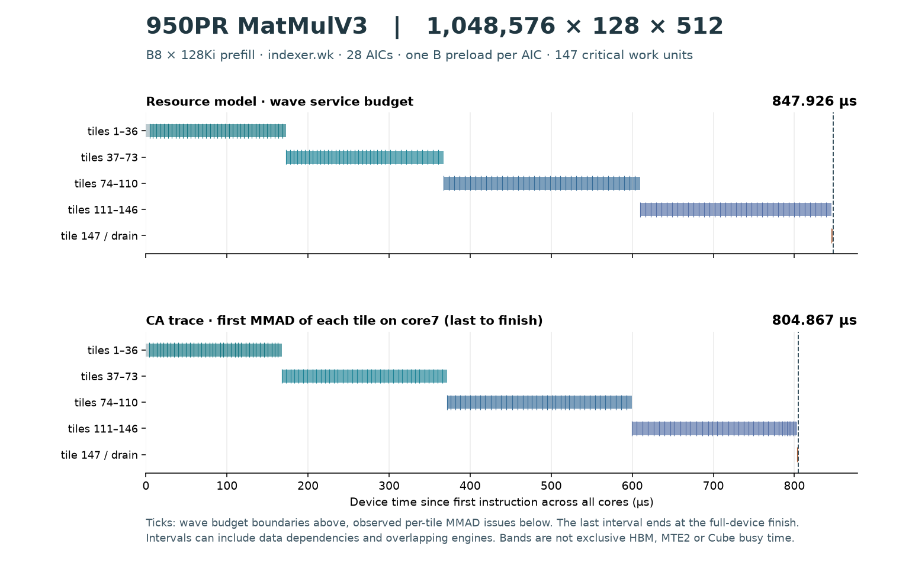

# 大 Matmul：权重复用、尾波和两种带宽上限

系统模拟器调用 `estimate('matmul', [M,N,K], dtype='bf16', chip=...)`。这里解释连续、非转置、无偏置 `A[M,K] @ B[K,N]` 的一种公开排程。B 能放进每个核的 L1 且会被同一个核上的多个输出块复用时，该核只搬一次 B；A 仍随输出块流入。计算、搬运的需求先按实际排程数出来，再用目标芯片的资源换算为时间。模型没有读 CA 文件，也没有按 SKU 名选公式。跨芯片仍假设复用同族库策略。其他 Matmul 场景保留常规多页或切 K 后归约的算法。

**1．先选分块。** `M,N,K` 分别是结果的行、列及内积长度。根据目标 AIC 数 `C` 与 L0A/B/C、L1 容量计算初始 `bm,bn,bk`（每块行数、列数和 K 深度）。候选请求单个 N 矩形、对齐的 N/K，M 块数多于 C、主机判据非纯 Cube bound，且 `2NK ≤ 3L1/4 < 2MK`：B 放得下、A 不放。M 块上限分别受剩余 L1 双缓冲与 FP32 L0C 双缓冲限制；K 页 `p` 最多含 4 个 K 小块，依照源码的 48 KiB 与 256 字节对齐条件选定。暂不覆盖需倍增 base-K 或 K 尾页的实现；遇到它们沿用旧模型。分支来源是[ops-nn host 对照源码](https://gitcode.com/cann/ops-nn/blob/602e4ad985da00aad28c16432841e9c5069e10de/matmul/mat_mul_v3/op_host/op_tiling/arch35/matmul_v3_basic_aswt_tiling.cpp)，实际测量调用的是安装包 `aclnnMatmul → MatMulV3_…_high_performance_131074`，不能把参考代码当作所调二进制。

**2．给最后一波分工。** `T=ceil(M/bm)` 是原始输出块数。完整波每次发 C 块；末波剩 R 块时，每块最多分给 `S=floor(C/R)` 个核。高度为 h 的末块按 `ceil(h/S)` 行切段，末段保留实际行数。每个非空片都做 `K/bk` 次 MMAD；所算的有效乘加仍是 `2MNK`，但相同 K 页可能有更多描述符。代码直接统计块尺寸直方图，无需按 token 或波数生成对象。970 等新硬件若改变尾波调度，请替换分核规则；改变算力本身不会生成新调度证据。

**3．分开定价核内、共享与片外。** 核内 BF16 吞吐是 `P=CUBE16_TOPS ×1000/(C×f_GHz)` ops/核/周期，单个 h 行 MMAD 发起间隔按 `ceil(2·align16(h)·N·bk/P)` 估算。同核的 Cube、A 页读、L1→L0 的 A/B 读和最终写回能重叠：完整块使用四项的最大值。对启动单列首个 B 填充、首个 A 页、首次 L0 装载；最后只加一次 Cube 响应尾巴（旧 DT 阶段观测 24 周期）及最后一片 FIXP 的排空。GM→L1 的有效速率若未配默认 64 B/核/周期，L0/FIXP 与控制阶段取目标 config 或既有 950 阶段周期，见[阶段参数](../../v0.16/matmul.json)。这些是实现的有效价，不是验证过的未来芯片常数。

设 `D=min(M, floor(max(0,L2_bytes−2NK−C·4bm·p)·retained/(2N)))`，是输出还有可能留在 L2 的行数：先留 B、每核两张 A 页，再以 BF16 每行 `2N` 字节计 C 的可用空间。默认 `retained=1`，这是乐观容量假设，不是已证明的 cache replacement 策略。输出可能留在 L2 的阶段，只记片外 A；余下阶段记 A 和必须写出的 C。跨 L2 的逻辑字节仍包含所有 C。

物理 HBM 每周期预算 `H=HBM_GB/s/f_GHz`，目标若显式配置 HBM 效率也按配置收紧。对已经发生读写混合的阶段，额外限制**共享路径可服务的有效流量** `F=L·[4000/(32×1.65×100)]·η`，上限为 L；L 是目标全片 L2 字节/周期（有显式接口时直接使用，否则取 950 host 的 100 B/核/周期）。4000 GB/s、32 核、1.65 GHz 是独立 DT 基准，`η` 是[不同 Cast/Quant 的饱和控制器周期](../../v0.30/matmul/external-service.json)按读写份额分箱后的中位数。例子写份额为 `N/(N+K)=20%`，`η=0.6941`。F 是把这些第三方算子的 DFI 有效服务映射到目标共享路径的**迁移假设**；不是实测 PR/970 L2 效率。它与物理 HBM 是串接的资源上限，**同一批混合字节耗时取 max(bytes/H, bytes/F)**，不会把 DT 比例重复乘到 PR 额定 HBM 上。PR 的 F 约 2.43 TB/s，物理 HBM 配置 1.4 TB/s，已比 F 更窄；DT 的 F 约 2.78 TB/s，比 4 TB/s HBM 更窄。如果目标换了互连，可用其 L2 和 HBM 约束进行敏感性分析，现有数据无法独立识别两种硬件物理路径。

对有独立逻辑读服务证据的目标，设 `G` 为配置 `matmul_initial_read_gbs`，允许的初始 A 命中信用最多 `min(L2_bytes, 2KD × max(0,1−HBM_GB/s / G))` 字节，整个调用只用一次。PR 的 G=1562.40 GB/s 来源是[独立的 Cast/Sigmoid 窗](../../v0.30/matmul/prices.json)中观察到的逻辑速率下界，跨过额定物理 HBM 可能对应初始缓存服务；由此取出的信用是情景假设，并非已知命中率。没有该字段就令 G 等于额定 HBM，信用为零。若实际运行的缓存是冷的，应移除 G 或设为额定 HBM。PR 本例信用 47,246,811 B，仅占 1 GiB A 的 4.4%。

在线对“首波 / 跨过脏输出容量的一波 / 尾波”切段，其余相同波乘重复次数。尾波共享端口服务与实际活动片数相关，核内价格取最大片；若输出在 L2 尚未满与已写回两类在一波交叉，按各自行数计量。总估计为首 MMAD 预算 + 分段求和 + 末片退休。输出保留每波资源成本、三阶段 µs、AIC/AIV、原输出/有效块数、物理 MMAD 数、逻辑与实现流量及芯片配置。超大合成输入允许用于数量级分析，但检查 `pricing.inplace_excluded_tensors_fit_hbm`（A、B、C 至少能否同时驻留）；为 false 时不能据此声称可实际运行。

## 算例：B8 × 128Ki 的 Flash indexer.wk

每卡 B=8，会话各 131,072 个 token 整批 prefill，TP8、K=512、每卡 N=128，故 M=1,048,576。A 为 1 GiB，B 为 128 KiB，C 为 256 MiB，逻辑计算量 137,438,953,472 ops。以下数字是这个单次 BF16 调用，模型服务使用分块 prefill 时要换成当次提交的 M。

| 项目 | 950DT | 950PR |
|---|---:|---:|
| AIC 数、基础 (bm,N,bk)、A 页深度 | 32，(256,128,32)，128 | 28，(256,128,32)，128 |
| 每个 AIC 的 B 加载；全片 GM→L1 | 一次，合计 4 MiB | 一次，合计 3.5 MiB |
| 普通输出块、波数、末波 | 4096 块、128 波；32 个满块 | 4096 块、147 波；8 个满块再各拆 3 片 |
| 预测 / CA 物理 MMAD | 65,536 / 65,536 | 65,792 / 65,792 |
| 预测 / CA 整窗，µs | 409.270 / 405.617 | 847.926 / 804.867 |
| 旧公共模型，µs | 437.251 | 1,155.000 |

PR 的最后 8×3 片中，16 片为 86 行、8 片为 84 行。每片 16 条 MMAD，全片实际为 65,408 条 256 行、256 条 86 行、128 条 84 行，三个尺寸都与模型相等。[PR 逐核地址与指令](128ki-pr-geometry.json)和[DT 对照](128ki-dt-geometry.json)逐核核实了同一 B 地址、所有 A 读取字节及最终所有 C 输出的无重叠覆盖。相同数量的运算可以有不同数量的实际指令。

PR 上，模型在 4.991 µs 进入首 MMAD；CA 末核 core7 首 MMAD 为 3.869 µs。上栏每个刻度是一个模型波的起点，下栏每个刻度是这个关键核某个输出片首 MMAD 的真实发起。下栏最后一点结束在整片官方退休时刻。图中的区间含等待和引擎重叠，不能解读成 Cube 一直在计算。后两组的预测平均间隔均为 10,813 周期，实测分别 10,177 和 9,321 周期；旧容量候选在这两组均计 15,579 周期。剩余 +5.35% 很大一部分在稳态，不宜调一个启动常数来补；对真正的内存控制器读/写服务量与初始 cache 水位仍无该算子直接证据。[每个刻度和平均间隔](pr-128ki-figure.json)

本例旧、新、实测 PR/DT 为 2.642、2.072、1.984。970DT 的外推为 87.608 µs，使用其自身 120 AIC、带宽和缓存；没有后代实测。新模型在这个已用于开发的形状表现较好，独立准确性看[64Ki、256Ki 冻结后的设备结果](report.md)。B 几何不适用于 Kimi 的 [32768,3072,512] 宽投影（单份 B 为 3 MiB，超过本地 L1）；没有另加该 shape 分支。

[查询开销](cost.json)覆盖普通 decode、Kimi 宽 prefill、B 常驻大形及 42 亿行的仅成本压力测试。本机 15 个芯片/shape 组合在 Python import 后首查最慢 3.50 ms，各重复 40 次最慢 0.525 ms。单核且 HBM 按核数同比缩放的敏感性测试仍正确处理不足一波及超 HBM；仅降低 AIC 数而保留整卡额定 HBM，host 可能合法选择普通 Cube 排程。计时不是硬实时保证，也不包含离线 CA。

Kimi 的同一 MLA 权重在单头/卡场景为 [N,K]=[256,512]，与开发中的 [128,512] 不同，输入为 8 个不等长 chunk 共 32,760 行，两端预测每核最多 8 / 10 轮并出现不同的残余行。[逐行推导、预算与实际采集状态](kimi-head/README.md) · [直接复用 DT 的配对基线](paired.md)
