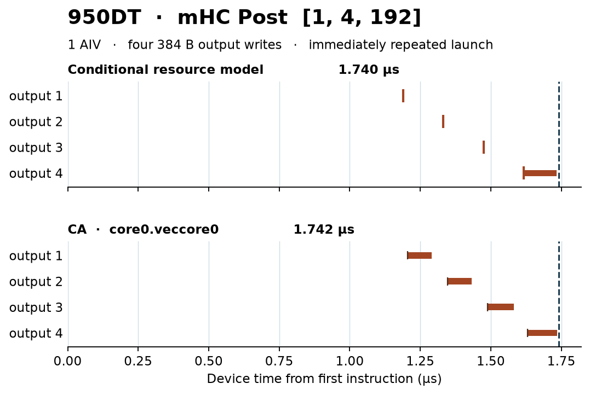

# 内置 mHC Post 的未知前序与四路写发起

| 同一组已测窗口 | 窗 / 不同 shape | v0.32 默认 WAPE / 最大 | v0.32 四写诊断 WAPE / 最大 | 本轮候选 WAPE / 最大 |
|---|---:|---:|---:|---:|
| 950DT 全量 | 151 / 113 | 27.94% / 63.56% | 27.48% / 58.39% | 27.53% / 49.94% |
| 950PR 全量 | 88 / 56 | 28.02% / 67.40% | 27.41% / 59.36% | 27.27% / 48.62% |
| 950DT 严格同库同形冷/热 | 21 / 10 | 36.19% / 63.56% | 34.65% / 58.39% | 35.22% / 48.55% |
| 950PR 严格同库同形冷/热 | 22 / 10 | 35.00% / 67.40% | 33.22% / 59.36% | 33.08% / 48.62% |

两端全量最大误差首次低于 50%，WAPE 仍高于 25%。相对上一轮四写诊断，DT 用 0.05 个百分点 WAPE 换来 8.45 个百分点的最大误差下降。两端各只有 10 个严格配对形状，未来端点尚待收齐，系统默认无状态接口继续使用 v0.32。这 239 个完整窗口和其中的冷热配对属于开发回放，资格与原 SHA 一致。本报告只讨论三维 `aclnnMhcPost`、连续 BF16、有 residual、第二轴为 4 的安装包合同。[逐窗预测、实测、kernel、误差与来源](replay.json) · [新形冻结与成本上限](freeze.json)

## 为什么原来的四写模型在 192 列仍会偏大

950DT 的 [1,4,192] 只启动一个 AIV。发布 kernel 为 `MhcPost_59130ccee6717ff2c0f15b485e731162_5`，同一进程首发、立即复跑、隔形回访的全设备窗分别是 4.528、1.742、1.744 µs。紧邻复跑时，从该核第一条指令到主要数据的首笔 DMA 为 1270 周期，上一轮控制阶段取 1482；从首向量 load 到第一笔输出写为 420 周期，上一轮取约 545。四笔写的相邻发起间隔均为 234 周期，旧的发起间隔模型已经解释了这部分。在 950PR，对应的首次、紧邻、回访为 4.282、1.736、1.732 µs。[目标核真实 read/write 窗](../../v0.32/post/wide-repeats.json)

把前端首发和每路写间隔分别定价。同一核有三笔实质 MTE2 输入，第一笔取 96 B 系数，后两笔加载 x 和四路 residual。热态五个外部宽度样本的两笔操作数 DMA 几乎都相隔 63 周期；首条向量 load 通常在两者就绪后 23 周期。窄片的响应受固定等待主导，随着字节增加，才需要用吞吐下界约束。这五个窗口均来自 DT，参与 AIV 数为 4、32、48、58、64，关键片为 160–448 列。新前端价格拟合时留出了单核 [1,4,192]、640/960 列与全部 PR。上一轮写间隔及退出参数含 [1,4,192] 的信息，因此该完整窗口仍算开发回放。

设 $A$ 为活跃 AIV 数，$d$ 为每核通道片宽，$g=\lceil d/64\rceil$，$v$ 为目标每核 FP32 ops/cycle，$v_0=255.68$ 为 950DT 参考值。单路含 $9d$ 个 FP32 操作，写 $2d$ B。实测能定位首笔主数据读、首个向量 load 与首笔写，但部分前端工作互相覆盖，所以用五个窗口的两段可观测等待之和估计 $F=1650.18+9.10(A-1)$ 周期。1650.18 是空载外推截距，9.10 是通过各窗口两两斜率的中位数得到的每活跃 lane 有效争用价，阶段拟合的残差绝对中位数为 46.53 周期。它依赖调度拓扑，迁移时假设沿用 950 的每 lane 价格。

写发起间隔为 $I=\max(9d/v,~2d r_w,~216+6g v_0/v+3\mathbf{1}_{d\bmod 64\ne0})$ 周期，$r_w$ 为目标 MTE3 每字节服务周期。每次写之间有固定发起、向量组与非满尾组成本。两笔主操作数读的就绪价为 $R=23+\max(177,2d r_r,63+\max(221,8d r_r))$，其中 $r_r$ 为目标 MTE2 每字节服务周期。177、221 是五个样本的响应中位数，63 是第二笔发起距离；较小传输可能在固定延迟内完成。热态最后一笔写响应取 $\max(195,2d r_w)$ 周期。当前 950 资源配置缺逐端口带宽时，沿用已有 18.40/16.02 周期每 KiB 的读/写服务价格。在 950DT 1.65 GHz 下，每微秒 1650 周期。

对 [1,4,192]，模型从第一条设备指令起，依次在 1.190、1.332、1.474、1.616 µs 发出四路写；实测为 1.205、1.347、1.489、1.631 µs。热端预测 1.740 µs，CA 1.742 µs。输入只有 shape 时，算法无法知道是否复跑，给首次与复跑**同一个 2.548 µs**。原四写诊断为 2.759 µs。[可重绘的逐笔时标](single-aiv-example.json) · [本轮参数、测量输入和单位](prices.json)

上栏前三个竖线是模型写发起，只有最后一笔有显式响应时间。下栏每个色条为源 CA 描述符的发起至返回。设备零点为该 kernel 所有活跃核的最早指令。本例用于演示候选的条件流水。

## 扩核和 token 分核

先前只使用一个 AIV，再扩至新物理核，末核从整窗零点开始的加入延迟在两个旧 DT 窗为 1.419/1.406 µs，先前至少已有两个 AIV 的十次扩核中位为 0.672 µs。给任意 $A>1$ 的通道分核保留“从一核扩核”这一可行端点。以 96 B 系数读、2d 与 8d B 操作数、四路写和最后退休分阶段定价。两旧样本的加入与主操作数首发分别给 2331 和 2934 周期。两笔主读间隔为 405.5 周期，向量交接为 67 周期，冷态最慢可行首写准备使用这两次的上端 1472 周期，再按目标向量吞吐定价。仅两次、宽度均为 256，因此新形须检验它向别的片宽延伸的能力。950DT/PR 的 [2,4,448] 从一核扩至四核，真实末核均为新物理核，扩核端点预测 5.505/5.506 µs，对应 CA 5.349/5.339 µs。已覆盖的热端则预测 1.823/1.824 µs，CA 1.899/1.888 µs。[新核与已派发核的真实时序](../../v0.24/post/topology.md) · [逐阶段开发证据](prices.json)

当通道分核存在多种状态，设 $l,h$ 为所有可行阶段模型给出的最短与最长耗时，候选报 $\max(2lh/(l+h),h/2)$。第一项平衡两端的相对误差，第二项是为系统容量规划显式选择的偏好，避免把最慢候选时间低估一半以上。它不保证真实窗口服从模型端点。新范围覆盖 DT 134/151、PR 73/88 个实测窗，旧范围分别覆盖 110/151、63/88。

token 分核的误差还涉及每核多行的发起速率。原可行状态仍来自逐行读/写、UB 分片及前序分支，未知前序选择 $\sqrt{lh}$，使高低两端对该估计的**倍率**相同。该政策完全不使用真实派发序列、状态频率或目标芯片 CA。[65,4,5120] 一类双片普通切换仍缺少多种独立形状的归因。开发时尝试把单片 token 在未见过的“前序通道→当前扩核”上也使用普通稳态速率，历史绝对误差之和在 DT/PR 均增大，候选保留原分支的条件价格。按路线拆分后，通道/Token 在 DT 的 WAPE 分别是 30.73%/22.82%，PR 为 32.39%/23.56%。[分路线最大误差、候选与公共点](replay.json)

## 可见输入的精度下界

对于同芯片、同库、同 shape 的多个观测 $y_i$，一个点能做到的最小最大相对误差为 $(\max y_i-\min y_i)/(\max y_i+\min y_i)$。每形分别取中位数可最小化绝对误差；若还要求每个窗最大 50%，点必须落在 $[0.5\max y_i,1.5\min y_i]$，将该中位数截入此区间再算 WAPE。以下界限使用全部相关真实标签，只能评价这套测试本身的可辨识性。

| 数据集 | 理论最小 WAPE | 理论最小最大误差 | 限定最大≤50% 的最低 WAPE |
|---|---:|---:|---:|
| DT 全部 151 窗 | 9.67% | 47.60% | 9.77% |
| PR 全部 88 窗 | 15.68% | 47.76% | 15.80% |
| DT 严格 10 个同形冷/热配对 | 27.64% | 47.60% | 28.46% |
| PR 严格 10 个同形冷/热配对 | 28.81% | 47.76% | 29.43% |

全量的 WAPE 仍有改进空间；严格配对若只提供形状，两端均无法同时满足 25% / 50%。已知同流启动顺序的系统能使用现有 `OperatorStream` 单独计算。[生产接口及有序结果](../../v0.32/post/report.md)

## 新形验证与成本

单进程依次派发 [1,4,208] 两次、[3,4,240] 两次，先测真实单核首发与热重复，再从一核扩到三核并重复。每端出现两种新形，每形有两个完全相同的无状态输入。检查 v0.28 最后一项 Post 的原串行槽后接手，DT→PR，每端一个 4 次调用的 CA 进程，限 30 分钟和 1.5 GiB。运行前保留 32 GiB 磁盘和宿主空余资源。逐核核对实际 ELF、物理 END 与终止标签、供应商核表、全输出值和写回字节。[已运行的后台状态](state.json) · [动态双端回执](forward.json)

| 独立目标 | DT 无状态预测 | PR 无状态预测 | 970DT 外推 | 设备实测 |
|---|---:|---:|---:|---|
| [1,4,208]，1 个 AIV | 2.570 µs | 2.572 µs | 2.356 µs | 待收 |
| [3,4,240]，3 个 AIV | 2.753 µs | 2.754 µs | 2.524 µs | 待收 |

2026-11-20 07:45:16 UTC 冻结前排查 108 个结果文件与 1160 份宿主日志或批次。另对既有队列的两个宽通道、两个双片 token 和一个 1024-token 大形的两端预先登记同一候选。默认判断等待独立设备窗。239 窗中单次形状候选计算中位数 DT/PR 为 0.052/0.136 ms，最大 0.868/0.252 ms，测量包括阶段重算，运行在已加载总价资源的宿主 Python 进程。[冻结及模型指纹](freeze.json) · [采集与评分实现](../../../development/validation/post33)
