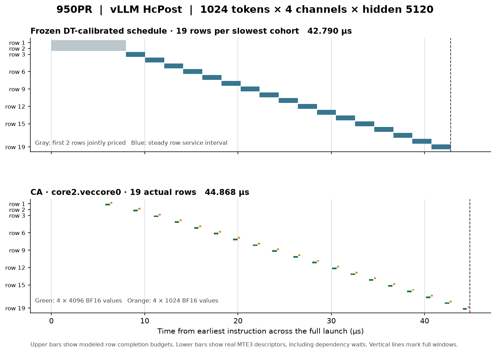

# vLLM HcPost 的 1024-token PR 全核退休与写回

| 芯片 / 证据 | 冻结公开模型 µs | DT 读响应候选 µs | CA 全窗 µs | 公开 / 候选有符号误差 |
|---|---:|---:|---:|---|
| 950PR，同次完整内核导出 | 52.850 | 42.790 | **44.868** | +17.79% / -4.63% |
| 950DT，3 个核缺终止指令 | 45.169 | 36.884 | N/A，至少 38.186 | 公开 N/A；候选至少低估 3.41% |
| 970DT，外推 | 24.696 | 20.899 | N/A | N/A |

输入 BF16 激活，每轮 1,024 个 token、4 个连接分支，hidden=5,120。实际调用 vLLM Ascend 的 aclnnHcPost，经 arch35 适配库进入 HcPost_d2fe6614722b27afa6f8d964c215447e_1。逐元素核对了 20,971,520 个 BF16 输出，全部与 RNE 金标一致。源文件已按原冻结登记核对，捕获的设备 ELF 的 .text 指纹与安装组件相同。该算例的公开模型、DT 校准候选均按冻结值引用。候选冻结时 PR 已在运行，结果尚未揭盲；这是同一大 shape 的跨芯片在途盲评。

安装版 CA 在真实 950PR、LPDDR5 配置上运行，发布了唯一一次 kernel 的独立目录。原顶层采集以 raw cap 退出，墙钟 72.21 分钟，峰值磁盘 26.91 GiB，原登记上限 24 GiB。退出发生在打印模型停止、全数值验证和官方逐核时间表以后。当时每次 kernel 的目录已有全部 56 个核，顶层重复导出仅有 34 个核的 trace 文件。保留原始失败回执，另从同次 kernel 的数据核验设备时间。此路径没有原生 SQLite 指令库。逐核 CSV 给出 END 次数，官方控制台只给两位小数的核内耗时，均缺各核绝对首发与退休时钟。逐核设备窗取自同次完整导出；本次新增 CA 采集为零。

全部 56 个 AIV 的逐核时间线、全片 trace、二进制画图包中的时间线与指令统计、每核的指令 CSV 逐项交叉。每个核都有恰好一个 END；END 可早于已发起的异步指令最后退休。用全局最早首发和最晚退休求设备窗，得到 (80,251−6,219) / 1,650 = 44.86788 µs。全核 GM 写出直接验证了 8,192 个地址区间，连续无洞、无重叠，共 41,943,040 B，恰好覆盖所有输出。官方输出的逐核时长表按 0.01 µs 的打印精度与时间线相符。完整离线复核用时 620.9 秒。

## 算例的行流水

将 1,024 个 token 按 56 AIV 分配，16 个核各执行 19 行，40 个核各执行 18 行，行数由实际输出写回字节独立计出。每行 4 个分支都分为 4,096+1,024 个 BF16 元素的两段。模型对慢组联合估算前两行 13199.5 周期，以后每行间隔 3376.7 周期。代入 19 行得到 (13199.5 + (19−2)×3376.7)/1,650 = 42.790 µs。全片共享资源下界 37.508 µs；取两者最大值。

实测最后退休的是 core2.veccore0，共完成 19 行。第二行最后一笔输出描述符在 9.557 µs 退休，余下各行输出完成间隔中位数 2.045 µs；模型慢组的稳态服务间隔为 2.046 µs。总残差 2.078 µs 可按实际行边界直接拆分，前两行贡献 1.557 µs，随后 17 行累计增量 0.515 µs，最后一笔输出退休至全核末端另有 0.006 µs。约 75% 的差值在第二行写完前已出现。描述符包含依赖等待，其中的 HBM、SIMD 和队列等待仍未逐项分离。DT 大形仍只有下界，不能给出正式 DT/PR 加速比。

[完整核验与逐核端点](pr-full.json) · [对应行事件](pr-rows.json) · [原预算失败回执](../../v0.31/post/vllm_hc_post-Ascend950PR_957b.json) · [950DT 的下界](../../v0.33/hcpost/partial.json) · [预测冻结及参数来源](../../v0.32/post/hc-pr-freeze.json)
