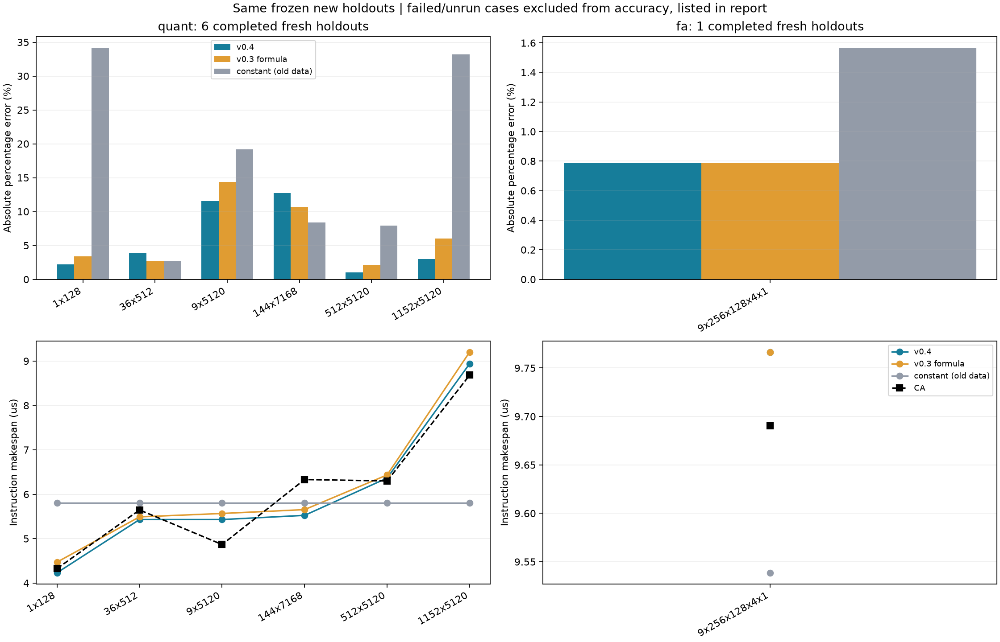
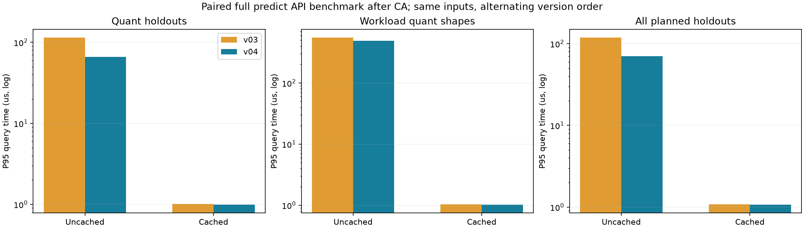
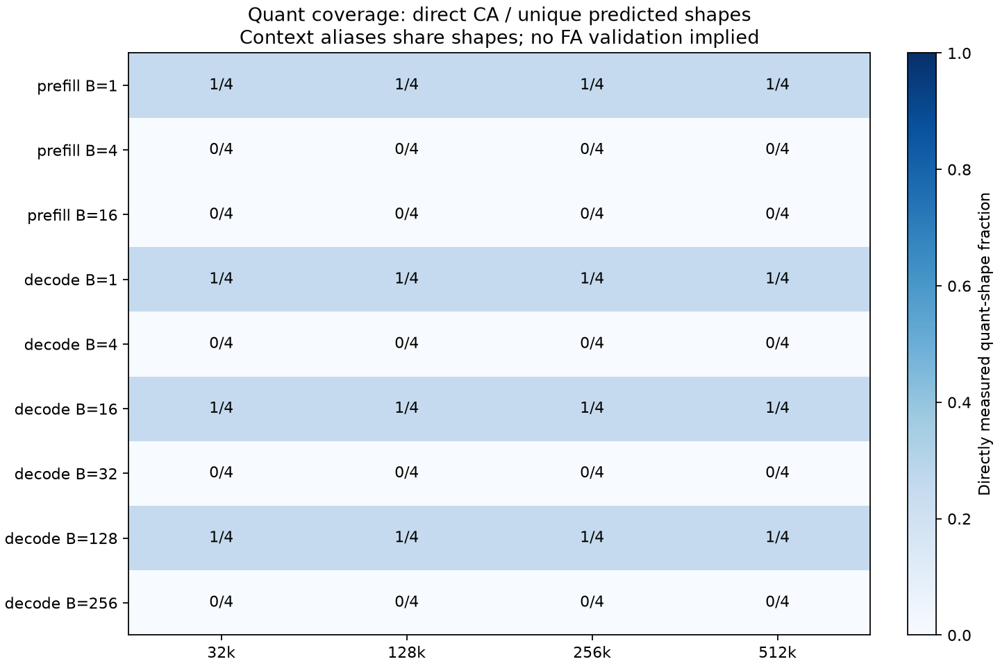
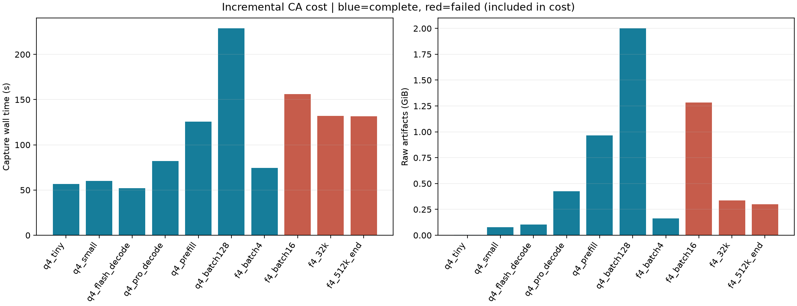

# v0.4 验证：quant 小 shape 回退、预测开销与长上下文边界

## 结论与口径

复用 38 个历史输入（其中 quant 13 个），仅补充读取此前未归约的 3 个 quant trace。新留出计划 10 个；本轮成功 7 个，未完成/失败 3 个。预测在采集前冻结，采集后没有调参；v0.3 的代码、参数和旧报告保持原状。

计时基准是 **CA 跨核指令窗口 makespan**，不含框架、Host enqueue 或窗口外 dispatch。不是实卡端到端延迟。以下误差只针对成功完成的全新留出点，失败点不参与误差平均，也不算通过。

| 组 | 完成点数 | v0.4 WAPE | v0.3 WAPE | 固定耗时 WAPE | v0.4 P90 APE |
| --- | ---: | ---: | ---: | ---: | ---: |
| quant 小工作量 | 3 | 5.88% | 6.75% | 17.29% | 10.01% |
| quant 较大工作量 | 3 | 5.31% | 6.26% | 18.35% | 10.79% |
| quant 全部 | 6 | 5.54% | 6.46% | 17.91% | 12.15% |
| FA 组件 | 1 | 0.79% | 0.79% | 1.57% | 0.79% |
| 全部（受长耗时点权重影响） | 7 | 4.54% | 5.26% | 14.46% | 12.03% |

验收口径为每类全部完成且 WAPE≤10%、P90 APE≤20%；完整门禁见 evaluation.json。缺失任何该类计划点，即不宣称该类完整通过。查询开销另检查未缓存P95≤1000μs、缓存P95≤10μs。

WAPE=Σ|预测−CA|/ΣCA；P90 为逐点 APE 的第 90 百分位。小工作量定义为每核≤4096 元素，独立于本轮测量结果。固定耗时主基线为历史 38 个输入中各算子的均值；另保留 v0.3 原始均值基线，数值见 evaluation.json。

v0.3 原有输入校验上限是维度 4096、FA B=1。为了在同一新集合比较，传入 v0.4 Case 仅绕过旧输入 guard；**v0.3 公式和参数没有扩展校准**。宽度 5120/7168、B>1、长 KV 上的 v0.3 比较值应称为“冻结公式外推”，不是原版已支持能力。



## 逐点独立验证

| 新留出 shape | CA μs | v0.4 μs | v0.3 μs | 固定 μs | v0.4 APE | 核数 预测/CA (AIC,AIV) |
| --- | ---: | ---: | ---: | ---: | ---: | --- |
| quant [1, 128] | 4.3248 | 4.2307 | 4.4708 | 5.8011 | 2.18% | [0, 1]/[0, 1] |
| quant [36, 512] | 5.6461 | 5.4298 | 5.4906 | 5.8011 | 3.83% | [0, 36]/[0, 36] |
| quant [9, 5120] | 4.8673 | 5.4298 | 5.5667 | 5.8011 | 11.56% | [0, 45]/[0, 45] |
| quant [144, 7168] | 6.3315 | 5.5242 | 5.6537 | 5.8011 | 12.75% | [0, 58]/[0, 58] |
| quant [512, 5120] | 6.2988 | 6.3643 | 6.4352 | 5.8011 | 1.04% | [0, 64]/[0, 64] |
| quant [1152, 5120] | 8.6836 | 8.9417 | 9.2037 | 5.8011 | 2.97% | [0, 64]/[0, 64] |
| fa [9, 256, 128, 4, 1] | 9.6903 | 9.7665 | 9.7665 | 9.5386 | 0.79% | [4, 8]/[4, 8] |

数值正确性：每个成功 case 均通过调用程序的全输出 golden 检查及 SMOKE_PASS；quant 检查精确 FP8/scale 字节，FA 为完整 CPU softmax(QK)V 对照（atol=0.002、rtol=0.01）。固定输入模式不是随机精度压力测试。

| 指令验证 | 预测的最大单核次数 | CA 最大单核次数 | 相对差 |
| --- | ---: | ---: | ---: |
| q4_test_tiny | 136.00004111605458 | 136 | 0.0000% |
| q4_test_small | 180.00002546442025 | 180 | 0.0000% |
| q4_test_flash_decode | 267.9999941611516 | 268 | 0.0000% |
| q4_test_pro_decode | 3300.00009432446 | 3300 | 0.0000% |
| q4_test_prefill | 7479.999875616232 | 7480 | 0.0000% |
| q4_test_batch128 | 16788.000484863373 | 16788 | 0.0000% |
| f4_test_batch4 | 4 | 4 | 0.0000% |

quant 拟合计数存在浮点尾差，按最近整数与 CA 比较。RV_* 包含 load/store/control，不能直接当纯算术利用率；FA MMAD 计数仅在 Q tile=64 路径有结构公式。Q tile=128 返回未验证。

### 失败、超时与未采集

| case | shape | 状态 | profiler/外层超时 | 原因 |
| --- | --- | --- | --- | --- |
| f4_test_batch16 | [9, 4096, 64, 16, 1] | failed | True / False | Incomplete/incorrect CA run: inspect run.log |
| f4_test_32k | [9, 32768, 64, 1, 1] | failed | True / False | Incomplete/incorrect CA run: inspect run.log |
| f4_test_512k_end | [9, 525312, 64, 1, 1] | failed | True / False | Incomplete/incorrect CA run: inspect run.log |

注意：profiler 内部超时可能仍返回码0，并打印 All task success；缺少 SMOKE_PASS/正确性检查时一律判失败。部分 trace 只保留作后续诊断，不当成完整 CA 耗时。FA 设定 profiler 内部限时2分钟、外层进程限时3分钟。

## quant 回退为什么改

旧 trace 显示小 case 的大部分时延在 VF 前和写回等待中。v0.3 用 log2(1+活跃核数) 持续抬高控制耗时下界，容易把小 shape 在多核下的等待差异拟合成确定趋势。本轮将控制项输入截断为 min(log2(1+AIV),4)，让多核小工作量回到共享的统计耗时；计算、DMA、UB 双缓冲递推仍保留。截断值是经验模型假设，不是硬件在 15 核饱和的结论。

使用旧 13 个 quant shape 比较 5 个候选：原控制式重拟合、常数控制项、饱和控制项、25%/50% 斜率收缩。逐点留出时重拟合全部 phase 参数，按小工作量 WAPE 选择；这仍属于开发集模型选择，不能当独立验证。

| 控制候选 | 旧数据逐点留出：全部 WAPE | 小工作量 WAPE |
| --- | ---: | ---: |
| v3_refit | 7.05% | 8.32% |
| constant_floor | 7.47% | 9.00% |
| saturated | 5.83% | 6.36% |
| shrink25 | 7.31% | 8.73% |
| shrink50 | 7.14% | 8.46% |

固定耗时为什么有时更好：shape 总元素增长不等于每核工作量增长，核数同时增加时，计算工作会被摊薄。小算子总时间的窄区间主要由启动、同步与排队决定；添加缺少证据的核数/带宽参数反而放大误差。固定均值具有低方差，但无法描述多 UB 迭代及很长 KV 的增长。应分小工作量和大工作量评价，而不是用一个总 WAPE 决定所有 regime。

## 未缓存预测开销

quant 现在只做一次分核/UB 计划、一次流水递推、一次不可变结果构造；不再先完整调用 v0.2/v0.3 并复制结果。旧版本耗时和基线比较放到离线评估。predict_us 提供可选纯标量结果，但下面主比较始终使用包含 plan/phase 的完整 predict API。

| 同一输入集、同一 API | v0.3 未缓存 P50/P95 μs | v0.4 未缓存 P50/P95 μs | v0.3/v0.4 缓存 P95 μs |
| --- | ---: | ---: | ---: |
| 6 个新 quant | 98.06/114.51 | 50.91/66.00 | 1.01/0.99 |
| 场景去重 quant | 103.87/552.49 | 54.72/493.24 | 1.03/1.02 |
| 全部 10 个计划输入 | 94.40/118.74 | 62.00/70.50 | 1.08/1.07 |

每版本/每模式 4000 次，交替版本顺序，CA 完成后测量，Case 已构造，缓存/未缓存显式分开；未缓存没有隐式 shape 缓存。相同计划输入包括失败 CA 点，仅用于 Python 查询计时。共享主机上的结果有调度波动；未做整网仿真器集成，不能据此声称系统开销已≤5%。

纯标量 predict_us 在去重 quant 场景上未缓存 P95=237.53 μs，单独报告，不用于完整 API 加速比。



## 实际场景映射及覆盖

输入长度按 1024 倍数，分别为 32768/131072/262144/524288；输出 1024。采用你给出的单卡 batch：prefill=1/4/16，decode=1/4/16/32/128/256。暂用 TP=8、每请求 prefill chunk=512/2048；这两项尚未固定，实际调度若按整批 token budget 分配，需重新生成 shape。

| 阶段 | tokenwise quant 激活 shape | FA 组件代理 shape (Q,KV,D,B,H) |
| --- | --- | --- |
| prefill | (B×chunk, hidden) | (chunk, prompt, 128, B, heads/8) |
| 普通 decode | (B, hidden) | (1, prompt+已生成量, 128, B, heads/8) |
| 推测 8 / 主模型校验 9 | (9B, hidden) | (9, prompt+已生成量, 128, B, heads/8) |

decode 采样生成进度 0 和 1024 两端。1k 输出是多步生成过程，不是单算子 Q=1024；实际校验轮数、有效 token 比例还依赖接受率。head TP 不自动把 tokenwise quant 行数再除以 TP。不同上下文常复用完全相同的 quant shape，已显式去重。

生成 360 条场景映射，392 个去重组件预测；这些是**输入合法性与预测路径检查，不是全部 CA 准确性验证**。完整逐项数据见 [workload-coverage.json](workload-coverage.json)。

| 模型 | hidden | TP8 query heads | 真实注意力差异 |
| --- | ---: | ---: | --- |
| DeepSeek V4.1 Flash | 5120 | 8 | head_dim=512、window=128、逐层压缩比与复用配置 |
| DeepSeek V4 Pro | 7168 | 16 | head_dim=512、window=128、压缩比 4/128 等 |
| Kimi K3 | 7168 | 12 | MLA qk_nope=128+rope=64、v=128；另有 KDA D128；路由专家宽度3584 |

这些差异意味着单凭 config 不能唯一确定实际 ACLNN kernel、融合、cache layout 和每卡 tensor。当前 D128 普通非因果 FA 是有意保留的代理：不能替代 DeepSeek 的 D512/稀疏压缩路径，不能把 Kimi 的 MLA 与 KDA 都当成普通 FA。专家宽度3584、MoE EP/TP 路由量和通信尚未纳入本轮实测。

新增 FA 的 B4/KV256 与 B16/KV4096 用于 batch 与分核/流水组件验证；它们数值上对应 32k/128 与512k/128，但不表示已经实现真实压缩注意力。32k 和 512k+1k 直接探针均只有一个 head；全卡 H=8/12/16 或更高 batch 的代价不能由一次单头验证自动证明。128k、256k 的完整 KV 本轮未新增 CA，其结果仍为外推。



图中相同上下文列覆盖一致是预期行为：tokenwise quant 当前批的 shape 不随历史 KV 长度变化。图中每格是直接实测过的去重 quant shape 数/该格预测的 shape 数，不能理解为整网覆盖率。

## 仿真成本与复现

本轮 10 次尝试、7 次成功；CA 调用墙钟 18.33 分钟、子进程 CPU 7.32 小时、原始产物 5.66 GiB。失败尝试计入成本。无自动重试；38 个历史输入没有重新仿真。墙钟不含离线 trace 解析/绘图。

预算：35 分钟 CA 墙钟、10 CPU 小时、12 GiB；普通 quant 每例≤300秒，FA≤180秒。总 CPU/磁盘门槛在 case 边界检查，可能单例越过门槛；超时流程最多额外等待15秒清理。全输出 CPU golden 保留；host 扩展只提高合法维度/工作预算，FA 单 tensor≤64M元素，乘积工作量≤512M。

冻结时间：`2026-11-17T06:57:29.688043+00:00`；model SHA256：`1b7a116c234d07fed008634e7874b41f73e930426a42833944769367f03c02d0`。源码、manifest、调用程序、原始包身份、trace SHA 和预测在 frozen-predictions.json/dataset.json 中可核对。浮点重放沿用 v0.2 的1e-12相对/绝对容差，允许Python版本求和实现的末位差异；模型和文件哈希严格一致。冻结提交：`73444da`。

```bash
python -m unittest discover -s tests -q
python -m operator_model --op quant --shape 9 5120
toolchains/envs/cann-9.2.1/bin/python scripts/workload-v4.py
toolchains/envs/cann-9.2.1/bin/python scripts/evaluate-v4.py
toolchains/envs/cann-9.2.1/bin/python scripts/report-v4.py
```

CA 重放使用 `scripts/collect-v1.py --version 0.4 --split holdout`；会检查冻结文件和成功缓存，失败不自动重试。机器本地的 raw trace 不提交 GitHub，发布的是摘要、输入、预测与完整校验身份。



CANN 日志仍有部分配置项不识别、缺少 debug_line/source call stack 的诊断。成功样本均满足 extractor 的 SMOKE_PASS、All task success、解析结束和单 kernel 检查，并用逐核时间窗口交叉核对；没有将缺失 source 映射补造为指令源码对应。原始警告保存在 dataset.json。

## 本轮边界及下一步

FA/matmul 时延公式本轮保持 v0.3；宽度、batch、KV 范围扩展必须靠留出证据分区验收。没有 A7/A8 的实测校准，没有实卡利用率验证，也没有把经验 busy 比例转换成 ISA 峰值利用率。

成功样本未发现分核或整数指令计数不符；下一步应定位 quant 的残余控制/写回时延，并先降低长 shape 的采集开销，再补最少的新留出点。长 KV 若受 trace 成本限制，应先设计汇总采集或验证重复 tile 的可组合性，并单独验证跨 tile、cache 和多核争用，不能直接宣称线性外推可靠。
