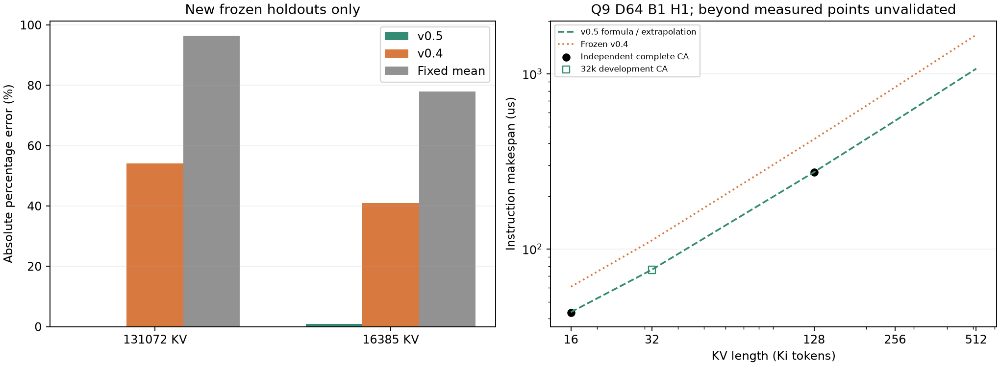
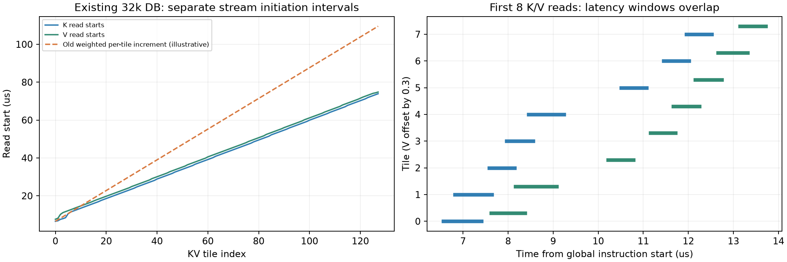

# v0.5 误差分析

## Summary / 本轮结论

- **f5_holdout_128k [9, 131072, 64, 1, 1]**：CA **274.821212 µs**；v0.5 **274.794429 µs / APE 0.01%**，旧v0.4 **423.363568 µs / 54.05%**，固定耗时 **9.538626 µs / 96.53%**。
- **f5_holdout_tail16k [9, 16385, 64, 1, 1]**：CA **43.218788 µs**；v0.5 **43.599334 µs / APE 0.88%**，旧v0.4 **60.900295 µs / 40.91%**，固定耗时 **9.538626 µs / 77.93%**。
- 同一新留出集WAPE：v0.5 **0.13%**，v0.4 **52.27%**，固定耗时 **94.00%**。样本仅2个、每个采集一次，没有统计置信区间。
- 32k旧数据用于本轮校准：预测由111.985723变为76.183878µs，相对75.98µs的误差由47.39%降至0.27%；**不是本轮独立验证**。
- 新增FA CA 2次，新增校准CA 0次；FA采集墙钟 **15.71分钟**，记录CPU **8.04小时**，保留数据 **469.48MiB**。
- 另有RMSNorm/Addmm两个极小调用验证，共79.54秒；全部4次CA墙钟合计 **17.04分钟**。两点均通过完整输出检查，但未用于时延拟合。
- 修正仅覆盖Q9/D64/B1/H1普通非因果FA长KV路径；quant、matmul及其他FA保留v0.4。256k/512k仍是未实测外推。
- 新增算子族已分离结构支持与时延校准状态：RMSNorm、Addmm、LightningIndexer、mHC、KDA、MoE融合链的泛化预测耗时均为null，不混入本页FA准确率。

配套 [建模策略、公式与方法解释](modeling-strategy.md)。本页比较始终使用同一组成功新留出点；不能把32k校准回放与128k独立验证混在一个准确率里。

## 1. 实际库算子和身份

实际运行CANN9.2.1的950 **ops-transformer库**，接口为 `aclnnFlashAttentionScoreV2`。输入Q=[Q,B,H×D]、K/V=[KV,B,H×D]，BF16/SBH、无mask/dropout、非因果、scale=1/sqrt(D)。它是普通FA代理，不是KDA、MLA或decode专用FIA。quant和matmul由950 ops-nn提供，分别调用aclnnDynamicMxQuant/aclnnMatmul。

FA安装对象：`opp/built-in/op_impl/ai_core/tbe/kernel/ascend950/ops_transformer/flash_attention_score_apt/FlashAttentionScore_50348df09d0b3ee451d3693a6b2ab3f5.o`，SHA256 `ac006aee669c8696aeab3bb3fe64fc29e5f3c8e2d172bf75f46db7176a2d4580`，与旧msopprof实际导出对象匹配。本轮compact未再次导出ELF，只记录实际DB entry；安装对象SHA不能替代一次新导出的运行时SHA。

目标SoC固定Ascend950DT_9582，host二进制SHA `2cf2c77e48233383ef4619ad61f136cc51a1462ae0d5ea63f226e64b4d2bd0e8`。每点的DB SHA、SKU适配器SHA、完整命令和model/freeze SHA见 [dataset.json](dataset.json)。文档中的源码仓是参考实现，不宣称与安装包逐字同源。

此前“桥接”仅指**同旧shape的新旧采集方式一致性校验**，不是额外算子。本轮没有重复该CA；沿用已检验的compact DB路径。

## 2. 独立留出逐点结果

| ID / shape | CA µs | v0.5 µs / APE | v0.4 µs / APE | 固定 µs / APE | 偏差 µs |
|---|---|---|---|---|---|
| f5_holdout_128k [9, 131072, 64, 1, 1] | 274.821212 | 274.794429 / 0.01% | 423.363568 / 54.05% | 9.538626 / 96.53% | -0.026783 |
| f5_holdout_tail16k [9, 16385, 64, 1, 1] | 43.218788 | 43.599334 / 0.88% | 60.900295 / 40.91% | 9.538626 / 77.93% | +0.380546 |

| ID | 实际kernel entry | 预测/实际 AIC,AIV | 预测/实际 MMAD | 数值检查 |
|---|---|---|---|---|
| f5_holdout_128k | entry_kernel_2050000040140220 | [1, 2] / [1, 2] | 2048 / 2048 | correctness elements=576 bad=0 max_abs_error=1.26169927e-07 atol=0.002 rtol=0.01 |
| f5_holdout_tail16k | entry_kernel_2050000040140220 | [1, 2] / [1, 2] | 258 / 258 | correctness elements=576 bad=0 max_abs_error=1.05939405e-06 atol=0.002 rtol=0.01 |

正确性是确定性输入的全部attention输出对CPU double golden，atol=0.002、rtol=0.01；并非随机全域数值测试。计时使用完整DB所有执行核的共同指令窗口，不用部分trace、最大单核span或主机墙钟替代。entry与tiling key相同也不能保证所有循环内部细节完全相同。

## 3. 校准机制、残差与固定耗时对照

32k开发样本：CA 75.980000、v0.5 76.183878、v0.4 111.985723、固定9.538626µs。数据角色已从上一轮留出改为本轮开发；中段112个tile也只是同一次trace内部观测，不是112个独立样本。

**已证实的修正依据**：Q读一次，K/V分别128次；已知QK/PV维度对应的PC不同，可以按流还原时间，不能把混排MMAD每4条直接等同源码循环。单次K/V读取延迟约0.85/0.75µs，稳态同流发起间隔约0.517µs，旧模型加权每轮增量约0.811µs。新模型只把长延迟用于首轮fill，后续按有效II推进。

**统计边界**：J来自启动时间对tile索引的回归，包含标量、同步、buffer和下游反压；它不是单独HBM吞吐。F是首轮读完成后的剩余路径，D是最后PV后的排空。来自同一32k样本的参数不能唯一分离所有硬件效应；即使留出误差很小，也不证明可跨Q、D、B/H或代际复用。

**新shape误差应怎样解释**：128k检验4倍长循环累积误差与是否换kernel；16k+1检验不同循环长度及尾块处理。模型为尾块计完整256 tile，但MMAD按128分段，可能产生小额保守偏差。若entry、核数或MMAD变化，应先判定路由不匹配；若它们吻合而耗时有偏差，则有效II、首尾启动和运行间变化是待分离因素，不能无证据全归因于访存或噪声。

**固定耗时为何失去优势**：小shape启动主导、总工作增大常被分核吸收，均值可比复杂拟合更稳定；这里B=H=1，KV增长增加的是单核循环，常数9.538626µs无法随循环增长。主对照常数冻结自旧数据，本轮没有重估均值。

图中K/V开始时刻和首轮读窗口是旧32k数据库实测；两种II的线用于解释校准，不是新留出结果。K/V中段分块回归斜率：{'k': [0.5077120545632275, 0.5158073227585422, 0.5186196486440389], 'v': [0.5095702257175865, 0.5156464835977032, 0.5181875604070726]} µs/tile。

## 4. 旧算子与旧shape的回归检查

45个去重历史记录的预测与v0.4完全相同，未重跑CA。下表包含38个旧开发样本和7个v0.4历史留出；这些数据不混入本轮两个新FA的WAPE。实际kernel、trace SHA、接口见evaluation.json，完整历史流水证据可复用上一轮报告。

| ID | 算子 / shape | 数据角色 | CA µs | v0.5=v0.4 µs | APE |
|---|---|---|---|---|---|
| q3_test_small | quant [512, 256] | reused_development | 5.207879 | 5.429783 | 4.26% |
| f3_test_short_tail | fa [32, 129, 64, 1, 4] | reused_development | 9.150303 | 9.720359 | 6.23% |
| f3_test_d128_tail | fa [17, 257, 128, 1, 1] | reused_development | 9.550910 | 10.470607 | 9.63% |
| f3_test_longkv | fa [17, 1153, 64, 1, 1] | reused_development | 12.486668 | 12.321879 | 1.32% |
| q3_test_one_ub | quant [576, 4096] | reused_development | 6.948485 | 6.729157 | 3.16% |
| q3_test_two_ub | quant [768, 4096] | reused_development | 7.202424 | 6.743424 | 6.37% |
| q2_cal_tiny | quant [1, 64] | reused_development | 4.326061 | 4.230658 | 2.21% |
| q2_cal_saturation | quant [65, 256] | reused_development | 4.898182 | 5.429783 | 10.85% |
| q2_cal_ub_loop | quant [1024, 4096] | reused_development | 8.047273 | 7.501657 | 6.78% |
| m2_cal_skinny_k | matmul [1, 256, 1024] | reused_development | 4.624243 | 4.560230 | 1.38% |
| m2_cal_k_tail | matmul [65, 128, 129] | reused_development | 3.711515 | 3.627777 | 2.26% |
| m2_cal_full | matmul [128, 512, 512] | reused_development | 4.381818 | 4.506080 | 2.84% |
| f2_cal_q128 | fa [128, 128, 64, 1, 1] | reused_development | 9.498182 | 9.247694 | 2.64% |
| f2_cal_longkv | fa [16, 1025, 64, 1, 1] | reused_development | 12.384243 | 12.312583 | 0.58% |
| f2_cal_heads4 | fa [16, 128, 64, 1, 4] | reused_development | 8.758182 | 8.894442 | 1.56% |
| f2_cal_d128 | fa [16, 128, 128, 1, 1] | reused_development | 8.714545 | 8.828627 | 1.31% |
| q2_test_wide | quant [1, 4096] | reused_development | 5.686060 | 5.429783 | 4.51% |
| m2_test_m_tail | matmul [129, 256, 256] | reused_development | 3.664243 | 3.946899 | 7.71% |
| m2_test_k_work | matmul [17, 256, 1024] | reused_development | 4.741818 | 5.040240 | 6.29% |
| f2_test_q129 | fa [129, 128, 64, 1, 1] | reused_development | 8.870910 | 9.080719 | 2.37% |
| f2_test_heads8 | fa [16, 128, 64, 1, 8] | reused_development | 9.401818 | 8.992063 | 4.36% |
| f2_test_d128 | fa [17, 192, 128, 1, 1] | reused_development | 9.050303 | 9.653277 | 6.66% |
| q2_test_ub_loop | quant [640, 4096] | reused_development | 6.217576 | 6.364308 | 2.36% |
| import_v1_q_test_wave | quant [33, 768] | reused_development | 5.209697 | 5.429783 | 4.22% |
| import_v1_m_cal_prefill | matmul [128, 256, 512] | reused_development | 4.393333 | 4.260930 | 3.01% |
| import_v1_f_test_verify | fa [17, 96, 64, 1, 1] | reused_development | 9.162425 | 8.691510 | 5.14% |
| import_v1_q_cal_small | quant [4, 256] | reused_development | 4.588485 | 4.759044 | 3.72% |
| import_v1_f_cal_small | fa [16, 64, 64, 1, 1] | reused_development | 9.052122 | 8.656922 | 4.37% |
| import_v1_q_cal_decode | quant [17, 512] | reused_development | 5.790303 | 5.429783 | 6.23% |
| import_v1_m_cal_decode | matmul [1, 128, 128] | reused_development | 3.356363 | 3.370393 | 0.42% |
| import_v1_m_cal_small | matmul [32, 64, 64] | reused_development | 3.291515 | 3.367861 | 2.32% |
| import_v1_f_test_context | fa [8, 192, 64, 1, 1] | reused_development | 8.805454 | 9.425492 | 7.04% |
| import_v1_f_cal_prefill | fa [64, 256, 64, 1, 1] | reused_development | 9.409091 | 9.702956 | 3.12% |
| import_v1_q_test_tail | quant [8, 384] | reused_development | 5.760000 | 5.429783 | 5.73% |
| import_v1_f_cal_decode | fa [1, 128, 64, 1, 1] | reused_development | 8.784242 | 8.718488 | 0.75% |
| import_v1_q_cal_prefill | quant [64, 1024] | reused_development | 5.531516 | 5.429783 | 1.84% |
| import_v1_m_test_prefill | matmul [48, 128, 192] | reused_development | 3.575152 | 3.632713 | 1.61% |
| import_v1_m_test_tail | matmul [17, 96, 128] | reused_development | 3.493940 | 3.505495 | 0.33% |
| q4_test_tiny | quant [1, 128] | reused_v04_holdout | 4.324848 | 4.230658 | 2.18% |
| q4_test_small | quant [36, 512] | reused_v04_holdout | 5.646060 | 5.429783 | 3.83% |
| q4_test_flash_decode | quant [9, 5120] | reused_v04_holdout | 4.867273 | 5.429783 | 11.56% |
| q4_test_pro_decode | quant [144, 7168] | reused_v04_holdout | 6.331515 | 5.524225 | 12.75% |
| q4_test_prefill | quant [512, 5120] | reused_v04_holdout | 6.298788 | 6.364308 | 1.04% |
| q4_test_batch128 | quant [1152, 5120] | reused_v04_holdout | 8.683636 | 8.941661 | 2.97% |
| f4_test_batch4 | fa [9, 256, 128, 4, 1] | reused_v04_holdout | 9.690303 | 9.766535 | 0.79% |

## 5. 长度外推、场景覆盖和未验证范围

| Q,KV,D,B,H | v0.5 µs | v0.4 µs | CA µs | 证据角色 |
|---|---|---|---|---|
| [9, 16385, 64, 1, 1] | 43.599334 | 60.900295 | 43.218788 | independent_measured |
| [9, 32768, 64, 1, 1] | 76.183878 | 111.985723 | 75.980000 | development |
| [9, 131072, 64, 1, 1] | 274.794429 | 423.363568 | 274.821212 | independent_measured |
| [9, 132096, 64, 1, 1] | 276.863289 | 426.607087 | — | unvalidated_extrapolation |
| [9, 262144, 64, 1, 1] | 539.608498 | 838.534029 | — | unvalidated_extrapolation |
| [9, 263168, 64, 1, 1] | 541.677358 | 841.777548 | — | unvalidated_extrapolation |
| [9, 524288, 64, 1, 1] | 1069.236635 | 1668.874950 | — | unvalidated_extrapolation |
| [9, 525312, 64, 1, 1] | 1071.305495 | 1672.118469 | — | unvalidated_extrapolation |

132096/263168/525312表示128k/256k/512k输入加1k输出接近结束的上下文端点。没有完整实测的行明确为外推。B1/H1/D64普通非因果FA不能代表用户的全部单卡batch、TP、prefill chunk或实际模型专用注意力。A7/A8无新证据。

新增算子族：见 [结构模型、准确API及校准状态](../../docs/extensions/README.md)。本轮FA的低误差不能转移给这些算子；KDA校验Q=9、mHC融合形态和MoE后半段GMM须单独检查。

| 新算子调用 / 参数 | 实际entry | CA µs | AIC/AIV / MMAD | 正确性 |
|---|---|---|---|---|
| ['rmsnorm', '1', '128'] | entry_kernel_1388 | 3.453939 | 0/1 / 0 | correctness count=128 bad=0 max_abs_error=0.00135139 atol=0.015625 rtol=0.015625 hard_limit=1; correctness count=1 bad=0 max_abs_error=9.23429e-08 atol=1.52588e-05 rtol=0.000976562 hard_limit=0.01 |
| ['addmm', '2', '16', '16', 'bias'] | entry_kernel_2 | 2.992121 | 1/0 / 1 | correctness count=32 bad=0 max_abs_error=0.00390625 atol=0.015625 rtol=0.015625 hard_limit=1 |

以上分别是ops-nn的aclnnRmsNorm和aclnnAddmm（BF16、alpha=beta=1、self bias）。两个调用各仅观察到一个kernel，耗时是完整指令窗口；没有泛化预测值，因此不计算APE。详细调用命令、DB SHA、正确性阈值及成本见 [调用证据](../../docs/extensions/smoke-950dt.json)。

## 6. 采集和在线预测成本

| ID | 状态 | 墙钟s | CPU秒 | 保留MiB | SQL归约s |
|---|---|---|---|---|---|
| f5_holdout_128k | ok | 794.53 | 24983.95 | 415.03 | 6.106 |
| f5_holdout_tail16k | ok | 148.10 | 3966.60 | 54.46 | 0.797 |

FA预算为最多两个新shape、总墙钟20分钟；128k最多960秒、尾块最多240秒，CPU/保留空间在case边界检查，另有临时产物2GiB停止门槛。新增算子调用验证另设每点120秒，RMSNorm/Addmm分别消耗40.74/38.80秒、CPU409.68/369.77秒、保留460330/386345字节。没有自动重试或新校准CA。保留字节不是峰值临时空间；CPU若进程超时为下界，当前CPU下界标记=False。

| 查询口径 | v0.5中位/P95 µs | v0.4中位/P95 µs |
|---|---|---|
| uncached_full | 28.810 / 30.140 | 59.840 / 64.070 |
| cached | 1.590 / 1.680 | 1.620 / 1.710 |

基准在模型已加载后，两个冻结shape、完整predict API、交替顺序各2000次；与CA采集成本分开。新长FA公式对KV长度为O(1)，缓存容量4096；这不是模型系统端到端性能测量。

## 7. 版本与复现

模型与采样冻结提交 `24d0590`；所有拟合/预测/调用器/适配器SHA在frozen-predictions.json。评估拒绝shape、SoC、host、适配器、模型或冻结文件身份变化，并要求采集开始晚于冻结。失败、超时和缺完整数值检查不会生成误差值。

`python3 scripts/evaluate-v5.py` 可从本地采集摘要重建报告，不运行CA；生成图片需matplotlib。已提交dataset/evaluation可供脱离SDK审阅。历史模型/报告不覆盖；本轮实际库路径与新证据审计见evidence.json。
