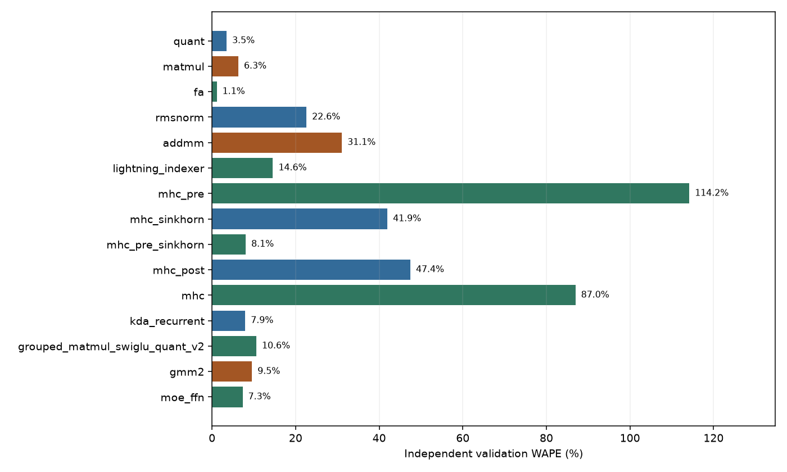

# 当前整套算子误差分析

| 算子 | 方法 | 开发 / 独立 shape | 验证误差 WAPE / 最大 | 查询最慢 ms |
|---|---|---:|---:|---:|
| dynamicMXquant | Vector | 19 / 10 | 3.47% / 5.92% | 1.550 |
| Matmul | Cube | 10 / 10 | 6.29% / 10.43% | 0.132 |
| FA | CV | 16 / 12 | 1.14% / 13.61% | 0.117 |
| RMSNorm | Vector | 3 / 10 | 22.59% / 97.61% | 0.246 |
| Addmm | Cube | 3 / 10 | 31.06% / 42.94% | 1.795 |
| Lightning Indexer | CV | 3 / 10 | 14.56% / 31.71% | 0.701 |
| mHC Pre | CV | 3 / 10 | 114.19% / 300.99% | 0.107 |
| mHC Sinkhorn | Vector | 3 / 10 | 41.95% / 128.02% | 0.014 |
| mHC PreSinkhorn | CV | 3 / 10 | 8.05% / 14.19% | 0.125 |
| mHC Post | Vector | 3 / 10 | 47.44% / 150.04% | 0.014 |
| mHC组合 | CV | 3 / 10 | 86.95% / 215.20% | 0.208 |
| KDA recurrent | Vector | 3 / 10 | 7.94% / 17.55% | 0.013 |
| KDA chunk | CV | 0 / 0 | N/A / N/A | N/A |
| GMM1–SwiGLU–MX量化 | CV | 4 / 10 | 10.59% / 32.74% | 0.123 |
| MoE GMM2 | Cube | 4 / 10 | 9.55% / 26.86% | 0.050 |
| MoE FFN组合 | CV | 4 / 10 | 7.31% / 23.01% | 0.164 |

每行对应默认模型的一种实现。独立列按不同 shape 计数，少于 10 个合格独立 shape 的路径为 KDA chunk。开发样例用于建立或诊断模型。

WAPE 是绝对偏差之和除以 CA 时间之和，最大误差是单例最大的绝对相对误差。表内只统计独立集。模型查询计时使用同一 Python 进程，每个 shape 调用统一入口 5 次，每次重新计算结果。最慢列取全部这些调用的最大墙钟毫秒数。硬件为 950DT 的 CA 模型，参考值为跨核指令窗口，多 kernel 串行求各窗口之和。

向量批采在一次 CA 初始化中依次同步多个 shape，可能保留前例热状态。MoE 组件和组合共享同一次链运行，mHC Pre 与拆分链也共享采集。完整数值检查、核数和数据源列于[逐例 JSON](./evaluation.json)。

## 逐 shape 结果

### dynamicMXquant

ops-nn · `aclnnDynamicMxQuant`。

| shape | 用途 | 预测 µs | CA µs | 有符号偏差 | 入口 | 活跃 AIC / AIV |
|---|---|---:|---:|---:|---|---|
| `[1, 128]` | 开发 | 4.231 | 4.325 | -2.2% | DynamicMxQuant_bf16toe4m3_high_performance_33_mix_aiv | 0 / 1 |
| `[36, 512]` | 开发 | 5.430 | 5.646 | -3.8% | DynamicMxQuant_bf16toe4m3_high_performance_33_mix_aiv | 0 / 36 |
| `[9, 5120]` | 开发 | 4.980 | 4.867 | +2.3% | DynamicMxQuant_bf16toe4m3_high_performance_33_mix_aiv | 0 / 45 |
| `[144, 7168]` | 开发 | 6.207 | 6.332 | -2.0% | DynamicMxQuant_bf16toe4m3_high_performance_33_mix_aiv | 0 / 58 |
| `[512, 5120]` | 开发 | 6.364 | 6.299 | +1.0% | DynamicMxQuant_bf16toe4m3_high_performance_33_mix_aiv | 0 / 64 |
| `[1152, 5120]` | 开发 | 8.942 | 8.684 | +3.0% | DynamicMxQuant_bf16toe4m3_high_performance_33_mix_aiv | 0 / 64 |
| `[512, 256]` | 开发 | 5.430 | 5.208 | +4.3% | DynamicMxQuant_bf16toe4m3_high_performance_33_mix_aiv | 0 / 64 |
| `[576, 4096]` | 开发 | 7.470 | 6.948 | +7.5% | DynamicMxQuant_bf16toe4m3_high_performance_33_mix_aiv | 0 / 64 |
| `[768, 4096]` | 开发 | 6.743 | 7.202 | -6.4% | DynamicMxQuant_bf16toe4m3_high_performance_33_mix_aiv | 0 / 64 |
| `[1, 64]` | 开发 | 4.231 | 4.326 | -2.2% | DynamicMxQuant_bf16toe4m3_high_performance_33_mix_aiv | 0 / 1 |
| `[65, 256]` | 开发 | 5.430 | 4.898 | +10.9% | DynamicMxQuant_bf16toe4m3_high_performance_33_mix_aiv | 0 / 33 |
| `[1024, 4096]` | 开发 | 7.502 | 8.047 | -6.8% | DynamicMxQuant_bf16toe4m3_high_performance_33_mix_aiv | 0 / 64 |
| `[1, 4096]` | 开发 | 5.430 | 5.686 | -4.5% | DynamicMxQuant_bf16toe4m3_high_performance_33_mix_aiv | 0 / 16 |
| `[640, 4096]` | 开发 | 6.364 | 6.218 | +2.4% | DynamicMxQuant_bf16toe4m3_high_performance_33_mix_aiv | 0 / 64 |
| `[33, 768]` | 开发 | 5.430 | 5.210 | +4.2% | DynamicMxQuant_bf16toe4m3_high_performance_33_mix_aiv | 0 / 34 |
| `[4, 256]` | 开发 | 4.759 | 4.588 | +3.7% | DynamicMxQuant_bf16toe4m3_high_performance_33_mix_aiv | 0 / 4 |
| `[17, 512]` | 开发 | 5.430 | 5.790 | -6.2% | DynamicMxQuant_bf16toe4m3_high_performance_33_mix_aiv | 0 / 34 |
| `[8, 384]` | 开发 | 5.430 | 5.760 | -5.7% | DynamicMxQuant_bf16toe4m3_high_performance_33_mix_aiv | 0 / 16 |
| `[64, 1024]` | 开发 | 5.214 | 5.532 | -5.7% | DynamicMxQuant_bf16toe4m3_high_performance_33_mix_aiv | 0 / 64 |
| `[36, 5120]` | 验证 | 5.292 | 5.584 | -5.2% | entry_kernel_21 | 0 / 60 |
| `[288, 7168]` | 验证 | 7.181 | 6.876 | +4.4% | entry_kernel_21 | 0 / 64 |
| `[1024, 7168]` | 验证 | 9.586 | 9.332 | +2.7% | entry_kernel_21 | 0 / 64 |
| `[1024, 6144]` | 验证 | 8.935 | 8.704 | +2.7% | entry_kernel_21 | 0 / 64 |
| `[128, 5120]` | 验证 | 5.794 | 5.885 | -1.5% | entry_kernel_21 | 0 / 64 |
| `[17, 1024]` | 验证 | 5.430 | 5.772 | -5.9% | entry_kernel_21 | 0 / 36 |
| `[1, 192]` | 验证 | 4.231 | 4.129 | +2.5% | entry_kernel_21 | 0 / 1 |
| `[36, 3072]` | 验证 | 5.156 | 4.971 | +3.7% | entry_kernel_21 | 0 / 54 |
| `[576, 7168]` | 验证 | 7.577 | 7.758 | -2.3% | entry_kernel_21 | 0 / 64 |
| `[7, 320]` | 验证 | 5.393 | 5.146 | +4.8% | entry_kernel_21 | 0 / 14 |

最大偏差出现在 `[17, 1024]`，实际入口为 `entry_kernel_21`。

### Matmul

ops-nn · `aclnnMatmul → MatMulV3`。

| shape | 用途 | 预测 µs | CA µs | 有符号偏差 | 入口 | 活跃 AIC / AIV |
|---|---|---:|---:|---:|---|---|
| `[1, 256, 1024]` | 开发 | 4.560 | 4.624 | -1.4% | MatMulV3_ND_ND_ND_ND_BF16_BF16_BF16_BF16_high_performance_2 | 4 / 0 |
| `[65, 128, 129]` | 开发 | 3.628 | 3.712 | -2.3% | MatMulV3_ND_ND_ND_ND_BF16_BF16_BF16_BF16_high_performance_2 | 10 / 0 |
| `[128, 512, 512]` | 开发 | 4.506 | 4.382 | +2.8% | MatMulV3_ND_ND_ND_ND_BF16_BF16_BF16_BF16_high_performance_2 | 32 / 0 |
| `[129, 256, 256]` | 开发 | 3.947 | 3.664 | +7.7% | MatMulV3_ND_ND_ND_ND_BF16_BF16_BF16_BF16_high_performance_2 | 20 / 0 |
| `[17, 256, 1024]` | 开发 | 5.040 | 4.742 | +6.3% | MatMulV3_ND_ND_ND_ND_BF16_BF16_BF16_BF16_high_performance_2 | 8 / 0 |
| `[128, 256, 512]` | 开发 | 4.261 | 4.393 | -3.0% | MatMulV3_ND_ND_ND_ND_BF16_BF16_BF16_BF16_high_performance_2 | 32 / 0 |
| `[1, 128, 128]` | 开发 | 3.370 | 3.356 | +0.4% | MatMulV3_ND_ND_ND_ND_BF16_BF16_BF16_BF16_high_performance_2 | 2 / 0 |
| `[32, 64, 64]` | 开发 | 3.368 | 3.292 | +2.3% | MatMulV3_ND_ND_ND_ND_BF16_BF16_BF16_BF16_high_performance_2 | 2 / 0 |
| `[48, 128, 192]` | 开发 | 3.633 | 3.575 | +1.6% | MatMulV3_ND_ND_ND_ND_BF16_BF16_BF16_BF16_high_performance_2 | 6 / 0 |
| `[17, 96, 128]` | 开发 | 3.505 | 3.494 | +0.3% | MatMulV3_ND_ND_ND_ND_BF16_BF16_BF16_BF16_high_performance_2 | 4 / 0 |
| `[128, 192, 256]` | 验证 | 3.816 | 3.798 | +0.5% | entry_kernel_2 | 24 / 0 |
| `[1, 32, 16]` | 验证 | 3.188 | 3.030 | +5.2% | entry_kernel_2 | 1 / 0 |
| `[256, 512, 256]` | 验证 | 4.368 | 4.192 | +4.2% | entry_kernel_2 | 32 / 0 |
| `[31, 64, 257]` | 验证 | 3.764 | 4.091 | -8.0% | entry_kernel_2 | 2 / 0 |
| `[4, 80, 48]` | 验证 | 3.257 | 3.524 | -7.6% | entry_kernel_2 | 2 / 0 |
| `[512, 512, 256]` | 验证 | 5.156 | 4.799 | +7.4% | entry_kernel_2 | 32 / 0 |
| `[64, 128, 512]` | 验证 | 4.183 | 4.437 | -5.7% | entry_kernel_2 | 8 / 0 |
| `[192, 384, 256]` | 验证 | 4.335 | 3.925 | +10.4% | entry_kernel_2 | 24 / 0 |
| `[2, 32, 32]` | 验证 | 3.171 | 3.244 | -2.3% | entry_kernel_2 | 1 / 0 |
| `[9, 128, 256]` | 验证 | 3.603 | 4.019 | -10.3% | entry_kernel_2 | 2 / 0 |

最大偏差出现在 `[192, 384, 256]`，实际入口为 `entry_kernel_2`。

### FA

ops-transformer · `aclnnFlashAttentionScoreV2`。

| shape | 用途 | 预测 µs | CA µs | 有符号偏差 | 入口 | 活跃 AIC / AIV |
|---|---|---:|---:|---:|---|---|
| `[32, 129, 64, 1, 4]` | 开发 | 9.720 | 9.150 | +6.2% | FlashAttentionScore_50348df09d0b3ee451d3693a6b2ab3f5_2328361008425337376_mix_aic | 4 / 8 |
| `[17, 257, 128, 1, 1]` | 开发 | 10.471 | 9.551 | +9.6% | FlashAttentionScore_50348df09d0b3ee451d3693a6b2ab3f5_2328361009230643744_mix_aic | 1 / 2 |
| `[17, 1153, 64, 1, 1]` | 开发 | 12.322 | 12.487 | -1.3% | FlashAttentionScore_50348df09d0b3ee451d3693a6b2ab3f5_2328361008425599520_mix_aic | 1 / 2 |
| `[128, 128, 64, 1, 1]` | 开发 | 9.248 | 9.498 | -2.6% | FlashAttentionScore_50348df09d0b3ee451d3693a6b2ab3f5_2328361008425337376_mix_aic | 2 / 4 |
| `[16, 1025, 64, 1, 1]` | 开发 | 12.313 | 12.384 | -0.6% | FlashAttentionScore_50348df09d0b3ee451d3693a6b2ab3f5_2328361008425599520_mix_aic | 1 / 2 |
| `[16, 128, 64, 1, 4]` | 开发 | 8.894 | 8.758 | +1.6% | FlashAttentionScore_50348df09d0b3ee451d3693a6b2ab3f5_2328361008425337376_mix_aic | 4 / 8 |
| `[16, 128, 128, 1, 1]` | 开发 | 8.829 | 8.715 | +1.3% | FlashAttentionScore_50348df09d0b3ee451d3693a6b2ab3f5_2328361009230643744_mix_aic | 1 / 2 |
| `[129, 128, 64, 1, 1]` | 开发 | 9.081 | 8.871 | +2.4% | FlashAttentionScore_50348df09d0b3ee451d3693a6b2ab3f5_2328361008425337376_mix_aic | 3 / 6 |
| `[16, 128, 64, 1, 8]` | 开发 | 8.992 | 9.402 | -4.4% | FlashAttentionScore_50348df09d0b3ee451d3693a6b2ab3f5_2328361008425337376_mix_aic | 8 / 16 |
| `[17, 192, 128, 1, 1]` | 开发 | 9.653 | 9.050 | +6.7% | FlashAttentionScore_50348df09d0b3ee451d3693a6b2ab3f5_2328361009230643744_mix_aic | 1 / 2 |
| `[17, 96, 64, 1, 1]` | 开发 | 8.692 | 9.162 | -5.1% | FlashAttentionScore_50348df09d0b3ee451d3693a6b2ab3f5_2328361008425337376_mix_aic | 1 / 2 |
| `[16, 64, 64, 1, 1]` | 开发 | 8.657 | 9.052 | -4.4% | FlashAttentionScore_50348df09d0b3ee451d3693a6b2ab3f5_2328361008425337376_mix_aic | 1 / 2 |
| `[8, 192, 64, 1, 1]` | 开发 | 9.425 | 8.805 | +7.0% | FlashAttentionScore_50348df09d0b3ee451d3693a6b2ab3f5_2328361008425337376_mix_aic | 1 / 2 |
| `[64, 256, 64, 1, 1]` | 开发 | 9.703 | 9.409 | +3.1% | FlashAttentionScore_50348df09d0b3ee451d3693a6b2ab3f5_2328361008425337376_mix_aic | 1 / 2 |
| `[1, 128, 64, 1, 1]` | 开发 | 8.718 | 8.784 | -0.7% | FlashAttentionScore_50348df09d0b3ee451d3693a6b2ab3f5_2328361008425337376_mix_aic | 1 / 2 |
| `[9, 32768, 64, 1, 1]` | 开发 | 76.184 | 75.980 | +0.3% | entry_kernel_2050000040140220 | 1 / 2 |
| `[9, 256, 128, 4, 1]` | 验证 | 9.767 | 9.690 | +0.8% | FlashAttentionScore_50348df09d0b3ee451d3693a6b2ab3f5_2328361009230643744_mix_aic | 4 / 8 |
| `[9, 131072, 64, 1, 1]` | 验证 | 274.794 | 274.821 | -0.0% | entry_kernel_2050000040140220 | 1 / 2 |
| `[9, 16385, 64, 1, 1]` | 验证 | 43.599 | 43.219 | +0.9% | entry_kernel_2050000040140220 | 1 / 2 |
| `[17, 384, 64, 1, 2]` | 验证 | 10.301 | 9.757 | +5.6% | entry_kernel_2050000040100220 | 2 / 4 |
| `[1, 64, 64, 1, 1]` | 验证 | 8.657 | 8.937 | -3.1% | entry_kernel_2050000040100220 | 1 / 2 |
| `[32, 512, 64, 1, 1]` | 验证 | 11.046 | 9.722 | +13.6% | entry_kernel_2050000040100220 | 1 / 2 |
| `[4, 256, 128, 1, 1]` | 验证 | 9.551 | 9.367 | +2.0% | entry_kernel_2050000070100220 | 1 / 2 |
| `[64, 320, 128, 1, 1]` | 验证 | 10.863 | 9.968 | +9.0% | entry_kernel_2050000070100220 | 1 / 2 |
| `[9, 4096, 64, 1, 1]` | 验证 | 18.256 | 18.226 | +0.2% | entry_kernel_2050000040140220 | 1 / 2 |
| `[1, 224, 64, 1, 1]` | 验证 | 9.465 | 8.826 | +7.2% | entry_kernel_2050000040100220 | 1 / 2 |
| `[4, 160, 64, 1, 1]` | 验证 | 9.406 | 9.461 | -0.6% | entry_kernel_2050000040100220 | 1 / 2 |
| `[8, 128, 128, 1, 1]` | 验证 | 8.770 | 9.136 | -4.0% | entry_kernel_2050000070100220 | 1 / 2 |

最大偏差出现在 `[32, 512, 64, 1, 1]`，实际入口为 `entry_kernel_2050000040100220`。

### RMSNorm

ops-nn · `aclnnRmsNorm`。

| shape | 用途 | 预测 µs | CA µs | 有符号偏差 | 入口 | 活跃 AIC / AIV |
|---|---|---:|---:|---:|---|---|
| `[9, 5120]` | 开发 | 4.713 | 4.188 | +12.5% | entry_kernel_1388 | 0 / 9 |
| `[36, 7168]` | 开发 | 6.397 | 6.614 | -3.3% | entry_kernel_1388 | 0 / 36 |
| `[1, 128]` | 开发 | 3.192 | 3.454 | -7.6% | entry_kernel_1388 | 0 / 1 |
| `[1, 256]` | 验证 | 3.206 | 3.637 | -11.8% | entry_kernel_1388 | 0 / 1 |
| `[4, 512]` | 验证 | 3.321 | 4.292 | -22.6% | entry_kernel_1388 | 0 / 4 |
| `[16, 1024]` | 验证 | 3.604 | 3.815 | -5.5% | entry_kernel_1388 | 0 / 16 |
| `[9, 7168]` | 验证 | 5.306 | 2.790 | +90.1% | entry_kernel_1388 | 0 / 9 |
| `[36, 5120]` | 验证 | 5.503 | 5.289 | +4.0% | entry_kernel_1388 | 0 / 36 |
| `[32, 4096]` | 验证 | 5.000 | 4.581 | +9.2% | entry_kernel_1388 | 0 / 32 |
| `[64, 2048]` | 验证 | 4.305 | 4.352 | -1.1% | entry_kernel_1388 | 0 / 64 |
| `[65, 128]` | 验证 | 3.409 | 3.084 | +10.6% | entry_kernel_1388 | 0 / 33 |
| `[128, 1024]` | 验证 | 4.305 | 3.090 | +39.3% | entry_kernel_1388 | 0 / 64 |
| `[1, 8192]` | 验证 | 4.061 | 2.055 | +97.6% | entry_kernel_1388 | 0 / 1 |

最大偏差出现在 `[1, 8192]`，实际入口为 `entry_kernel_1388`。

### Addmm

ops-nn · `aclnnAddmm`。

| shape | 用途 | 预测 µs | CA µs | 有符号偏差 | 入口 | 活跃 AIC / AIV |
|---|---|---:|---:|---:|---|---|
| `[16, 64, 256]` | 开发 | 5.040 | 3.447 | +46.2% | entry_kernel_2 | 1 / 0 |
| `[9, 64, 128]` | 开发 | 4.766 | 3.342 | +42.6% | entry_kernel_2 | 1 / 0 |
| `[2, 16, 16]` | 开发 | 4.532 | 2.992 | +51.5% | entry_kernel_2 | 1 / 0 |
| `[128, 192, 256]` | 验证 | 5.040 | 3.763 | +33.9% | entry_kernel_2 | 24 / 0 |
| `[16, 192, 384]` | 验证 | 5.251 | 3.877 | +35.4% | entry_kernel_2 | 3 / 0 |
| `[256, 512, 256]` | 验证 | 5.623 | 4.327 | +29.9% | entry_kernel_2 | 32 / 0 |
| `[4, 80, 48]` | 验证 | 4.613 | 3.625 | +27.2% | entry_kernel_2 | 2 / 0 |
| `[512, 512, 256]` | 验证 | 6.402 | 4.479 | +42.9% | entry_kernel_2 | 32 / 0 |
| `[64, 128, 512]` | 验证 | 5.463 | 4.519 | +20.9% | entry_kernel_2 | 8 / 0 |
| `[1, 32, 16]` | 验证 | 4.537 | 3.288 | +38.0% | entry_kernel_2 | 1 / 0 |
| `[2, 32, 32]` | 验证 | 4.551 | 3.408 | +33.5% | entry_kernel_2 | 1 / 0 |
| `[31, 64, 257]` | 验证 | 5.066 | 4.253 | +19.1% | entry_kernel_2 | 2 / 0 |
| `[9, 128, 256]` | 验证 | 4.955 | 3.756 | +31.9% | entry_kernel_2 | 2 / 0 |

最大偏差出现在 `[512, 512, 256]`，实际入口为 `entry_kernel_2`。

### Lightning Indexer

ops-transformer · `aclnnLightningIndexer`。

| shape | 用途 | 预测 µs | CA µs | 有符号偏差 | 入口 | 活跃 AIC / AIV |
|---|---|---:|---:|---:|---|---|
| `[1, 1, 512, 8, 128]` | 开发 | 5.771 | 6.093 | -5.3% | entry_kernel_31b1b | [32] / [64] |
| `[1, 1, 1024, 8, 128]` | 开发 | 6.755 | 6.741 | +0.2% | entry_kernel_31b1b | [32] / [64] |
| `[1, 2, 768, 8, 128]` | 开发 | 6.682 | 6.365 | +5.0% | entry_kernel_31b1b | [32] / [64] |
| `[1, 1, 640, 8, 128]` | 验证 | 6.652 | 6.200 | +7.3% | entry_kernel_31b1b | [32] / [64] |
| `[1, 1, 896, 8, 128]` | 验证 | 6.711 | 6.439 | +4.2% | entry_kernel_31b1b | [32] / [64] |
| `[1, 2, 1024, 8, 128]` | 验证 | 6.755 | 6.516 | +3.7% | entry_kernel_31b1b | [32] / [64] |
| `[1, 4, 1024, 8, 128]` | 验证 | 6.755 | 8.043 | -16.0% | entry_kernel_31b1b | [32] / [64] |
| `[1, 8, 1536, 8, 128]` | 验证 | 8.396 | 8.862 | -5.3% | entry_kernel_31b1b | [32] / [64] |
| `[1, 1, 2048, 8, 128]` | 验证 | 10.051 | 8.614 | +16.7% | entry_kernel_31b1b | [32] / [64] |
| `[1, 2, 3072, 8, 128]` | 验证 | 13.361 | 11.101 | +20.4% | entry_kernel_31b1b | [32] / [64] |
| `[1, 4, 4096, 8, 128]` | 验证 | 16.670 | 15.674 | +6.4% | entry_kernel_31b1b | [32] / [64] |
| `[1, 9, 4096, 8, 128]` | 验证 | 16.670 | 15.334 | +8.7% | entry_kernel_31b1b | [32] / [64] |
| `[1, 1, 8192, 8, 128]` | 验证 | 29.909 | 22.709 | +31.7% | entry_kernel_31b1b | [32] / [64] |

最大偏差出现在 `[1, 1, 8192, 8, 128]`，实际入口为 `entry_kernel_31b1b`。

### mHC Pre

ops-transformer · `aclnnMhcPre`。

| shape | 用途 | 预测 µs | CA µs | 有符号偏差 | 入口 | 活跃 AIC / AIV |
|---|---|---:|---:|---:|---|---|
| `[1, 4, 128]` | 开发 | 8.312 | 8.271 | +0.5% | entry_kernel_2 | [32] / [64] |
| `[8, 4, 128]` | 开发 | 8.312 | 8.542 | -2.7% | entry_kernel_2 | [32] / [64] |
| `[3, 4, 128]` | 开发 | 8.312 | 8.312 | -0.0% | entry_kernel_2 | [32] / [64] |
| `[1, 4, 64]` | 验证 | 8.312 | 9.482 | -12.3% | entry_kernel_1 | [32] / [64] |
| `[2, 4, 128]` | 验证 | 8.312 | 8.005 | +3.8% | entry_kernel_2 | [32] / [64] |
| `[4, 4, 256]` | 验证 | 12.125 | 8.421 | +44.0% | entry_kernel_2 | [32] / [64] |
| `[16, 4, 128]` | 验证 | 8.312 | 9.308 | -10.7% | entry_kernel_2 | [32] / [64] |
| `[1, 4, 512]` | 验证 | 19.752 | 8.544 | +131.2% | entry_kernel_2 | [32] / [64] |
| `[4, 4, 1024]` | 验证 | 35.005 | 8.730 | +301.0% | entry_kernel_2 | [32] / [64] |
| `[9, 4, 1024]` | 验证 | 35.005 | 9.024 | +287.9% | entry_kernel_2 | [32] / [64] |
| `[16, 4, 512]` | 验证 | 19.752 | 9.385 | +110.5% | entry_kernel_2 | [32] / [64] |
| `[32, 4, 1024]` | 验证 | 35.005 | 11.368 | +207.9% | entry_kernel_2 | [32] / [64] |
| `[1, 4, 80]` | 验证 | 8.312 | 9.802 | -15.2% | entry_kernel_1 | [32] / [64] |

最大偏差出现在 `[4, 4, 1024]`，实际入口为 `entry_kernel_2`。

### mHC Sinkhorn

ops-transformer · `aclnnMhcSinkhorn`。

| shape | 用途 | 预测 µs | CA µs | 有符号偏差 | 入口 | 活跃 AIC / AIV |
|---|---|---:|---:|---:|---|---|
| `[1, 4]`，I=20 | 开发 | 6.605 | 6.296 | +4.9% | entry_kernel_0 | 0 / 1 |
| `[64, 4]`，I=20 | 开发 | 6.973 | 7.598 | -8.2% | entry_kernel_0 | 0 / 64 |
| `[17, 4]`，I=20 | 开发 | 6.847 | 6.532 | +4.8% | entry_kernel_0 | 0 / 17 |
| `[2, 4]`，I=2 | 验证 | 6.658 | 3.593 | +85.3% | entry_kernel_0 | 0 / 2 |
| `[4, 4]`，I=5 | 验证 | 6.716 | 2.945 | +128.0% | entry_kernel_0 | 0 / 4 |
| `[8, 4]`，I=10 | 验证 | 6.778 | 4.995 | +35.7% | entry_kernel_0 | 0 / 8 |
| `[9, 4]`，I=20 | 验证 | 6.788 | 6.212 | +9.3% | entry_kernel_0 | 0 / 9 |
| `[16, 4]`，I=32 | 验证 | 6.842 | 8.156 | -16.1% | entry_kernel_0 | 0 / 16 |
| `[31, 4]`，I=20 | 验证 | 6.904 | 6.333 | +9.0% | entry_kernel_0 | 0 / 31 |
| `[32, 4]`，I=20 | 验证 | 6.907 | 5.336 | +29.4% | entry_kernel_0 | 0 / 32 |
| `[63, 4]`，I=5 | 验证 | 6.972 | 4.101 | +70.0% | entry_kernel_0 | 0 / 63 |
| `[65, 4]`，I=10 | 验证 | 7.178 | 3.258 | +120.3% | entry_kernel_0 | 0 / 33 |
| `[128, 4]`，I=20 | 验证 | 7.178 | 5.475 | +31.1% | entry_kernel_0 | 0 / 64 |

最大偏差出现在 `[4, 4]`，实际入口为 `entry_kernel_0`。

### mHC PreSinkhorn

ops-transformer · `aclnnMhcPreSinkhorn`。

| shape | 用途 | 预测 µs | CA µs | 有符号偏差 | 入口 | 活跃 AIC / AIV |
|---|---|---:|---:|---:|---|---|
| `[1, 4, 4096]`，I=20 | 开发 | 9.939 | 9.701 | +2.5% | entry_kernel_3e8 | [32] / [64] |
| `[4, 4, 4096]`，I=20 | 开发 | 9.939 | 9.939 | +0.0% | entry_kernel_3e8 | [32] / [64] |
| `[2, 4, 4096]`，I=20 | 开发 | 9.939 | 10.648 | -6.7% | entry_kernel_3e8 | [32] / [64] |
| `[3, 4, 4096]`，I=20 | 验证 | 9.939 | 10.373 | -4.2% | entry_kernel_3e8 | [32] / [64] |
| `[5, 4, 4096]`，I=20 | 验证 | 9.939 | 9.761 | +1.8% | entry_kernel_3e8 | [32] / [64] |
| `[6, 4, 4096]`，I=20 | 验证 | 9.939 | 9.785 | +1.6% | entry_kernel_3e8 | [32] / [64] |
| `[7, 4, 4096]`，I=20 | 验证 | 9.939 | 11.518 | -13.7% | entry_kernel_3e8 | [32] / [64] |
| `[8, 4, 4096]`，I=20 | 验证 | 9.939 | 10.529 | -5.6% | entry_kernel_3e8 | [32] / [64] |
| `[9, 4, 4096]`，I=20 | 验证 | 9.939 | 10.202 | -2.6% | entry_kernel_3e8 | [32] / [64] |
| `[12, 4, 4096]`，I=20 | 验证 | 9.939 | 10.952 | -9.2% | entry_kernel_3e8 | [32] / [64] |
| `[16, 4, 4096]`，I=20 | 验证 | 9.939 | 11.560 | -14.0% | entry_kernel_3e8 | [32] / [64] |
| `[24, 4, 4096]`，I=20 | 验证 | 9.939 | 11.583 | -14.2% | entry_kernel_3e8 | [32] / [64] |
| `[32, 4, 4096]`，I=20 | 验证 | 9.939 | 11.114 | -10.6% | entry_kernel_3e8 | [32] / [64] |

最大偏差出现在 `[24, 4, 4096]`，实际入口为 `entry_kernel_3e8`。

### mHC Post

ops-transformer · `aclnnMhcPost`。

| shape | 用途 | 预测 µs | CA µs | 有符号偏差 | 入口 | 活跃 AIC / AIV |
|---|---|---:|---:|---:|---|---|
| `[1, 4, 128]` | 开发 | 4.051 | 4.646 | -12.8% | entry_kernel_5 | 0 / 1 |
| `[32, 4, 128]` | 开发 | 4.417 | 3.408 | +29.6% | entry_kernel_6 | 0 / 32 |
| `[9, 4, 128]` | 开发 | 4.283 | 4.613 | -7.2% | entry_kernel_5 | 0 / 9 |
| `[1, 4, 64]` | 验证 | 4.051 | 4.588 | -11.7% | entry_kernel_5 | 0 / 1 |
| `[2, 4, 256]` | 验证 | 4.127 | 5.276 | -21.8% | entry_kernel_5 | 0 / 2 |
| `[4, 4, 512]` | 验证 | 4.276 | 4.108 | +4.1% | entry_kernel_5 | 0 / 8 |
| `[9, 4, 1024]` | 验证 | 4.438 | 3.966 | +11.9% | entry_kernel_5 | 0 / 36 |
| `[16, 4, 256]` | 验证 | 4.351 | 2.214 | +96.5% | entry_kernel_5 | 0 / 16 |
| `[32, 4, 512]` | 验证 | 4.501 | 2.388 | +88.4% | entry_kernel_6 | 0 / 32 |
| `[36, 4, 128]` | 验证 | 4.429 | 1.772 | +150.0% | entry_kernel_6 | 0 / 36 |
| `[64, 4, 256]` | 验证 | 4.501 | 3.007 | +49.7% | entry_kernel_6 | 0 / 64 |
| `[65, 4, 128]` | 验证 | 4.501 | 2.110 | +113.3% | entry_kernel_6 | 0 / 33 |
| `[1, 4, 7168]` | 验证 | 4.426 | 2.430 | +82.1% | entry_kernel_5 | 0 / 32 |

最大偏差出现在 `[36, 4, 128]`，实际入口为 `entry_kernel_6`。

### mHC组合

ops-transformer · `aclnnMhcPre + aclnnMhcSinkhorn + aclnnMhcPost`。

| shape | 用途 | 预测 µs | CA µs | 有符号偏差 | 入口 | 活跃 AIC / AIV |
|---|---|---:|---:|---:|---|---|
| `[1, 4, 128]`，I=20 | 开发 | 16.702 | 15.970 | +4.6% | entry_kernel_2+entry_kernel_0+entry_kernel_5 | [32, 0, 0] / [64, 1, 1] |
| `[8, 4, 128]`，I=20 | 开发 | 16.702 | 16.791 | -0.5% | entry_kernel_2+entry_kernel_0+entry_kernel_5 | [32, 0, 0] / [64, 8, 8] |
| `[3, 4, 128]`，I=20 | 开发 | 16.702 | 16.835 | -0.8% | entry_kernel_2+entry_kernel_0+entry_kernel_5 | [32, 0, 0] / [64, 3, 3] |
| `[1, 4, 64]`，I=20 | 验证 | 16.702 | 17.143 | -2.6% | entry_kernel_1+entry_kernel_0+entry_kernel_5 | [32, 0, 0] / [64, 1, 1] |
| `[2, 4, 128]`，I=20 | 验证 | 16.702 | 16.416 | +1.7% | entry_kernel_2+entry_kernel_0+entry_kernel_5 | [32, 0, 0] / [64, 2, 2] |
| `[4, 4, 256]`，I=20 | 验证 | 22.520 | 17.344 | +29.8% | entry_kernel_2+entry_kernel_0+entry_kernel_5 | [32, 0, 0] / [64, 4, 4] |
| `[16, 4, 128]`，I=20 | 验证 | 16.702 | 18.202 | -8.2% | entry_kernel_2+entry_kernel_0+entry_kernel_5 | [32, 0, 0] / [64, 16, 16] |
| `[1, 4, 512]`，I=20 | 验证 | 34.156 | 17.343 | +96.9% | entry_kernel_2+entry_kernel_0+entry_kernel_5 | [32, 0, 0] / [64, 1, 2] |
| `[4, 4, 1024]`，I=20 | 验证 | 57.429 | 18.220 | +215.2% | entry_kernel_2+entry_kernel_0+entry_kernel_5 | [32, 0, 0] / [64, 4, 16] |
| `[9, 4, 1024]`，I=20 | 验证 | 57.429 | 18.482 | +210.7% | entry_kernel_2+entry_kernel_0+entry_kernel_5 | [32, 0, 0] / [64, 9, 36] |
| `[16, 4, 512]`，I=20 | 验证 | 34.156 | 18.691 | +82.7% | entry_kernel_2+entry_kernel_0+entry_kernel_5 | [32, 0, 0] / [64, 16, 32] |
| `[32, 4, 1024]`，I=20 | 验证 | 57.429 | 20.070 | +186.1% | entry_kernel_2+entry_kernel_0+entry_kernel_6 | [32, 0, 0] / [64, 32, 32] |
| `[1, 4, 80]`，I=20 | 验证 | 16.702 | 17.559 | -4.9% | entry_kernel_1+entry_kernel_0+entry_kernel_5 | [32, 0, 0] / [64, 1, 1] |

最大偏差出现在 `[4, 4, 1024]`，实际入口为 `entry_kernel_2+entry_kernel_0+entry_kernel_5`。

### KDA recurrent

ops-transformer · `aclnnRecurrentKda`。

| shape | 用途 | 预测 µs | CA µs | 有符号偏差 | 入口 | 活跃 AIC / AIV |
|---|---|---:|---:|---:|---|---|
| `[1, 1, 1, 1, 128, 128]` | 开发 | 15.072 | 15.219 | -1.0% | entry_kernel_0 | 0 / 1 |
| `[1, 2, 1, 1, 128, 128]` | 开发 | 18.547 | 18.467 | +0.4% | entry_kernel_0 | 0 / 1 |
| `[1, 4, 1, 1, 128, 128]` | 开发 | 25.498 | 25.430 | +0.3% | entry_kernel_0 | 0 / 1 |
| `[1, 3, 1, 1, 128, 128]` | 验证 | 22.022 | 21.932 | +0.4% | entry_kernel_0 | 0 / 1 |
| `[1, 5, 1, 1, 128, 128]` | 验证 | 28.973 | 24.648 | +17.5% | entry_kernel_0 | 0 / 1 |
| `[1, 6, 1, 1, 128, 128]` | 验证 | 32.449 | 28.441 | +14.1% | entry_kernel_0 | 0 / 1 |
| `[1, 7, 1, 1, 128, 128]` | 验证 | 35.924 | 31.195 | +15.2% | entry_kernel_0 | 0 / 1 |
| `[1, 8, 1, 1, 128, 128]` | 验证 | 39.399 | 35.396 | +11.3% | entry_kernel_0 | 0 / 1 |
| `[1, 1, 1, 1, 128, 256]` | 验证 | 18.547 | 17.434 | +6.4% | entry_kernel_0 | 0 / 1 |
| `[1, 2, 1, 1, 128, 256]` | 验证 | 25.498 | 22.684 | +12.4% | entry_kernel_0 | 0 / 1 |
| `[1, 3, 1, 1, 128, 256]` | 验证 | 32.449 | 31.071 | +4.4% | entry_kernel_0 | 0 / 1 |
| `[1, 4, 1, 1, 128, 256]` | 验证 | 39.399 | 38.342 | +2.8% | entry_kernel_0 | 0 / 1 |
| `[1, 6, 1, 1, 128, 256]` | 验证 | 53.301 | 52.691 | +1.2% | entry_kernel_0 | 0 / 1 |

最大偏差出现在 `[1, 5, 1, 1, 128, 128]`，实际入口为 `entry_kernel_0`。

### KDA chunk

ops-transformer · `aclnnChunkKdaFwd`。

普通整块和 safe gate 双头候选均在 CA 主 kernel 触发重复 set_flag。完整 CA 耗时 0 个；另有 10 个冻结 shape 通过逻辑工作量、依赖与 CPU 稀疏前向核对，S=1 至 256，头数 1 至 8。[逐 shape 结构验证](./cube/chunk-structure-validation.json)。

### GMM1–SwiGLU–MX量化

ops-transformer · `aclnnGroupedMatmulSwigluQuantV2`。

| shape | 用途 | 预测 µs | CA µs | 有符号偏差 | 入口 | 活跃 AIC / AIV |
|---|---|---:|---:|---:|---|---|
| `[2, 64, 64, 1]`，各专家行数 [2] | 开发 | 7.272 | 7.005 | +3.8% | entry_kernel_0 | [32] / [64] |
| `[2, 64, 128, 1]`，各专家行数 [2] | 开发 | 7.272 | 7.280 | -0.1% | entry_kernel_0 | [32] / [64] |
| `[4, 128, 64, 2]`，各专家行数 [1, 3] | 开发 | 7.858 | 7.364 | +6.7% | entry_kernel_0 | [32] / [64] |
| `[6, 128, 128, 2]`，各专家行数 [1, 5] | 开发 | 7.858 | 7.390 | +6.3% | entry_kernel_0 | [32] / [64] |
| `[1, 64, 64, 1]`，各专家行数 [1] | 验证 | 7.272 | 7.044 | +3.2% | entry_kernel_0 | [32] / [64] |
| `[3, 64, 64, 2]`，各专家行数 [1, 2] | 验证 | 7.272 | 7.081 | +2.7% | entry_kernel_0 | [32] / [64] |
| `[8, 64, 128, 1]`，各专家行数 [8] | 验证 | 7.272 | 7.405 | -1.8% | entry_kernel_0 | [32] / [64] |
| `[16, 128, 128, 2]`，各专家行数 [1, 15] | 验证 | 7.858 | 7.372 | +6.6% | entry_kernel_0 | [32] / [64] |
| `[17, 128, 64, 2]`，各专家行数 [8, 9] | 验证 | 7.858 | 7.414 | +6.0% | entry_kernel_0 | [32] / [64] |
| `[8, 256, 128, 2]`，各专家行数 [1, 7] | 验证 | 9.941 | 7.489 | +32.7% | entry_kernel_0 | [32] / [64] |
| `[32, 128, 128, 4]`，各专家行数 [2, 6, 8, 16] | 验证 | 7.858 | 7.686 | +2.2% | entry_kernel_0 | [32] / [64] |
| `[16, 256, 256, 1]`，各专家行数 [16] | 验证 | 9.941 | 8.193 | +21.3% | entry_kernel_0 | [32] / [64] |
| `[32, 256, 128, 2]`，各专家行数 [1, 31] | 验证 | 9.941 | 8.214 | +21.0% | entry_kernel_0 | [32] / [64] |
| `[64, 128, 256, 4]`，各专家行数 [8, 8, 16, 32] | 验证 | 7.858 | 8.355 | -5.9% | entry_kernel_0 | [32] / [64] |

最大偏差出现在 `[8, 256, 128, 2]`，实际入口为 `entry_kernel_0`。

### MoE GMM2

ops-transformer · `aclnnGroupedMatmulV5`。

| shape | 用途 | 预测 µs | CA µs | 有符号偏差 | 入口 | 活跃 AIC / AIV |
|---|---|---:|---:|---:|---|---|
| `[2, 64, 64, 1]`，各专家行数 [2] | 开发 | 3.410 | 3.248 | +5.0% | entry_kernel_0 | [32] / [0] |
| `[2, 64, 128, 1]`，各专家行数 [2] | 开发 | 3.695 | 3.545 | +4.2% | entry_kernel_0 | [32] / [0] |
| `[4, 128, 64, 2]`，各专家行数 [1, 3] | 开发 | 3.410 | 3.707 | -8.0% | entry_kernel_0 | [32] / [0] |
| `[6, 128, 128, 2]`，各专家行数 [1, 5] | 开发 | 3.695 | 3.697 | -0.0% | entry_kernel_0 | [32] / [0] |
| `[1, 64, 64, 1]`，各专家行数 [1] | 验证 | 3.410 | 3.151 | +8.2% | entry_kernel_0 | [32] / [0] |
| `[3, 64, 64, 2]`，各专家行数 [1, 2] | 验证 | 3.410 | 3.771 | -9.6% | entry_kernel_0 | [32] / [0] |
| `[8, 64, 128, 1]`，各专家行数 [8] | 验证 | 3.695 | 3.228 | +14.5% | entry_kernel_0 | [32] / [0] |
| `[16, 128, 128, 2]`，各专家行数 [1, 15] | 验证 | 3.695 | 3.838 | -3.7% | entry_kernel_0 | [32] / [0] |
| `[17, 128, 64, 2]`，各专家行数 [8, 9] | 验证 | 3.410 | 3.921 | -13.0% | entry_kernel_0 | [32] / [0] |
| `[8, 256, 128, 2]`，各专家行数 [1, 7] | 验证 | 3.695 | 3.630 | +1.8% | entry_kernel_0 | [32] / [0] |
| `[32, 128, 128, 4]`，各专家行数 [2, 6, 8, 16] | 验证 | 3.695 | 3.885 | -4.9% | entry_kernel_0 | [32] / [0] |
| `[16, 256, 256, 1]`，各专家行数 [16] | 验证 | 4.516 | 3.560 | +26.9% | entry_kernel_0 | [32] / [0] |
| `[32, 256, 128, 2]`，各专家行数 [1, 31] | 验证 | 3.695 | 3.905 | -5.4% | entry_kernel_0 | [32] / [0] |
| `[64, 128, 256, 4]`，各专家行数 [8, 8, 16, 32] | 验证 | 4.516 | 4.142 | +9.0% | entry_kernel_0 | [32] / [0] |

最大偏差出现在 `[16, 256, 256, 1]`，实际入口为 `entry_kernel_0`。

### MoE FFN组合

ops-transformer · `aclnnGroupedMatmulSwigluQuantV2 + aclnnGroupedMatmulV5`。

| shape | 用途 | 预测 µs | CA µs | 有符号偏差 | 入口 | 活跃 AIC / AIV |
|---|---|---:|---:|---:|---|---|
| `[2, 64, 64, 1]`，各专家行数 [2] | 开发 | 10.682 | 10.253 | +4.2% | entry_kernel_0+entry_kernel_0 | [32, 32] / [64, 0] |
| `[2, 64, 128, 1]`，各专家行数 [2] | 开发 | 10.967 | 10.825 | +1.3% | entry_kernel_0+entry_kernel_0 | [32, 32] / [64, 0] |
| `[4, 128, 64, 2]`，各专家行数 [1, 3] | 开发 | 11.268 | 11.070 | +1.8% | entry_kernel_0+entry_kernel_0 | [32, 32] / [64, 0] |
| `[6, 128, 128, 2]`，各专家行数 [1, 5] | 开发 | 11.553 | 11.087 | +4.2% | entry_kernel_0+entry_kernel_0 | [32, 32] / [64, 0] |
| `[1, 64, 64, 1]`，各专家行数 [1] | 验证 | 10.682 | 10.195 | +4.8% | entry_kernel_0+entry_kernel_0 | [32, 32] / [64, 0] |
| `[3, 64, 64, 2]`，各专家行数 [1, 2] | 验证 | 10.682 | 10.852 | -1.6% | entry_kernel_0+entry_kernel_0 | [32, 32] / [64, 0] |
| `[8, 64, 128, 1]`，各专家行数 [8] | 验证 | 10.967 | 10.633 | +3.1% | entry_kernel_0+entry_kernel_0 | [32, 32] / [64, 0] |
| `[16, 128, 128, 2]`，各专家行数 [1, 15] | 验证 | 11.553 | 11.209 | +3.1% | entry_kernel_0+entry_kernel_0 | [32, 32] / [64, 0] |
| `[17, 128, 64, 2]`，各专家行数 [8, 9] | 验证 | 11.268 | 11.335 | -0.6% | entry_kernel_0+entry_kernel_0 | [32, 32] / [64, 0] |
| `[8, 256, 128, 2]`，各专家行数 [1, 7] | 验证 | 13.636 | 11.119 | +22.6% | entry_kernel_0+entry_kernel_0 | [32, 32] / [64, 0] |
| `[32, 128, 128, 4]`，各专家行数 [2, 6, 8, 16] | 验证 | 11.553 | 11.571 | -0.2% | entry_kernel_0+entry_kernel_0 | [32, 32] / [64, 0] |
| `[16, 256, 256, 1]`，各专家行数 [16] | 验证 | 14.457 | 11.753 | +23.0% | entry_kernel_0+entry_kernel_0 | [32, 32] / [64, 0] |
| `[32, 256, 128, 2]`，各专家行数 [1, 31] | 验证 | 13.636 | 12.119 | +12.5% | entry_kernel_0+entry_kernel_0 | [32, 32] / [64, 0] |
| `[64, 128, 256, 4]`，各专家行数 [8, 8, 16, 32] | 验证 | 12.374 | 12.496 | -1.0% | entry_kernel_0+entry_kernel_0 | [32, 32] / [64, 0] |

最大偏差出现在 `[16, 256, 256, 1]`，实际入口为 `entry_kernel_0+entry_kernel_0`。

## 误差来源与采集成本

quant 的 UB 头尾开销、Matmul 的 tile 分支、FA 的 KV 流水均沿用冻结模型。FA 的 128k 证据仅适用于已测 Q9、D64、单 batch 单 head 路径，256k/512k 为外推。新增路由使用有限的开发 trace 估算阶段服务。任务数、算法分支和资源重叠变化都可能破坏模板假设。具体诊断如下。

- **RMSNorm 与 mHC Post。** RMSNorm 的 [65,128] 按模型分配给 64 核，实测仅启动 33 核。分配每核两行时，33 核即可覆盖 65 行。Post 的 [32,4,512] 模板同样预计 64 核，实测为 32 核。历史 Post 两个开发点 [1,4,128] 与 [32,4,128] 的入口编号分别为 5 和 6，已按 DB 修正旧版文字。错误的分支和分核会改变临界核的实际工作量。

- **Addmm。** [512,512,256] 预测 6.402 µs，CA 为 4.479 µs。最后结束的核上，读、算、写的真实活动区间并集为 2.121 µs，模型给出 4.326 µs。预计的控制时间 2.076 µs 与实测未覆盖时间 2.107 µs 相近。该例的主因是首波内部的阶段重叠被低估。[临界核区间分解](./cube/worst-addmm.json)

- **FA。** WAPE 按参考时间加权，单个 128k 长循环可以显著影响总数。短 Q、不同 D 的单例相对误差另见上表。只有 Q9、B1、H1、D64 的相应长循环有长上下文 CA，不能把该 WAPE 套到任意 batch 或上下文。

- **mHC Pre 与 Indexer。** Pre 的 D128、256、512、1024 样例中，同一入口上核内最多的 MMAD 均为 8 条。冻结模板按 N×D 放大工作，T4、D1024 预测 35.01 µs，实际 8.73 µs。指令数证据表明，直接按宽度放大旧的忙时会夸大成本。Indexer 的 L8192 有 64 条 MMAD，对应 8192/128 个段，预测 29.91 µs 与实测 22.71 µs 仍有差距。段数吻合只能验证工作划分，服务时间和重叠还需校准。

- **融合与专家计算。** Indexer 模板按 KV 点积段数和 TopK 归并段数伸缩，mHC 混合链按每段库入口分别归属，MoE 需用本 rank 的真实专家 token 数。开发 trace 内同时工作的流水集合沿用到新 shape 是一项假设，算法切换及专家尾块会改变集合。逐例记录可用于核对入口、AIC/AIV 数和各段占用。

quant/FA、Cube/KDA 和融合采集分别累计 43.98、40.05、79.78 worker 分钟。并行 worker 的时间可以重叠。Vector 批采累计 35.52 worker 分钟，基础设施故障按已记录的 caller 时间计。

[Vector 采集成本](./vector/costs.json) · [Cube 与 KDA 失败记录](./cube/attempts.json) · [融合采集成本](./fusion/costs.json) · [版本变化与重点偏差](./changes.md)
